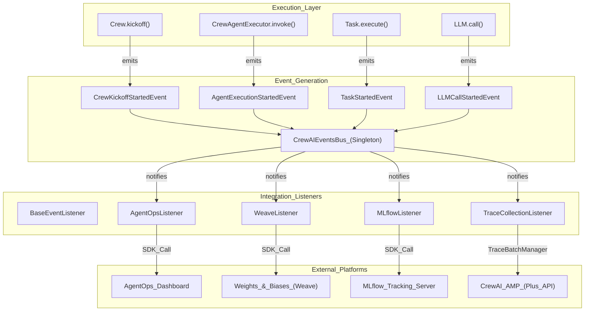
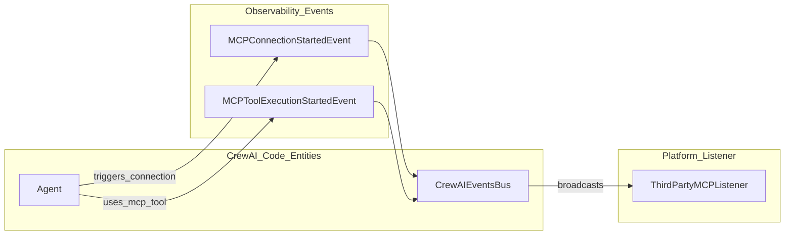

<!-- source: DeepWiki mcp.deepwiki.com · repo crewAIInc/crewAI · page 6.4 Third-Party Observability Integrations · fetched 2026-10-26 -->

# Third-Party Observability Integrations

<details>
<summary>Relevant source files</summary>

The following files were used as context for generating this wiki page:

- [.env.test](.env.test)
- [docs/edge/ar/concepts/event-listener.mdx](docs/edge/ar/concepts/event-listener.mdx)

</details>


## Purpose and Scope

This document describes CrewAI's integrations with external observability platforms for monitoring, tracing, and analyzing AI agent execution. These third-party integrations leverage CrewAI's internal event bus architecture to provide enterprise-grade monitoring, distributed tracing, and performance analytics beyond the built-in telemetry system.

For information about CrewAI's internal event system architecture, see [6.1 Event System Architecture](). For details on the built-in tracing and telemetry capabilities, see [6.2 Built-in Tracing and Telemetry](). For CrewAI AMP enterprise observability features, see [10.4 Control Plane and Monitoring]().

## Supported Platforms

CrewAI integrates with several major observability platforms through a standardized event-driven listener pattern:

| Platform | Focus Area | Key Features |
|:---|:---|:---|
| **Langfuse** | LLM application observability | Token usage tracking, prompt management, evaluation |
| **Portkey** | AI gateway and observability | Multi-provider routing, caching, analytics |
| **Weave** | ML experiment tracking | Dataset versioning, model evaluation, comparisons |
| **AgentOps** | Agent-specific monitoring | Multi-agent coordination, task flows, debugging |
| **MLflow** | ML lifecycle management | Experiment tracking, model registry, deployment |
| **OpenLIT** | OpenTelemetry-based tracing | Standards-based monitoring, cost analysis |
| **Langtrace** | LangChain/LLM tracing | Request tracing, latency analysis, prompt tracking |
| **Opik** | LLM Evaluation & Tracing | Comet ML integration, trace visualization |
| **Arize Phoenix** | AI Observability & Eval | Notebook-first tracing, evaluation, and data versioning |
| **Datadog** | Full-stack observability | Infrastructure monitoring alongside LLM traces |
| **Braintrust** | AI Development Platform | Evaluation, logging, and data management |
| **Galileo** | LLM Evaluation | Guardrails, hallucination detection, and monitoring |

Sources: `docs/edge/ar/concepts/event-listener.mdx` [1-187]()

## Integration Architecture

Third-party observability platforms integrate with CrewAI through the `CrewAIEventsBus` [docs/edge/ar/concepts/event-listener.mdx:16-16](), which acts as a central hub for all execution events.

### High-Level Integration Pattern

The following diagram bridges the "Natural Language Space" of observability platforms to the "Code Entity Space" of CrewAI's event system.

**CrewAI Observability Data Flow**

Sources: `docs/edge/ar/concepts/event-listener.mdx` [14-20](), `docs/edge/ar/concepts/event-listener.mdx` [102-167]()

### Event Mapping Strategy

Integrations inherit from `BaseEventListener` [docs/edge/ar/concepts/event-listener.mdx:18-18]() and implement `setup_listeners(self, crewai_event_bus)` [docs/edge/ar/concepts/event-listener.mdx:42-42](). They map CrewAI's internal events to platform-specific spans and traces.

| CrewAI Event | Typical Platform Mapping |
|:---|:---|
| `CrewKickoffStartedEvent` | Start of a Trace or Session [docs/edge/ar/concepts/event-listener.mdx:102-102]() |
| `AgentExecutionStartedEvent` | Agent Span / Step [docs/edge/ar/concepts/event-listener.mdx:114-114]() |
| `TaskStartedEvent` | Task Span / Context [docs/edge/ar/concepts/event-listener.mdx:122-122]() |
| `ToolUsageStartedEvent` | Tool Execution Span [docs/edge/ar/concepts/event-listener.mdx:128-128]() |
| `LLMCallStartedEvent` | Generation / Completion Span [docs/edge/ar/concepts/event-listener.mdx:165-165]() |

Sources: `docs/edge/ar/concepts/event-listener.mdx` [100-170]()

## Platform-Specific Integrations

### AgentOps Integration
AgentOps specializes in multi-agent monitoring. It tracks agent roles, goals, and inter-agent delegations. It listens for `AgentExecutionStartedEvent` [docs/edge/ar/concepts/event-listener.mdx:114-114]() and `AgentExecutionCompletedEvent` [docs/edge/ar/concepts/event-listener.mdx:115-115]() to build a timeline of agent interactions.

### Weave (Weights & Biases)
Weave provides visual tracing for LLM applications. It captures prompts and completions through `LLMCallStartedEvent` [docs/edge/ar/concepts/event-listener.mdx:165-165]() and `LLMCallCompletedEvent` [docs/edge/ar/concepts/event-listener.mdx:166-166]().

### MLflow Integration
MLflow maps CrewAI executions to "Runs". 
- **Parameters**: Logged from `Crew` and `Agent` configurations.
- **Metrics**: Token usage and duration from `CrewKickoffCompletedEvent` [docs/edge/ar/concepts/event-listener.mdx:103-103]().
- **Artifacts**: Final outputs and task results.

### CrewAI AMP (Enterprise) Tracing
The CrewAI AMP platform provides built-in prompt tracing [docs/edge/ar/concepts/event-listener.mdx:22-25]().
- **Prompt Tracing Dashboard**: Visualizes all prompts, completions, and metadata [docs/edge/ar/concepts/event-listener.mdx:25-25]().
- **Capabilities**: View full history of prompts, track token usage/costs, and debug agent inference failures [docs/edge/ar/concepts/event-listener.mdx:29-31]().
- **Compliance**: Export traces for auditing and compliance [docs/edge/ar/concepts/event-listener.mdx:34-34]().

### Model Context Protocol (MCP) Observability
When using MCP servers, CrewAI emits specific events for connection and tool execution that third-party platforms can capture:
- `MCPConnectionStartedEvent` [docs/edge/ar/concepts/event-listener.mdx:134-134]()
- `MCPToolExecutionStartedEvent` [docs/edge/ar/concepts/event-listener.mdx:137-137]()

**MCP Integration Entity Map**

Sources: `docs/edge/ar/concepts/event-listener.mdx` [132-140]()

## Implementation Guide

To implement a custom integration or use an existing one, the listener must be instantiated in the application entry point to ensure it is registered with the singleton `CrewAIEventsBus` [docs/edge/ar/concepts/event-listener.mdx:78-86]().

### Registration Pattern
```python
# my_listeners.py
from crewai.events import BaseEventListener, CrewKickoffStartedEvent

class MyCustomObservability(BaseEventListener):
    def setup_listeners(self, crewai_event_bus):
        @crewai_event_bus.on(CrewKickoffStartedEvent)
        def handle_start(source, event):
            # Send data to external API
            print(f"Crew '{event.crew_name}' has started!")

# crew.py
from my_listeners import MyCustomListener
my_listener = MyCustomListener() # Instantiation registers it [docs/edge/ar/concepts/event-listener.mdx:86-86]
```

Sources: `docs/edge/ar/concepts/event-listener.mdx` [37-94]()

## Configuration and Environment

Many third-party integrations require specific environment variables for authentication and endpoint configuration. These are typically set in a `.env` file [.env.test:1-160]().

| Variable | Integration |
|:---|:---|
| `CREWAI_TRACING_ENABLED` | Global flag for CrewAI internal tracing [.env.test:146-146]() |
| `OTEL_SDK_DISABLED` | Disables OpenTelemetry SDK if set to true [.env.test:144-144]() |
| `CREWAI_DISABLE_TELEMETRY` | Disables CrewAI framework telemetry [.env.test:143-143]() |

Sources: `.env.test` [140-148]()

---

