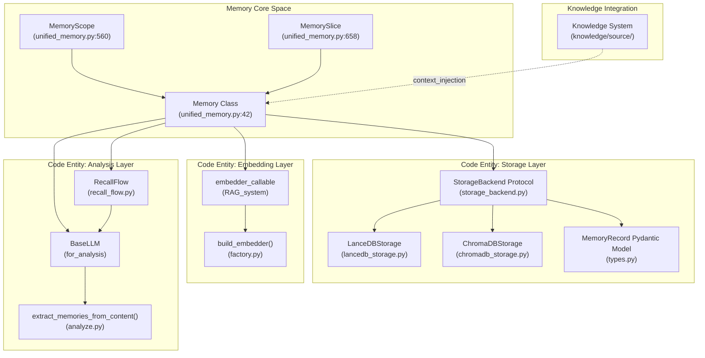
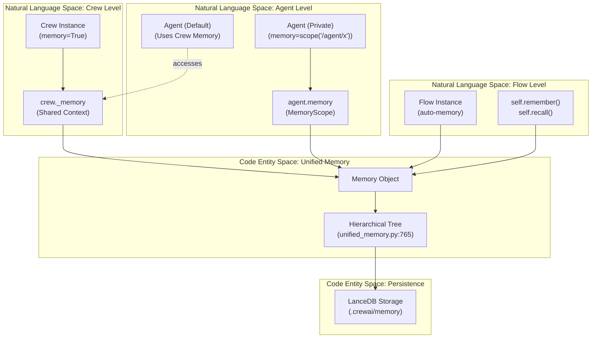

<!-- source: DeepWiki mcp.deepwiki.com · repo crewAIInc/crewAI · page 7 Memory and Knowledge Systems · fetched 2026-10-26 -->

# Memory and Knowledge Systems

Relevant source files

The following files were used as context for generating this wiki page:

- [docs/edge/ar/concepts/knowledge.mdx](docs/edge/ar/concepts/knowledge.mdx)
- [docs/edge/ar/concepts/memory.mdx](docs/edge/ar/concepts/memory.mdx)

## Purpose and Scope

This document describes CrewAI's unified memory and knowledge systems, which provide context-aware information storage and retrieval for agents, crews, and flows. The system uses LLM-driven analysis to organize memories into hierarchical scopes, supports adaptive-depth recall with composite scoring, and integrates external knowledge sources through RAG (Retrieval-Augmented Generation) patterns.

For information about how agents use memory during task execution, see [Agents](#2.2). For memory usage within flows, see [Flows: Event-Driven Orchestration](#3). For the underlying RAG infrastructure, see [RAG and Embedding Infrastructure](#7.5).

## System Architecture

The memory system consists of three primary components: the `Memory` class for storage and retrieval, the `RecallFlow` for intelligent query processing, and the `Knowledge` system for external data sources.

### Memory System Components

**Sources:** [lib/crewai/src/crewai/memory/unified_memory.py:1-850](), [docs/edge/ar/concepts/memory.mdx:8-38]()

### Integration with Crews, Agents, and Flows

**Sources:** [docs/edge/ar/concepts/memory.mdx:74-159](), [lib/crewai/src/crewai/memory/unified_memory.py:560-657]()

## Unified Memory Architecture

The `Memory` class [lib/crewai/src/crewai/memory/unified_memory.py:42]() replaces separate short-term, long-term, and entity memories with a single interface. It uses an LLM to analyze content during the `remember()` process to infer metadata like importance and categories.

- **Storage Backends**: Supports `LanceDB` (default) and `ChromaDB` through a pluggable `StorageBackend` protocol.
- **LLM-Driven Analysis**: Uses `extract_memories_from_content` to break down raw text into atomic facts [docs/edge/ar/concepts/memory.mdx:61-72]().

For details, see [Unified Memory Architecture](#7.1).

**Sources:** [lib/crewai/src/crewai/memory/unified_memory.py:50-144](), [docs/edge/ar/concepts/memory.mdx:10-38]()

## Memory Operations and Scopes

Memories are organized into a hierarchical, filesystem-like structure called **Scopes** [docs/edge/ar/concepts/memory.mdx:161-180]().

- **Scopes**: Paths like `/project/alpha` or `/agent/researcher` allow for context-restricted views.
- **MemoryScope**: A class [lib/crewai/src/crewai/memory/unified_memory.py:560]() that wraps a `Memory` instance to restrict all operations to a specific branch of the scope tree.
- **MemorySlice**: Allows read-only access to multiple disjoint scopes simultaneously [lib/crewai/src/crewai/memory/unified_memory.py:658]().

For details, see [Memory Operations and Scopes](#7.2).

**Sources:** [lib/crewai/src/crewai/memory/unified_memory.py:560-763](), [docs/edge/ar/concepts/memory.mdx:161-180]()

## Memory Recall and Consolidation

The system uses a **Composite Scoring** mechanism for retrieval [docs/edge/ar/concepts/memory.mdx:10](), combining:
1. **Semantic Similarity**: Vector distance between query and record.
2. **Recency**: Exponential decay based on `recency_half_life_days` [docs/edge/ar/concepts/memory.mdx:30]().
3. **Importance**: LLM-assigned weight (0.0 to 1.0).

The `RecallFlow` [lib/crewai/src/crewai/memory/recall_flow.py:10]() manages "Deep Recall," where the system performs multi-step searches with query expansion and time-hint analysis.

For details, see [Memory Recall and Consolidation](#7.3).

**Sources:** [lib/crewai/src/crewai/memory/unified_memory.py:218-526](), [docs/edge/ar/concepts/memory.mdx:483-513]()

## Knowledge Sources and Configuration

The `Knowledge` system provides agents with access to static external information [docs/edge/ar/concepts/knowledge.mdx:10-19](). Unlike the dynamic `Memory` system, `Knowledge` sources are typically pre-loaded.

- **Supported Sources**: `StringKnowledgeSource`, `TextFileKnowledgeSource`, `PDFKnowledgeSource`, `CSVKnowledgeSource`, `JSONKnowledgeSource`, `ExcelKnowledgeSource`, and `CrewDoclingSource` (for web content) [docs/edge/ar/concepts/knowledge.mdx:153-213]().
- **Configuration**: Managed via `KnowledgeConfig`, allowing agents to query these sources during task execution using RAG. Agents can have their own `knowledge_sources` independent of the crew [docs/edge/ar/concepts/knowledge.mdx:229-244]().

For details, see [Knowledge Sources and Configuration](#7.4).

**Sources:** [docs/edge/ar/concepts/knowledge.mdx:153-213](), [docs/edge/ar/concepts/knowledge.mdx:229-244]()

## RAG and Embedding Infrastructure

The infrastructure layer manages how text is vectorized and stored for retrieval.

- **Embedding Factory**: `build_embedder()` creates embedding functions from providers like OpenAI, Google Vertex, IBM WatsonX, and VoyageAI.
- **RAG Storage**: Provides abstractions for `ChromaDB` and `Qdrant` through `set_rag_config()` and `get_rag_client()` [docs/edge/ar/concepts/knowledge.mdx:28-61]().

For details, see [RAG and Embedding Infrastructure](#7.5).

**Sources:** [docs/edge/ar/concepts/knowledge.mdx:28-61](), [lib/crewai/src/crewai/rag/embeddings/providers/huggingface/huggingface_provider.py:11-35]()

---

