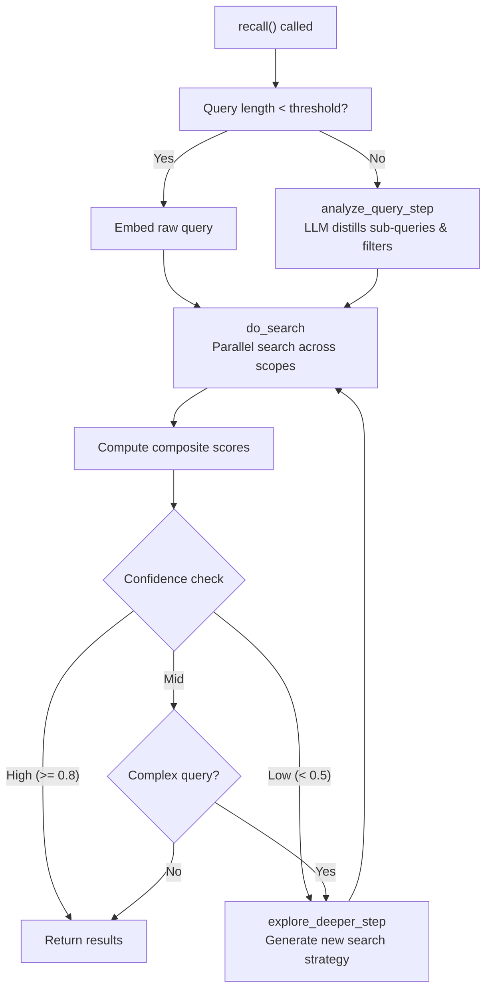
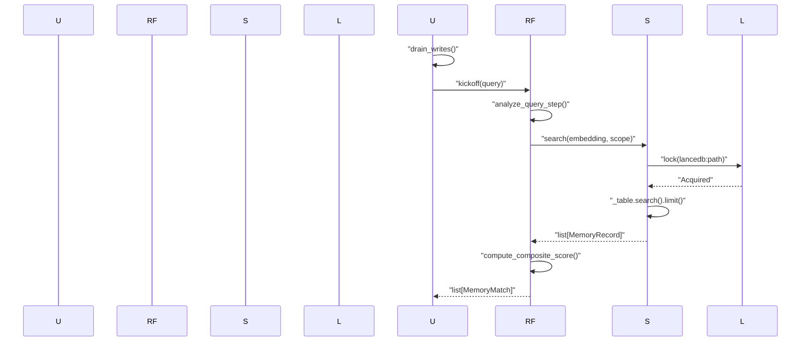
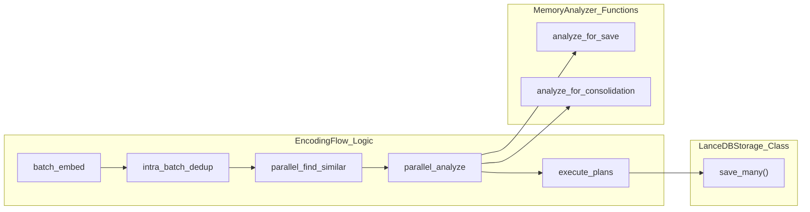

<!-- source: DeepWiki mcp.deepwiki.com · repo crewAIInc/crewAI · page 7.3 Memory Recall and Consolidation · fetched 2026-10-26 -->

# Memory Recall and Consolidation

<details>
<summary>Relevant source files</summary>

The following files were used as context for generating this wiki page:

- [docs/edge/ar/concepts/memory.mdx](docs/edge/ar/concepts/memory.mdx)

</details>


## Purpose and Scope

This page documents the recall and consolidation mechanisms in CrewAI's unified memory system. It explains how the `recall()` method retrieves relevant memories using composite scoring and adaptive-depth search via `RecallFlow`, and how the `EncodingFlow` prevents duplicate memories from accumulating through consolidation.

## Overview of Recall

The `recall()` method retrieves relevant memories by combining vector search with optional LLM-driven analysis. Results are ranked by a composite score that blends semantic similarity, recency, and importance. The method supports two modes: **shallow** (fast, direct vector search) and **deep** (intelligent, adaptive retrieval via `RecallFlow`).

Sources: [lib/crewai/src/crewai/memory/unified_memory.py:223-318](), [docs/edge/ar/concepts/memory.mdx:10-30]()

## Recall Modes: Shallow vs Deep

### Shallow Recall
Shallow recall performs a direct vector search against the storage backend (e.g., `LanceDBStorage`) followed by composite scoring. It bypasses LLM analysis, making it suitable for high-frequency, low-latency lookups.

```python
matches = memory.recall("PostgreSQL port", depth="shallow")
```

### Deep Recall (Default)
Deep recall utilizes `RecallFlow`, an event-driven orchestration that analyzes the query to produce targeted sub-queries and filters. It iteratively deepens exploration if initial results have low confidence.

```python
# Deep is the default depth
matches = memory.recall("Summarize all database decisions from last month")
```

### Smart LLM Skip
To optimize performance, queries shorter than the `query_analysis_threshold` (default 200 characters) skip the LLM analysis step even in deep mode. This saves ~1-3s for simple keyword lookups while preserving advanced reasoning for complex, long-form queries.

Sources: [lib/crewai/src/crewai/memory/unified_memory.py:65-85](), [lib/crewai/src/crewai/memory/recall_flow.py:189-210]()

## RecallFlow Architecture

`RecallFlow` implements an iterative retrieval pattern inspired by Retrieval-Augmented Language Models (RLM).

### Execution Pipeline

**RecallFlow Multi-Step Process**



Sources: [lib/crewai/src/crewai/memory/recall_flow.py:58-280](), [lib/crewai/src/crewai/memory/unified_memory.py:223-318]()

### Key Components of RecallFlow
- **Parallel Search**: Executes searches across multiple (embedding x scope) pairs concurrently using a `ThreadPoolExecutor` [lib/crewai/src/crewai/memory/recall_flow.py:152-180]().
- **Confidence Routing**: Uses `confidence_threshold_high` and `confidence_threshold_low` to decide if the current results are sufficient or if recursive exploration is required [lib/crewai/src/crewai/memory/recall_flow.py:230-260]().
- **Exploration Budget**: Limits the number of iterative deepening rounds (default 1) to prevent infinite loops [lib/crewai/src/crewai/memory/recall_flow.py:55-55]().

## Composite Scoring

Every `MemoryMatch` is ranked using a weighted sum of semantic similarity, temporal recency, and inferred importance.

### Scoring Formula
The `compute_composite_score` function calculates the final score:
`score = (sim * semantic_weight) + (recency * recency_weight) + (importance * importance_weight)`

| Signal | Logic | Default Weight |
| :--- | :--- | :--- |
| **Semantic** | `1 / (1 + distance)` from vector index | 0.5 |
| **Recency** | Exponential decay: `0.5^(age_days / half_life)` | 0.3 |
| **Importance** | LLM-assigned value (0.0 to 1.0) | 0.2 |

Sources: [lib/crewai/src/crewai/memory/types.py:126-150](), [docs/edge/ar/concepts/memory.mdx:90-96]()

## Memory Consolidation

Consolidation is the process of merging new information with existing memories to prevent redundancy and keep the memory store concise.

### EncodingFlow Pipeline
When `remember()` or `remember_many()` is called, the `EncodingFlow` manages the save pipeline:
1. **Batch Embed**: Generates vectors for all items in one call [lib/crewai/src/crewai/memory/encoding_flow.py:128-136]().
2. **Intra-batch Dedup**: Uses a cosine similarity matrix to drop near-exact duplicates (similarity >= 0.98) within the current batch [lib/crewai/src/crewai/memory/encoding_flow.py:141-172]().
3. **Parallel Find Similar**: Searches storage for records similar to the new items [lib/crewai/src/crewai/memory/encoding_flow.py:178-210]().
4. **Parallel Analyze**: LLM analyzes pairs of (new item, similar existing record) to create a `ConsolidationPlan` [lib/crewai/src/crewai/memory/encoding_flow.py:212-250]().
5. **Execute Plans**: Performs bulk updates, deletions, and inserts based on LLM decisions [lib/crewai/src/crewai/memory/encoding_flow.py:252-300]().

### Consolidation Actions
The LLM can choose four actions for each record:
- `keep`: Both records are distinct and accurate.
- `update`: Merge new info into the existing record.
- `delete`: New info supersedes/invalidates the old record.
- `insert_new`: Default action if no conflict exists.

Sources: [lib/crewai/src/crewai/memory/encoding_flow.py:23-97]()

## Background Saves and Read Barriers

### Asynchronous Execution
Memory saves are non-blocking. `remember_many()` submits the `EncodingFlow` to a `ThreadPoolExecutor` and returns immediately [lib/crewai/src/crewai/memory/unified_memory.py:170-195]().

### Read Barrier (drain_writes)
To ensure data consistency, `recall()` implements a **read barrier**. It calls `self.drain_writes()` before every search, which blocks until all pending background save operations are finished [lib/crewai/src/crewai/memory/unified_memory.py:245-255]().

Sources: [lib/crewai/src/crewai/memory/unified_memory.py:112-125]()

## Code Entity Space Mapping

The following diagrams map conceptual memory operations to specific classes and methods within the codebase.

**Recall and Storage Interaction**



Sources: [lib/crewai/src/crewai/memory/unified_memory.py:223-318](), [lib/crewai/src/crewai/memory/storage/lancedb_storage.py:41-150](), [lib/crewai/src/crewai/utilities/lock_store.py:17]()

**Encoding and Consolidation Flow**



Sources: [lib/crewai/src/crewai/memory/encoding_flow.py:89-300](), [lib/crewai/src/crewai/memory/analyze.py:23-29]()

## Configuration Reference

| Parameter | Default | Purpose |
| :--- | :--- | :--- |
| `query_analysis_threshold` | 200 | Min characters to trigger LLM query analysis |
| `confidence_threshold_high` | 0.8 | Score above which results are considered "High Confidence" |
| `confidence_threshold_low` | 0.5 | Score below which results are considered "Low Confidence" |
| `exploration_budget` | 1 | Max rounds of iterative deepening in RecallFlow |
| `consolidation_threshold` | 0.85 | Similarity required to trigger LLM consolidation |
| `batch_dedup_threshold` | 0.98 | Similarity for dropping items within a single batch |

Sources: [lib/crewai/src/crewai/memory/unified_memory.py:50-110](), [lib/crewai/src/crewai/memory/recall_flow.py:37-56]()

---

