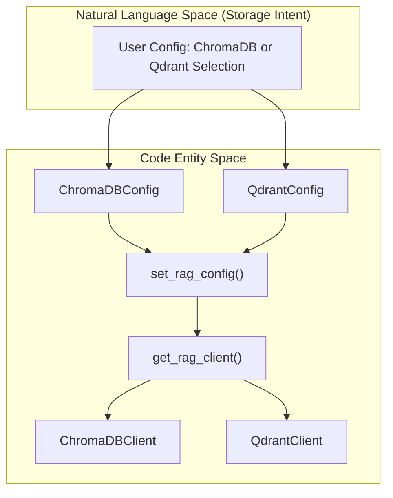

<!-- source: DeepWiki mcp.deepwiki.com · repo crewAIInc/crewAI · page 7.5 RAG and Embedding Infrastructure · fetched 2026-10-26 -->

# RAG and Embedding Infrastructure

<details>
<summary>Relevant source files</summary>

The following files were used as context for generating this wiki page:

- [.env.test](.env.test)
- [docs/edge/ar/concepts/knowledge.mdx](docs/edge/ar/concepts/knowledge.mdx)

</details>


The Retrieval-Augmented Generation (RAG) and Embedding infrastructure in CrewAI provides a standardized layer for converting natural language into vector representations and managing their storage. This system enables agents to maintain long-term memory, access external knowledge bases, and perform semantic searches across different storage backends and embedding providers.

## Embedding Factory and Provider System

The `EmbeddingFactory` is the central orchestration point for creating embedding functions. It abstracts away the complexities of different provider SDKs and provides a unified interface for the rest of the framework.

### Provider Resolution Data Flow

When a configuration dictionary is passed to the factory, it resolves the provider string to a specific implementation class using `PROVIDER_PATHS` [lib/crewai/src/crewai/rag/embeddings/factory.py:90-110](). The factory supports over 15 providers, including OpenAI, Google Vertex, IBM WatsonX, and VoyageAI.

The following diagram illustrates how natural language configuration is transformed into functional code entities within the codebase:

**Embedding Factory Implementation Flow**
```mermaid
graph TD
    subgraph "Natural Language Space (Config)"
        A["DictConfig: {'provider': 'openai', ...}"]
    end

    subgraph "Code Entity Space"
        B["EmbeddingFactory.build_embedder()"]
        C["EmbeddingFactory.import_and_validate_definition()"]
        D["PROVIDER_PATHS Mapping"]
        E["BaseEmbeddingsProvider Implementation"]
        F["EmbeddingFunction (Chroma/Custom)"]
    end

    A --> B
    B --> D
    D --> C
    C --> E
    E -->|".embedding_callable()"| F
    F -->| "Process Text" | G["Vector Embeddings"]
```
Sources: [lib/crewai/src/crewai/rag/embeddings/factory.py:113-182](), [lib/crewai/tests/rag/embeddings/test_embedding_factory.py:14-42]()

### Key Functions and Classes
- **`build_embedder(config: dict)`**: The primary entry point that takes a provider name and configuration to return an `EmbeddingFunction` [lib/crewai/src/crewai/rag/embeddings/factory.py:185-212]().
- **`BaseEmbeddingsProvider`**: An abstract base class that ensures all providers implement a consistent interface for dumping models and returning callables [lib/crewai/src/crewai/rag/embeddings/factory.py:113-125]().
- **`PROVIDER_PATHS`**: A registry mapping string identifiers (e.g., `"watsonx"`, `"voyageai"`) to their respective internal module paths [lib/crewai/src/crewai/rag/embeddings/factory.py:90-110]().

Sources: [lib/crewai/src/crewai/rag/embeddings/factory.py:1-212]()

## RAG Storage Layer

CrewAI provides a provider-neutral RAG client abstraction for vector stores. While ChromaDB is the default, Qdrant is also natively supported. This layer is separate from the internal memory storage and is used when direct control over vector collections is required.

### Vector Client Abstraction
The RAG configuration is managed via utility functions that handle the global state of the RAG client [docs/edge/ar/concepts/knowledge.mdx:37-59]().

| Feature | Description | Code Reference |
| :--- | :--- | :--- |
| **Storage Providers** | ChromaDB (Default), Qdrant | [docs/edge/ar/concepts/knowledge.mdx:32-35]() |
| **Configuration** | `set_rag_config(config)` | [docs/edge/ar/concepts/knowledge.mdx:41]() |
| **Client Retrieval** | `get_rag_client()` | [docs/edge/ar/concepts/knowledge.mdx:42]() |
| **API Uniformity** | `create_collection`, `add_documents`, `search` | [docs/edge/ar/concepts/knowledge.mdx:51-56]() |

The following diagram bridges user-facing storage declarations to concrete client code entities:

**RAG Storage Architecture**

Sources: [docs/edge/ar/concepts/knowledge.mdx:28-61]()

## Google Vertex AI Infrastructure

The Google Vertex AI implementation supports a dual-SDK architecture to handle both legacy and modern Google embedding models.

### Dual SDK Support
The `GoogleGenAIVertexEmbeddingFunction` automatically selects the appropriate SDK based on the `model_name` [lib/crewai/src/crewai/rag/embeddings/providers/google/genai_vertex_embedding.py:100-106]():
1.  **Legacy Models**: Uses `vertexai.language_models` for `textembedding-gecko` variants [lib/crewai/src/crewai/rag/embeddings/providers/google/genai_vertex_embedding.py:56-65]().
2.  **Modern Models**: Uses the `google-genai` SDK for `gemini-embedding-001` and `text-embedding-005` [lib/crewai/src/crewai/rag/embeddings/providers/google/genai_vertex_embedding.py:68-72]().

### Authentication Modes
The Vertex AI provider supports two primary authentication flows:
- **Project ID/Location**: Uses Application Default Credentials (ADC) for secure backend access [lib/crewai/src/crewai/rag/embeddings/providers/google/vertex.py:34]().
- **API Key**: Direct access via the new `google-genai` SDK [lib/crewai/src/crewai/rag/embeddings/providers/google/vertex.py:35]().

Sources: [lib/crewai/src/crewai/rag/embeddings/providers/google/genai_vertex_embedding.py:19-171](), [lib/crewai/src/crewai/rag/embeddings/providers/google/vertex.py:23-57]()

## Unified Memory Integration

The RAG infrastructure serves as the backbone for the unified `Memory` class. When `memory=True` is enabled for a Crew, the system automatically configures an embedder and storage backend.

### Data Flow: Memory Storage
When a Crew executes a task, the resulting content is processed for memory storage:
1.  **Extraction**: The `Memory` class uses an LLM to extract discrete facts from the task output.
2.  **Embedding**: The `Memory` class uses the configured `_embedder_instance` (resolved via `EmbeddingFactory`) to convert text to vectors.
3.  **Persistence**: The vectors are stored in the database associated with a specific memory scope.

Sources: [docs/edge/ar/concepts/knowledge.mdx:8-38](), [docs/edge/ar/concepts/knowledge.mdx:161-181]()

## Supported Providers Table

| Provider | Class Name | Model Alias | Key Config Fields |
| :--- | :--- | :--- | :--- |
| **OpenAI** | `OpenAIProvider` | `openai` | `api_key`, `model_name` |
| **Azure** | `AzureProvider` | `azure` | `api_base`, `api_version`, `deployment_id` |
| **Google Vertex** | `VertexAIProvider` | `google-vertex` | `project_id`, `location`, `task_type` |
| **IBM WatsonX** | `WatsonXProvider` | `watsonx` | `apikey`, `url`, `project_id` |
| **VoyageAI** | `VoyageAIProvider` | `voyageai` | `api_key`, `model_name` |
| **Ollama** | `OllamaProvider` | `ollama` | `url`, `model_name` |

Sources: [lib/crewai/src/crewai/rag/embeddings/factory.py:90-110](), [lib/crewai/src/crewai/rag/embeddings/providers/google/types.py:36-78](), [lib/crewai/tests/rag/embeddings/test_embedding_factory.py:54-65]()

## Implementation Details

### Google Vertex Predict Request
The infrastructure handles low-level formatting of requests to Google's AI Platform. Prediction requests are structured as POSTs to the `predict` endpoint [lib/crewai/tests/cassettes/rag/embeddings/test_crew_memory_with_google_vertex_project_id.yaml:24-25]().

```json
{
  "instances": [
    {
      "content": "text to embed",
      "task_type": "RETRIEVAL_DOCUMENT"
    }
  ]
}
```
The response contains a `values` array representing the high-dimensional vector [lib/crewai/tests/cassettes/rag/embeddings/test_crew_memory_with_google_vertex_project_id.yaml:29-88]().

Sources: [lib/crewai/src/crewai/rag/embeddings/providers/google/genai_vertex_embedding.py:1-171](), [lib/crewai/tests/cassettes/rag/embeddings/test_crew_memory_with_google_vertex_project_id.yaml:1-90]()

---

