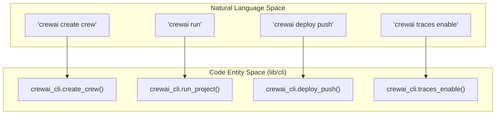
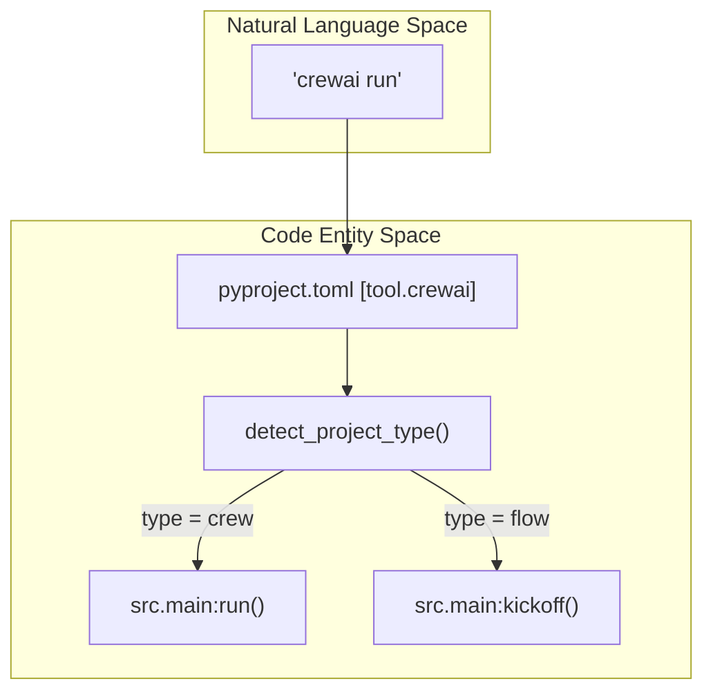

<!-- source: DeepWiki mcp.deepwiki.com · repo crewAIInc/crewAI · page 8.1 CLI Tools and Templates · fetched 2026-10-26 -->

# CLI Tools and Templates

Relevant source files

The following files were used as context for generating this wiki page:

- [.github/codeql/codeql-config.yml](.github/codeql/codeql-config.yml)
- [docs/edge/ar/concepts/cli.mdx](docs/edge/ar/concepts/cli.mdx)
- [docs/edge/ar/guides/crews/first-crew.mdx](docs/edge/ar/guides/crews/first-crew.mdx)

The purpose of this page is to document the CrewAI CLI package (`lib/cli`), available command-line interface commands, Crew versus Flow project templates, generated directory structures, and project execution mechanics.

---

## 1. The `lib/cli` Package Architecture

The CrewAI command-line interface is implemented within the monorepo inside the `lib/cli` package [.github/codeql/codeql-config.yml:21](). It provides project scaffolding, environment management via `uv`, command routing, and direct interaction with the CrewAI Agent Management Platform (AMP). 

The following diagram maps natural language CLI intents to their corresponding code entities within the CLI package:

Sources: [.github/codeql/codeql-config.yml:21](), [docs/edge/ar/concepts/cli.mdx:37-268]()

---

## 2. CLI Command Overview

The CLI registers a console entry point (`crewai`) that dispatches execution based on arguments and options [docs/edge/ar/concepts/cli.mdx:27-33](). 

### Core Commands

| Command | Target / Purpose | Code Reference |
| :--- | :--- | :--- |
| `create` | Scaffolds a new Crew or Flow project | [docs/edge/ar/concepts/cli.mdx:37-55]() |
| `version` | Displays installed versions of `crewai` and dependencies | [docs/edge/ar/concepts/cli.mdx:67-76]() |
| `run` | Executes the active Crew or Flow (`src.main:run` or `src.main:kickoff`) | [docs/edge/ar/concepts/cli.mdx:133-146]() |
| `train` | Runs the agent training loop over specified iterations | [docs/edge/ar/concepts/cli.mdx:77-87]() |
| `replay` | Re-executes crew execution starting from a given task ID | [docs/edge/ar/concepts/cli.mdx:88-97]() |
| `test` | Evaluates crew performance against test suites | [docs/edge/ar/concepts/cli.mdx:123-132]() |
| `chat` | Starts an interactive chat session using `chat_llm` | [docs/edge/ar/concepts/cli.mdx:148-183]() |
| `reset-memories` | Clears local memory storage (short/long/entities/knowledge) | [docs/edge/ar/concepts/cli.mdx:106-121]() |
| `deploy` | Manages AMP deployments (`create`, `push`, `status`, `logs`) | [docs/edge/ar/concepts/cli.mdx:185-224]() |
| `traces` | Toggles or reports local tracing configuration status | [docs/edge/ar/concepts/cli.mdx:257-268]() |

Sources: [docs/edge/ar/concepts/cli.mdx:35-268]()

---

## 3. Project Templates and Scaffolding

CrewAI supports two primary project templates: **Crews** and **Flows**. Project generation is managed by the `crewai create` command [docs/edge/ar/concepts/cli.mdx:37-53]().

### Crew Project Template

Starting with version `0.140.0`, the default template for new crews is **JSON-first** [docs/edge/ar/concepts/cli.mdx:55](). 

**Generated Directory Structure:**
- `crew.jsonc`: Defines global crew settings, task execution sequence, process types, and default inputs [docs/edge/ar/guides/crews/first-crew.mdx:84-112]()
- `agents/*.jsonc`: Declarative configuration for individual agent roles, goals, backstories, assigned tools, and LLM configurations [docs/edge/ar/guides/crews/first-crew.mdx:49-76]()
- `knowledge/`: Local directory housing knowledge sources [docs/edge/ar/guides/crews/first-crew.mdx:34]()
- `tools/`: Python modules for custom tool implementations [docs/edge/ar/guides/crews/first-crew.mdx:38]()
- `skills/`: Optional markdown files defining agent domain skills [docs/edge/ar/guides/crews/first-crew.mdx:37]()

Legacy Python/YAML configurations (`crew.py`, `config/agents.yaml`, `config/tasks.yaml`) can be generated by passing the `--classic` flag [docs/edge/ar/guides/crews/first-crew.mdx:41-43]().

Sources: [docs/edge/ar/concepts/cli.mdx:55](), [docs/edge/ar/guides/crews/first-crew.mdx:27-43]()

---

## 4. Project Type Identification and Execution Topology

The CLI and underlying runtime identify project semantics by inspecting the `[tool.crewai]` metadata block inside `pyproject.toml`.

Sources: [docs/edge/ar/concepts/cli.mdx:133-146](), [docs/edge/ar/guides/crews/first-crew.mdx:35]()

---

## 5. Tracing and Configuration Management

The CLI stores local CLI configurations and telemetry preferences inside `~/.config/crewai/settings.json` [docs/edge/ar/concepts/cli.mdx:299]().

### Tracing Resolution Hierarchy
Tracing state is determined by evaluating settings in strict priority order:
1. **Explicit Code Flag**: `Crew(tracing=True/False)` [docs/edge/ar/concepts/cli.mdx:274-278]()
2. **Environment Variable**: `CREWAI_TRACING_ENABLED=true` [docs/edge/ar/concepts/cli.mdx:280]()
3. **CLI Preference**: Modified via `crewai traces enable` or `crewai traces disable` [docs/edge/ar/concepts/cli.mdx:265-266]()

Sources: [docs/edge/ar/concepts/cli.mdx:245-290]()

---

## 6. Deployment and AMP Integration

The CLI connects local projects to **CrewAI AMP** (Agent Management Platform) via authenticated endpoints [docs/edge/ar/concepts/cli.mdx:185-188](). 

- `crewai login`: Authenticates users via a secure device code flow [docs/edge/ar/concepts/cli.mdx:237-243]()
- `crewai deploy create`: Registers a new deployment context [docs/edge/ar/concepts/cli.mdx:197]()
- `crewai deploy push`: Bundles and uploads project files to AMP [docs/edge/ar/concepts/cli.mdx:202]()
- `crewai deploy status`: Inspects remote execution health and healthchecks [docs/edge/ar/concepts/cli.mdx:205-208]()

Sources: [docs/edge/ar/concepts/cli.mdx:185-244]()

---

