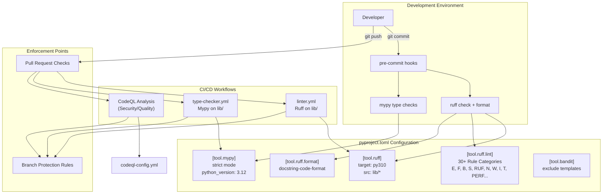
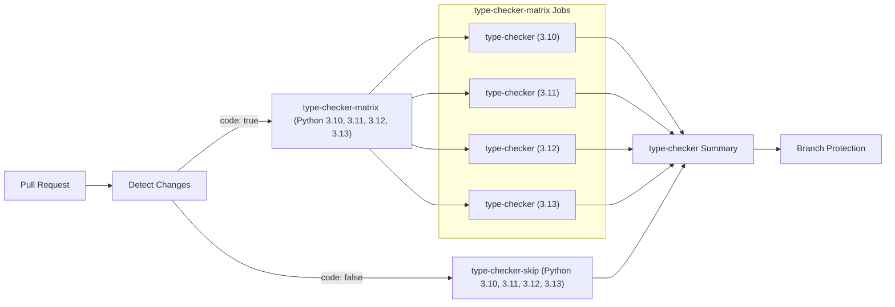

<!-- source: DeepWiki mcp.deepwiki.com · repo crewAIInc/crewAI · page 9.3 Code Quality Tools · fetched 2026-10-26 -->

# Code Quality Tools

Relevant source files

The following files were used as context for generating this wiki page:

- [.editorconfig](.editorconfig)
- [.github/codeql/codeql-config.yml](.github/codeql/codeql-config.yml)
- [.github/workflows/linter.yml](.github/workflows/linter.yml)
- [.github/workflows/type-checker.yml](.github/workflows/type-checker.yml)

This document covers the code quality infrastructure used in the CrewAI codebase, including linting, type checking, security scanning, and their integration with CI/CD pipelines. These tools enforce code consistency, catch bugs early, maintain security standards across the monorepo, and ensure code health.

For information about testing infrastructure, see [Testing Infrastructure](9.1). For CI/CD workflows beyond quality checks, see [CI/CD Workflows](9.2). For pre-commit hook configuration, see [Pre-commit Hooks](9.4).

## Overview

The CrewAI project employs three primary code quality tools, all configured in the root `pyproject.toml`. These tools are installed as development dependencies in the UV workspace and enforced through both pre-commit hooks and GitHub Actions workflows.

| Tool | Purpose | Configuration Location |
|------|---------|----------------------|
| **Ruff** | Linting and formatting (30+ rule categories) | `[tool.ruff]` |
| **Mypy** | Type checking (Strict mode) | `[tool.mypy]` |
| **Bandit** | Security scanning | `[tool.bandit]` |

The project also uses an `.editorconfig` file to enforce basic editor settings like indentation (2 spaces for Python) and line endings across all environments.

**Sources**: [.editorconfig:1-14](), [pyproject.toml:36-128]()

---

## Code Quality Tool Integration

### Architecture Diagram: Quality Enforcement Pipeline

This diagram illustrates how configuration from `pyproject.toml` flows into local development tools and CI/CD runners.

**Sources**: [.github/workflows/linter.yml:59-63](), [.github/workflows/type-checker.yml:67](), [pyproject.toml:36-128](), [.github/codeql/codeql-config.yml:1-36]()

---

## Ruff: Linting and Formatting

Ruff serves as both the linter and formatter for the CrewAI codebase, replacing multiple tools (pylint, flake8, isort, black) with a single fast implementation.

### Configuration

The root configuration defines the scope and behavior of the tool.

**Basic Settings**:
- **Target Version**: `py310` to ensure compatibility with Python 3.10+.
- **Source Roots**: The `src = ["lib/*"]` setting tells Ruff to treat all packages under `lib/` (like `crewai`, `crewai-tools`, `crewai-files`) as first-party imports.
- **Automatic Fixes**: `fix = true` is enabled to automatically resolve fixable violations.

**Exclusions**:
Specific directories are excluded from standard linting:
- `lib/crewai/src/crewai/cli/templates`: Contains generated code patterns.
- `lib/crewai/tests/`, `lib/crewai-tools/tests/`: Tests often require relaxed patterns.

**Sources**: [pyproject.toml:36-46]()

### Linting Rules

Ruff enables over 30 rule categories covering style, security, performance, and best practices:

| Category | Code | Purpose |
|----------|------|---------|
| pycodestyle errors | E | Standard PEP8 style issues |
| Pyflakes | F | Logic errors like unused imports or undefined names |
| flake8-bugbear | B | Design issues and common bug patterns |
| bandit | S | Security vulnerabilities (hardcoded secrets, SQLi) |
| ruff-specific | RUF | Specialized rules for Ruff features |
| pep8-naming | N | Naming conventions for classes/functions |
| isort | I | Import formatting and grouping |
| flake8-print | T | Detection of forbidden `print()` calls |
| PERF | PERF | Performance optimizations for loops/comprehensions |
| async/await | ASYNC | Correct usage of asynchronous patterns |

**Sources**: [pyproject.toml:51-82]()

### Per-File Ignores

Test files have relaxed rules to allow common testing practices that would otherwise be flagged as errors:

- **S101**: Allows `assert` statements (mandatory for pytest).
- **S105/S106**: Allows hardcoded passwords or keys for mock testing.
- **RET504**: Allows unnecessary variable assignments before return for clarity.
- **B017**: Allows catching generic `Exception` in specific test scenarios.

**Sources**: [pyproject.toml:106-110]()

---

## Mypy: Type Checking

Mypy enforces static type checking across the codebase with a strict configuration to ensure type safety in the internal logic.

### Core Configuration

The project operates in **strict mode**, which is the highest level of enforcement.

| Setting | Purpose |
|---------|---------|
| `strict = true` | Enables all strict flags by default |
| `disallow_untyped_defs` | Every function signature must have type annotations |
| `disallow_any_unimported` | Prevents using `Any` for types that could not be resolved from imports |
| `no_implicit_optional` | Forces explicit `Optional[T]` or `T | None` for arguments defaulting to `None` |
| `python_version = "3.12"` | Baseline for the type system features |
| `plugins = ["pydantic.mypy"]` | Integration for Pydantic model validation |

**Sources**: [pyproject.toml:112-121]()

### Matrix Testing

Because CrewAI supports multiple Python versions, the type checker is executed against a matrix in CI:

- **Versions**: 3.10, 3.11, 3.12, 3.13.
- **Command**: `uv run mypy lib/`.

This ensures that type hints remain valid across the entire supported version range, catching issues where newer syntax (like `|` for unions) might break on older versions if not handled via `from __future__ import annotations`.

**Sources**: [.github/workflows/type-checker.yml:32-67]()

---

## Bandit: Security Scanning

Bandit is integrated into the linting ruleset via Ruff's `S` rule category. It specifically targets security flaws such as:
- Use of `eval()` or `exec()`.
- Insecure usage of temporary files.
- Hardcoded credentials.

The `pyproject.toml` excludes `lib/crewai/src/crewai/cli/templates` from Bandit scanning to avoid false positives in scaffolded project code.

**Sources**: [pyproject.toml:60](), [pyproject.toml:126-128]()

---

## CodeQL: Advanced Security and Quality Analysis

CodeQL is a semantic code analysis engine used to find vulnerabilities and errors in the codebase. It is configured via `.github/codeql/codeql-config.yml` and integrated into the CI/CD pipeline.

### Configuration

The `codeql-config.yml` file defines which paths to include and exclude from the analysis.

**Paths to Include**:
- GitHub Actions workflows and composite actions: `.github/workflows/**`, `.github/actions/**` [.github/codeql/codeql-config.yml:18-19]()
- All Python source code from workspace packages: `lib/cli/src/**`, `lib/crewai/src/**`, `lib/crewai-core/src/**`, `lib/crewai-tools/src/**`, `lib/crewai-files/src/**`, `lib/devtools/src/**` [.github/codeql/codeql-config.yml:21-26]()
- Test files: `lib/cli/tests/**`, `lib/crewai/tests/**`, `lib/crewai-core/tests/**`, `lib/crewai-tools/tests/**`, `lib/crewai-files/tests/**`, `lib/devtools/tests/**` [.github/codeql/codeql-config.yml:28-33]()

**Paths to Ignore**:
- Template files: `lib/cli/src/crewai_cli/templates/**` [.github/codeql/codeql-config.yml:5]()
- Test cassettes: `lib/crewai/tests/cassettes/**`, `lib/crewai-tools/tests/cassettes/**` [.github/codeql/codeql-config.yml:7-8]()
- Cache and build artifacts: `.cache/**`, `docs/.cache/**` [.github/codeql/codeql-config.yml:10-12]()
- Experimental code: `lib/crewai/src/crewai/experimental/a2a/**` [.github/codeql/codeql-config.yml:14]()

This granular control ensures that CodeQL focuses on relevant code while avoiding boilerplate, test fixtures, or generated content that might produce false positives.

**Sources**: [.github/codeql/codeql-config.yml:1-36]()

---

## CI/CD Integration

### Linter Workflow

The `linter.yml` workflow runs on every pull request to ensure no code style regressions are merged.

1.  **Detect Changes**: Uses `dorny/paths-filter` to determine if code changes (`code: true`) have occurred, skipping the lint job if only documentation or non-code files are modified. [.github/workflows/linter.yml:9-29]()
2.  **Environment Setup**: Uses `astral-sh/setup-uv` with Python 3.11. [.github/workflows/linter.yml:49-53]()
3.  **Dependency Sync**: `uv sync --all-groups --all-extras --no-install-project`. [.github/workflows/linter.yml:57]()
4.  **Execution**:
    -   `uv run ruff check lib/`: Validates logic and style. [.github/workflows/linter.yml:60]()
    -   `uv run ruff format --check lib/`: Verifies that the code is formatted according to the project's rules without actually modifying the files. [.github/workflows/linter.yml:63]()
5.  **Cache Management**: Uses `actions/cache` to restore and save `uv` caches, speeding up subsequent runs. [.github/workflows/linter.yml:37-47](), [.github/workflows/linter.yml:65-73]()
6.  **Summary Job**: A final `lint` job provides a single status for branch protection, reporting success or failure based on the `lint-run` job's outcome. [.github/workflows/linter.yml:76-93]()

**Sources**: [.github/workflows/linter.yml:9-93]()

### Type Checker Workflow

The `type-checker.yml` workflow implements a multi-job strategy.

The `type-checker-matrix` job uses the `uv` cache to speed up repeated runs. It checks the entire `lib/` directory.
1.  **Detect Changes**: Similar to the linter, it uses `dorny/paths-filter` to check for code changes. [.github/workflows/type-checker.yml:9-29]()
2.  **Matrix Strategy**: Runs `mypy` against Python versions 3.10, 3.11, 3.12, and 3.13. [.github/workflows/type-checker.yml:30-38]()
3.  **Environment Setup and Dependencies**: Installs `uv` and syncs dependencies for each Python version. [.github/workflows/type-checker.yml:56-64]()
4.  **Run Type Checks**: Executes `uv run mypy lib/`. [.github/workflows/type-checker.yml:67]()
5.  **Cache Management**: Manages `uv` caches per Python version. [.github/workflows/type-checker.yml:44-54](), [.github/workflows/type-checker.yml:69-78]()
6.  **Skip Job**: A `type-checker-skip` job is included to report a skipped status for branch protection when no code changes are detected. [.github/workflows/type-checker.yml:79-92]()
7.  **Summary Job**: A final `type-checker` job aggregates the results from the matrix jobs for branch protection. [.github/workflows/type-checker.yml:94-111]()

**Sources**: [.github/workflows/type-checker.yml:9-111]()

---

