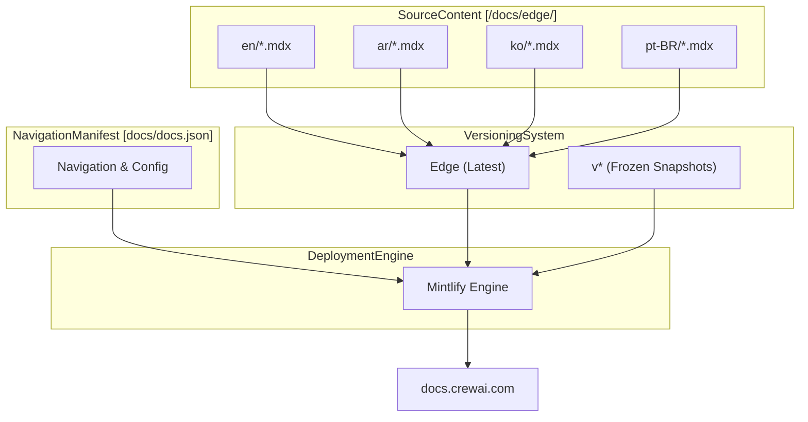
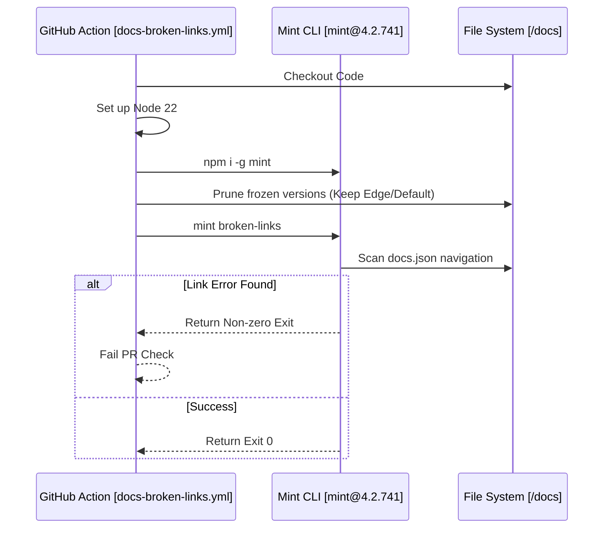

<!-- source: DeepWiki mcp.deepwiki.com · repo crewAIInc/crewAI · page 9.5 Documentation Infrastructure · fetched 2026-10-26 -->

# Documentation Infrastructure

Relevant source files

The following files were used as context for generating this wiki page:

- [.github/workflows/docs-broken-links.yml](.github/workflows/docs-broken-links.yml)
- [DOCS_TRANSLATIONS.md](DOCS_TRANSLATIONS.md)
- [docs/common-room-tracking.js](docs/common-room-tracking.js)
- [docs/docs.json](docs/docs.json)

The CrewAI documentation system is built on [Mintlify](https://mintlify.com), providing a high-performance, versioned, and multi-lingual documentation platform. The infrastructure is designed to support the rapid evolution of the framework by maintaining "Edge" (development) and versioned (stable) documentation tracks across multiple locales.

## System Architecture

The documentation infrastructure resides primarily in the `/docs` directory of the monorepo. It utilizes a centralized configuration file, `docs.json`, to manage navigation, themes, and localization.

### Documentation Data Flow
The following diagram illustrates how documentation content is structured and served through the Mintlify system.

**Documentation Content Flow**

**Sources:** [docs/docs.json:1-30](), [.github/workflows/docs-broken-links.yml:5-13](), [DOCS_TRANSLATIONS.md:27-31]()

## Navigation and Configuration (`docs.json`)

The `docs/docs.json` file serves as the manifest for the entire documentation site. It defines the visual theme, search integration, and the hierarchical navigation structure for every supported language and version.

### Key Configuration Entities
- **Theme:** Uses the `aspen` theme with brand-specific colors (`primary: #EB6658`) [docs/docs.json:3-9]().
- **Contextual Options:** Configures integrations for AI-assisted reading and development environments, including `chatgpt`, `claude`, `perplexity`, `mcp`, `cursor`, and `vscode` [docs/docs.json:11-20](). It also includes a custom option to "Request a feature" linking to GitHub issues [docs/docs.json:21-27]().
- **Anchors:** Global links for the Website, Forum, Blog, and CrewGPT assistant [docs/docs.json:34-55]().

### Multi-Locale Support
The system supports four primary locales, each defined within the `navigation.languages` array. The English locale acts as the source of truth [DOCS_TRANSLATIONS.md:38]().
1. **English (`en`)**: [docs/docs.json:32]()
2. **Arabic (`ar`)**: [docs/docs.json:3324]()
3. **Korean (`ko`)**: [docs/docs.json:6611]()
4. **Portuguese (Brazil) (`pt-BR`)**: [docs/docs.json:9898]()

**Sources:** [docs/docs.json:1-100](), [DOCS_TRANSLATIONS.md:6-7]()

## Translation Workflow

Updates to the documentation follow a strict synchronization process to maintain parity across locales.

### Synchronization Steps
1.  **Identify Changes:** Use `git diff` to find modified `*.mdx` files under `docs/edge/en/` [DOCS_TRANSLATIONS.md:12-23]().
2.  **Target Mapping:** For every English file, a corresponding file must be updated in `ar`, `ko`, and `pt-BR` directories [DOCS_TRANSLATIONS.md:27-31](). If a new English page is added, matching entries must also be added to `docs/docs.json` for each locale [DOCS_TRANSLATIONS.md:33-34]().
3.  **Translation Rules:** Prose and frontmatter (title, description, sidebarTitle) are translated, while MDX/JSX tags, code blocks, URLs, and identifiers remain unchanged. Key terms like Agent, Crew, Task, Flow, LLM, API, CLI, MCP should remain in English where appropriate [DOCS_TRANSLATIONS.md:41-48]().
4.  **Link Rewriting:** Internal links must be updated to use the target locale prefix (e.g., `/en/` to `/{lang}/`) [DOCS_TRANSLATIONS.md:47]().
5.  **Verification (Optional):** The `mintlify broken-links` command can be run from the `docs` directory to verify links [DOCS_TRANSLATIONS.md:52-53]().

**Sources:** [DOCS_TRANSLATIONS.md:8-56]()

## Versioning Strategy

CrewAI employs a dual-track versioning system to ensure users can access information relevant to their installed package version.

### Version Tracks
| Track | Path | Purpose |
| :--- | :--- | :--- |
| **Edge** | `docs/edge/` | Reflects the current state of the `main` branch. Updated continuously. |
| **Versioned** | `docs/v* /` | Snapshot of documentation at a specific release point (e.g., `v0.1.0`). |

The `docs.json` manifest explicitly maps these versions to navigation tabs, allowing users to toggle between "Edge" and stable releases [docs/docs.json:57-60]().

### Documentation Pruning and Freezing
During automated link checks, the system performs a "pruning" of frozen snapshots to optimize performance, keeping only the "Edge" and the "Default" (latest stable) versions active for the check [.github/workflows/docs-broken-links.yml:34-61](). This process involves a Python script that modifies `docs.json` to remove older version entries and deletes corresponding `docs/v*` directories that are not explicitly kept [.github/workflows/docs-broken-links.yml:37-61]().

**Sources:** [docs/docs.json:57-85](), [.github/workflows/docs-broken-links.yml:37-61]()

## Automated Quality Assurance

### Broken Link Checker
The `Check Documentation Broken Links` workflow (`.github/workflows/docs-broken-links.yml`) triggers on pull requests targeting documentation files, pushes to `main` affecting `docs/**`, and manual `workflow_dispatch` events [.github/workflows/docs-broken-links.yml:1-14](). It uses the Mint CLI (version 4.2.741) to verify all references after setting up Node.js and installing the CLI globally [.github/workflows/docs-broken-links.yml:24-30]().

**Link Validation Logic**

**Sources:** [.github/workflows/docs-broken-links.yml:19-64]()

### Analytics and Tracking
The documentation includes a custom tracking script, `docs/common-room-tracking.js`, which integrates with `cdn.cr-relay.com`. This script initializes a global `window.signals` object and asynchronously loads the `signals.js` script from `cdn.cr-relay.com`. It provides methods like `page`, `identify`, and `form` to track user interactions [docs/common-room-tracking.js:1-18]().

**Sources:** [docs/common-room-tracking.js:1-18]()

## Content Organization

The documentation is organized into logical groups within the `docs.json` navigation:
-   **Get Started:** Introduction, installation, and quickstart guides [docs/docs.json:77-85]().
-   **Guides:** Categorized by Strategy, Agents, Crews, Flows, Frontend, Tools, Coding Tools, Advanced, and Migration [docs/docs.json:88-169]().
-   **Core Concepts:** Deep dives into the framework's architecture, including Agents, Tasks, Crews, Flows, Streaming, Production Architecture, Knowledge, Skills, LLMs, Files, and Processes [docs/docs.json:173-186]().
-   **MCP Integration:** Documentation for Model Context Protocol integrations (stdio, sse, security) [docs/docs.json:181-192]().

**Sources:** [docs/docs.json:73-195]()

---

