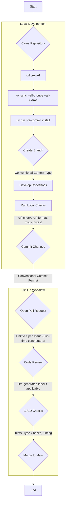
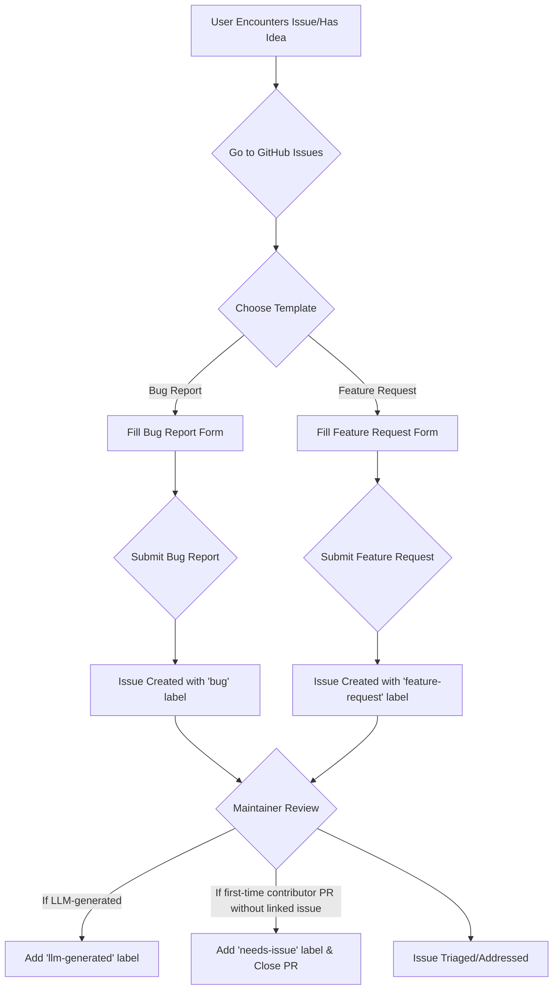

<!-- source: DeepWiki mcp.deepwiki.com · repo crewAIInc/crewAI · page 9.6 Contribution Workflow and Governance · fetched 2026-10-26 -->

# 9.6. Contribution Workflow and Governance

<details>
<summary>Relevant source files</summary>

The following files were used as context for generating this wiki page:

- [.github/CONTRIBUTING.md](.github/CONTRIBUTING.md)
- [.github/ISSUE_TEMPLATE/bug_report.yml](.github/ISSUE_TEMPLATE/bug_report.yml)
- [.github/ISSUE_TEMPLATE/config.yml](.github/ISSUE_TEMPLATE/config.yml)
- [.github/ISSUE_TEMPLATE/feature_request.yml](.github/ISSUE_TEMPLATE/feature_request.yml)
- [.github/pull_request_template.md](.github/pull_request_template.md)
- [.github/security.md](.github/security.md)
- [AGENTS.md](AGENTS.md)
- [LICENSE](LICENSE)

</details>


This page outlines the guidelines and processes for contributing to the CrewAI project, covering everything from setting up your development environment to submitting pull requests, reporting issues, and understanding the project's governance, including its security policy and licensing.

## Development Setup

To contribute to CrewAI, you need to set up your development environment. The project uses `uv` for package management and `pre-commit` for Git hooks [./github/CONTRIBUTING.md:16-17]().

### Prerequisites
*   Python: Versions 3.10–3.14 are supported, with 3.12 being the primary development target [./github/CONTRIBUTING.md:15]().
*   `uv`: A fast Python package installer and resolver [./github/CONTRIBUTING.md:16]().
*   `pre-commit`: A framework for managing Git hooks [./github/CONTRIBUTING.md:17]().

### Installation Steps
1.  Clone the CrewAI repository:
    ```bash
    git clone https://github.com/crewAIInc/crewAI.git
    cd crewAI
    ```
2.  Synchronize dependencies for all groups and extras using `uv`:
    ```bash
    uv sync --all-groups --all-extras
    ```
3.  Install `pre-commit` hooks:
    ```bash
    uv run pre-commit install
    ```
Sources: [./github/CONTRIBUTING.md:20-28]()

## Repository Structure

CrewAI is organized as a `uv` workspace, containing several packages under the `lib/` directory [./github/CONTRIBUTING.md:31-32]().

| Package          | Path                 | Description                  |
| :--------------- | :------------------- | :--------------------------- |
| `crewai`         | `lib/crewai/`        | Core framework               |
| `crewai-tools`   | `lib/crewai-tools/`  | Tool integrations            |
| `crewai-files`   | `lib/crewai-files/`  | File handling                |
| `devtools`       | `lib/devtools/`      | Internal release tooling     |

Documentation is located in the `docs/` directory, with translations available in `docs/{en,ar,ko,pt-BR}/` [./github/CONTRIBUTING.md:41-42]().

Sources: [./github/CONTRIBUTING.md:31-42]()

## Contribution Workflow

### Branching Strategy

New branches should be created off `main` and follow a conventional commit type prefix [./github/CONTRIBUTING.md:47-48]().
The format is `<type>/<short-description>` [./github/CONTRIBUTING.md:50]().

**Allowed Types:** `feat`, `fix`, `docs`, `style`, `refactor`, `perf`, `test`, `chore`, `ci` [./github/CONTRIBUTING.md:52]().

**Examples:**
*   `feat/agent-skills`
*   `fix/memory-scope`
*   `docs/arabic-translation`
Sources: [./github/CONTRIBUTING.md:47-56]()

### Code Quality and Style

The project enforces strict code quality standards through `ruff`, `mypy`, and `pytest`.

#### Manual Checks
*   **Linting (`ruff check`):**
    ```bash
    uv run ruff check lib/
    ```
*   **Formatting (`ruff format`):**
    ```bash
    uv run ruff format lib/
    ```
*   **Type Checking (`mypy`):**
    ```bash
    uv run mypy lib/
    ```
*   **Testing (`pytest`):**
    ```bash
    uv run pytest lib/crewai/tests/ -x -q
    ```
Sources: [./github/CONTRIBUTING.md:62-69]()

#### Code Style Guidelines
*   **Types:** Use built-in generics (e.g., `list[str]`, `dict[str, int]`) instead of `typing.List`/`typing.Dict` [./github/CONTRIBUTING.md:72]().
*   **Annotations:** All functions, methods, and classes require full type annotations [./github/CONTRIBUTING.md:73]().
*   **Docstrings:** Use Google-style docstrings, keeping them minimal but informative [./github/CONTRIBUTING.md:74]().
*   **Imports:** Use `collections.abc` for abstract base classes [./github/CONTRIBUTING.md:75]().
*   **Type Narrowing:** Prefer `isinstance`, `TypeIs`, or `TypeGuard` over `hasattr` [./github/CONTRIBUTING.md:76]().
*   **Avoid:** Bare `dict`/`list` without type parameters [./github/CONTRIBUTING.md:77]().
Sources: [./github/CONTRIBUTING.md:71-77]()

### Commits

CrewAI follows the [Conventional Commits](https://www.conventionalcommits.org/) specification [./github/CONTRIBUTING.md:82]().

**Format:**
```
<type>(<optional scope>): <lowercase description>
```
*   Use imperative mood (e.g., "add feature" not "added feature") [./github/CONTRIBUTING.md:85]().
*   Keep the title under 72 characters [./github/CONTRIBUTING.md:86]().
*   Include a body only if it provides additional context [./github/CONTRIBUTING.md:87]().
*   Do not use `--no-verify` to skip hooks [./github/CONTRIBUTING.md:88]().

**Examples:**
*   `feat(memory): add lancedb storage backend`
*   `fix(agents): resolve deadlock in concurrent execution`
*   `chore(deps): bump pydantic to 2.11`
Sources: [./github/CONTRIBUTING.md:82-98]()

### Pull Requests

*   Each PR should represent one logical change and be focused [./github/CONTRIBUTING.md:102-103]().
*   PRs exceeding 500 lines are automatically labeled `size/XL` [./github/CONTRIBUTING.md:104]().
*   The PR title must follow the conventional commit format [./github/CONTRIBUTING.md:105]().
*   Link related issues using `#123`, `Fixes #123`, or the issue URL [./github/CONTRIBUTING.md:106]().
*   First-time contributors must open or pick an existing **open** issue and mention it in the PR title or body. PRs without a linked open issue will be automatically closed and labeled `needs-issue` [./github/CONTRIBUTING.md:107-108]().

The pull request template [./github/pull_request_template.md:1-24]() guides contributors to include:
*   Related issue links (`Fixes #`) [./github/pull_request_template.md:3]()
*   A summary of the solution [./github/pull_request_template.md:11]()
*   Verification steps, including test updates and local checks [./github/pull_request_template.md:15-20]()
*   Additional context [./github/pull_request_template.md:23]()

Sources: [./github/CONTRIBUTING.md:101-108](), [./github/pull_request_template.md:1-24]()

### Testing

Tests are run using `pytest`.
*   **Run all tests:**
    ```bash
    uv run pytest lib/crewai/tests/ -x -q
    ```
*   **Run a specific test file:**
    ```bash
    uv run pytest lib/crewai/tests/agents/test_agent.py -x -q
    ```
*   **Run a specific test:**
    ```bash
    uv run pytest lib/crewai/tests/agents/test_agent.py::test_agent_creation -x -q
    ```
*   **Run `crewai-tools` tests:**
    ```bash
    uv run pytest lib/crewai-tools/tests/ -x -q
    ```
Sources: [./github/CONTRIBUTING.md:110-123]()

### Type Checking

Strict `mypy` type checking is enforced across all packages.
*   **Check everything:**
    ```bash
    uv run mypy lib/
    ```
*   **Check a specific package:**
    ```bash
    uv run mypy lib/crewai/src/crewai/
    ```
CI workflows run `mypy` on Python 3.10, 3.11, 3.12, and 3.13 for every pull request [./github/CONTRIBUTING.md:135]().
Sources: [./github/CONTRIBUTING.md:126-135]()

### Documentation

CrewAI documentation uses [Mintlify](https://mintlify.com/) and resides in the `docs/` directory [./github/CONTRIBUTING.md:140](). The site configuration is managed via `docs/docs.json` [./github/CONTRIBUTING.md:140]().

**Supported Languages:** English (`en`), Arabic (`ar`), Korean (`ko`), and Brazilian Portuguese (`pt-BR`) [./github/CONTRIBUTING.md:142]().

**Documentation Workflow:**
1.  Edit the English version in `docs/en/` first [./github/CONTRIBUTING.md:145]().
2.  Update translations in `docs/{ar,ko,pt-BR}/` to maintain parity [./github/CONTRIBUTING.md:146]().
3.  Preserve all MDX/JSX syntax, code blocks, and URLs in translations [./github/CONTRIBUTING.md:147]().
4.  Update `docs/docs.json` navigation if new pages are added [./github/CONTRIBUTING.md:148]().
5.  Do not modify files under `docs/v*/` as these are frozen release snapshots [./github/CONTRIBUTING.md:39]().
6.  Do not delete or rename files under `docs/images/` as frozen snapshots may reference them [./github/CONTRIBUTING.md:40]().

**Previewing Documentation:**
*   To preview changes locally: `cd docs && mintlify dev` [./github/CONTRIBUTING.md:42]().
*   To check for broken links: `cd docs && mintlify broken-links` [./github/CONTRIBUTING.md:43]().
Sources: [./github/CONTRIBUTING.md:139-150](), [AGENTS.md:35-45]()

### Dependency Management

The project uses `uv` for dependency management. Direct use of `pip` is discouraged [./github/CONTRIBUTING.md:163]().
*   **Add a runtime dependency to `crewai`:**
    ```bash
    uv add --package crewai <package>
    ```
*   **Add a development dependency to the workspace:**
    ```bash
    uv add --dev <package>
    ```
*   **Synchronize after changes:**
    ```bash
    uv sync
    ```
Sources: [./github/CONTRIBUTING.md:153-163]()

## Issue Reporting

Issues should be reported using the provided GitHub issue templates [./github/CONTRIBUTING.md:167]().

### Bug Report
The bug report template [./github/ISSUE_TEMPLATE/bug_report.yml:1-116]() requires detailed information to help reproduce and resolve issues:
*   Description of the bug [./github/ISSUE_TEMPLATE/bug_report.yml:8-11]()
*   Steps to reproduce [./github/ISSUE_TEMPLATE/bug_report.yml:16-24]()
*   Expected behavior [./github/ISSUE_TEMPLATE/bug_report.yml:28-31]()
*   Screenshots/Code snippets [./github/ISSUE_TEMPLATE/bug_report.yml:35-39]()
*   Operating System [./github/ISSUE_TEMPLATE/bug_report.yml:42-58]()
*   Python Version [./github/ISSUE_TEMPLATE/bug_report.yml:61-68]()
*   CrewAI Version [./github/ISSUE_TEMPLATE/bug_report.yml:71-76]()
*   CrewAI Tools Version [./github/ISSUE_TEMPLATE/bug_report.yml:79-84]()
*   Virtual Environment [./github/ISSUE_TEMPLATE/bug_report.yml:87-94]()
*   Evidence (logs, error messages) [./github/ISSUE_TEMPLATE/bug_report.yml:97-101]()
*   Possible Solution [./github/ISSUE_TEMPLATE/bug_report.yml:104-108]()
*   Additional context [./github/ISSUE_TEMPLATE/bug_report.yml:111-115]()

### Feature Request
The feature request template [./github/ISSUE_TEMPLATE/feature_request.yml:1-64]() guides users to propose new functionality:
*   Feature Area [./github/ISSUE_TEMPLATE/feature_request.yml:12-24]()
*   Relation to existing bugs [./github/ISSUE_TEMPLATE/feature_request.yml:28-32]()
*   Description of the desired solution [./github/ISSUE_TEMPLATE/feature_request.yml:35-39]()
*   Considered alternatives [./github/ISSUE_TEMPLATE/feature_request.yml:42-46]()
*   Additional context [./github/ISSUE_TEMPLATE/feature_request.yml:49-53]()
*   Willingness to Contribute [./github/ISSUE_TEMPLATE/feature_request.yml:56-63]()

Sources: [./github/CONTRIBUTING.md:167-170](), [./github/ISSUE_TEMPLATE/bug_report.yml:1-116](), [./github/ISSUE_TEMPLATE/feature_request.yml:1-64]()

## LLM-Generated Contributions

Any pull request or issue created by an LLM, AI agent, or coding assistant (e.g., Claude Code, Cursor, Copilot, Devin, OpenHands) **must** include the `llm-generated` label [./github/CONTRIBUTING.md:3-7](). Unlabeled AI-generated contributions may be closed without review [./github/CONTRIBUTING.md:7]().

Sources: [./github/CONTRIBUTING.md:3-7]()

## Security Policy

CrewAI is committed to protecting the confidentiality, integrity, and availability of its ecosystem [./github/security.md:3-4]().

### How to Report Vulnerabilities
Security vulnerabilities should be reported through one of the following channels:
*   **Email:** `crewai-vdp-ess@submit.bugcrowd.com` [./github/security.md:10]()
*   **Website:** https://security.crewai.com [./github/security.md:11]()

**Important:** Do not disclose vulnerabilities via public GitHub issues, pull requests, or social media. Reports submitted through other channels will not be reviewed [./github/security.md:13-16]().

Sources: [./github/security.md:1-16]()

## Licensing

By contributing to CrewAI, you agree that your contributions will be licensed under the [MIT License](LICENSE) [./github/CONTRIBUTING.md:173]().

The MIT License grants broad permissions for use, modification, and distribution, provided the copyright notice and permission notice are included in all copies or substantial portions of the software [LICENSE:3-11](). It also disclaims any warranty and liability [LICENSE:13-18]().

Sources: [./github/CONTRIBUTING.md:173](), [LICENSE:1-18]()

## Contribution Workflow Diagram


Sources: [./github/CONTRIBUTING.md:20-135](), [./github/pull_request_template.md:1-24]()

## Issue Reporting Workflow Diagram


Sources: [./github/CONTRIBUTING.md:3-7](), [./github/CONTRIBUTING.md:107-108](), [./github/CONTRIBUTING.md:167-170](), [./github/ISSUE_TEMPLATE/bug_report.yml:1-116](), [./github/ISSUE_TEMPLATE/feature_request.yml:1-64]()

---

