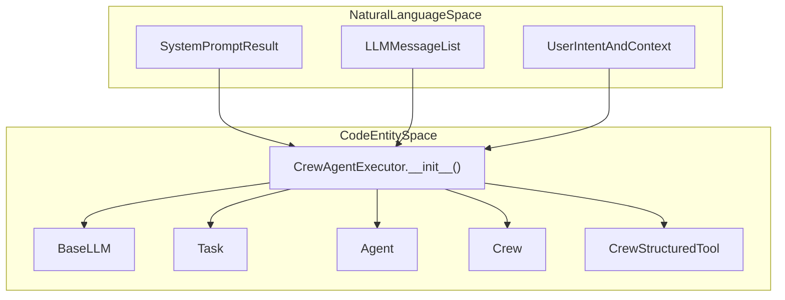
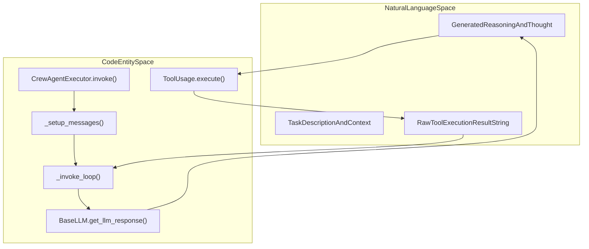
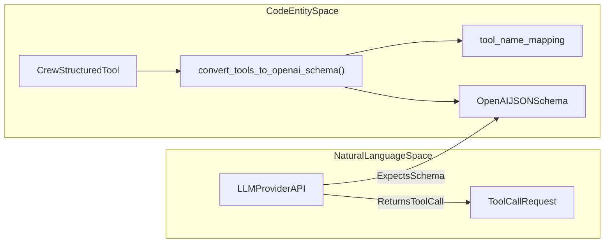

<!-- source: DeepWiki mcp.deepwiki.com · repo crewAIInc/crewAI · extra page Agent Execution Engine · fetched 2026-10-26 -->

# Agent Execution Engine

<details>
<summary>Relevant source files</summary>

The following files were used as context for generating this wiki page:

- [docs/edge/ar/concepts/agents.mdx](docs/edge/ar/concepts/agents.mdx)
- [docs/edge/ar/concepts/reasoning.mdx](docs/edge/ar/concepts/reasoning.mdx)

</details>


The Agent Execution Engine is the core component that orchestrates agent behavior through an iterative loop of LLM calls, tool execution, and decision-making. It manages the lifecycle of agent execution within both Crews and standalone LiteAgents [lib/crewai/src/crewai/agents/crew_agent_executor.py:92-174]().

This document focuses on the execution mechanics—how agents process tasks through iterative reasoning loops, manage context windows, enforce rate limits, and handle edge cases like infinite loops or parsing errors.

Sources: [lib/crewai/src/crewai/agents/crew_agent_executor.py:92-174]()

## Executor Architecture

The execution engine is implemented through the `CrewAgentExecutor` class, which manages agent execution within a Crew context, providing full orchestration capabilities [lib/crewai/src/crewai/agents/crew_agent_executor.py:92-105]().

Title: CrewAgentExecutor Initialization and State Architecture

Sources: [lib/crewai/src/crewai/agents/crew_agent_executor.py:92-174]()

| Parameter | Type | Purpose |
|-----------|------|---------|
| `llm` | `BaseLLM` | Language model for generating responses [lib/crewai/src/crewai/agents/crew_agent_executor.py:137]() |
| `task` | `Task` | Current task being executed [lib/crewai/src/crewai/agents/crew_agent_executor.py:138]() |
| `agent` | `Agent` | Agent instance executing the task [lib/crewai/src/crewai/agents/crew_agent_executor.py:139]() |
| `max_iter` | `int` | Maximum iterations before forcing answer [lib/crewai/src/crewai/agents/crew_agent_executor.py:145]() |
| `tools` | `list[CrewStructuredTool]` | Available tools for execution [lib/crewai/src/crewai/agents/crew_agent_executor.py:142]() |
| `respect_context_window` | `bool` | Whether to summarize on context overflow [lib/crewai/src/crewai/agents/crew_agent_executor.py:153]() |

Sources: [lib/crewai/src/crewai/agents/crew_agent_executor.py:137-153]()

## Execution Loop (ReAct Pattern)

The execution loop implements the ReAct (Reason + Act) pattern, alternating between thinking via LLM calls and acting via tool execution [lib/crewai/src/crewai/agents/crew_agent_executor.py:184-209]().

Title: ReAct Execution Loop Bridging Natural Language and Code Entities

Sources: [lib/crewai/src/crewai/agents/crew_agent_executor.py:184-317]()

## Tool Calling Patterns

CrewAI supports two primary tool calling patterns: Native Function Calling and ReAct manual parsing [lib/crewai/src/crewai/utilities/agent_utils.py:144-210]().

Title: Native Tool Schema Conversion

Sources: [lib/crewai/src/crewai/utilities/agent_utils.py:144-210]()

### Tool Execution Pipeline

When an agent decides to use a tool, the `ToolUsage` class handles parsing and execution:
1. Selection: `_select_tool(tool_name)` finds the tool in the agent's toolbox [lib/crewai/src/crewai/tools/tool_usage.py:138]().
2. Validation: Arguments are validated against the tool's schema [lib/crewai/src/crewai/tools/base_tool.py:156-177]().
3. Execution: The tool's `_run` or `_arun` method is invoked [lib/crewai/src/crewai/tools/base_tool.py:198-215]().

Sources: [lib/crewai/src/crewai/tools/tool_usage.py:126-163](), [lib/crewai/src/crewai/tools/base_tool.py:57-98]()

## Multi-Turn Conversation Handling

The executor maintains a conversation history in the `messages` list, which grows with each iteration [lib/crewai/src/crewai/agents/crew_agent_executor.py:92-174]().

Title: Message Summarization Flow
```mermaid
sequenceDiagram
    participant Loop as _invoke_loop
    participant Utils as agent_utils.py
    participant LLM as BaseLLM
    
    Loop->>Utils: is_context_length_exceeded()
    Utils-->>Loop: True
    Loop->>Utils: handle_context_length()
    Utils->>Utils: summarize_messages()
    Utils->>LLM: _asummarize_chunks()
    LLM-->>Utils: Summarized content
    Utils-->>Loop: Updated messages
```
Sources: [lib/crewai/src/crewai/utilities/agent_utils.py:464-567]()

## Iteration Control and Rate Limiting

### Max Iterations
The `max_iter` parameter prevents infinite loops. Once reached, `handle_max_iterations_exceeded` forces the agent to provide a final answer based on current context [lib/crewai/src/crewai/utilities/agent_utils.py:124-181]().

### RPM Rate Limiting
The `enforce_rpm_limit` function uses a controller to ensure the agent does not exceed allowed Requests Per Minute [lib/crewai/src/crewai/utilities/agent_utils.py:220-229]().

Sources: [lib/crewai/src/crewai/utilities/agent_utils.py:124-229]()

## Asynchronous Execution

The engine provides full async support via `ainvoke` and `_ainvoke_loop` [lib/crewai/src/crewai/agents/crew_agent_executor.py:319-465]().

| Sync Method | Async Equivalent | Purpose |
|-------------|------------------|---------|
| `invoke` | `ainvoke` | Main entry point [lib/crewai/src/crewai/agents/crew_agent_executor.py:319]() |
| `_invoke_loop` | `_ainvoke_loop` | Execution loop [lib/crewai/src/crewai/agents/crew_agent_executor.py:372]() |
| `get_llm_response` | `aget_llm_response` | Async LLM interaction [lib/crewai/src/crewai/utilities/agent_utils.py:284]() |
| `execute_tool...` | `aexecute_tool...` | Async tool call [lib/crewai/src/crewai/utilities/tool_utils.py:63]() |

Sources: [lib/crewai/src/crewai/agents/crew_agent_executor.py:319-465](), [lib/crewai/src/crewai/utilities/tool_utils.py:63]()

---

