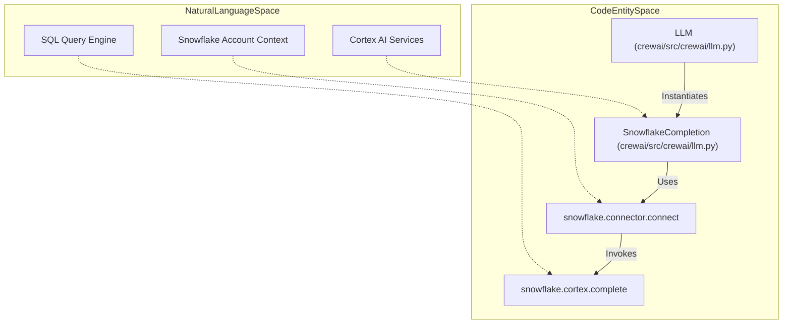
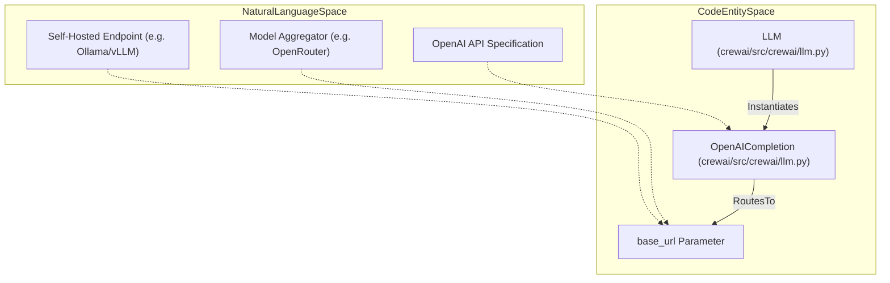

<!-- source: DeepWiki mcp.deepwiki.com · repo crewAIInc/crewAI · extra page Snowflake and OpenAI-Compatible Providers · fetched 2026-10-26 -->

# Snowflake and OpenAI-Compatible Providers

<details>
<summary>Relevant source files</summary>

The following files were used as context for generating this wiki page:

- [.env.test](.env.test)
- [docs/edge/ar/concepts/llms.mdx](docs/edge/ar/concepts/llms.mdx)

</details>


This page documents the integration of Snowflake Cortex AI and OpenAI-compatible providers within the CrewAI framework. These integrations allow agents to leverage Snowflake's managed LLM services or any self-hosted/third-party endpoint that adheres to the OpenAI API specification.

## Overview

CrewAI provides native support for Snowflake Cortex AI through the `SnowflakeCompletion` class and a flexible OpenAI-compatible interface for providers like OpenRouter, Together AI, or local instances (e.g., Ollama, vLLM). These integrations are managed via the `LLM` factory class, which routes requests based on the model string prefix [lib/crewai/src/crewai/llm.py:1-200]().

Sources: [lib/crewai/src/crewai/llm.py:1-200]()

## Snowflake Cortex AI Integration

The Snowflake integration utilizes the `SnowflakeCompletion` class to interact with Snowflake Cortex AI. This allows users to run LLMs directly within their Snowflake environment, leveraging governed data and infrastructure [lib/crewai/src/crewai/llm.py:650-750]().

### Data Flow and Architecture

When a model string starting with `snowflake/` is provided, the `LLM` class initializes a `SnowflakeCompletion` instance [lib/crewai/src/crewai/llm.py:650-680](). This instance manages the connection to Snowflake using `snowflake-connector-python` and executes SQL functions (specifically `snowflake.cortex.complete`) to generate responses [lib/crewai/src/crewai/llm.py:681-720]().

#### Snowflake System to Code Entity Mapping
The following diagram illustrates how natural language concepts in Snowflake map to specific code entities in the CrewAI implementation.

**Diagram: Snowflake Cortex AI Integration Map**

Sources: [lib/crewai/src/crewai/llm.py:1-200](), [lib/crewai/src/crewai/llm.py:650-750]()

### Configuration
Configuration is handled via environment variables or direct parameters passed to the `LLM` class [lib/crewai/src/crewai/llm.py:660-680]().

| Parameter | Environment Variable | Description |
| :--- | :--- | :--- |
| `user` | `SNOWFLAKE_USER` | Snowflake username [ .env.test:97]() |
| `password` | `SNOWFLAKE_PASSWORD` | Snowflake password [ .env.test:98]() |
| `account` | `SNOWFLAKE_ACCOUNT` | Snowflake account identifier [ .env.test:99]() |
| `warehouse` | `SNOWFLAKE_WAREHOUSE` | Virtual warehouse for compute [ .env.test:100]() |
| `database` | `SNOWFLAKE_DATABASE` | Database context [ .env.test:101]() |
| `schema` | `SNOWFLAKE_SCHEMA` | Schema context [ .env.test:102]() |

Sources: [.env.test:97-103](), [lib/crewai/src/crewai/llm.py:660-680]()

## OpenAI-Compatible Providers

CrewAI supports any provider that implements the OpenAI API schema [docs/edge/ar/concepts/llms.mdx:100-108](). This is commonly used for self-hosted models or aggregators like OpenRouter [lib/crewai/src/crewai/llm.py:350-400]().

### Implementation Detail
The `OpenAICompletion` class serves as the base for these interactions [lib/crewai/src/crewai/llm.py:350-380](). When a non-standard OpenAI model is used, the `base_url` parameter is modified to point to the provider's endpoint [lib/crewai/src/crewai/llm.py:381-410]().

#### OpenAI-Compatible Endpoint Mapping
The following diagram illustrates how natural language concepts for OpenAI-compatible endpoints map to code entities in the framework.

**Diagram: OpenAI-Compatible Endpoint Mapping**

Sources: [lib/crewai/src/crewai/llm.py:350-450](), [docs/edge/ar/concepts/llms.mdx:100-108]()

### Logic Flow for OpenAI-Compatible Endpoints
1. **Model Detection**: The `LLM` class parses the model string [lib/crewai/src/crewai/llm.py:100-150]().
2. **Base URL Override**: If a `base_url` is provided in the `LLM` constructor or environment, it overrides the default endpoint [ .env.test:43-44]().
3. **Request Dispatch**: The `OpenAICompletion` class formats messages and tools into the standard OpenAI JSON schema and sends them to the configured `base_url` [lib/crewai/src/crewai/llm.py:400-440]().

Sources: [lib/crewai/src/crewai/llm.py:350-450](), [docs/edge/ar/concepts/llms.mdx:120-159]()

### Key Providers and Configurations

#### OpenRouter
Used by prefixing the model with `openrouter/` and setting the `OPENROUTER_API_KEY` [.env.test:16]().
- **Base URL**: `https://openrouter.ai/api/v1` [lib/crewai/src/crewai/llm.py:350-400]()
- **Key Function**: `OpenAICompletion.call` handles request dispatching [lib/crewai/src/crewai/llm.py:380-420]()

#### Local Endpoints (Ollama/vLLM)
For local providers, the `base_url` must be explicitly set in the `LLM` configuration [docs/edge/ar/concepts/llms.mdx:75-88]():
```python
llm = LLM(
    model="openai/custom-model",
    base_url="http://localhost:11434/v1",
    api_key="na"
)
```
Sources: [docs/edge/ar/concepts/llms.mdx:75-88](), [lib/crewai/src/crewai/llm.py:100-150]()

## Technical Reference

### SnowflakeCompletion Class
Defined in `lib/crewai/src/crewai/llm.py` [lib/crewai/src/crewai/llm.py:650-750]().

- **`__init__`**: Establishes the Snowflake connection using credentials retrieved from the environment or passed arguments [lib/crewai/src/crewai/llm.py:655-675]().
- **`call(messages, tools, ...)`**: 
    1. Converts conversation history into a format suitable for the `snowflake.cortex.complete` function [lib/crewai/src/crewai/llm.py:680-700]().
    2. Executes a SQL query: `SELECT snowflake.cortex.complete(model, messages)` [lib/crewai/src/crewai/llm.py:701-720]().
    3. Parses the JSON result back into a standard completion format [lib/crewai/src/crewai/llm.py:721-740]().

Sources: [lib/crewai/src/crewai/llm.py:650-750]()

### OpenAICompletion Class
Defined in `lib/crewai/src/crewai/llm.py` [lib/crewai/src/crewai/llm.py:350-450]().

- **`call`**: The main entry point for all OpenAI-compatible calls. It handles the mapping of `max_tokens`, `temperature`, and `stop` sequences [lib/crewai/src/crewai/llm.py:380-410]().
- **Tool Mapping**: Automatically converts CrewAI tools into the `tools` and `tool_choice` format expected by the OpenAI API [lib/crewai/src/crewai/llm.py:420-440]().

Sources: [lib/crewai/src/crewai/llm.py:350-450]()

---

