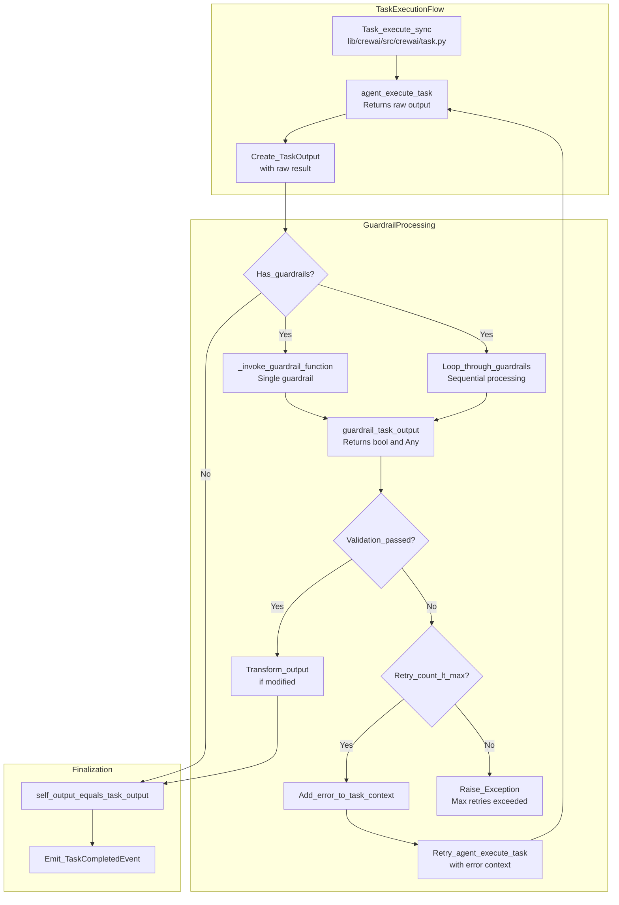

<!-- source: DeepWiki mcp.deepwiki.com · repo crewAIInc/crewAI · extra page Task Guardrails and Validation · fetched 2026-10-26 -->

# Task Guardrails and Validation

<details>
<summary>Relevant source files</summary>

The following files were used as context for generating this wiki page:

- [docs/edge/ar/concepts/tasks.mdx](docs/edge/ar/concepts/tasks.mdx)
- [docs/edge/ar/learn/force-tool-output-as-result.mdx](docs/edge/ar/learn/force-tool-output-as-result.mdx)

</details>


## Purpose and Scope

This document describes CrewAI's task guardrail system, which validates and optionally transforms task outputs before they are accepted as final results. Guardrails provide programmatic or LLM-based quality control, ensuring task outputs meet specified criteria before proceeding to subsequent tasks in a workflow.

The system includes support for single guardrails, sequential pipelines of multiple guardrails, and specialized enterprise features like the **Hallucination Guardrail**, which specifically detects AI-generated content not supported by reference context.

---

## Guardrail Overview

Guardrails are validation functions that execute immediately after an agent completes a task. They evaluate the `TaskOutput` and return a tuple indicating success/failure and optionally transformed output. If validation fails, the task is retried with error context until it passes or exceeds the retry limit.

### Key Characteristics

| Feature | Description |
|---------|-------------|
| **Execution Timing** | After agent task execution, before output finalization [lib/crewai/src/crewai/task.py:512-603]() |
| **Validation Type** | Programmatic (callable) or LLM-based (string description/HallucinationGuardrail) |
| **Retry Behavior** | Automatic retry with error feedback on validation failure [lib/crewai/src/crewai/task.py:785-794]() |
| **Output Transformation** | Can modify/transform output during validation [lib/crewai/src/crewai/task.py:649-657]() |
| **Multiple Guardrails** | Sequential processing with independent retry tracking [lib/crewai/src/crewai/task.py:713-715]() |

### Guardrail Architecture

The following diagram illustrates the data flow from task execution through the guardrail validation loop.

**Task Guardrail Execution Flow**


Sources:
- [lib/crewai/src/crewai/task.py:604-691]()
- [lib/crewai/src/crewai/task.py:512-603]()
- [docs/edge/ar/concepts/tasks.mdx:65-72]()

---

## Guardrail Types

CrewAI supports programmatic validation, string-based LLM validation, and specialized hallucination detection.

### Callable Guardrails

Callable guardrails are Python functions that receive a `TaskOutput` and return a validation result.

**Signature:**
```python
def guardrail_function(task_output: TaskOutput) -> tuple[bool, Any]:
    """
    Args:
        task_output: TaskOutput object with raw result and metadata
    
    Returns:
        Tuple of (success: bool, result: str | TaskOutput)
    """
```

**Validation Logic** ([lib/crewai/src/crewai/task.py:207-264]()):
The `Task` class uses Pydantic field validators to ensure the guardrail function accepts exactly one parameter and returns the correct tuple structure.

### Hallucination Guardrail (Enterprise)

The `HallucinationGuardrail` is an enterprise-grade validator that compares task output against reference context to ensure factual accuracy [docs/edge/ar/enterprise/features/hallucination-guardrail.mdx:10-20]().

- **Context Comparison**: Evaluates faithfulness to source material.
- **Thresholding**: Supports a custom faithfulness score (0-10) [docs/edge/ar/enterprise/features/hallucination-guardrail.mdx:59-68]().
- **Tool Integration**: Can include tool execution results in the reference context for more accurate verification [docs/edge/ar/enterprise/features/hallucination-guardrail.mdx:72-81]().

### Type Definitions and Mapping

**Guardrail Type Mapping**
```mermaid
graph LR
    subgraph "NaturalLanguageSpace"
        StringDesc["str<br/>'Ensure output is JSON'"]
        ContextDesc["str<br/>'Reference Context'"]
    end

    subgraph "CodeEntitySpace"
        GuardrailType["GuardrailType<br/>Union[GuardrailCallable, str]"]
        LLMGuardrail["class LLMGuardrail<br/>lib/crewai/src/crewai/tasks/llm_guardrail.py"]
        HallucinationGuardrail["class HallucinationGuardrail<br/>lib/crewai/src/crewai/tasks/hallucination_guardrail.py"]
        GuardrailCallable["GuardrailCallable<br/>Callable[[TaskOutput], tuple[bool, Any]]"]
    end
    
    StringDesc -.->|Converts to| LLMGuardrail
    ContextDesc -.->|Input for| HallucinationGuardrail
    LLMGuardrail --|>|Implements| GuardrailCallable
    HallucinationGuardrail --|>|Implements| GuardrailCallable
    GuardrailType --> GuardrailCallable
```

Sources:
- [lib/crewai/src/crewai/task.py:167-174]()
- [lib/crewai/src/crewai/tasks/llm_guardrail.py:32-51]()
- [docs/edge/ar/enterprise/features/hallucination-guardrail.mdx:25-39]()

---

## LLM-Based Guardrails Implementation

The `LLMGuardrail` class validates task output using a specialized internal "Guardrail Agent".

### Execution Logic

1.  **Agent Creation**: Instantiates an internal `Agent` with the role "Guardrail Agent" [lib/crewai/src/crewai/tasks/llm_guardrail.py:53-58]().
2.  **Prompt Construction**: Builds a query containing the task result and the natural language guardrail description [lib/crewai/src/crewai/tasks/llm_guardrail.py:60-74]().
3.  **Structured Kickoff**: Executes `agent.kickoff()` with `response_format=LLMGuardrailResult` to ensure the response is machine-readable [lib/crewai/src/crewai/tasks/llm_guardrail.py:76]().
4.  **Result Parsing**: Returns `True` if valid, or `False` with the LLM's feedback to trigger a task retry [lib/crewai/src/crewai/tasks/llm_guardrail.py:98-100]().

### Data Models

The `LLMGuardrailResult` Pydantic model defines the schema for the LLM's validation response [lib/crewai/src/crewai/tasks/llm_guardrail.py:22-30]().

| Field | Type | Description |
|-------|------|-------------|
| `valid` | `bool` | Whether the task output complies with the guardrail |
| `feedback` | `str \| None` | Feedback about the output if it is not valid |

Sources:
- [lib/crewai/src/crewai/tasks/llm_guardrail.py:52-79]()

---

## Multiple Guardrails and Sequential Processing

The `guardrails` field accepts a list of validation functions that process sequentially. Each guardrail receives the output of the previous guardrail, enabling transformation pipelines.

### Sequential Processing Logic

When multiple guardrails are configured, they execute in order. Each guardrail receives the output from the previous guardrail, allowing for transformation chains [lib/crewai/src/crewai/task.py:649-657]().

Each guardrail maintains its own retry count in the `_guardrail_retry_counts` dictionary, ensuring that one failing guardrail doesn't prematurely exhaust the retry budget for the entire task [lib/crewai/src/crewai/task.py:713]().

Sources:
- [lib/crewai/src/crewai/task.py:171-174]()
- [lib/crewai/src/crewai/task.py:298-350]()
- [lib/crewai/src/crewai/task.py:713-715]()

---

## Validation and Retry Mechanism

The retry mechanism automatically re-executes the task when validation fails, providing error context to the agent for correction.

### Implementation Details

**Guardrail Invocation** ([lib/crewai/src/crewai/task.py:693-844]()):
The `_invoke_guardrail_function` handles the retry loop:
1.  **Event Emission**: Emits `LLMGuardrailStartedEvent` via the `crewai_event_bus` [lib/crewai/src/crewai/task.py:706-709]().
2.  **Execution**: Calls the guardrail function [lib/crewai/src/crewai/task.py:719]().
3.  **Failure Handling**: If `success` is `False`, it checks if `retry_count < guardrail_max_retries` [lib/crewai/src/crewai/task.py:750]().
4.  **Agent Re-kickoff**: If retries are available, it calls `agent.execute_task()` with a `context` string describing the validation failure [lib/crewai/src/crewai/task.py:785-794]().
5.  **Recursion**: The method calls itself recursively with the new output to re-validate [lib/crewai/src/crewai/task.py:808-814]().

### Event Observability

The system uses the `EventListener` to track guardrail status and report it to telemetry or the console.

| Event | Trigger |
|-------|---------|
| `LLMGuardrailStartedEvent` | Before calling the guardrail function [lib/crewai/src/crewai/task.py:706]() |
| `LLMGuardrailCompletedEvent` | After validation succeeds or fails [lib/crewai/src/crewai/task.py:751]() |

Sources:
- [lib/crewai/src/crewai/task.py:693-844]()
- [lib/crewai/src/crewai/events/event_listener.py:68-71]()
- [docs/edge/ar/enterprise/features/hallucination-guardrail.mdx:138-145]()

---

