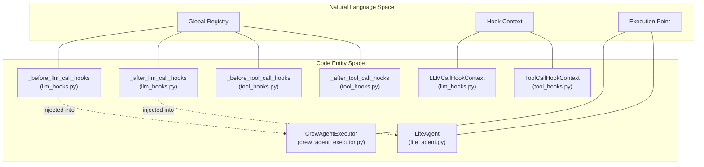
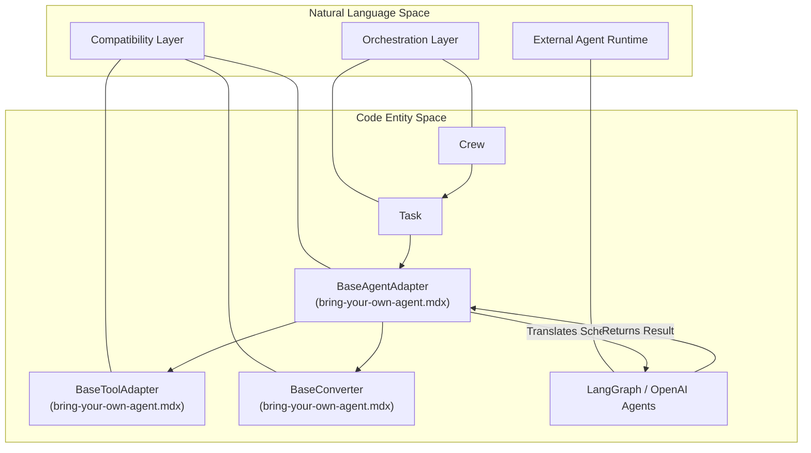

<!-- source: DeepWiki mcp.deepwiki.com · repo crewAIInc/crewAI · extra page Agent Hooks and Extensibility · fetched 2026-10-26 -->

# Agent Hooks and Extensibility

Relevant source files

The following files were used as context for generating this wiki page:

- [docs/edge/ar/learn/before-and-after-kickoff-hooks.mdx](docs/edge/ar/learn/before-and-after-kickoff-hooks.mdx)
- [docs/edge/ar/learn/bring-your-own-agent.mdx](docs/edge/ar/learn/bring-your-own-agent.mdx)
- [docs/edge/ar/learn/execution-boundary-hooks.mdx](docs/edge/ar/learn/execution-boundary-hooks.mdx)
- [docs/edge/ar/learn/execution-hooks.mdx](docs/edge/ar/learn/execution-hooks.mdx)

This page documents the agent hook system and the extensibility patterns in CrewAI. These mechanisms provide extension points for modifying agent behavior, intercepting execution cycles, and implementing custom agent logic without modifying core framework code.

## Purpose and Scope

The hook system provides primary extension mechanisms for the CrewAI runtime:
- **LLM Hooks**: Intercept and modify LLM interactions (messages sent, responses received) [lib/crewai/src/crewai/hooks/llm_hooks.py:157-158]().
- **Tool Hooks**: Intercept and modify tool executions (inputs, outputs) [lib/crewai/src/crewai/hooks/tool_hooks.py:120-121]().
- **Execution Boundary Hooks**: Intercept runtime boundaries (`EXECUTION_START`, `INPUT`, `OUTPUT`, `EXECUTION_END`) using the `@on` decorator [docs/edge/ar/learn/execution-boundary-hooks.mdx:7-11]().
- **BaseAgentAdapter**: A pattern for integrating agents from other frameworks (e.g., LangGraph, OpenAI Agents) into CrewAI [docs/edge/ar/learn/bring-your-own-agent.mdx:8-20]().

Sources: [lib/crewai/src/crewai/hooks/llm_hooks.py:157-158](), [lib/crewai/src/crewai/hooks/tool_hooks.py:120-121](), [docs/edge/ar/learn/execution-boundary-hooks.mdx:7-11](), [docs/edge/ar/learn/bring-your-own-agent.mdx:8-20]()

---

## Hook System Architecture

The hook system uses a global registration pattern. Hooks are registered once and automatically loaded into all agent executors (`CrewAgentExecutor`, `LiteAgent`) and LLM calls throughout the system [lib/crewai/src/crewai/hooks/llm_hooks.py:164-168]().

### Agent Hooks Component Mapping

The following diagram bridges natural language concepts to the specific code entities that implement the hook system.

Sources: [lib/crewai/src/crewai/hooks/llm_hooks.py:157-158](), [lib/crewai/src/crewai/hooks/tool_hooks.py:120-121](), [lib/crewai/src/crewai/hooks/llm_hooks.py:23-48](), [lib/crewai/src/crewai/hooks/tool_hooks.py:23-42]()

---

## LLM Hooks

LLM hooks intercept every call to the language model. They enable modification of messages before sending and responses after receiving, executing within the agent's loop with full access to conversation history [lib/crewai/src/crewai/hooks/llm_hooks.py:23-58]().

### LLMCallHookContext

The `LLMCallHookContext` class provides complete access to the execution state.

| Attribute | Type | Description |
|-----------|------|-------------|
| `executor` | `CrewAgentExecutor \| AgentExecutor \| LiteAgent \| None` | Reference to the executor instance [lib/crewai/src/crewai/hooks/llm_hooks.py:50]() |
| `messages` | `list[LLMMessage]` | **Mutable reference** to conversation messages [lib/crewai/src/crewai/hooks/llm_hooks.py:51]() |
| `agent` | `Any` | Agent instance executing the task [lib/crewai/src/crewai/hooks/llm_hooks.py:52]() |
| `task` | `Any` | Task instance being executed [lib/crewai/src/crewai/hooks/llm_hooks.py:53]() |
| `crew` | `Any` | Crew instance [lib/crewai/src/crewai/hooks/llm_hooks.py:54]() |
| `llm` | `BaseLLM \| None \| str \| Any` | LLM instance being called [lib/crewai/src/crewai/hooks/llm_hooks.py:55]() |
| `iterations` | `int` | Current iteration count in agent loop [lib/crewai/src/crewai/hooks/llm_hooks.py:56]() |
| `response` | `str \| None` | LLM response string (after_llm_call hooks only) [lib/crewai/src/crewai/hooks/llm_hooks.py:57]() |

**Warning:** You must modify `messages` in-place (e.g., `context.messages.append(...)`). Replacing the list reference entirely will prevent the executor from seeing the changes [lib/crewai/src/crewai/hooks/llm_hooks.py:37-40]().

Sources: [lib/crewai/src/crewai/hooks/llm_hooks.py:23-58](), [lib/crewai/src/crewai/hooks/llm_hooks.py:80-110]()

---

## Tool Hooks

Tool hooks provide access to the tool being called and its input parameters.

### ToolCallHookContext

| Attribute | Type | Description |
|-----------|------|-------------|
| `tool_name` | `str` | Name of the tool being called [lib/crewai/src/crewai/hooks/tool_hooks.py:30]() |
| `tool_input` | `dict[str, Any]` | **Mutable** tool input parameters [lib/crewai/src/crewai/hooks/tool_hooks.py:31]() |
| `tool` | `CrewStructuredTool` | Reference to the tool instance [lib/crewai/src/crewai/hooks/tool_hooks.py:36]() |
| `tool_result` | `str \| None` | Result (only for after_tool_call hooks) [lib/crewai/src/crewai/hooks/tool_hooks.py:40]() |

- **Before Hooks**: Can modify `tool_input` in-place or return `False` to block execution [lib/crewai/src/crewai/hooks/tool_hooks.py:134-136]().
- **After Hooks**: Can modify the tool result by returning a new string [lib/crewai/src/crewai/hooks/tool_hooks.py:171-174]().

Sources: [lib/crewai/src/crewai/hooks/tool_hooks.py:23-42](), [lib/crewai/src/crewai/hooks/tool_hooks.py:124-181]()

---

## Execution Boundary Hooks

Execution boundary hooks intercept the outer boundaries of crew and flow execution using the `@on` decorator [docs/edge/ar/learn/execution-boundary-hooks.mdx:7-11]().

### Interception Points

| Interception Point | Timing | Payload (`ctx.payload`) |
|--------------------|--------|--------------------------|
| `EXECUTION_START` | Crew or Flow about to start | Input `dict` [docs/edge/ar/learn/execution-boundary-hooks.mdx:18]() |
| `INPUT` | Resolved execution inputs | Input `dict` [docs/edge/ar/learn/execution-boundary-hooks.mdx:19]() |
| `OUTPUT` | Final result ready | Output object (`CrewOutput` or flow result) [docs/edge/ar/learn/execution-boundary-hooks.mdx:20]() |
| `EXECUTION_END` | Execution finished (success or failure) | Output object or `None` on failure [docs/edge/ar/learn/execution-boundary-hooks.mdx:21]() |

Hooks can mutate `ctx.payload` in place, return a replacement value, or raise `HookAborted(reason, source)` to halt execution [docs/edge/ar/learn/execution-boundary-hooks.mdx:32-36]().

Sources: [docs/edge/ar/learn/execution-boundary-hooks.mdx:7-42]()

---

## Agent Interoperability: BaseAgentAdapter

CrewAI allows the use of agents from other frameworks within a Crew by using the adapter pattern [docs/edge/ar/learn/bring-your-own-agent.mdx:8-12]().

### Custom Agent Implementation

To integrate a third-party agent, you must implement a class inheriting from `BaseAgentAdapter`. This abstract class extends `BaseAgent` to maintain compatibility while providing translation layers for external requirements [docs/edge/ar/learn/bring-your-own-agent.mdx:18-20]().

| Required Method | Description |
|-----------------|-------------|
| `configure_tools` | Translates CrewAI tools to the format expected by the external agent [docs/edge/ar/learn/bring-your-own-agent.mdx:24]() |
| `configure_structured_output` | Maps CrewAI's output expectations to the external agent's schema [docs/edge/ar/learn/bring-your-own-agent.mdx:25]() |

Ready-to-use adapters are provided for:
1. **LangGraph** [docs/edge/ar/learn/bring-your-own-agent.mdx:36]()
2. **OpenAI Agents** [docs/edge/ar/learn/bring-your-own-agent.mdx:37]()

### Adapter Component Mapping

The following diagram bridges natural language adapter concepts to concrete code entities in the adapter layer.

Sources: [docs/edge/ar/learn/bring-your-own-agent.mdx:8-41]()

---

## CrewBase and Project Hooks

When using the `@CrewBase` decorator pattern, additional lifecycle hooks are available to manage the orchestration flow.

### Project Lifecycle Hooks
- `@before_kickoff`: Executes logic before the crew begins any tasks. It receives the input dictionary and can modify it before execution [docs/edge/ar/learn/before-and-after-kickoff-hooks.mdx:9-23]().
- `@after_kickoff`: Executes logic after the crew completes all tasks. It receives the final result object [docs/edge/ar/learn/before-and-after-kickoff-hooks.mdx:25-39]().
- `@before_llm_call_crew`: Registers a hook specifically within the scope of a decorated project [docs/edge/ar/learn/execution-hooks.mdx:58-61]().

Sources: [docs/edge/ar/learn/before-and-after-kickoff-hooks.mdx:7-47](), [docs/edge/ar/learn/execution-hooks.mdx:49-67]()

---

