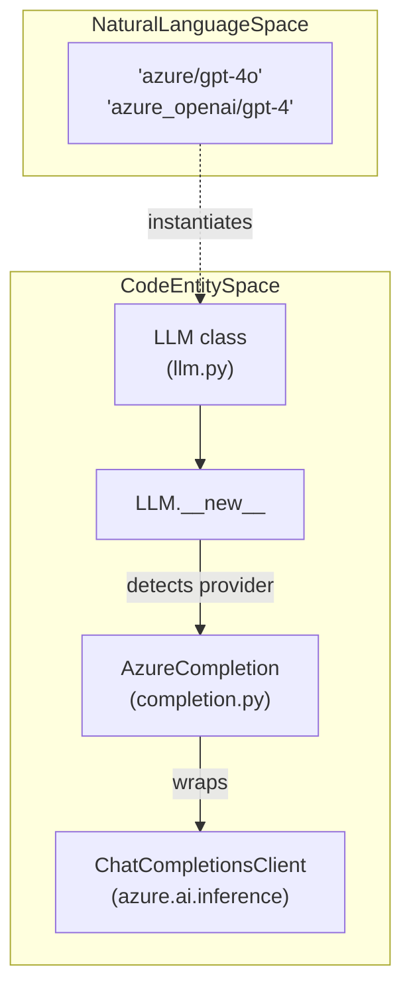
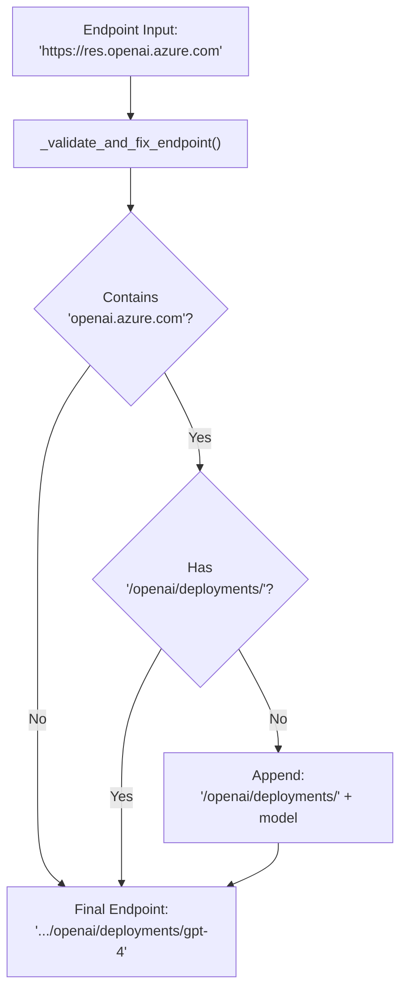
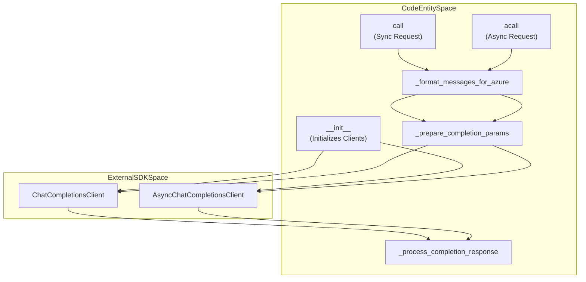

<!-- source: DeepWiki mcp.deepwiki.com · repo crewAIInc/crewAI · extra page Azure Provider · fetched 2026-10-26 -->

# Azure Provider

Relevant source files

The following files were used as context for generating this wiki page:

- [.env.test](.env.test)
- [docs/edge/ar/concepts/llms.mdx](docs/edge/ar/concepts/llms.mdx)

## Purpose and Scope

The Azure Provider implements native integration between CrewAI and the `azure-ai-inference` SDK, enabling direct communication with Azure OpenAI models and other models deployed via Azure AI Studio or Azure Machine Learning. This provider offers optimized performance through the Azure-native SDK rather than through the LiteLLM abstraction layer.

For information about the general LLM architecture and factory routing, see [LLM Integration](). For other provider implementations, see [OpenAI Provider](), [Anthropic Provider](), [Gemini Provider](), and [Bedrock Provider]().

The Azure Provider supports:
- Direct `ChatCompletionsClient` integration [lib/crewai/src/crewai/llms/providers/azure/completion.py:24-29]()
- Azure OpenAI model deployments and generic Azure AI Inference endpoints [lib/crewai/src/crewai/llms/providers/azure/completion.py:178-182]()
- Native function calling with OpenAI models [lib/crewai/src/crewai/llms/providers/azure/completion.py:486-518]()
- Streaming and non-streaming responses [lib/crewai/src/crewai/llms/providers/azure/completion.py:407-484]()
- Structured output validation via Pydantic [lib/crewai/src/crewai/llms/providers/azure/completion.py:567-605]()
- Comprehensive error handling for Azure-specific status codes [lib/crewai/src/crewai/llms/providers/azure/completion.py:207-243]()

Sources: [lib/crewai/src/crewai/llms/providers/azure/completion.py:1-100]()

## Architecture Overview

The Azure Provider integrates into CrewAI's LLM abstraction layer through the factory pattern. When a model string indicates Azure (via prefix or explicit provider), the `LLM` factory instantiates `AzureCompletion` instead of falling back to LiteLLM.

### Natural Language to Code Entity Space: Factory Routing

The following diagram bridges the user's intent (model string) to the specific code entities responsible for Azure integration.

**Diagram: Azure Provider Factory Routing**

The factory routes to Azure when:
1. Model string contains `azure/` or `azure_openai/` prefix.
2. Explicit `provider="azure"` parameter is passed to the `LLM` constructor.
3. Model name matches Azure patterns (e.g., `gpt-4`, `gpt-35-turbo`).

Sources: [lib/crewai/src/crewai/llms/providers/azure/completion.py:72-182](), [lib/crewai/tests/llms/azure/test_azure.py:24-46]()

## Configuration and Initialization

### Required Parameters

The `AzureCompletion` class requires specific configuration to connect to Azure services:

| Parameter | Type | Description | Environment Variable |
|-----------|------|-------------|---------------------|
| `model` | `str` | Azure deployment name or model name | - |
| `api_key` | `str \| None` | Azure API key | `AZURE_API_KEY` |
| `endpoint` | `str \| None` | Azure endpoint URL | `AZURE_ENDPOINT`, `AZURE_OPENAI_ENDPOINT`, `AZURE_API_BASE` |

### Optional Parameters

| Parameter | Type | Default | Description |
|-----------|------|---------|-------------|
| `api_version` | `str \| None` | `"2024-06-01"` | Azure API version [lib/crewai/src/crewai/llms/providers/azure/completion.py:137]() |
| `timeout` | `float \| None` | `None` | Request timeout in seconds |
| `max_retries` | `int` | `2` | Maximum retry attempts |
| `temperature` | `float \| None` | `None` | Sampling temperature (0-2) |
| `top_p` | `float \| None` | `None` | Nucleus sampling parameter |
| `frequency_penalty` | `float \| None` | `None` | Frequency penalty (-2 to 2) |
| `presence_penalty` | `float \| None` | `None` | Presence penalty (-2 to 2) |
| `max_tokens` | `int \| None` | `None` | Maximum tokens in response |
| `stop` | `list[str] \| None` | `None` | Stop sequences |
| `stream` | `bool` | `False` | Enable streaming responses |
| `response_format` | `type[BaseModel] \| None` | `None` | Pydantic model for structured output |

Sources: [lib/crewai/src/crewai/llms/providers/azure/completion.py:79-173](), [lib/crewai/tests/llms/azure/test_azure.py:150-173](), [.env.test:28-32]()

## Endpoint URL Validation and Construction

Azure OpenAI endpoints follow a specific format. The `AzureCompletion` class automatically validates and constructs proper endpoint URLs via `_validate_and_fix_endpoint` [lib/crewai/src/crewai/llms/providers/azure/completion.py:151]().

**Diagram: Azure Endpoint URL Construction Flow**

The validation logic ensures that Azure OpenAI endpoints include the full deployment path. If the endpoint is missing `/openai/deployments/{deployment-name}`, it is automatically appended using the model name.

Sources: [lib/crewai/src/crewai/llms/providers/azure/completion.py:183-205]()

## Core Implementation Details

### AzureCompletion Class Structure

`AzureCompletion` inherits from `BaseLLM` and implements the required `call` and `acall` methods.

**Diagram: AzureCompletion Data Flow**

### Client Initialization

The initializer creates both synchronous and asynchronous clients using `AzureKeyCredential` [lib/crewai/src/crewai/llms/providers/azure/completion.py:154-165]().

Sources: [lib/crewai/src/crewai/llms/providers/azure/completion.py:154-165]()

## Message Formatting for Azure

Azure AI Inference has specific requirements for message formatting, handled by `_format_messages_for_azure` [lib/crewai/src/crewai/llms/providers/azure/completion.py:520]().

### Key Message Formatting Rules

1. **Tool Messages**: Must include `tool_call_id` and use role `"tool"` [lib/crewai/src/crewai/llms/providers/azure/completion.py:541-551]().
2. **Assistant Messages with Tool Calls**: Preserve the `tool_calls` array [lib/crewai/src/crewai/llms/providers/azure/completion.py:553-560]().
3. **Content Handling**: Ensures `content` is a string (defaulting to `""` if `None`) to satisfy SDK requirements [lib/crewai/src/crewai/llms/providers/azure/completion.py:536]().

Sources: [lib/crewai/src/crewai/llms/providers/azure/completion.py:520-565]()

## Tool Calling Support

The Azure Provider converts CrewAI's tool format to Azure's `ChatCompletionsToolDefinition` using `_convert_tools_for_interference` [lib/crewai/src/crewai/llms/providers/azure/completion.py:486]().

When `available_functions` are provided, `AzureCompletion` handles the tool execution loop internally via `_handle_tool_execution` [lib/crewai/src/crewai/llms/providers/azure/completion.py:640-674]().

Sources: [lib/crewai/src/crewai/llms/providers/azure/completion.py:486-518](), [lib/crewai/src/crewai/llms/providers/azure/completion.py:640-674]()

## Streaming Support

Streaming is handled by `_handle_streaming_completion` (sync) [lib/crewai/src/crewai/llms/providers/azure/completion.py:701]() and `_ahandle_streaming_completion` (async) [lib/crewai/src/crewai/llms/providers/azure/completion.py:794]().

### Streaming Chunk Processing

The `_process_streaming_update` method handles individual `StreamingChatCompletionsUpdate` objects:

1. **Content Deltas**: Appends to `full_response` and emits `LLMStreamChunkEvent` [lib/crewai/src/crewai/llms/providers/azure/completion.py:734-742]().
2. **Tool Call Deltas**: Accumulates tool name and arguments across chunks [lib/crewai/src/crewai/llms/providers/azure/completion.py:744-775]().
3. **Usage Data**: Tracks token usage if the update contains `usage` metadata [lib/crewai/src/crewai/llms/providers/azure/completion.py:787-792]().

Sources: [lib/crewai/src/crewai/llms/providers/azure/completion.py:725-792](), [lib/crewai/src/crewai/llms/providers/azure/completion.py:407-484]()

## Structured Output Support

Structured outputs are supported for OpenAI models deployed on Azure. The provider uses `JsonSchemaFormat` to enforce schemas at the API level [lib/crewai/src/crewai/llms/providers/azure/completion.py:432-442]().

Sources: [lib/crewai/src/crewai/llms/providers/azure/completion.py:174-182](), [lib/crewai/src/crewai/llms/providers/azure/completion.py:567-605]()

## Error Handling

The provider maps `HttpResponseError` to descriptive error messages and specifically handles context window issues [lib/crewai/src/crewai/llms/providers/azure/completion.py:207-270]().

| Error Code | Logic/Action |
|------------|--------------|
| `401` | Authentication failure message [lib/crewai/src/crewai/llms/providers/azure/completion.py:217](). |
| `404` | Endpoint not found message [lib/crewai/src/crewai/llms/providers/azure/completion.py:219](). |
| `429` | Rate limit exceeded message [lib/crewai/src/crewai/llms/providers/azure/completion.py:223](). |
| Context Length | Raised as `LLMContextLengthExceededError` [lib/crewai/src/crewai/llms/providers/azure/completion.py:252](). |

Sources: [lib/crewai/src/crewai/llms/providers/azure/completion.py:207-270](), [lib/crewai/src/crewai/utilities/agent_utils.py:1-50]()

---

