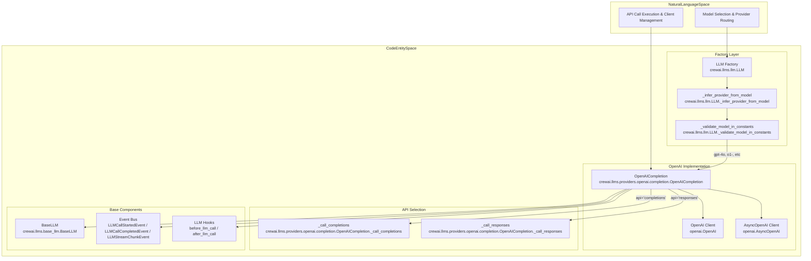
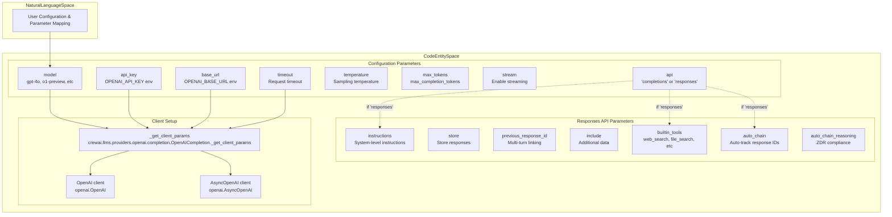
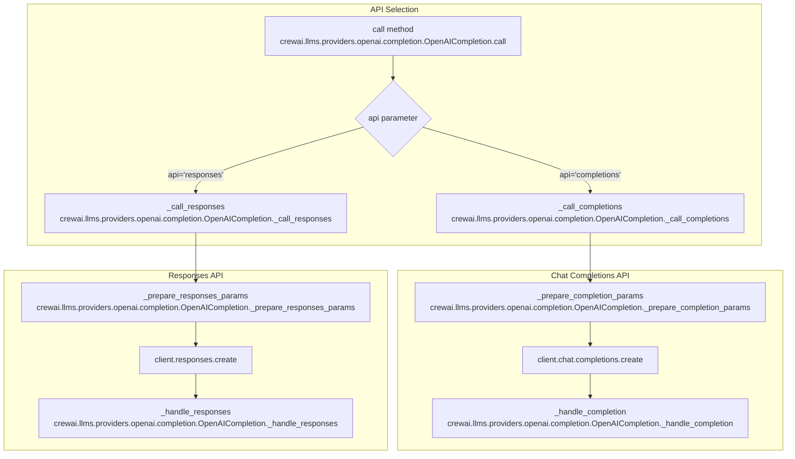
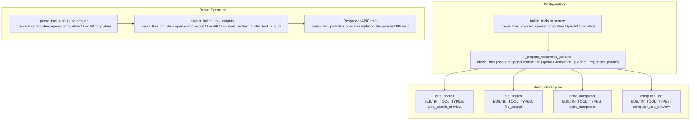
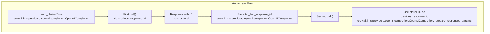

<!-- source: DeepWiki mcp.deepwiki.com · repo crewAIInc/crewAI · extra page OpenAI Provider · fetched 2026-10-26 -->

# OpenAI Provider

<details>
<summary>Relevant source files</summary>

The following files were used as context for generating this wiki page:

- [docs/edge/ar/concepts/llms.mdx](docs/edge/ar/concepts/llms.mdx)

</details>


The OpenAI Provider provides native integration with OpenAI's Python SDK, supporting both the Chat Completions API and the Responses API. This implementation offers direct access to OpenAI-specific features including built-in tools (web search, file search, code interpreter), stateful multi-turn conversations, and Zero Data Retention (ZDR) compliance for reasoning models.

## Architecture Overview

The `OpenAICompletion` class provides the native implementation for OpenAI models, extending the `BaseLLM` abstract base class. The implementation is automatically selected by the LLM factory when using OpenAI model identifiers.



**Diagram: OpenAI Provider Architecture**

Sources: [lib/crewai/src/crewai/llms/providers/openai/completion.py:149-264](), [lib/crewai/src/crewai/llms/base_llm.py:85-175]()

## Initialization and Configuration

The `OpenAICompletion` class is instantiated through the LLM factory or directly. Configuration includes API credentials, client parameters, and model-specific settings.



**Diagram: OpenAI Configuration Flow**

### Basic Initialization

```python
from crewai import LLM

# Automatic provider inference
llm = LLM(model="gpt-4o")

# Advanced configuration with detailed parameters
llm = LLM(
    model="openai/gpt-4o",
    temperature=0.7,
    timeout=120,
    max_tokens=4000,
    api_key="sk-...",
    reasoning_effort="medium"  # For o1 models
)
```

### Client Parameters

| Parameter | Type | Description | Default |
|-----------|------|-------------|---------|
| `model` | `str` | Model identifier (gpt-4o, o1-preview, etc) | `"gpt-4o"` |
| `api_key` | `str` | OpenAI API key | `OPENAI_API_KEY` env |
| `base_url` | `str` | Custom API base URL | `OPENAI_BASE_URL` env |
| `organization` | `str` | OpenAI organization ID | `None` |
| `project` | `str` | OpenAI project ID | `None` |
| `timeout` | `float` | Request timeout in seconds | `None` |
| `max_retries` | `int` | Maximum retry attempts | `2` |

### Completion Parameters

| Parameter | Type | Description | Default |
|-----------|------|-------------|---------|
| `temperature` | `float` | Sampling temperature (0-2) | `None` |
| `top_p` | `float` | Nucleus sampling parameter | `None` |
| `max_tokens` | `int` | Maximum tokens (legacy) | `None` |
| `max_completion_tokens` | `int` | Maximum completion tokens (for newer models) | `None` |
| `stream` | `bool` | Enable streaming responses | `False` |
| `reasoning_effort` | `str` | Effort for o1 models: low, medium, high | `None` |

Sources: [docs/edge/ar/concepts/llms.mdx:148-172](), [lib/crewai/src/crewai/llms/providers/openai/completion.py:186-248](), [lib/crewai/src/crewai/llms/providers/openai/completion.py:332-359]()

## Chat Completions API vs Responses API

OpenAI offers two API primitives: the traditional Chat Completions API and the newer Responses API. The `api` parameter determines which is used.



**Diagram: API Selection and Features**

### Chat Completions API (Default)

The traditional API supporting custom function calling and streaming. It is the standard interface for most GPT models.

### Responses API

The newer API with built-in tools and stateful conversations. It supports specific features like `web_search` and `file_search` natively. The Responses API is designed for multimodal native support, including text, images, and audio as core components.

Sources: [lib/crewai/src/crewai/llms/providers/openai/completion.py:149-177](), [lib/crewai/src/crewai/llms/providers/openai/completion.py:361-428](), [lib/crewai/src/crewai/llms/providers/openai/completion.py:618-738](), [docs/edge/ar/concepts/llms.mdx:191-193]()

## Built-in Tools (Responses API)

The Responses API provides access to OpenAI's built-in tools without requiring external implementations.



**Diagram: Built-in Tools Architecture**

### ResponsesAPIResult Structure

The `ResponsesAPIResult` dataclass provides structured access to tool outputs including `web_search_results`, `file_search_results`, and `code_interpreter_results`.

Sources: [lib/crewai/src/crewai/llms/providers/openai/completion.py:112-147](), [lib/crewai/src/crewai/llms/providers/openai/completion.py:1074-1156]()

## Auto-chaining for Multi-turn Conversations

The `auto_chain` feature automatically tracks and uses response IDs to maintain stateful conversations. When enabled, the provider stores the `_last_response_id` and injects it as `previous_response_id` in subsequent calls.



Sources: [lib/crewai/src/crewai/llms/providers/openai/completion.py:219](), [lib/crewai/src/crewai/llms/providers/openai/completion.py:294-310](), [lib/crewai/src/crewai/llms/providers/openai/completion.py:669-671](), [lib/crewai/src/crewai/llms/providers/openai/completion.py:795-796]()

## Zero Data Retention (ZDR) Compliance

The `auto_chain_reasoning` feature enables Zero Data Retention compliance for reasoning models by preserving encrypted reasoning content. It extracts reasoning items using `_extract_reasoning_items` and prepends them to the input of the next call to preserve the chain-of-thought without unencrypted server storage.

Sources: [lib/crewai/src/crewai/llms/providers/openai/completion.py:169-177](), [lib/crewai/src/crewai/llms/providers/openai/completion.py:648-651](), [lib/crewai/src/crewai/llms/providers/openai/completion.py:799-802](), [lib/crewai/src/crewai/llms/providers/openai/completion.py:1158-1185]()

## Streaming and Usage Tracking

The provider supports streaming responses via `LLMStreamChunkEvent`. Token usage is tracked internally using `_track_token_usage_internal` and can be retrieved via `get_usage_metrics()`.

Sources: [lib/crewai/src/crewai/llms/base_llm.py:541-567](), [lib/crewai/src/crewai/llms/base_llm.py:578-623](), [lib/crewai/src/crewai/llms/providers/openai/completion.py:1385-1514]()

---

