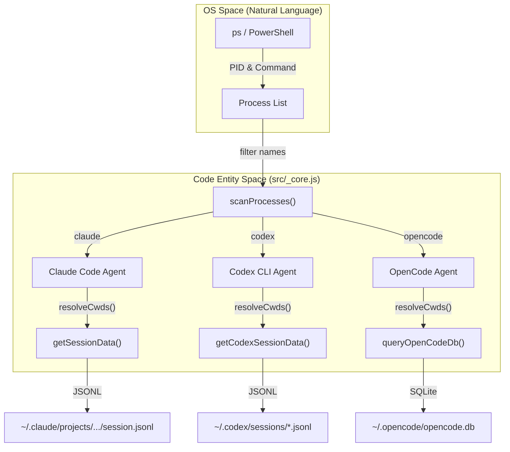
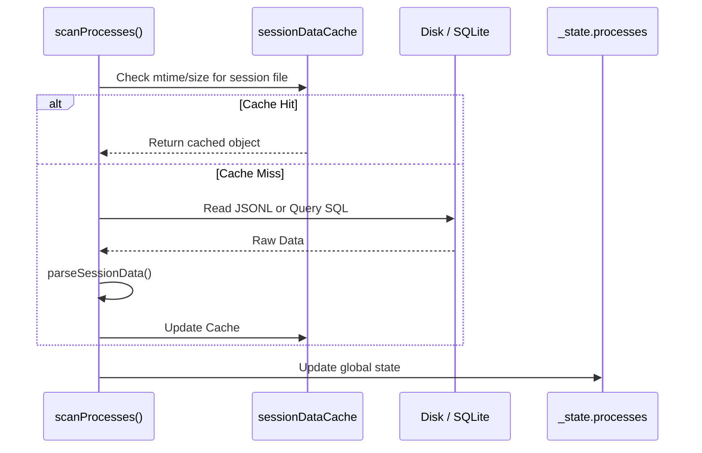

<!-- source: DeepWiki mcp.deepwiki.com · repo aakashadesara/ctop · page 1.2 Supported AI Agents · fetched 2026-10-26 -->

# Supported AI Agents

Relevant source files

The following files were used as context for generating this wiki page:

- [README.md](README.md)
- [docs/claude-icon.png](docs/claude-icon.png)
- [docs/codex-icon.png](docs/codex-icon.png)
- [src/_core.js](src/_core.js)
- [test/animations.test.js](test/animations.test.js)
- [test/caching.test.js](test/caching.test.js)

`ctop` provides real-time monitoring for three primary AI coding agents: **Claude Code**, **Codex CLI**, and **OpenCode**. Each agent is detected via its process name and enriched with metadata extracted from its specific local data store [README.md:108-111]().

## Agent Detection and Mapping

The detection engine scans the system process list (using `ps` on Unix or `Get-Process` on Windows) to identify active agent instances [src/_core.js:1015-1031](). Once a process is identified, `ctop` resolves its Current Working Directory (CWD) and maps it to the corresponding session file or database [src/_core.js:1086-1110]().

### Detection Logic Flow

The following diagram illustrates how the `scanProcesses` function bridges the gap between OS-level process IDs and the agent-specific data entities.

**Diagram: Process to Entity Mapping**

Sources: [src/_core.js:1015-1031](), [src/_core.js:1086-1110](), [README.md:108-111]()

---

## Supported Agent Types

### 1. Claude Code
Claude Code sessions are identified by the `claude` process name. Metadata is stored in a `session.jsonl` file located within a project-specific directory under the user's home folder [src/_core.js:1141-1143]().

*   **Detection Pattern:** Processes matching `/claude/i` [src/_core.js:1020]().
*   **Data Location:** `~/.claude/projects/<project-dir-name>/session.jsonl` [src/_core.js:1141-1143]().
*   **Format:** JSONL (JSON Lines).
*   **Parsing Logic:** `getSessionData(filePath)` reads the file to extract the session title (summary), model name, and token usage [src/_core.js:1138-1175](). It uses a dual-buffer approach to parse the file from both the beginning (for metadata) and the end (for the latest token counts) [src/_core.js:1150-1170]().

### 2. Codex CLI
Codex CLI sessions are identified by the `codex` process name. Unlike Claude, Codex stores session metadata in a centralized sessions directory where filenames often contain the session ID [src/_core.js:1248-1250]().

*   **Detection Pattern:** Processes matching `/codex/i` [src/_core.js:1021]().
*   **Data Location:** `~/.codex/sessions/` [src/_core.js:1248]().
*   **Format:** JSONL.
*   **Parsing Logic:** `getCodexSessionData(filePath)` scans the session file for lines with `type: "session_meta"` to resolve the session ID and CWD [src/_core.js:1247-1275]().

### 3. OpenCode
OpenCode sessions are identified by the `opencode` process name. This agent uses a SQLite database for persistence rather than flat files [src/_core.js:1322-1324]().

*   **Detection Pattern:** Processes matching `/opencode/i` [src/_core.js:1022]().
*   **Data Location:** `~/.opencode/opencode.db` [src/_core.js:1322]().
*   **Format:** SQLite.
*   **Parsing Logic:** `queryOpenCodeDb(dbPath, pid)` executes SQL queries to retrieve session information, including the project path, active branch, and model details [src/_core.js:1321-1350]().

---

## Technical Comparison

The following table summarizes the implementation details for each agent type as defined in the `_core.js` enrichment pipeline.

| Feature | Claude Code | Codex CLI | OpenCode |
| :--- | :--- | :--- | :--- |
| **Process Match** | `claude` | `codex` | `opencode` |
| **Data Source** | `session.jsonl` | `*.jsonl` | `opencode.db` |
| **Storage Type** | File-per-project | File-per-session | Central SQLite |
| **Parsing Function** | `getSessionData` | `getCodexSessionData` | `queryOpenCodeDb` |
| **CWD Resolution** | `lsof` / `/proc` | Metadata payload | SQL Query |
| **Token Tracking** | `readSessionLog` | `readSessionLog` | SQL Aggregation |

Sources: [src/_core.js:1138-1175](), [src/_core.js:1247-1275](), [src/_core.js:1321-1350](), [src/_core.js:1015-1031]()

---

## Data Flow: From File to UI

`ctop` uses a caching layer to ensure that expensive disk I/O and SQLite queries do not block the 30 FPS TUI rendering loop [test/animations.test.js:14-16]().

**Diagram: Data Enrichment Pipeline**

### Key Functions
*   **`readSessionLog(proc, limit)`**: Tail-reads the last 64KB of a session's JSONL file to provide the live log view (`L` key) without loading the entire history into memory [test/caching.test.js:94-122]().
*   **`updateTokenRates()`**: Calculates the delta between the current and previous token counts to render the token activity sparkline [src/_core.js:2010-2030]().

Sources: [src/_core.js:1138-1175](), [test/caching.test.js:10-44](), [test/caching.test.js:94-122](), [test/animations.test.js:14-20]()

---

