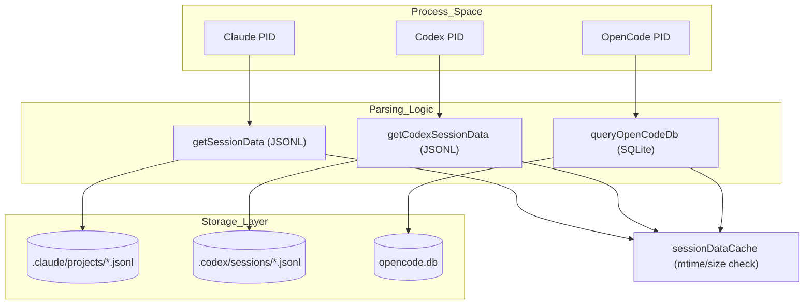
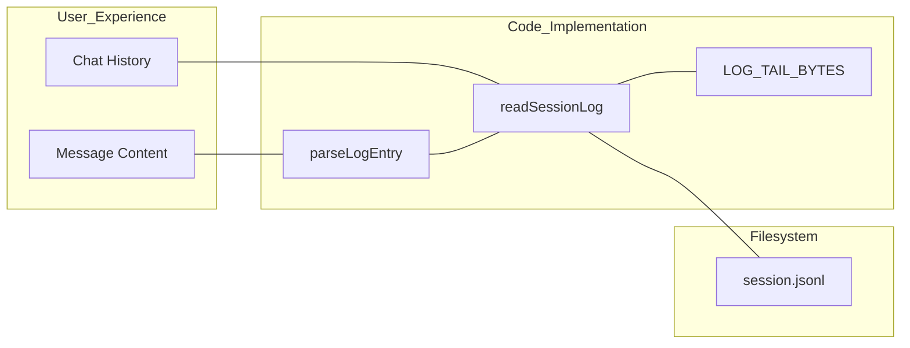

<!-- source: DeepWiki mcp.deepwiki.com · repo aakashadesara/ctop · page 2.2 Session Data Parsing · fetched 2026-10-26 -->

# Session Data Parsing

Relevant source files

The following files were used as context for generating this wiki page:

- [src/_core.js](src/_core.js)
- [src/session.js](src/session.js)
- [test/animations.test.js](test/animations.test.js)
- [test/caching.test.js](test/caching.test.js)
- [test/config.test.js](test/config.test.js)
- [test/log-tailing.test.js](test/log-tailing.test.js)
- [test/session.test.js](test/session.test.js)

This page provides a deep dive into how `ctop` extracts structured information and chat history from various AI agent session formats. The system uses a multi-layered approach involving dual-buffer JSONL parsing, SQLite querying, and a high-performance caching layer to ensure the TUI remains responsive even when monitoring dozens of active sessions.

## Overview of Parsing Pipeline

The parsing pipeline is triggered during the main refresh cycle. Once the **Process Detection Engine** resolves a PID to a specific session file or database, the parsing modules extract metrics (tokens, model, cost) and log history.

### Data Flow: PID to Session Metrics
1.  **Discovery**: `resolveCwds` maps PIDs to working directories [src/_core.js:1260-1285]().
2.  **Mapping**: `getSessionFilesForProject` locates the relevant `.jsonl` or `.db` files within the agent's data directory [src/_core.js:1545-1570]().
3.  **Parsing**: The specific parser (`getSessionData`, `getCodexSessionData`, or `queryOpenCodeDb`) is invoked [src/_core.js:1450-1540]().
4.  **Caching**: The `sessionDataCache` stores results indexed by file path and validated by `mtime` and `size` [src/_core.js:1455-1465]().

**Sources:** `src/_core.js`, `src/session.js`

## Claude Code: JSONL Dual-Buffer Parsing

Claude Code sessions are stored in `.jsonl` files within `~/.claude/projects/`. Because these files can grow quite large, `ctop` employs a "dual-buffer" strategy in `getSessionData` to extract both the start of the session (for titles) and the end of the session (for the latest metrics).

### Implementation Details
*   **Title Extraction**: `getSessionData` looks for a `summary` field in the JSON lines [src/_core.js:1480-1485](). If missing, it parses the first `user` message, skipping XML-like system instructions (e.g., messages starting with `<`) [test/session.test.js:86-101]().
*   **Metric Extraction**: It scans the final lines for an `assistant` message containing a `usage` object. This object provides `input_tokens`, `cache_creation_input_tokens`, `cache_read_input_tokens`, and `output_tokens` [test/session.test.js:103-141]().
*   **Context Calculation**: Context percentage is derived by comparing the sum of input and cache tokens against the `contextLimit` (default 1M) [src/_core.js:1505-1515]().

### Natural Language Space to Code Entity Space (Claude)

| Concept | Code Entity (Function/Variable) | File Reference |
| :--- | :--- | :--- |
| Session File Discovery | `getSessionFilesForProject` | [src/_core.js:1545]() |
| Main Parser | `getSessionData` | [src/_core.js:1450]() |
| Log Line Processor | `parseLogEntry` | [src/_core.js:1740]() |
| Context Math | `contextLimit` | [src/_core.js:148]() |

**Sources:** `src/_core.js`, `test/session.test.js`

## Codex and OpenCode Parsing

While Claude uses JSONL, other agents require different handling:

*   **Codex CLI**: Parsed via `getCodexSessionData`. It looks for `session_meta` lines in JSONL to extract the session ID and CLI version [test/caching.test.js:61-65]().
*   **OpenCode**: Uses `queryOpenCodeDb` to interface with a local SQLite database. It retrieves the latest session metrics and model identifiers using `better-sqlite3` (if available) or falling back to a shell-out to `sqlite3`.

### Diagram: Multi-Agent Parsing Pipeline

**Sources:** `src/_core.js`, `test/caching.test.js`

## Log Tailing and Partial-Line Handling

`readSessionLog` is responsible for fetching the chat history displayed in the Pane View. To prevent memory exhaustion, it does not read the entire file.

### The Tail-Read Algorithm
1.  **Buffer Allocation**: A buffer of `LOG_TAIL_BYTES` (default 64KB) is allocated [test/caching.test.js:122-147]().
2.  **Offset Seek**: The function reads only the last 64KB of the session file.
3.  **Partial Line Drop**: Since the 64KB boundary likely cuts through a JSON line, the first (potentially incomplete) line in the buffer is discarded [test/caching.test.js:122-160]().
4.  **JSON Sanitization**: Each line is parsed via `parseLogEntry`, which handles:
    *   Converting array-based content (text blocks) into strings [test/log-tailing.test.js:26-39]().
    *   Filtering out `tool_use` and `tool_result` blocks [test/log-tailing.test.js:41-53]().
    *   Replacing newlines with spaces for single-line TUI display [test/log-tailing.test.js:92-98]().

### Natural Language Space to Code Entity Space (Logs)

**Sources:** `src/_core.js`, `test/log-tailing.test.js`, `test/caching.test.js`

## Caching Layer (mtime/size)

To maintain a 30 FPS UI, `ctop` avoids redundant disk I/O. The `sessionDataCache` and `sessionLogCache` use a composite key of the file path, modified time (`mtimeMs`), and file `size`.

| Cache Name | Key | Value | Invalidation |
| :--- | :--- | :--- | :--- |
| `sessionDataCache` | `filePath` | Parsed metadata object | `mtimeMs` or `size` change [test/caching.test.js:32-43]() |
| `sessionLogCache` | `filePath` | Array of log entries | `mtimeMs` or `size` change [test/caching.test.js:188-200]() |
| `pidCwdCache` | `PID` | Resolved CWD string | Pruned when PID is no longer active [src/_core.js:1275]() |

**Sources:** `src/_core.js`, `test/caching.test.js`

---

