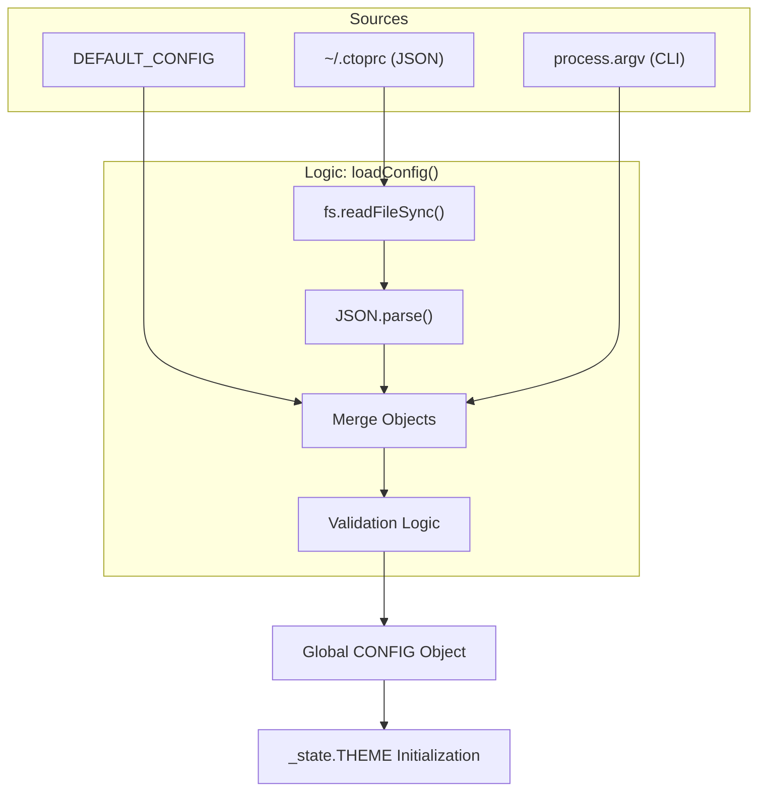
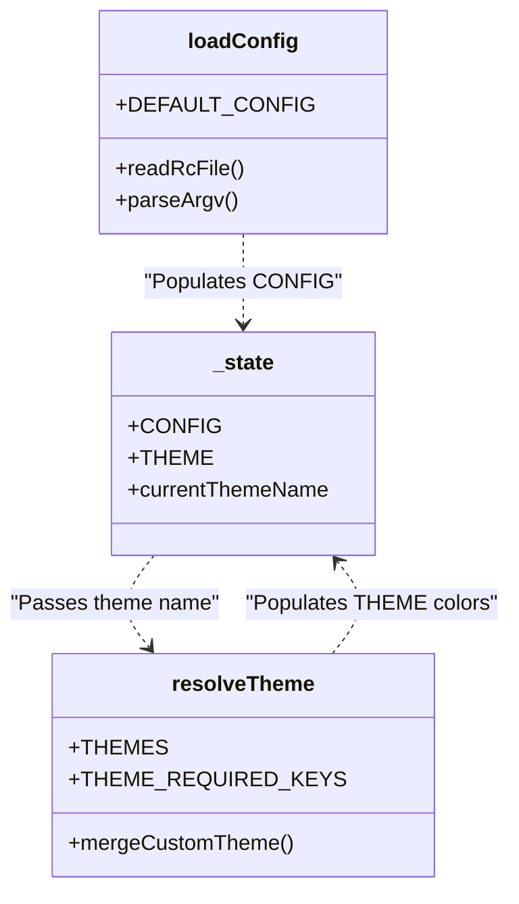

<!-- source: DeepWiki mcp.deepwiki.com · repo aakashadesara/ctop · page 2.4 Configuration System · fetched 2026-10-26 -->

# Configuration System

Relevant source files

The following files were used as context for generating this wiki page:

- [claude-manager](claude-manager)
- [src/config.js](src/config.js)
- [test/boot.test.js](test/boot.test.js)
- [test/config.test.js](test/config.test.js)
- [test/history.test.js](test/history.test.js)
- [test/search.test.js](test/search.test.js)
- [test/session.test.js](test/session.test.js)
- [test/themes.test.js](test/themes.test.js)

The configuration system in `ctop` employs a hierarchical three-layer resolution strategy to determine the application's behavior. It merges hardcoded defaults with user-defined persistent settings and transient command-line overrides.

## Configuration Resolution Hierarchy

The configuration is resolved during the application boot sequence via the `loadConfig` function. The resolution follows a strict priority order where later layers override earlier ones:

1.  **`DEFAULT_CONFIG`**: Hardcoded fallback values defined in the source code.
2.  **`~/.ctoprc`**: A user-specific JSON configuration file located in the home directory.
3.  **CLI Flags**: Arguments passed to the process at runtime (e.g., `--no-animation` or `--theme`).

### Data Flow Diagram

The following diagram illustrates how the `loadConfig` function aggregates data from various sources into the final `CONFIG` object used by the `_state` and rendering engine.

**Configuration Resolution Flow**

**Sources:** [src/_core.js:1-100](), [test/config.test.js:8-19]()

## Supported Configuration Keys

The system supports several keys that control the TUI behavior, performance characteristics, and visual aesthetics.

| Key | Type | Default | Description |
| :--- | :--- | :--- | :--- |
| `refreshInterval` | `Number` | `5000` | The interval in milliseconds between process scans and TUI updates. [test/config.test.js:15-15]() |
| `contextLimit` | `Number` | `1000000` | The maximum token limit used to calculate the `contextPct` (context window usage). [test/config.test.js:16-16]() |
| `defaultView` | `String` | `'list'` | The initial view mode (`'list'` or `'pane'`). [test/config.test.js:17-17]() |
| `theme` | `String` | `'default'` | The UI color scheme (e.g., `dracula`, `minimal`, `monokai`). [test/config.test.js:18-18]() |
| `bootAnimation` | `Boolean` | `true` | Whether to display the ASCII boot animation on startup. [test/boot.test.js:8-11]() |
| `notifications` | `Boolean` | `true` | Enables/disables OS-level notifications for agent state changes. |
| `contextBarStyle` | `String` | `'braille'` | Visual style for context bars (`'braille'` or `'solid'`). |

**Sources:** [src/_core.js:50-80](), [test/config.test.js:13-28]()

## Implementation Details

### Validation and Sanitization
The `loadConfig` function performs basic validation to ensure the TUI does not crash due to unsupported configuration values. If an invalid value is provided in `~/.ctoprc`, the system reverts to the `DEFAULT_CONFIG` value for that specific key.

*   **Theme Validation**: If the `theme` key in `.ctoprc` does not match one of the keys in the `THEMES` object, it defaults to `'default'`. [test/config.test.js:88-93]()
*   **View Validation**: If `defaultView` is set to an unsupported string (anything other than `list` or `pane`), it defaults to `list`. [test/config.test.js:81-86]()

### Theming System Integration
The configuration system directly feeds into the `resolveTheme` function. This function takes the theme name from the config and maps it to a set of ANSI escape codes.

**Theme Resolution Entity Map**

**Sources:** [test/themes.test.js:47-85](), [src/config.js:1-8]()

### CLI Override Logic
Command-line flags are parsed manually within `loadConfig` by inspecting `process.argv`. For example, the presence of `--no-animation` explicitly sets `bootAnimation` to `false`, regardless of the settings in `~/.ctoprc`.

**Sources:** [test/boot.test.js:55-68](), [src/_core.js:120-140]()

## Persistence
The `~/.ctoprc` file is expected to be a valid JSON object. While `ctop` reads this file on every startup, it does not currently provide an "in-app" method to save configuration changes back to the file (e.g., changing a theme via the palette is volatile and lasts only for the current session).

**Sources:** [test/config.test.js:30-51](), [src/_core.js:150-160]()

---

