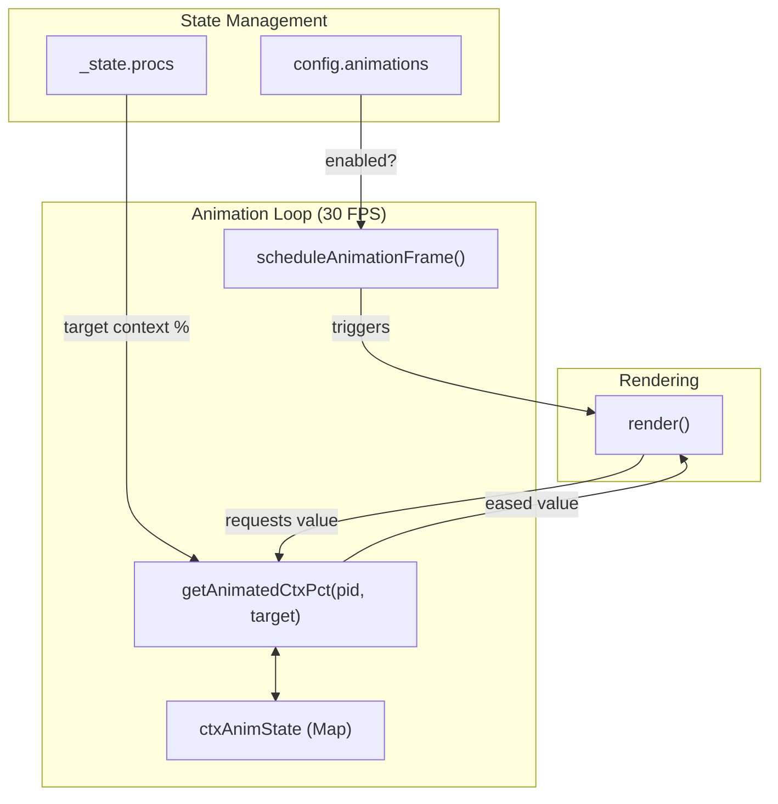
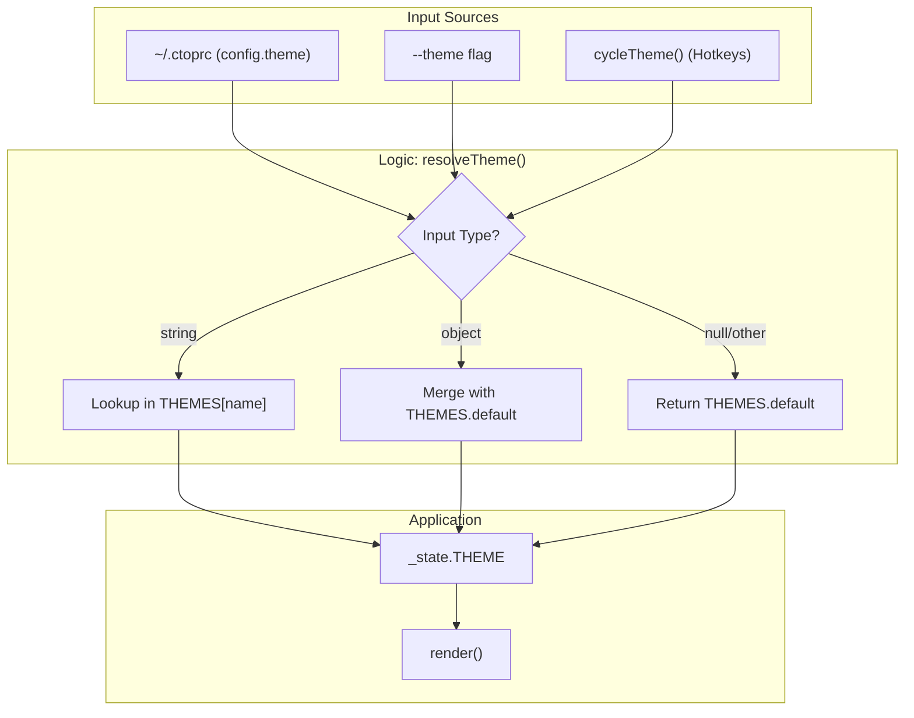

<!-- source: DeepWiki mcp.deepwiki.com · repo aakashadesara/ctop · page 3.3 Animation and Theming · fetched 2026-10-26 -->

# Animation and Theming

<details>
<summary>Relevant source files</summary>

The following files were used as context for generating this wiki page:

- [claude-manager](claude-manager)
- [src/_core.js](src/_core.js)
- [src/colors.js](src/colors.js)
- [test/animations.test.js](test/animations.test.js)
- [test/caching.test.js](test/caching.test.js)
- [test/history.test.js](test/history.test.js)
- [test/search.test.js](test/search.test.js)
- [test/themes.test.js](test/themes.test.js)

</details>


The `ctop` TUI utilizes a high-frequency animation loop to provide smooth visual transitions for context usage bars and selection highlights. This system is decoupled from the primary data refresh cycle (which defaults to 5 seconds) to ensure a responsive interface. The look and feel are controlled by a flexible theming engine that supports both built-in presets and custom color configurations.

### Animation System

The animation system operates at a target 30 FPS, managed by a recursive scheduling function. It primarily handles the interpolation of context window percentages and the visual "pulse" or movement of the selection cursor.

#### The Animation Loop
The loop is initialized and managed through `scheduleAnimationFrame`. It checks the `config.animations` flag before execution. If animations are disabled in `~/.ctoprc`, the loop does not run, and UI elements snap immediately to their target values.

*   **`ANIM_FPS`**: Fixed at 30 [test/animations.test.js:15-15]().
*   **`ANIM_FRAME_MS`**: Calculated as `Math.floor(1000 / 30)`, approximately 33ms per frame [test/animations.test.js:18-20]().
*   **`_state.animationTimer`**: Holds the reference to the current `setTimeout`, allowing the loop to be halted via `clearAnimationTimer` [test/animations.test.js:108-112]().

#### Easing and Interpolation
The function `getAnimatedCtxPct` is the core of the visual smoothing for context bars. It uses a linear interpolation (lerp) approach to move a PID's current displayed percentage toward its actual target value.

| Behavior | Logic |
| :--- | :--- |
| **First Call** | Returns the target immediately and initializes `ctxAnimState` for the PID [test/animations.test.js:37-48](). |
| **Subsequent Calls** | Returns a value between `current` and `target` using a 0.3 easing factor [test/animations.test.js:65-73](). |
| **Snapping** | If the difference between `current` and `target` is `< 1`, it snaps to the target to prevent infinite micro-adjustments [test/animations.test.js:75-84](). |

#### Animation State Flow
The following diagram illustrates how the animation loop interacts with the global state to update the TUI.

**TUI Animation Data Flow**

Sources: [src/_core.js:146-155](), [test/animations.test.js:37-97]()

---

### Theming Engine

The theming engine defines the color palette for all TUI elements, including headers, process statuses, context bars, and cost metrics.

#### Built-in Themes
`ctop` includes five pre-defined themes [src/_core.js:39-70]():
1.  **`default`**: High-contrast with orange headers and green/yellow/red status indicators.
2.  **`minimal`**: Grayscale-focused with subtle dim accents.
3.  **`dracula`**: Based on the popular Dracula color scheme (purples and pinks).
4.  **`solarized`**: Based on Solarized Dark (blues and yellows).
5.  **`monokai`**: Based on the Monokai palette (vibrant greens and pinks).

#### Theme Structure
Every theme must implement the keys defined in `THEME_REQUIRED_KEYS` [src/_core.js:73-73]().

| Key | Purpose |
| :--- | :--- |
| `header` / `headerBg` | Style for the top status bar and column headers. |
| `selection` | Background color for the currently selected row. |
| `active` / `stopped` / `zombie` | Colors for process lifecycle states. |
| `ctxLow` / `ctxMed` / `ctxHigh` / `ctxOk` | Color thresholds for the context usage bar. |
| `border` / `accent` | Colors for UI separators and highlighted text. |

#### Theme Resolution and Cycling
*   **`resolveTheme(value)`**: Validates and merges theme configurations. If a string is provided, it looks up a built-in theme. If an object is provided, it merges it with the `default` theme to ensure no required keys are missing [src/_core.js:75-83]().
*   **`cycleTheme()`**: Iterates through the `THEME_NAMES` array, updating `_state.THEME` and `_state.currentThemeName` in real-time. This is typically triggered by the `T` key in the TUI [test/themes.test.js:100-133]().
*   **`ctxColor(pct)`**: A helper that maps a context percentage to a theme color (`ctxLow` for <10%, `ctxMed` for 10-39%, `ctxHigh` for 40-69%, and `ctxOk` for >=70%) [test/themes.test.js:135-163]().

**Theme Resolution Logic**

Sources: [src/_core.js:75-83](), [src/colors.js:1-11](), [test/themes.test.js:47-85]()

### Configuration
Theming and animation settings are persisted in `~/.ctoprc`.

```json
{
  "theme": "dracula",
  "animations": true,
  "bootAnimation": true
}
```
[src/_core.js:146-181]()

Sources:
- `src/_core.js`: Implementation of `THEMES`, `resolveTheme`, and `DEFAULT_CONFIG`.
- `src/colors.js`: Public API for theme constants and resolution.
- `test/animations.test.js`: Detailed behavior of the animation loop and easing logic.
- `test/themes.test.js`: Validation of built-in themes and color mapping logic.

---

