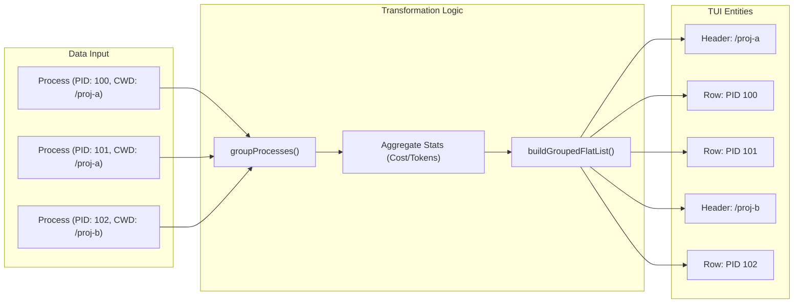

<!-- source: DeepWiki mcp.deepwiki.com · repo aakashadesara/ctop · page 4.2 Command Palette and Filter/Sort · fetched 2026-10-26 -->

# Command Palette and Filter/Sort

<details>
<summary>Relevant source files</summary>

The following files were used as context for generating this wiki page:

- [src/input.js](src/input.js)
- [test/filter-sort.test.js](test/filter-sort.test.js)
- [test/format.test.js](test/format.test.js)
- [test/grouping.test.js](test/grouping.test.js)
- [test/palette.test.js](test/palette.test.js)
- [test/token-rate.test.js](test/token-rate.test.js)

</details>


The Command Palette and Filter/Sort systems provide the primary mechanisms for navigating and managing large numbers of AI agent sessions within `ctop`. The command palette offers a fuzzy-searchable interface for global actions, while the filter/sort pipeline enables real-time data transformation for the process list.

## Command Palette (`showPalette`)

The command palette is a modal interface triggered by the `P` key (or via mouse interaction). It allows users to execute commands by typing partial strings, which are matched against available actions using a fuzzy search algorithm.

### Available Actions
The palette exposes several core actions defined in the `COMMANDS` array:
*   **Kill / Force-kill**: Terminates the selected agent process using `SIGTERM` (-15) or `SIGKILL` (-9).
*   **Refresh**: Manually triggers the poll-enrich-render cycle.
*   **Theme**: Cycles through the five built-in TUI color schemes.
*   **Export**: Saves the current session data to Markdown, JSON, or CSV.

### Implementation Details
The palette logic relies on two primary functions for search and ranking:
1.  **`fuzzyMatch`**: Checks if characters in the query appear in the target string in the correct order [test/palette.test.js:5-37]().
2.  **`fuzzyScore`**: Calculates a numerical score where prefix matches and consecutive character matches are weighted more heavily [test/palette.test.js:39-65]().

The `filterCommands` function uses these to return a list of up to 10 matching commands, sorted by relevance [test/palette.test.js:67-116]().

**Sources:** [test/palette.test.js:1-117](), [src/input.js:1-11]()

---

## Filter and Sort Pipeline

The `applySortAndFilter` function acts as the controller for the TUI's data display. It processes the raw `allProcesses` array from the global `_state` and populates the `processes` array used for rendering.

### Filtering (`filterMode`)
Filtering is case-insensitive and checks the `filterText` against multiple process attributes:
*   **Git Branch**: Matches the current branch name.
*   **Model**: Matches the AI model identifier (e.g., "sonnet").
*   **CWD**: Matches the directory path.
*   **Slug/Title**: Matches session identifiers or user-defined titles.

### Sorting (`SORT_MODES`)
The system supports several sorting modes, which can be toggled or reversed via keyboard shortcuts:
| Mode | Logic |
| :--- | :--- |
| `age` | Default. Sorts by `startDate` (oldest first). |
| `cpu` | Sorts by CPU usage percentage (highest first). |
| `mem` | Sorts by memory usage (highest first). |
| `context` | Sorts by remaining context window percentage (lowest/most-used first). |

**Sources:** [test/filter-sort.test.js:21-186]()

---

## Grouping and Path Normalization

To improve readability in the List View, `ctop` groups processes by their Working Directory (CWD).

### Process Grouping
The `groupProcesses` function aggregates individual PIDs into logical project groups. It calculates aggregate statistics for each group, including `totalCost`, `totalTokens`, and `activeCount` [test/grouping.test.js:30-132]().
*   Processes with identical `cwd` are merged.
*   Processes without a resolvable CWD are placed in an "unknown" group [test/grouping.test.js:93-103]().
*   Groups are sorted by `totalCost` in descending order by default [test/grouping.test.js:105-115]().

### Flat List Construction
`buildGroupedFlatList` transforms the hierarchical group data back into a flat array of "items" for the TUI renderer. This allows the list to contain both "group header" rows and "process" rows, ensuring child processes always appear immediately under their respective headers [test/grouping.test.js:152-184]().

### Path Shortening
The `shortenCwd` utility improves UI density by replacing the user's home directory path with the `~` symbol [test/grouping.test.js:134-150]().

**Sources:** [test/grouping.test.js:1-184]()

---

## Data Flow: Interaction to State

The following diagram illustrates how user input through the Command Palette or Filter interface flows through the system to update the rendered state.

### Input Processing Flow
Title: "Input and Filter Data Flow"
```mermaid
graph TD
    subgraph "Natural Language Space"
        "User types 'kill'" --> "Fuzzy Query"
        "User types 'feature/'" --> "Filter String"
    end

    subgraph "Code Entity Space"
        "Fuzzy Query" --> "fuzzyScore()"
        "fuzzyScore()" --> "filterCommands()"
        "filterCommands()" --> "COMMANDS[]"
        
        "Filter String" --> "applySortAndFilter()"
        "applySortAndFilter()" --> "_state.filterText"
        "_state.filterText" --> "_state.processes[]"
        
        "COMMANDS[]" -- "Execute" --> "Action Handler"
        "Action Handler" --> "buildKillCommand()"
        "Action Handler" --> "cycleTheme()"
    end
```
**Sources:** [test/palette.test.js:3-116](), [test/filter-sort.test.js:21-106](), [src/input.js:1-10]()

---

## Process Aggregation Logic

The relationship between raw process data and the grouped display list is managed by the grouping pipeline.

### Grouping and Flattening Pipeline
Title: "Process Grouping and Flat List Pipeline"

**Sources:** [test/grouping.test.js:30-91](), [test/grouping.test.js:152-184]()

---

