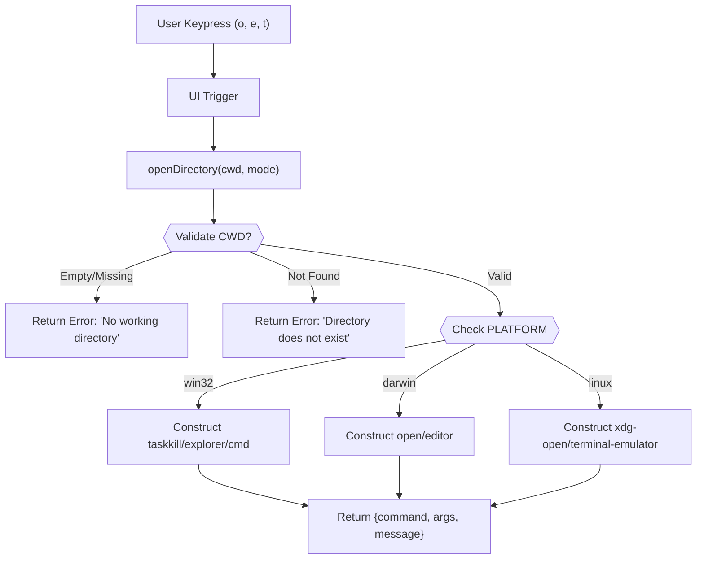
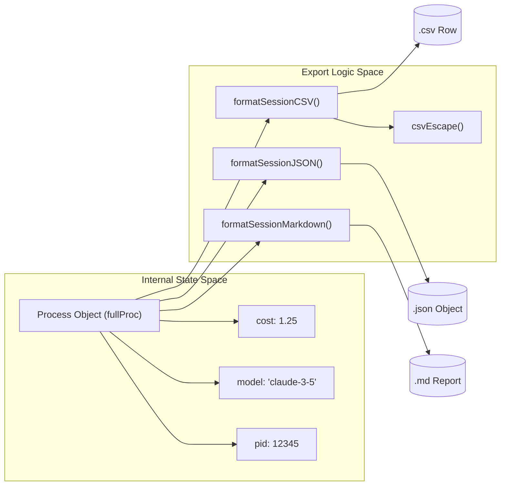

<!-- source: DeepWiki mcp.deepwiki.com · repo aakashadesara/ctop · page 4.3 Quick Jump and Session Export · fetched 2026-10-26 -->

# Quick Jump and Session Export

Relevant source files

The following files were used as context for generating this wiki page:

- [src/input.js](src/input.js)
- [test/export.test.js](test/export.test.js)
- [test/heatmap.test.js](test/heatmap.test.js)
- [test/quick-jump.test.js](test/quick-jump.test.js)
- [test/windows.test.js](test/windows.test.js)

The `ctop` TUI provides deep integration with the local development environment through "Quick Jump" capabilities—allowing users to instantly pivot from a monitored AI session to its source directory in a file explorer, code editor, or terminal. Additionally, it supports structured session data export for reporting and analysis.

## Quick Jump: `openDirectory`

The `openDirectory` function is the core utility for interacting with the host operating system to open project directories [src/input.js:8](). It abstracts platform-specific commands to provide a unified interface for three distinct modes: `finder`, `editor`, and `terminal`.

### Implementation Details
The function first validates that the target process has a resolved Working Directory (CWD). If the CWD is missing or the directory no longer exists on disk, it returns a descriptive error [test/quick-jump.test.js:19-58]().

| Mode | Purpose | Command (macOS) | Command (Linux) | Command (Windows) |
| :--- | :--- | :--- | :--- | :--- |
| `finder` | Open OS file manager | `open` | `xdg-open` | `explorer` |
| `editor` | Open in code editor | `$EDITOR` or `code` | `$EDITOR` or `code` | `$EDITOR` or `code` |
| `terminal` | Open new shell at path | `open -a Terminal` | `x-terminal-emulator`* | `cmd /c start` |

*\*Falls back to `gnome-terminal` or `xterm` if the emulator is unavailable [test/quick-jump.test.js:148-151]().*

### Editor Resolution
For `editor` mode, `ctop` prioritizes the user's environment via `process.env.EDITOR`. If this environment variable is unset, it defaults to `code` (Visual Studio Code) [test/quick-jump.test.js:75-109]().

### Windows Path Normalization
Because `ctop` tracks sessions across platforms, it includes specific logic in `cwdToProjectDirName` to normalize paths for session slug generation, replacing backslashes and removing drive colons (e.g., `C:\Users\dev` becomes `C-Users-dev`) [test/windows.test.js:80-104]().

**Quick Jump Command Flow**

**Sources:** [test/quick-jump.test.js:19-155](), [test/windows.test.js:80-128](), [src/input.js:8]()

---

## Session Export Formats

`ctop` allows users to export the current state of an AI agent session into three formats. These functions transform the internal process object (containing PID, model, tokens, and cost) into structured strings.

### 1. Markdown (`formatSessionMarkdown`)
Generates a human-readable report suitable for GitHub issues or documentation. It handles missing fields gracefully by substituting "unknown" or "N/A" and formats currency values (e.g., costs < $0.01 are shown as `<$0.01`) [test/export.test.js:28-75]().

### 2. JSON (`formatSessionJSON`)
Produces a machine-readable, pretty-printed (2-space indent) JSON string. It organizes token data into a nested `tokens` object containing `input`, `output`, `cacheCreate`, and `cacheRead` keys [test/export.test.js:77-112]().

### 3. CSV (`formatSessionCSV`)
Generates a single-row CSV (including headers) for spreadsheet ingestion. It utilizes a helper function `csvEscape` to ensure that directory paths or git branch names containing commas, double quotes, or newlines are correctly quoted and escaped [test/export.test.js:114-177]().

### Data Mapping Table

| Internal Property | Markdown Label | JSON Key | CSV Column |
| :--- | :--- | :--- | :--- |
| `pid` | **PID:** | `pid` | `pid` |
| `model` | **Model:** | `model` | `model` |
| `cost` | **Cost:** | `cost` | `cost` |
| `inputTokens` | `input` | `tokens.input` | `input_tokens` |
| `gitBranch` | **Branch:** | `branch` | `branch` |
| `cwd` | **Directory:** | `cwd` | `directory` |

**Export Logic and Entity Association**

**Sources:** [test/export.test.js:10-26](), [test/export.test.js:28-145](), [test/export.test.js:147-177]()

---

