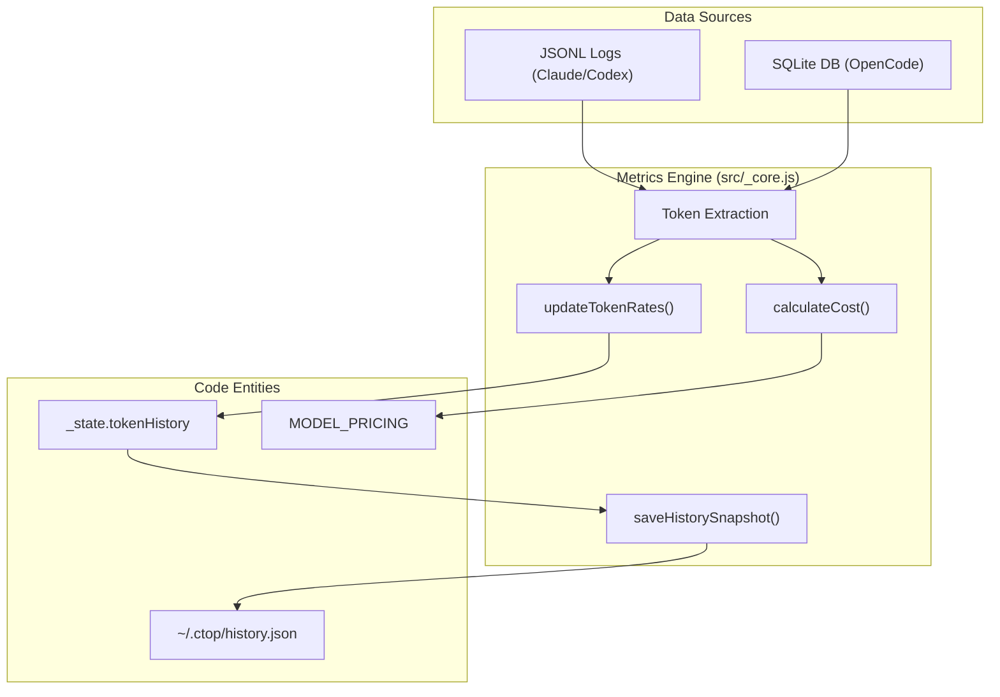
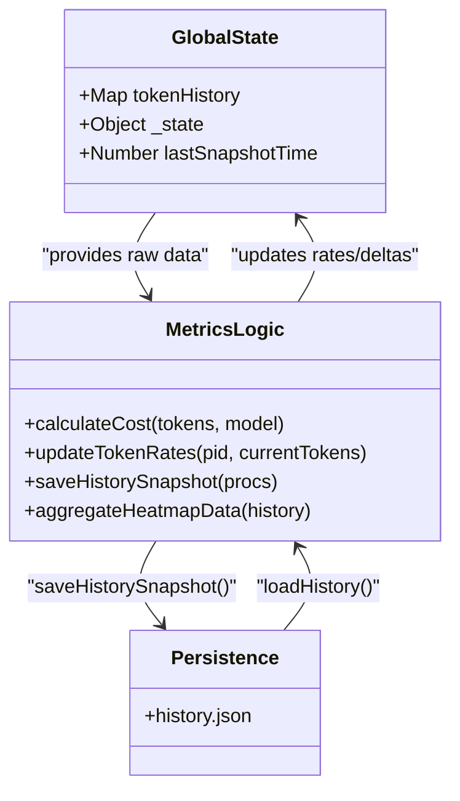

<!-- source: DeepWiki mcp.deepwiki.com · repo aakashadesara/ctop · page 5 Metrics and Cost Engine · fetched 2026-10-26 -->

# Metrics and Cost Engine

Relevant source files

The following files were used as context for generating this wiki page:

- [claude-manager](claude-manager)
- [src/_core.js](src/_core.js)
- [src/cost.js](src/cost.js)
- [test/animations.test.js](test/animations.test.js)
- [test/caching.test.js](test/caching.test.js)
- [test/history.test.js](test/history.test.js)
- [test/search.test.js](test/search.test.js)
- [test/themes.test.js](test/themes.test.js)

The **Metrics and Cost Engine** is the analytical core of `ctop`, responsible for transforming raw session logs and process data into actionable financial and performance insights. It tracks token consumption across four distinct categories, applies dynamic pricing models based on agent versions, and persists historical data to provide long-term usage trends.

### Architectural Overview

The engine operates as a post-processing stage in the **Poll-Enrich-Render** pipeline. After session data is parsed from JSONL or SQLite sources, it is passed through the metrics engine to compute costs and token rates before being stored in the global `_state` object.

"Metrics Engine Data Flow"

**Sources:** [src/_core.js:1-100](), [src/_core.js:1410-1450]()

---

### Key Subsystems

#### 1. Cost Calculation
`ctop` features a sophisticated pricing engine that accounts for the nuances of modern LLM billing, including prompt caching. It uses a prefix-matching algorithm to map model identifiers (e.g., `claude-3-7-sonnet-20250219`) to the correct rates in the `MODEL_PRICING` table.

*   **Formula:** Costs are calculated by summing the products of input, output, cache-read, and cache-creation tokens against their respective "per-million-token" rates.
*   **Visualization:** The `buildCostGauge` function generates a compact visual representation of a session's financial impact relative to other active sessions.

For details, see [Cost Calculation](#5.1).

**Sources:** [src/cost.js:1-9](), [src/_core.js:1250-1310]()

#### 2. Token Tracking and Rates
Beyond cumulative totals, `ctop` monitors the velocity of interaction. By maintaining a `tokenHistory` Map, the system calculates the delta of token consumption between refresh intervals.

*   **Real-time Velocity:** Functions like `updateTokenRates` and `formatTokenRate` provide "tokens per second" metrics, allowing users to see how hard an agent is working during a specific task.
*   **Context Management:** The engine tracks `contextPct` to visualize how close a session is to the model's maximum context window (e.g., 200k tokens), triggering color-coded warnings as limits approach.

For details, see [Token Tracking and Rates](#5.2).

**Sources:** [src/_core.js:1320-1380](), [test/animations.test.js:27-63]()

#### 3. History and Analytics
To provide perspective beyond the current terminal session, `ctop` persists metrics to a local history file.

*   **7-Day Rolling History:** The `saveHistorySnapshot` function runs on a throttled `SNAPSHOT_INTERVAL` to record aggregate stats into `~/.ctop/history.json`.
*   **Visual Aggregation:** The engine includes a heatmap pipeline (`aggregateHeatmapData`) and a Braille-based timeline view to show activity bursts over the last 24 hours and 7 days.

For details, see [History, Heatmap, and Timeline](#5.3).

**Sources:** [test/history.test.js:24-82](), [src/_core.js:1480-1550]()

---

### Metrics Data Model

The following diagram illustrates how the `_state` object relates to the metrics functions defined in `src/_core.js`.

"Natural Language to Code Entity Mapping"

**Sources:** [src/_core.js:1150-1200](), [test/history.test.js:103-134]()

### Summary Table of Metrics

| Metric | Code Reference | Description |
| :--- | :--- | :--- |
| **Input Tokens** | `proc.inputTokens` | Total prompt tokens sent to the model. |
| **Output Tokens** | `proc.outputTokens` | Total completion tokens generated by the model. |
| **Cache Read** | `proc.cacheReadTokens` | Tokens served from the model's internal cache (cheaper). |
| **Cache Create** | `proc.cacheCreateTokens` | Tokens written to the model's cache for future use. |
| **Cost** | `proc.cost` | Calculated USD value based on `MODEL_PRICING`. |
| **Token Rate** | `formatTokenRate()` | Velocity of token consumption (tokens/sec). |
| **Context %** | `getAnimatedCtxPct()` | Visual percentage of context window used. |

**Sources:** [src/_core.js:1250-1280](), [test/animations.test.js:37-54](), [test/history.test.js:84-101]()

---

