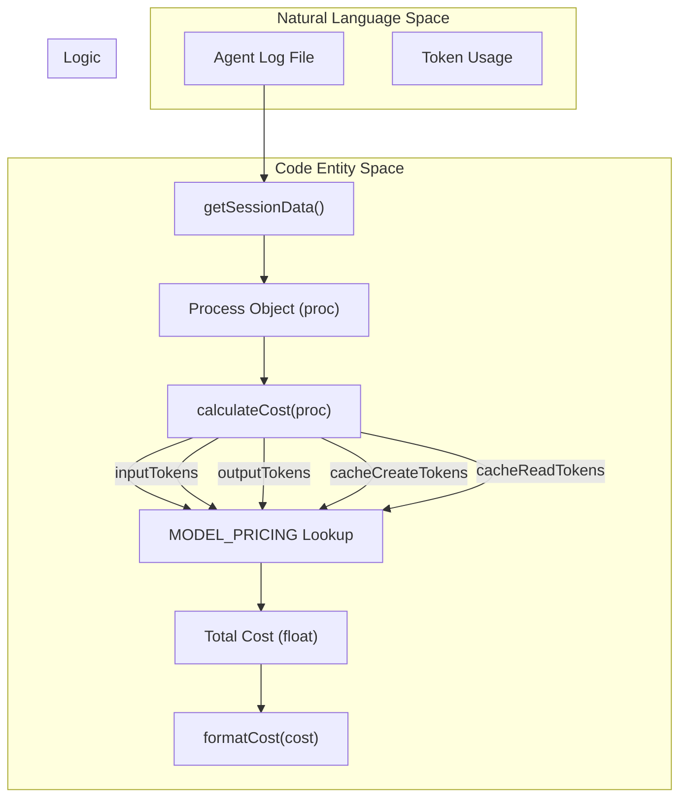
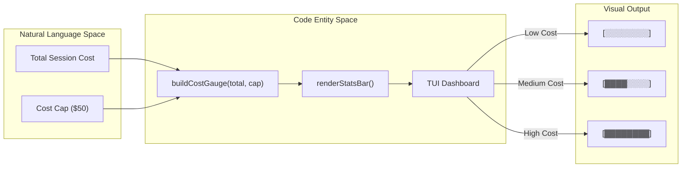

<!-- source: DeepWiki mcp.deepwiki.com · repo aakashadesara/ctop · page 5.1 Cost Calculation · fetched 2026-10-26 -->

# Cost Calculation

Relevant source files

The following files were used as context for generating this wiki page:

- [src/cost.js](src/cost.js)
- [test/cost.test.js](test/cost.test.js)
- [test/status-bar.test.js](test/status-bar.test.js)

The cost engine in `ctop` provides real-time financial monitoring of AI agent sessions. It maps model identifiers to specific pricing tiers and calculates cumulative costs based on four token categories: input, output, cache creation, and cache reads.

## Model Pricing Table

Pricing is defined in the `MODEL_PRICING` object, which stores rates per million tokens for various Claude models and local providers.

| Model Category | Input ($/1M) | Output ($/1M) | Cache Write ($/1M) | Cache Read ($/1M) |
| :--- | :--- | :--- | :--- | :--- |
| **Sonnet 3.5** | 3.00 | 15.00 | 3.75 | 0.30 |
| **Opus** | 15.00 | 75.00 | 18.75 | 1.50 |
| **Haiku 3.5** | 0.80 | 4.00 | 1.00 | 0.08 |
| **Local/Ollama** | 0.00 | 0.00 | 0.00 | 0.00 |

### Prefix Matching Logic
The system uses flexible string matching to associate model versions (e.g., `claude-3-5-sonnet-20241022`) with their pricing tiers.
- **Specific Match**: It first checks for an exact key match in `MODEL_PRICING` [test/cost.test.js:185-190]().
- **Keyword Fallback**: If no exact match is found, it searches for keywords "opus" or "haiku" within the model string to apply those respective rates [test/cost.test.js:81-105]().
- **Default**: If all matches fail, it defaults to Sonnet pricing [test/cost.test.js:68-79]().

**Sources:**
- `MODEL_PRICING` definition: [src/cost.js:5]()
- Pricing structure validation: [test/cost.test.js:192-204]()

## Cost Calculation Formula

The `calculateCost` function computes the total session cost by summing the products of token counts and their respective per-million rates.

### Formula
$$Total Cost = \sum \left( \frac{Tokens_{type} \times Rate_{type}}{1,000,000} \right)$$

The function handles missing or null token counts by defaulting them to 0, ensuring robust calculation even if an agent log is partially parsed [test/cost.test.js:119-128](). If the `model` or `inputTokens` are entirely missing, it returns `null` [test/cost.test.js:6-14]().

### Data Flow: Log to Cost
The following diagram illustrates how raw log data is transformed into a dollar value.

**Cost Calculation Pipeline**

**Sources:**
- `calculateCost` implementation: [src/cost.js:6]()
- Token handling logic: [test/cost.test.js:21-36]()

## Formatting and Visualization

### `formatCost`
To ensure readability in the TUI, costs are formatted into human-readable strings:
- **Null values**: Returns `--` [test/cost.test.js:149-151]().
- **Small values**: Any cost greater than $0 but less than $0.01 is displayed as `<$0.01` [test/cost.test.js:153-161]().
- **Standard values**: Costs are rounded to two decimal places (e.g., `$1.23`) [test/cost.test.js:167-180]().

### Cost Gauge (`buildCostGauge`)
The Dashboard stats bar includes a visual gauge representing the total session cost relative to a configurable cap (defaulting to $50).

- **Length**: Always 8 characters [test/status-bar.test.js:39-44]().
- **Characters**: Uses Unicode block characters: `░` (empty/light) and `▓` (filled/dark) [test/status-bar.test.js:13-31]().
- **Logic**:
    - **0%**: `░░░░░░░░`
    - **50%**: `▓▓▓▓░░░░`
    - **100%+**: `▓▓▓▓▓▓▓▓` (Clamped at 100%)

**Cost Gauge Mapping**

**Sources:**
- `formatCost` logic: [test/cost.test.js:148-181]()
- `buildCostGauge` logic: [test/status-bar.test.js:12-45]()
- `renderStatsBar` integration: [test/status-bar.test.js:179-185]()

---

