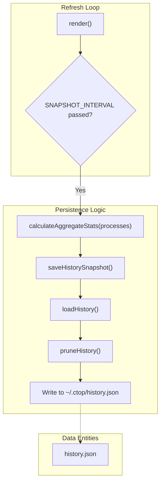
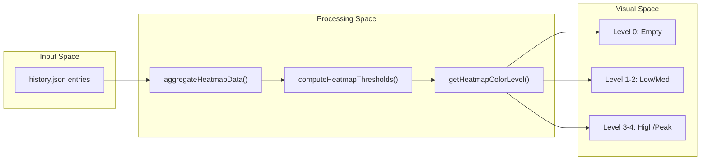

<!-- source: DeepWiki mcp.deepwiki.com · repo aakashadesara/ctop · page 5.3 History, Heatmap, and Timeline · fetched 2026-10-26 -->

# History, Heatmap, and Timeline

Relevant source files

The following files were used as context for generating this wiki page:

- [claude-manager](claude-manager)
- [test/heatmap.test.js](test/heatmap.test.js)
- [test/history.test.js](test/history.test.js)
- [test/quick-jump.test.js](test/quick-jump.test.js)
- [test/search.test.js](test/search.test.js)
- [test/themes.test.js](test/themes.test.js)
- [test/timeline.test.js](test/timeline.test.js)
- [test/windows.test.js](test/windows.test.js)

This section details the persistence and analytical subsystems of `ctop`. These components allow users to track AI usage trends over time, visualize activity intensity via heatmaps, and inspect the chronological flow of individual agent sessions.

## History Persistence System

`ctop` maintains a 7-day rolling history of aggregate session metrics. This data is stored in a local JSON file and is updated periodically during the application lifecycle.

### Data Storage and Lifecycle
The history is stored in `~/.ctop/history.json` [test/history.test.js:28-28](). The system uses a throttle mechanism defined by `SNAPSHOT_INTERVAL` (typically 1 minute) to prevent excessive disk I/O [test/history.test.js:103-115]().

Key functions in the lifecycle include:
*   `loadHistory()`: Reads the history file into memory. If the file is missing, it returns an empty array [test/history.test.js:26-34]().
*   `saveHistorySnapshot(processes)`: Aggregates current process metrics (tokens, cost, session counts) and appends a timestamped entry to the history array [test/history.test.js:83-101]().
*   `pruneHistory(history)`: Enforces the `HISTORY_RETENTION_DAYS` limit (7 days) by removing entries where the timestamp is older than the retention boundary [test/history.test.js:36-52]().

### Aggregate Stats Calculation
Before saving a snapshot, `ctop` calculates aggregate statistics across all monitored processes using `calculateAggregateStats`. This includes summing total input/output tokens and counting active vs. total sessions [test/history.test.js:96-101]().

### History Persistence Flow
Title: History Snapshot and Pruning Logic

Sources: [test/history.test.js:36-52](), [test/history.test.js:83-115](), [test/history.test.js:121-134]()

---

## Heatmap Aggregation Pipeline

The heatmap provides a visual representation of AI activity (tokens, cost, or session count) grouped by day.

### Aggregation Logic
The `aggregateHeatmapData(history, metric)` function processes historical entries and groups them by ISO date strings (YYYY-MM-DD) [test/heatmap.test.js:37-61](). It supports three primary metrics:
1.  **tokens**: Sum of input, output, and cache tokens [test/heatmap.test.js:59-61]().
2.  **cost**: Cumulative financial cost based on model pricing [test/heatmap.test.js:85-88]().
3.  **sessions**: Total number of concurrent sessions recorded [test/heatmap.test.js:90-114]().

### Thresholds and Color Levels
To determine the visual intensity of a heatmap cell, `ctop` uses a percentile-based distribution:
*   `computeHeatmapThresholds(values)`: Calculates the 25th, 50th, and 75th percentiles of the dataset to create four intensity buckets [test/heatmap.test.js:202-219]().
*   `getHeatmapColorLevel(value, thresholds)`: Maps a specific daily value to a color level (0-4). Level 0 represents zero or negative activity, while level 4 represents values in the top quartile [test/heatmap.test.js:200-220]().

### Heatmap Data Flow
Title: Heatmap Processing Pipeline

Sources: [test/heatmap.test.js:37-61](), [test/heatmap.test.js:200-220]()

---

## Session Timeline View

The Timeline view provides a detailed chronological breakdown of a single agent session by parsing its log files (primarily JSONL for Claude).

### Parsing and Event Detection
The `parseSessionTimeline(filePath)` function reads session logs and extracts specific interaction types [test/timeline.test.js:25-68]():
*   **user**: Messages initiated by the user. XML-like system instructions are filtered out to keep the timeline clean [test/timeline.test.js:25-33](), [test/timeline.test.js:135-143]().
*   **assistant**: Responses from the AI agent [test/timeline.test.js:35-43]().
*   **tool_use**: Specific blocks within assistant messages indicating tool execution (e.g., "Read", "Write") [test/timeline.test.js:45-59]().
*   **tool_result**: The output or confirmation of a tool execution [test/timeline.test.js:61-68]().

### Temporal Analysis
The parser calculates the `startTime` (first event) and `endTime` (last event) to determine the `totalDuration` of the session [test/timeline.test.js:70-87](). It also calculates `duration_ms` between consecutive events to identify where the agent spent the most time [test/timeline.test.js:89-98]().

### Formatting
*   **Summary Truncation**: Event summaries are truncated to 40 characters for display in the TUI [test/timeline.test.js:145-153]().
*   **formatElapsed(ms)**: Converts millisecond durations into human-readable strings (e.g., "2m 30s") [test/timeline.test.js:6-6]().

### Timeline Logic Table

| Event Type | Source Logic | Display Summary |
| :--- | :--- | :--- |
| `user` | `role === 'user'` | Truncated message content [test/timeline.test.js:25-33]() |
| `assistant` | `role === 'assistant'` | Truncated text response [test/timeline.test.js:35-43]() |
| `tool_use` | `type === 'tool_use'` | Tool name (e.g., "Bash", "Read") [test/timeline.test.js:45-59]() |
| `tool_result`| `type === 'tool_result'`| Execution status/result [test/timeline.test.js:61-68]() |

Sources: [test/timeline.test.js:25-98](), [test/timeline.test.js:135-153]()

---

