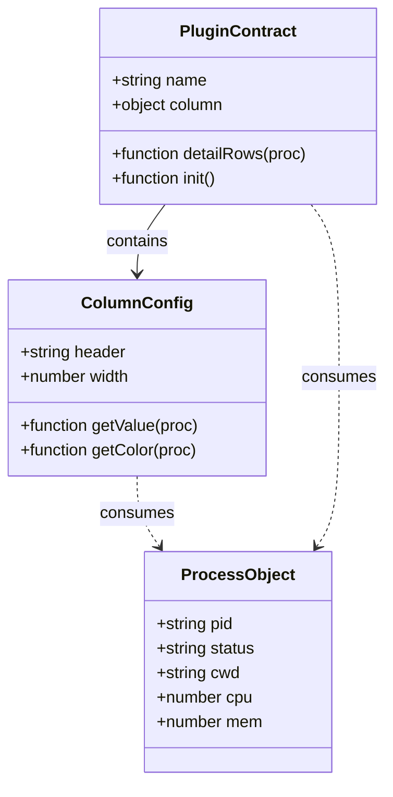

<!-- source: DeepWiki mcp.deepwiki.com · repo aakashadesara/ctop · page 6.1 Plugin System · fetched 2026-10-26 -->

# Plugin System

<details>
<summary>Relevant source files</summary>

The following files were used as context for generating this wiki page:

- [README.md](README.md)
- [examples/plugins/uptime.js](examples/plugins/uptime.js)
- [src/_core.js](src/_core.js)
- [test/animations.test.js](test/animations.test.js)
- [test/caching.test.js](test/caching.test.js)
- [test/plugins.test.js](test/plugins.test.js)

</details>


The `ctop` plugin system allows users to extend the terminal interface with custom data columns and detailed information rows without modifying the core source code. Plugins are loaded dynamically from the local filesystem and integrated into the main rendering loop.

## Plugin Architecture

Plugins are defined as CommonJS modules that export a specific contract. This contract allows the plugin to initialize state, define a table column for the List View, and provide extra rows for the Detail/Pane View.

### The Plugin Contract

A valid plugin module must export an object with the following properties:

| Property | Type | Description |
| :--- | :--- | :--- |
| `name` | `string` | **Required.** Unique identifier for the plugin. |
| `description` | `string` | Optional description of the plugin's purpose. |
| `init` | `function` | Optional. Called once when the plugin is loaded. |
| `cleanup` | `function` | Optional. Called when the application terminates. |
| `column` | `object` | Optional. Defines a new column in the List View table. |
| `detailRows` | `function` | Optional. Returns an array of `{ label, value, color }` for the Detail View. |

### Column Definition

The `column` object defines how the plugin appears in the main process list:

*   `header`: The string displayed in the table header [examples/plugins/uptime.js:5-5]().
*   `width`: Fixed width of the column [examples/plugins/uptime.js:6-6]().
*   `getValue(proc)`: A function that receives a process object and returns the string to display [examples/plugins/uptime.js:7-7]().
*   `getColor(proc)`: Optional. Returns an ANSI color code for the cell text [test/plugins.test.js:126-126]().

### Data Flow: Plugin Integration

The following diagram illustrates how plugins are discovered and integrated into the `ctop` lifecycle.

**Plugin Discovery and Lifecycle**

```mermaid
graph TD
    subgraph "Initialization Space"
        START["Start ctop"] --> LP["loadPlugins('~/.ctop/plugins/')"]
        LP --> READ["fs.readdirSync"]
        READ --> REQ["require(plugin.js)"]
        REQ --> INIT["plugin.init()"]
        INIT --> STORE["Push to _state.plugins"]
    end

    subgraph "Render Space"
        RENDER["renderListMode()"] --> PLUG_COL["Iterate _state.plugins"]
        PLUG_COL --> GET_VAL["column.getValue(proc)"]
        GET_VAL --> FMT["fmtRow()"]
    end

    subgraph "Detail Space"
        PANE["renderPaneMode()"] --> DET_ROWS["plugin.detailRows(proc)"]
        DET_ROWS --> DISP["Display Extra Info Rows"]
    end
```

**Sources:** [src/_core.js:1-7](), [test/plugins.test.js:7-88](), [test/plugins.test.js:164-182]()

---

## Implementation Details

### Plugin Loading Logic

The `loadPlugins(dir)` function is responsible for scanning the plugin directory and validating modules.

1.  **Directory Scanning**: It checks if the directory exists using `fs.existsSync` [test/plugins.test.js:45-47]().
2.  **File Filtering**: It only attempts to load files ending in `.js` [test/plugins.test.js:49-58]().
3.  **Validation**: It requires a `name` property to be present; otherwise, the plugin is skipped [test/plugins.test.js:68-74]().
4.  **Error Handling**: The loader is wrapped in try-catch blocks to ensure a single malformed plugin does not crash the entire application [test/plugins.test.js:60-66]().

### Column Rendering

When `renderListMode` is called, it constructs the table header and rows. It iterates through the loaded plugins in `_state.plugins` and appends their `column.header` to the main header string. During row construction, it calls `column.getValue(proc)` for every process in the list.

**Code Entity Mapping: Plugin Contract to TUI**

**Sources:** [test/plugins.test.js:102-116](), [test/plugins.test.js:164-182](), [examples/plugins/uptime.js:1-9]()

---

## Example: Uptime Plugin

The `uptime.js` plugin demonstrates a minimal implementation that adds a column showing the start time of the agent process.

```javascript
// ~/.ctop/plugins/uptime.js
module.exports = {
  name: 'uptime',
  description: 'Show process uptime in human-readable format',
  column: {
    header: 'UPTIME',
    width: 10,
    getValue: (proc) => proc.startTime || '--',
  },
};
```
**Sources:** [examples/plugins/uptime.js:1-9]()

### Installation

To install a custom plugin:
1.  Create the directory: `mkdir -p ~/.ctop/plugins/`
2.  Place your `.js` file inside that directory.
3.  Restart `ctop`.

The plugin will automatically be detected and its column will appear on the far right of the List View [README.md:112-127]().

## Technical Constraints

*   **Synchronous Execution**: Plugin functions (`getValue`, `detailRows`) are called during the render cycle. They must be synchronous and highly performant to avoid dropping the TUI frame rate (targeted at 30 FPS) [test/animations.test.js:14-20]().
*   **No Dependencies**: Plugins should ideally rely only on the `proc` object provided. While they can `require` Node.js built-in modules, external npm dependencies are not supported unless they are available in the `ctop` environment.
*   **Visual Width**: When returning values in `getValue`, the plugin should respect the `width` defined in the contract. `ctop` uses `visualWidth` (handling ANSI and Unicode) to ensure the table layout remains aligned [src/_core.js:122-127]().

**Sources:** [src/_core.js:122-127](), [test/animations.test.js:14-20](), [test/plugins.test.js:1-230]()

---

