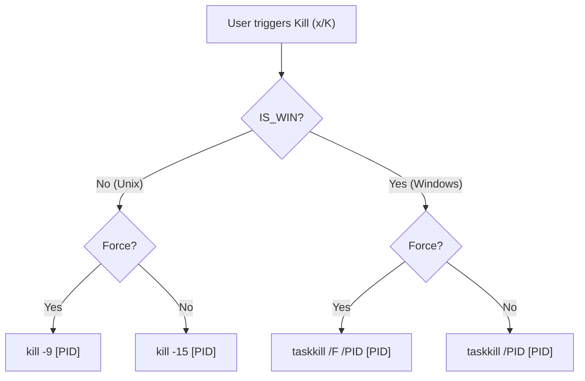
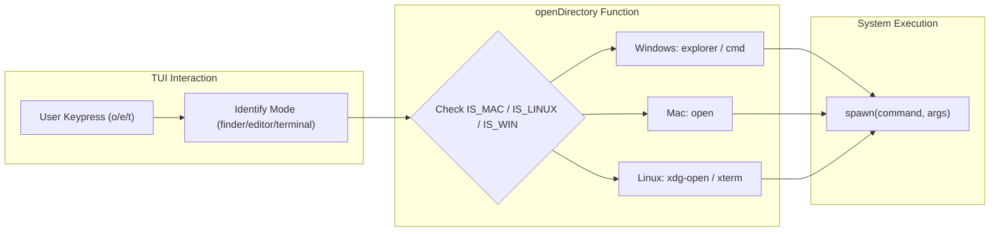

<!-- source: DeepWiki mcp.deepwiki.com · repo aakashadesara/ctop · page 6.3 Cross-Platform Support · fetched 2026-10-26 -->

# Cross-Platform Support

Relevant source files

The following files were used as context for generating this wiki page:

- [src/_core.js](src/_core.js)
- [src/process.js](src/process.js)
- [test/animations.test.js](test/animations.test.js)
- [test/caching.test.js](test/caching.test.js)
- [test/heatmap.test.js](test/heatmap.test.js)
- [test/quick-jump.test.js](test/quick-jump.test.js)
- [test/windows.test.js](test/windows.test.js)

`ctop` is designed to provide a consistent monitoring experience across macOS, Linux, and Windows. This is achieved through a platform abstraction layer that detects the host operating system and branches logic for process discovery, directory normalization, and terminal interaction.

## Platform Detection

The application identifies the host environment during the initialization phase of the core module. It utilizes the native Node.js `os` module to set boolean flags used throughout the codebase for conditional logic.

| Flag | Logic | Target OS |
| :--- | :--- | :--- |
| `IS_MAC` | `PLATFORM === 'darwin'` | macOS |
| `IS_LINUX` | `PLATFORM === 'linux'` | Linux Distributions |
| `IS_WIN` | `PLATFORM === 'win32'` | Windows |

Sources: `[src/_core.js:9-13]()`, `[test/windows.test.js:16-35]()`

## Process Discovery and Management

### Windows-Specific Discovery
On Unix-like systems, `ctop` typically relies on `ps` and `lsof`. However, on Windows (`IS_WIN`), the system utilizes PowerShell's `Get-Process` to discover active agent sessions. This allows the tool to map Windows PIDs to their corresponding executable paths and working directories.

### Signal Handling and Killing Processes
Process termination requires different commands and signals depending on the platform. The `buildKillCommand` function abstracts these differences to provide a unified interface for the TUI's "kill" actions.

*   **Unix (macOS/Linux):** Uses the standard `kill` command with signal `-15` (SIGTERM) for graceful exits and `-9` (SIGKILL) for forced termination.
*   **Windows:** Uses the `taskkill` utility. Graceful termination omits flags, while forced termination adds the `/F` (force) flag.

**Process Termination Logic**

Sources: `[src/_core.js:11-13]()`, `[test/windows.test.js:37-78]()`, `[src/process.js:9-11]()`

## Path Normalization

Claude Code and other agents often store session data in directories named after the project's filesystem path. Because Windows uses backslashes (`\`) and drive letters (e.g., `C:`) while Unix uses forward slashes (`/`), `ctop` implements `cwdToProjectDirName` to normalize these paths into a consistent format for session file lookups.

*   **Unix Transformation:** `/Users/foo/project` becomes `-Users-foo-project`.
*   **Windows Transformation:** `C:\Users\foo\project` becomes `C-Users-foo-project`.

The implementation uses a regex `/[\\/]/` to split paths, ensuring that mixed separators are handled correctly on any platform.

Sources: `[test/windows.test.js:80-104]()`, `[test/windows.test.js:163-190]()`

## Terminal and Directory Invocation

The "Quick Jump" feature (triggered by `o`, `e`, or `t`) allows users to open a session's directory in a file explorer, editor, or terminal. The commands used to trigger these actions are platform-dependent.

| Action | macOS (`IS_MAC`) | Linux (`IS_LINUX`) | Windows (`IS_WIN`) |
| :--- | :--- | :--- | :--- |
| **Finder/Explorer** | `open [dir]` | `xdg-open [dir]` | `explorer [dir]` |
| **Terminal** | `open -a Terminal [dir]` | `x-terminal-emulator` | `cmd /c start` |
| **Editor** | `$EDITOR` or `code` | `$EDITOR` or `code` | `$EDITOR` or `code` |

**Quick Jump Data Flow**

Sources: `[test/quick-jump.test.js:60-155]()`, `[test/windows.test.js:106-161]()`

## Visual Rendering and ANSI Compatibility

While ANSI escape codes are standard, terminal width calculation for CJK characters and Emojis varies. `ctop` uses a zero-dependency `visualWidth` utility that leverages `Intl.Segmenter` to ensure the TUI layout remains intact across different terminal emulators (e.g., iTerm2, Windows Terminal, Alacritty).

The `visualWidth` function specifically handles:
1.  **Wide Characters:** Identified via Unicode ranges (e.g., `0x4E00` to `0x9FFF` for CJK).
2.  **Emoji Presentation:** Detected via `\p{Emoji_Presentation}`.
3.  **ANSI Stripping:** Removing escape codes before calculating visible length.

Sources: `[src/_core.js:88-127]()`, `[src/_core.js:15-36]()`

---

