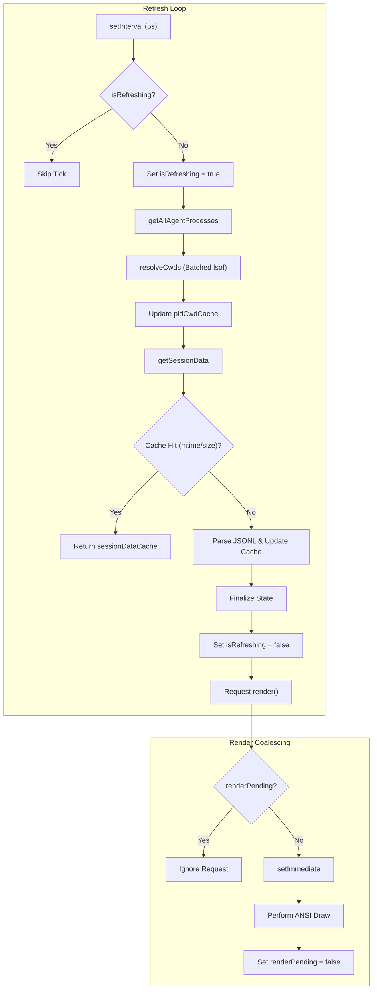

<!-- source: DeepWiki mcp.deepwiki.com · repo aakashadesara/ctop · page 7 Performance and Caching · fetched 2026-10-26 -->

# Performance and Caching

Relevant source files

The following files were used as context for generating this wiki page:

- [docs/designs/2026-05-10-perf-many-sessions.md](docs/designs/2026-05-10-perf-many-sessions.md)
- [src/_core.js](src/_core.js)
- [test/animations.test.js](test/animations.test.js)
- [test/caching.test.js](test/caching.test.js)

The performance architecture of `ctop` is designed to handle dozens of concurrent AI agent sessions (e.g., Claude Code, Codex CLI) without blocking the Node.js event loop or causing TUI lag [docs/designs/2026-05-10-perf-many-sessions.md:5-10](). The system employs aggressive module-level caching, batched OS-level queries, and execution guards to ensure that UI responsiveness remains high even under heavy session loads.

### Performance Architecture Overview

The core performance strategy focuses on minimizing synchronous shell-outs and redundant file system operations during the 5-second auto-refresh cycle [docs/designs/2026-05-10-perf-many-sessions.md:46-65]().

#### Data Flow and Optimization Points

| Component | Optimization Technique | Code Entity |
| :--- | :--- | :--- |
| **Process Discovery** | Batched `lsof` and PID-to-CWD caching | `resolveCwds`, `pidCwdCache` |
| **Session Parsing** | Mtime/Size-based file caching | `sessionDataCache` |
| **Log Tail-Reading** | 64KB partial reads + entry caching | `readSessionLog`, `sessionLogCache` |
| **TUI Rendering** | `setImmediate` coalescing | `render` wrapper, `renderPending` |
| **Refresh Cycle** | Re-entry guard flag | `isRefreshing` |

### Caching Layers

`ctop` maintains several in-memory caches to avoid expensive operations. These caches are invalidated based on file system metadata (`mtimeMs` and `size`) or process lifecycle events.

*   **`pidCwdCache`**: Maps PIDs to their Current Working Directories. On macOS, this is populated via a single batched `lsof` call rather than N individual calls [docs/designs/2026-05-10-perf-many-sessions.md:72-83]().
*   **`sessionDataCache`**: Stores parsed JSONL session metadata (titles, model info). It uses the file path as a key and invalidates only if the file's `mtimeMs` or `size` changes [test/caching.test.js:21-30]().
*   **`sessionLogCache`**: Specifically for the log pane, this cache stores parsed log entries. It is paired with a tail-reading mechanism that only processes the last 64KB of large log files [test/caching.test.js:122-147]().
*   **`sessionFileCache`**: Caches the list of session files within a project directory to avoid frequent `readdirSync` calls [docs/designs/2026-05-10-perf-many-sessions.md:127-132]().

For detailed reference on invalidation policies and cache structures, see [Caching Layer](#7.1).

**Sources:** [docs/designs/2026-05-10-perf-many-sessions.md:21-31](), [test/caching.test.js:8-44](), [test/caching.test.js:175-200]()

### Execution Control

To prevent event-loop starvation and "stacking" of refresh cycles, `ctop` implements two primary guards:

1.  **Refresh Re-entry Guard**: The `setInterval` logic for the auto-refresh skips the current tick if the previous refresh operation is still in progress [docs/designs/2026-05-10-perf-many-sessions.md:32-33]().
2.  **Render Coalescing**: Rapid sequential calls to `render()` (e.g., from mashing navigation keys) are coalesced using `setImmediate`. This ensures that at most one screen redraw happens per event loop tick [docs/designs/2026-05-10-perf-many-sessions.md:34-35]().

For implementation details on these guards, see [Render Coalescing and Refresh Guard](#7.2).

**Sources:** [docs/designs/2026-05-10-perf-many-sessions.md:59-62]()

### System Integration Diagram

This diagram illustrates how the various caches and guards interface with the core refresh loop and the OS.

**Refresh Cycle Performance Flow**

**Sources:** [docs/designs/2026-05-10-perf-many-sessions.md:21-39](), [docs/designs/2026-05-10-perf-many-sessions.md:72-83]()

### Performance Metrics and Scaling

The architecture is optimized for the following scale (based on the 2026-05-10 design):
*   **Max Sessions**: Tested with ~73 active sessions [docs/designs/2026-05-10-perf-many-sessions.md:5]().
*   **Refresh Latency**: Reduced from several seconds to <200ms on macOS by batching `lsof` [docs/designs/2026-05-10-perf-many-sessions.md:51-52]().
*   **Log Handling**: Handles JSONL files >128KB efficiently via 64KB tail-reads [docs/designs/2026-05-10-perf-many-sessions.md:52-53](), [test/caching.test.js:146-147]().

**Sources:** [docs/designs/2026-05-10-perf-many-sessions.md:5-11](), [docs/designs/2026-05-10-perf-many-sessions.md:48-58]()

---

