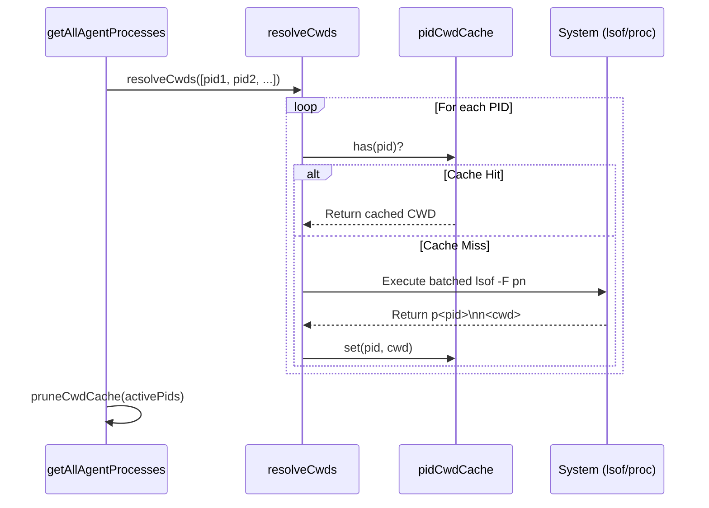
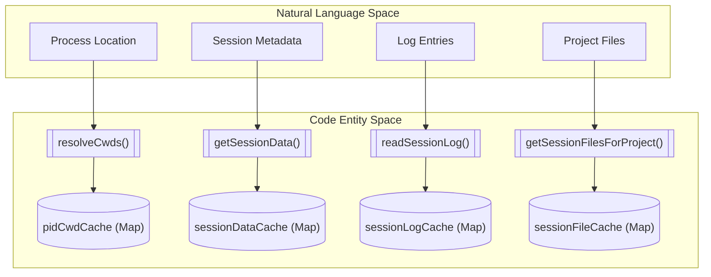

<!-- source: DeepWiki mcp.deepwiki.com · repo aakashadesara/ctop · page 7.1 Caching Layer · fetched 2026-10-26 -->

# Caching Layer

Relevant source files

The following files were used as context for generating this wiki page:

- [docs/designs/2026-05-10-perf-many-sessions.md](docs/designs/2026-05-10-perf-many-sessions.md)
- [src/_core.js](src/_core.js)
- [test/animations.test.js](test/animations.test.js)
- [test/caching.test.js](test/caching.test.js)

The caching layer in `ctop` is a performance-critical subsystem designed to handle high volumes of concurrent AI agent sessions (e.g., 70+ active Claude Code or Codex processes) without blocking the Node.js event loop. It employs module-level `Map` objects to cache expensive I/O operations, such as filesystem stats, log parsing, and process-to-directory resolution [docs/designs/2026-05-10-perf-many-sessions.md:5-10]().

## Core Caches Overview

`ctop` maintains several internal caches within `src/_core.js`. These caches are primarily invalidated based on file modification times (`mtimeMs`) and file sizes, ensuring that UI updates remain consistent with the underlying session data [docs/designs/2026-05-10-perf-many-sessions.md:25-31]().

| Cache Name | Key Type | Value Type | Purpose |
| :--- | :--- | :--- | :--- |
| `pidCwdCache` | `Number` (PID) | `String` (Path) | Stores resolved Current Working Directories for active processes to avoid redundant `lsof` calls. |
| `sessionDataCache` | `String` (Path) | `{mtimeMs, size, data}` | Caches parsed JSONL metadata (titles, model info) for agent session files. |
| `sessionLogCache` | `String` (Path) | `{mtimeMs, size, entries}` | Caches the tail-parsed log entries for the Log Pane. |
| `sessionFileCache` | `String` (Path) | `{mtimeMs, files}` | Caches the list of session files within a project directory. |
| `gitDiffCache` | `String` (Path) | `{mtimeMs, diff}` | Caches the output of `git diff --stat` for the Dashboard. |

**Sources:** [docs/designs/2026-05-10-perf-many-sessions.md:20-35](), [src/_core.js:10-40]()

## PID to CWD Resolution (`pidCwdCache`)

On macOS and Linux, resolving the Current Working Directory (CWD) of a process is an expensive operation. `ctop` optimizes this by batching requests and caching the results.

### Implementation and Batching
Instead of executing `lsof` for every process, `ctop` uses `resolveCwds(pids)` to perform a single batched `lsof -a -d cwd -p <pids> -F pn` call [docs/designs/2026-05-10-perf-many-sessions.md:72-84](). The `-F pn` flag provides a machine-readable format that is immune to column shifting [docs/designs/2026-05-10-perf-many-sessions.md:122-126]().

### Invalidation Policy
The `pidCwdCache` is pruned during the `getAllAgentProcesses` cycle. Any PID that no longer appears in the system process list is removed from the cache to prevent memory leaks [docs/designs/2026-05-10-perf-many-sessions.md:87-91]().

### Process-to-Cache Data Flow
The following diagram illustrates how the system resolves process locations through the caching layer.

**Diagram: PID Resolution Flow**

**Sources:** [docs/designs/2026-05-10-perf-many-sessions.md:72-116](), [src/_core.js:1333-1350]()

## Session Data Caching (`sessionDataCache`)

The `getSessionData(filePath)` function retrieves metadata like session titles and token counts. To avoid re-parsing large JSONL files on every 5-second refresh, it checks the file's `mtimeMs` and `size` [docs/designs/2026-05-10-perf-many-sessions.md:25-26]().

*   **Logic**: If `fs.statSync(filePath)` matches the cached `mtimeMs` and `size`, the cached object is returned [test/caching.test.js:21-30]().
*   **Invalidation**: Any change to the file (new message, model update) triggers a re-parse [test/caching.test.js:32-43]().

**Sources:** [src/_core.js:1363-1380](), [test/caching.test.js:21-43]()

## Log Tail Caching (`sessionLogCache`)

The Log Pane displays the most recent interactions. Reading multi-megabyte JSONL files entirely would block the UI. `readSessionLog` implements a high-performance tail-read strategy:

1.  **Tail Read**: The function reads only the last `64 KB` (`LOG_TAIL_BYTES`) of the file [docs/designs/2026-05-10-perf-many-sessions.md:29-31]().
2.  **Partial Line Handling**: It discards the first potentially fragmented line of the 64KB buffer to ensure valid JSON parsing [test/caching.test.js:122-125]().
3.  **Caching**: The parsed array of log entries is cached. If the file size and mtime are identical on the next call, the parsing step is skipped entirely [test/caching.test.js:175-186]().

**Sources:** [src/_core.js:1803-1840](), [test/caching.test.js:122-186]()

## Directory and File Caching (`sessionFileCache`)

When mapping PIDs to session files, `ctop` must list files in the `.claude/projects/...` directories. `getSessionFilesForProject` uses a two-tier caching strategy:

1.  **Readdir Cache**: The list of filenames is cached based on the directory's `mtimeMs`. If no files were added or removed, `readdirSync` is skipped [docs/designs/2026-05-10-perf-many-sessions.md:127-133]().
2.  **Stat Refresh**: While the filename list is cached, `ctop` still performs a `statSync` on each file to get fresh `mtime` values. This ensures that session files are correctly sorted by "most recent" even if no new files were created [docs/designs/2026-05-10-perf-many-sessions.md:134-143]().

**Sources:** [src/_core.js:1541-1560](), [docs/designs/2026-05-10-perf-many-sessions.md:127-143]()

## Summary of Code Entities

The following diagram maps the logical caching concepts to the specific variables and functions implemented in the codebase.

**Diagram: Caching Entity Map**

**Sources:** [src/_core.js:10-50](), [src/_core.js:1333-1840](), [docs/designs/2026-05-10-perf-many-sessions.md:20-40]()

---

