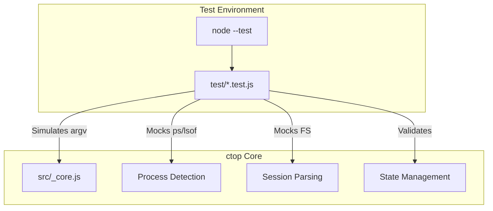
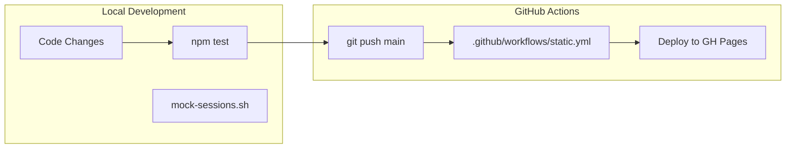

<!-- source: DeepWiki mcp.deepwiki.com · repo aakashadesara/ctop · page 8 Testing and Development · fetched 2026-10-26 -->

# Testing and Development

Relevant source files

The following files were used as context for generating this wiki page:

- [.github/workflows/static.yml](.github/workflows/static.yml)
- [package.json](package.json)
- [scripts/mock-sessions.sh](scripts/mock-sessions.sh)

This section provides an overview of the tools and workflows used to maintain, test, and demonstrate `ctop`. The project prioritizes a "Keep It Simple, Stupid" (KISS) testing philosophy, avoiding complex mocking of private helpers in favor of functional tests that exercise the CLI's core logic. Development is further supported by automated demo recording scripts and a streamlined deployment process for documentation.

## Testing Architecture

The `ctop` test suite is built using the native Node.js test runner, ensuring zero-dependency testing that is fast and reliable across platforms. The suite consists of 28 test files covering everything from TUI rendering logic to the process detection engine.

### Test Isolation and Patterns
To ensure tests do not interfere with the host system or each other, the suite employs several isolation patterns:
*   **Temporary Directories:** Tests involving file system operations (like parsing session logs) use unique temporary directories.
*   **Cache Clearing:** Internal caches, such as `sessionScanCache`, are cleared between runs to ensure fresh state.
*   **Argument Manipulation:** `process.argv` is programmatically modified within tests to simulate different CLI flag combinations.

For a deep dive into the test suite structure and how to run them, see **[Test Suite](#8.1)**.

### Testing Workflow Diagram
The following diagram illustrates how the test runner interacts with the core system components.

**Test Runner Integration**

Sources: [package.json:11-11](), [src/_core.js:1-50]()

---

## Documentation and Demo Assets

Maintaining visual documentation is a core part of `ctop` development. Because `ctop` is a real-time TUI, static screenshots are often insufficient to demonstrate its capabilities.

### Mock Session Generation
The `scripts/mock-sessions.sh` script is a specialized utility that spawns fake AI agent processes. It creates convincing `session.jsonl` files with realistic back-and-forth conversations, token counts, and model metadata [scripts/mock-sessions.sh:2-3](). This allows developers to record high-quality demos without needing active, paid AI sessions.

### Automated GIF Recording
The project uses **VHS** (by Charmbracelet) to record terminal sessions into GIFs. The workflow is automated via `npm run gif`, which:
1.  Spawns mock sessions.
2.  Runs `vhs` against `.tape` files (e.g., `hero.tape`).
3.  Optimizes the resulting GIFs using `gifsicle`.
4.  Cleans up the mock processes.

For details on the recording scripts and VHS configuration, see **[Demo Recording and Documentation Assets](#8.2)**.

### Documentation Deployment
The project's documentation is hosted via GitHub Pages. A GitHub Action workflow (`.github/workflows/static.yml`) automatically deploys the contents of the `docs/` directory to the live site whenever changes are pushed to the `main` branch [.github/workflows/static.yml:4-7]().

**CI/CD Pipeline**

Sources: [package.json:12-12](), [.github/workflows/static.yml:1-43]()

---

## Related Pages
*   **[Test Suite](#8.1)**: Detailed breakdown of the 28 test files and isolation strategies.
*   **[Demo Recording and Documentation Assets](#8.2)**: Guide to using `mock-sessions.sh` and generating TUI GIFs.

---

