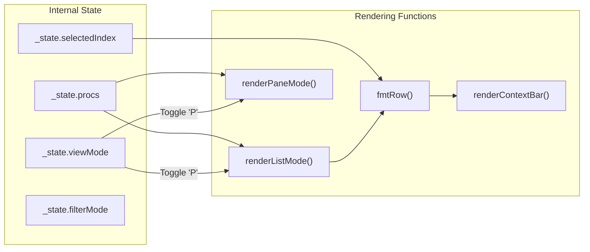

<!-- source: DeepWiki mcp.deepwiki.com · repo aakashadesara/ctop · page 9 Glossary · fetched 2026-10-26 -->

# Glossary

<details>
<summary>Relevant source files</summary>

The following files were used as context for generating this wiki page:

- [README.md](README.md)
- [claude-manager](claude-manager)
- [docs/index.html](docs/index.html)
- [src/_core.js](src/_core.js)
- [src/cost.js](src/cost.js)
- [test/animations.test.js](test/animations.test.js)
- [test/caching.test.js](test/caching.test.js)
- [test/grouping.test.js](test/grouping.test.js)
- [test/heatmap.test.js](test/heatmap.test.js)
- [test/history.test.js](test/history.test.js)
- [test/quick-jump.test.js](test/quick-jump.test.js)
- [test/search.test.js](test/search.test.js)
- [test/themes.test.js](test/themes.test.js)
- [test/token-rate.test.js](test/token-rate.test.js)
- [test/windows.test.js](test/windows.test.js)

</details>


This page provides definitions for codebase-specific terms, domain concepts, and technical abbreviations used throughout the `ctop` project.

## Core Domain Concepts

### Agent
A supported AI coding assistant process monitored by `ctop`. The system currently detects and enriches data for three specific agents: **Claude Code**, **Codex CLI**, and **OpenCode**.
*   **Detection**: Accomplished via `ps` or PowerShell by matching command-line strings [src/_core.js:1034-1065]().
*   **Enrichment**: The process of mapping a PID to a working directory (CWD) and then to a specific session file or database [src/_core.js:1152-1198]().

### Context Window
The token limit of the AI model's memory. `ctop` visualizes this using a segmented bar (Braille or Block) showing the distribution of Input, Cache, and Output tokens against the total limit.
*   **Implementation**: `renderContextBar` [src/_core.js:1745-1775]() and `renderContextBarBraille` [src/_core.js:1777-1815]().
*   **Default Limit**: Managed by `config.contextLimit`, defaulting to 1,000,000 tokens [src/_core.js:148-148]().

### Session Data
Metadata and history associated with a specific agent instance.
*   **Claude**: Parsed from `session.jsonl` files in `~/.claude/projects/` [src/_core.js:1210-1256]().
*   **Codex**: Parsed from `~/.codex/sessions/` [src/_core.js:1258-1296]().
*   **OpenCode**: Queried from SQLite databases in `~/.opencode/` [src/_core.js:1298-1335]().

---

## Technical Terms & Abbreviations

| Term | Definition | Code Pointer |
| :--- | :--- | :--- |
| **CWD** | Current Working Directory. Used as the primary key for grouping multiple agent processes into a single project view. | [src/_core.js:1152-1198]() |
| **JSONL** | JSON Lines format. The primary storage format for Claude and Codex session logs, where each line is a valid JSON object. | [src/_core.js:1210-1256]() |
| **Mtime** | Modification Time. Used by the caching layer to determine if a session file needs to be re-parsed. | [src/_core.js:1222-1225]() |
| **PID** | Process Identifier. The unique ID assigned by the OS to an agent process. | [src/_core.js:1034-1065]() |
| **SIGTERM / SIGKILL** | Unix signals for graceful (`x`) and forced (`X`) process termination. | [src/_core.js:2550-2570]() |
| **TUI** | Terminal User Interface. The entire visual layer of `ctop`, built using raw ANSI escape codes. | [src/_core.js:15-37]() |

---

## Data Flow & Architecture Diagrams

### Agent Discovery & Enrichment Pipeline
This diagram shows how a raw OS process is transformed into an enriched `proc` object within the `_state.procs` array.

```mermaid
graph TD
    subgraph "Natural Language Space"
        A["User starts 'claude'"]
        B["ctop Refresh Cycle"]
    end

    subgraph "Code Entity Space"
        C["getProcesses()"]
        D["resolveCwds()"]
        E["getSessionData()"]
        F["_state.procs"]
    end

    A --> B
    B --> C
    C -- "Uses ps/PowerShell" --> D
    D -- "Uses lsof/proc" --> E
    E -- "Parses JSONL/SQLite" --> F
    F -- "Render Loop" --> G["render()"]
end
```
**Sources:** [src/_core.js:1034-1065](), [src/_core.js:1152-1198](), [src/_core.js:1210-1256]()

### TUI State to Visual Mapping
This diagram bridges the internal `_state` variables to the functions responsible for generating ANSI strings.


**Sources:** [src/_core.js:1924-1950](), [src/_core.js:1952-1980](), [src/_core.js:1745-1775]()

---

## Implementation Details

### Caching Layer
To maintain a high refresh rate without high CPU overhead, `ctop` employs several module-level caches:
*   **`pidCwdCache`**: Maps PIDs to resolved directories to avoid repeated `lsof` calls [src/_core.js:1152-1152]().
*   **`sessionDataCache`**: Stores parsed JSONL data, keyed by file path and validated via `mtime` and `size` [src/_core.js:1210-1215]().
*   **`sessionLogCache`**: Specifically caches the tail-end of session logs for the `L` (Log View) pane [src/_core.js:1337-1345]().

### Cost Engine
The cost engine calculates real-time API expenditure based on the `MODEL_PRICING` table.
*   **Function**: `calculateCost(model, input, output, cacheRead, cacheCreate)` [src/_core.js:2350-2380]().
*   **Logic**: It performs prefix matching on model strings (e.g., `claude-3-5-sonnet`) to find the correct per-million-token rate [src/_core.js:2355-2360]().

### Visualizations
*   **Braille Bar**: A high-density 2x4 dot grid used for sparklines and context bars. Uses Unicode characters from `\u2800` to `\u28FF`.
*   **Waveform**: A representation of token activity over time, generated by `renderMessageWaveform` [src/_core.js:1817-1845]().

**Sources:**
*   Platform detection and ANSI constants: [src/_core.js:10-37]()
*   Config defaults: [src/_core.js:146-155]()
*   Process discovery: [src/_core.js:1034-1065]()
*   CWD resolution: [src/_core.js:1152-1198]()
*   Claude/Codex/OpenCode parsing: [src/_core.js:1210-1335]()
*   Cost calculation: [src/_core.js:2350-2380]()
*   TUI Rendering: [src/_core.js:1924-1980]()