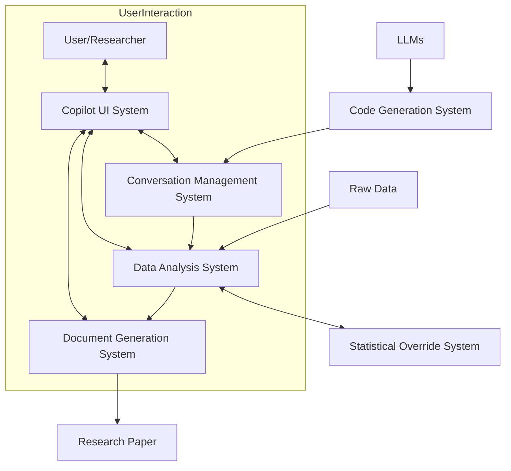
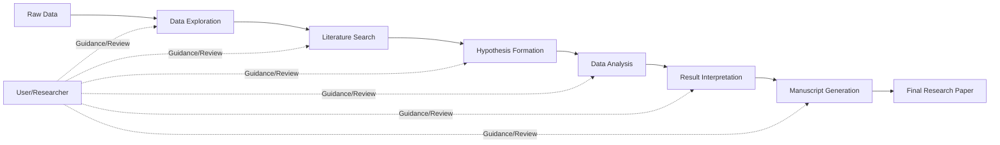
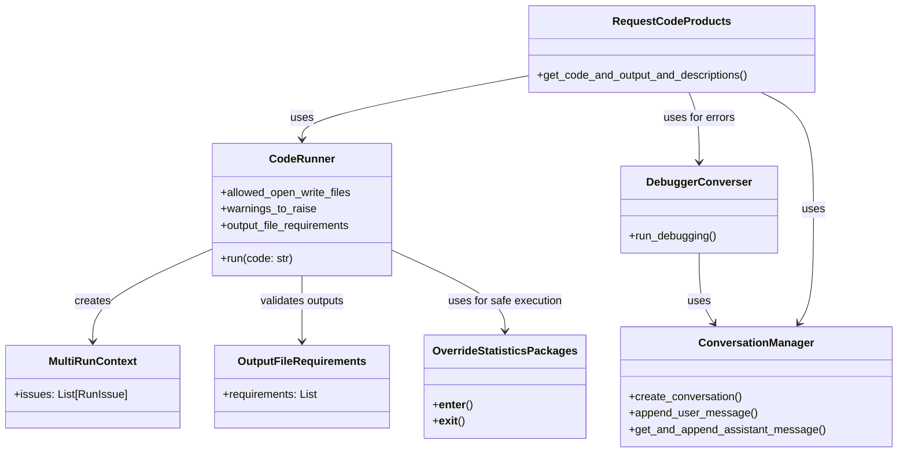
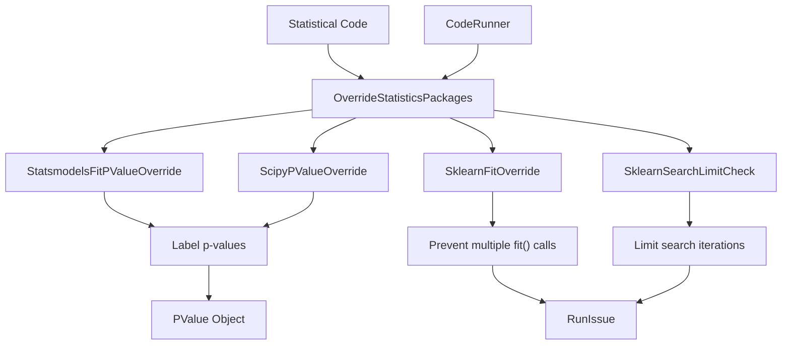
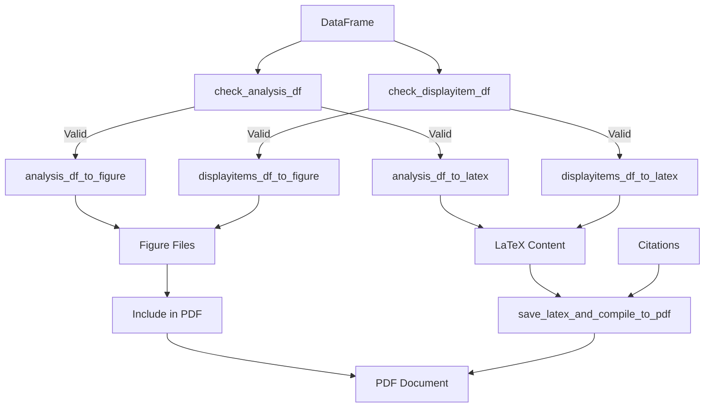

<!-- source: DeepWiki mcp.deepwiki.com · repo Technion-Kishony-lab/data-to-paper · page 1 Overview · fetched 2026-10-26 -->

# Overview

<details>
<summary>Relevant source files</summary>

The following files were used as context for generating this wiki page:

- [.gitignore](.gitignore)
- [INSTALL.md](INSTALL.md)
- [MANIFEST.in](MANIFEST.in)
- [README.md](README.md)
- [pyproject.toml](pyproject.toml)
- [release.py](release.py)

</details>


## Purpose and Scope

The `data-to-paper` framework is an automation system that systematically guides interacting AI agents through a complete end-to-end scientific research process. It transforms raw data into transparent, backward-traceable, human-verifiable scientific papers.

This framework is designed to:
1. Automate scientific research while maintaining transparency, traceability, and verifiability
2. Provide both fully autonomous (autopilot) and human-guided (copilot) operation modes
3. Enable researchers to oversee, inspect, and direct the research process

For installation instructions and environment setup, see [Installation and Setup](#1.1).

Sources: [README.md:10-15](), [README.md:38-43]()

## High-Level Architecture

### Core System Components

The framework consists of several interconnected systems that work together to transform raw data into research papers:



Sources: [README.md:38-44](), [README.md:45-57]()

### Key Components

1. **Data Analysis System**: Processes and analyzes raw data using statistical methods and machine learning techniques.

2. **Document Generation System**: Transforms analyzed data into LaTeX tables, figures, and a complete research paper.

3. **Code Generation System**: Generates data analysis code using LLMs with debugging capabilities.

4. **Conversation Management System**: Orchestrates interactions with LLMs.

5. **Statistical Override System**: Provides guardrails for statistical packages to prevent common LLM coding errors.

6. **Copilot UI System**: Provides a graphical interface for researcher guidance and oversight.

For more details on the system architecture, see [Architecture Overview](#1.2).

Sources: [README.md:58-59](), [pyproject.toml:6-9]()

## Research Workflow

The framework guides AI agents through the conventional scientific research path:



Sources: [README.md:80-83]()

## Code Execution Environment

The Code Execution Environment provides a secure sandbox for running AI-generated code:



This system ensures that AI-generated code runs safely and correctly, with guardrails to prevent common errors and a debugging system to identify and fix issues.

For more details about the Code Execution System, see [Code Execution System](#2).

Sources: [README.md:58-59]()

## Statistical Override System

The Statistical Override System intercepts calls to statistical packages and enforces proper behavior:



This system is a key guardrail that intercepts calls to statistical packages (`statsmodels`, `scipy`, `sklearn`) to enforce proper behavior, such as labeling p-values and preventing p-hacking.

For more details about the Statistical Override System, see [Statistical Package Overrides](#2.3).

Sources: [README.md:58-59](), [pyproject.toml:53-60]()

## Document Generation System

The Document Generation System transforms analyzed data into research papers:



This system creates backward-traceable manuscripts where any numeric values can be traced back to the specific code lines that created them.

For more details about the Document Generation System, see [Document Generation System](#4).

Sources: [README.md:41-43]()

## Installation and Usage

### Installation

To install and set up the `data-to-paper` framework:

1. Install the package using pip:
   ```
   pip install data-to-paper
   ```

2. Install dependencies:
   - Pandoc for document conversion
   - LaTeX for PDF compilation

3. Set up API keys as environment variables:
   - OPENAI_API_KEY
   - SEMANTIC_SCHOLAR_API_KEY
   - DEEPINFRA_API_KEY (optional)

4. Check the installation:
   ```
   data-to-paper-chkres
   ```

5. Run the application:
   ```
   data-to-paper
   ```

For more detailed installation instructions, see [Installation and Setup](#1.1).

Sources: [INSTALL.md:1-9](), [INSTALL.md:22-44](), [INSTALL.md:48-56]()

### Example Usage

The framework includes several example datasets for testing:

| Dataset | Description | Command |
|---------|-------------|---------|
| Health Indicators | CDC's BRFSS 2015 dataset | `data-to-paper diabetes` |
| Social Network | Twitter interactions among 117th Congress members | `data-to-paper social_network` |
| Treatment Policy | NICU treatment outcomes | `data-to-paper npr_nicu` |
| Treatment Optimization (Easy) | Compare two ML methods | `data-to-paper ML_easy` |
| Treatment Optimization (Medium) | Compare ML and formula-based methods | `data-to-paper ML_medium` |
| Treatment Optimization (Hard) | Compare multiple methods | `data-to-paper ML_hard` |

Sources: [README.md:102-148]()

## Key Features

1. **End-to-end field-agnostic research**: The process navigates through the entire scientific path, from data exploration to creating complete research papers.

2. **Traceable "data-chained" manuscripts**: Creates backward-traceable papers where numeric values can be traced to specific code lines.

3. **Autopilot or Copilot operation**: Can run fully autonomously or with human guidance.

4. **Coding guardrails**: Statistical packages are overridden with guardrails to minimize common LLM coding errors.

Sources: [README.md:38-59]()

## Package Components

The `data-to-paper` package includes the following major components:

| Component | Description | Dependencies |
|-----------|-------------|--------------|
| Core Framework | Main research automation logic | OpenAI, regex, tiktoken |
| Statistical Overrides | Statistical package guardrails | numpy, pandas, statsmodels, scipy, scikit-learn |
| Document Generation | LaTeX and PDF generation | PyMuPDF, Jinja2 |
| User Interface | Copilot GUI application | PySide6, colorama, pygments |
| External Integrations | Literature search | requests |

Sources: [pyproject.toml:40-61]()

## Next Steps

For more information about specific components of the `data-to-paper` framework, see:

- [Code Execution System](#2) for details about the code execution environment
- [Data Analysis System](#3) for information about data processing and analysis
- [Document Generation System](#4) for documentation on creating research papers
- [LLM Interaction System](#5) for details about interacting with Large Language Models
- [User Interface](#6) for information about the GUI application

Sources: [README.md:86-90]()

---

