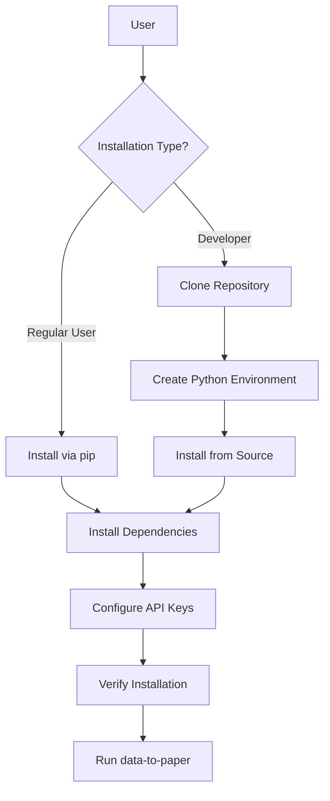
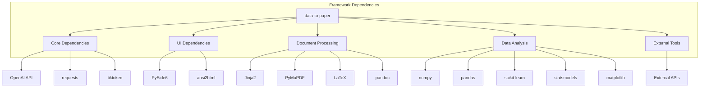
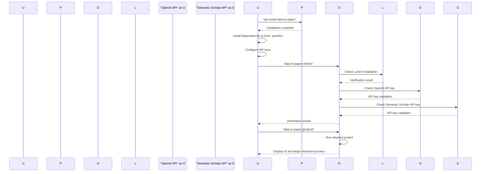

<!-- source: DeepWiki mcp.deepwiki.com · repo Technion-Kishony-lab/data-to-paper · page 1.1 Installation and Setup · fetched 2026-10-26 -->

# Installation and Setup

<details>
<summary>Relevant source files</summary>

The following files were used as context for generating this wiki page:

- [.gitignore](.gitignore)
- [INSTALL.md](INSTALL.md)
- [MANIFEST.in](MANIFEST.in)
- [README.md](README.md)
- [pyproject.toml](pyproject.toml)
- [release.py](release.py)

</details>


This document provides detailed instructions for installing and configuring the data-to-paper framework, a system for conducting reproducible AI-driven scientific research. The guide covers both standard user installation and developer setup options, required dependencies, API key configuration, and verification steps.

## Overview of Installation Process

The installation process consists of four main steps: package installation, dependency setup, API key configuration, and verification. The framework can be installed either as a regular user (via pip) or as a developer (from source).



Sources: [README.md:24-29](), [INSTALL.md:1-9](), [INSTALL.md:11-20]()

## System Requirements

### Supported Platforms
The data-to-paper framework can run on multiple platforms:
- Linux
- macOS
- Windows

### Python Requirements
- Python 3.9 or later

### Third-Party Software Dependencies
- LaTeX distribution (for document compilation)
- Pandoc (for document conversion)

Sources: [pyproject.toml:62](), [INSTALL.md:22-44]()

## Installation for Regular Users

If you want to use the data-to-paper framework without modifying its source code, follow these steps:

1. Install the package using pip:
   ```bash
   pip install data-to-paper
   ```

2. Install dependencies as described in the [Dependencies](#dependencies) section below.

3. Configure API keys as described in the [API Key Configuration](#api-key-configuration) section.

4. Verify the installation:
   ```bash
   data-to-paper-chkres
   ```

5. Run the application:
   ```bash
   data-to-paper
   ```

Sources: [README.md:24-29](), [INSTALL.md:3-8]()

## Installation for Developers

If you plan to modify the source code or contribute to the project, follow these steps:

1. Clone the repository:
   ```bash
   git clone https://github.com/Technion-Kishony-lab/data-to-paper
   ```

2. Create and activate a Python environment (optional but recommended):
   ```bash
   conda create -n data-to-paper python=3.11
   conda activate data-to-paper
   ```

3. Navigate to the repository folder:
   ```bash
   cd data-to-paper
   ```

4. Install the package in development mode:
   ```bash
   pip install -e .
   ```

5. Install dependencies as described in the [Dependencies](#dependencies) section below.

6. Configure API keys as described in the [API Key Configuration](#api-key-configuration) section.

7. Verify the installation:
   ```bash
   data-to-paper-chkres
   ```

Sources: [INSTALL.md:11-20]()

## Dependencies

The framework has several dependencies that need to be installed separately:

### Package Dependencies

The following Python packages are automatically installed when you install data-to-paper:

| Category | Packages |
|----------|----------|
| Core | openai, regex, tiktoken, requests |
| UI | PySide6, colorama, pygments, ansi2html |
| Document Processing | PyMuPDF, Jinja2 |
| Data Analysis | numpy, pandas, scipy, statsmodels, scikit-learn, networkx, matplotlib |
| Testing | pytest |

### Pandoc Installation

Pandoc is used for document conversion:

1. Follow instructions at [Pandoc Installation](https://pandoc.org/installing.html)

### LaTeX Installation

LaTeX is required for PDF generation:

#### Debian-based Systems (Ubuntu, etc.)
```bash
sudo apt-get update && \
sudo apt-get install -y --no-install-recommends \
texlive-latex-base \
texlive-latex-extra \
texlive-fonts-recommended
```

#### macOS
```bash
# Install Homebrew if not already installed
# /bin/bash -c "$(curl -fsSL https://raw.githubusercontent.com/Homebrew/install/HEAD/install.sh)"

# Install MacTeX (without GUI)
brew install --cask mactex-no-gui
```

#### Windows
1. Download and install MiKTeX from [MiKTeX Download Page](https://miktex.org/download)
2. During installation, select 'Yes' when asked to install missing packages on-the-fly

Sources: [pyproject.toml:40-61](), [INSTALL.md:22-44]()



Sources: [pyproject.toml:40-61](), [INSTALL.md:22-44]()

## API Key Configuration

The framework requires several API keys to function properly:

### Required API Keys

1. **OPENAI_API_KEY** - For accessing OpenAI's language models
2. **SEMANTIC_SCHOLAR_API_KEY** - For literature search functionality
3. **DEEPINFRA_API_KEY** (optional) - For optional deep infrastructure features

### Setting Up API Keys

To configure these keys, set them as environment variables:

#### Linux/macOS
```bash
export OPENAI_API_KEY="your-openai-api-key"
export SEMANTIC_SCHOLAR_API_KEY="your-semantic-scholar-api-key"
export DEEPINFRA_API_KEY="your-deepinfra-api-key"  # Optional
```

To make these settings permanent, add these lines to your `~/.bashrc` or `~/.zshrc` file.

#### Windows
```cmd
setx OPENAI_API_KEY "your-openai-api-key"
setx SEMANTIC_SCHOLAR_API_KEY "your-semantic-scholar-api-key"
setx DEEPINFRA_API_KEY "your-deepinfra-api-key"  # Optional
```

### Obtaining API Keys

- **OpenAI API Key**: Sign up at [OpenAI API](https://platform.openai.com/signup) and create an API key in your account dashboard.
- **Semantic Scholar API Key**: Register for an API key at [Semantic Scholar API](https://www.semanticscholar.org/product/api).
- **DeepInfra API Key** (optional): Register at [DeepInfra](https://deepinfra.com/) to obtain an API key.

Sources: [INSTALL.md:47-56]()

## Verification and Testing

After installation, verify that all dependencies and API keys are correctly configured:

```bash
data-to-paper-chkres
```

This command checks:
1. Python dependencies
2. External tools (LaTeX, pandoc)
3. API key configurations

If everything is set up correctly, you should see success messages for each check.

### Running the Application

Once verification is successful, you can run the application:

```bash
data-to-paper
```

The framework can also be run with console output using:

```bash
data-to-paper-run-with-console
```

Sources: [INSTALL.md:58-62](), [pyproject.toml:70-75]()

## Sample Projects

The data-to-paper framework includes several example projects you can try:

```bash
# Health Indicators dataset
data-to-paper diabetes

# Social Network analysis
data-to-paper social_network

# Treatment Policy analysis
data-to-paper npr_nicu

# Treatment Optimization (ML comparison)
data-to-paper ML_easy
data-to-paper ML_medium
data-to-paper ML_hard
```

Sources: [README.md:102-148]()



Sources: [INSTALL.md:1-62](), [README.md:24-29]()

## Troubleshooting

### Common Issues

1. **LaTeX compilation errors**
   - Ensure you have the complete LaTeX distribution installed
   - Check if your system PATH includes LaTeX binaries

2. **API key issues**
   - Verify that the environment variables are correctly set
   - Ensure you haven't reached API usage limits
   - Check for any special characters in your API keys

3. **Package dependency errors**
   - Try reinstalling with `pip install --force-reinstall data-to-paper`
   - Ensure your Python version is 3.9 or higher

### Getting Help

If you encounter issues not covered in this guide, you can:
- Check the project's GitHub repository for known issues
- Submit a new issue on the GitHub repository

Sources: [INSTALL.md:22-56](), [pyproject.toml:62]()

---

