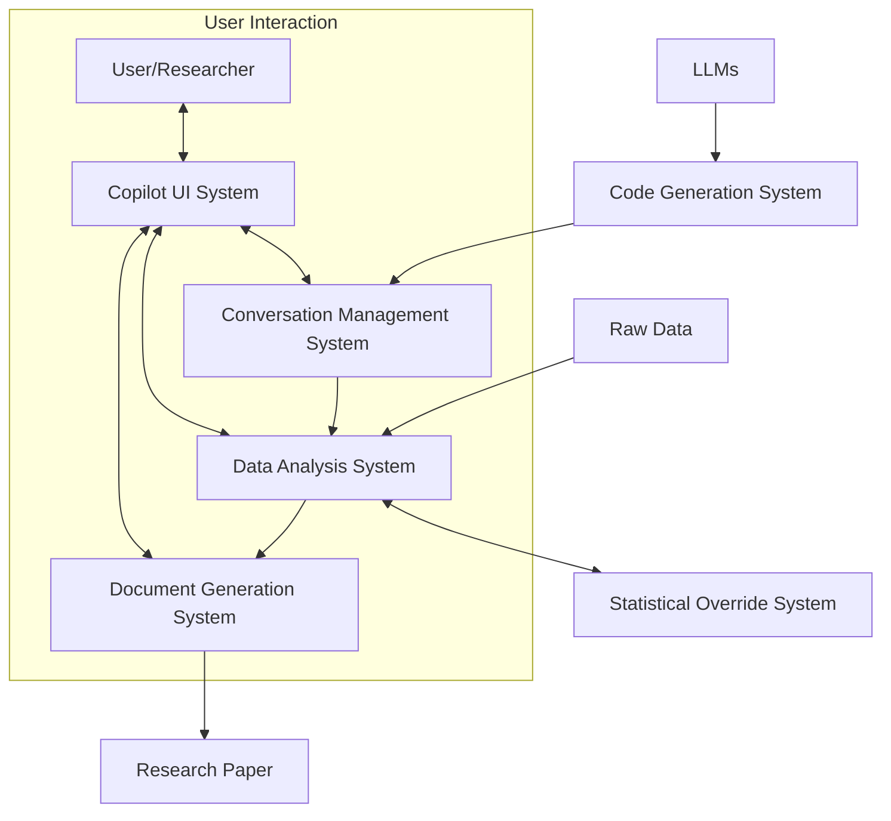
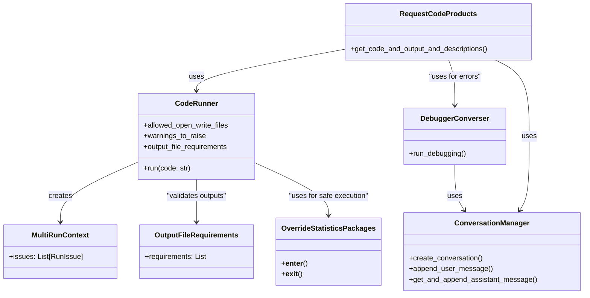
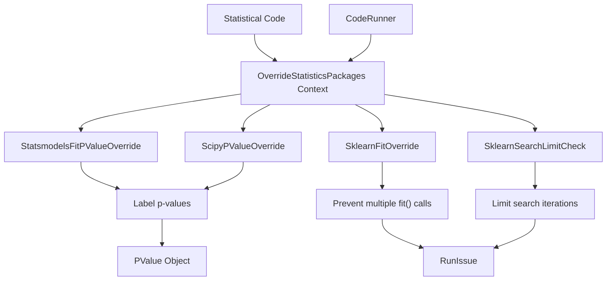
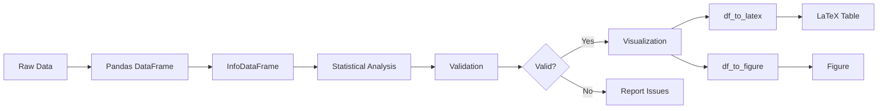
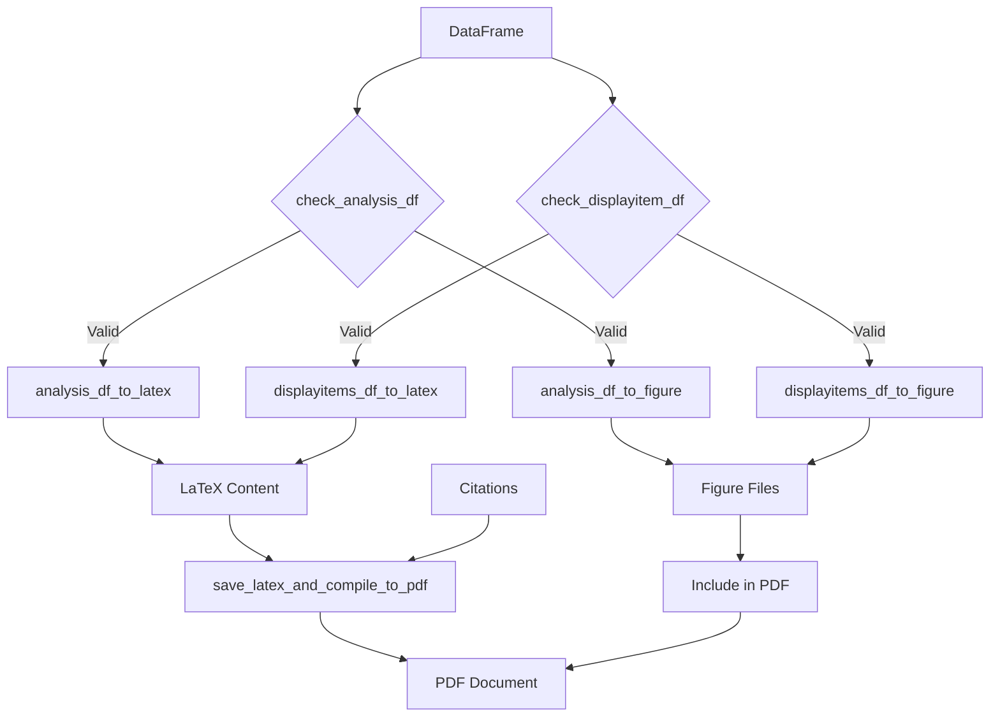
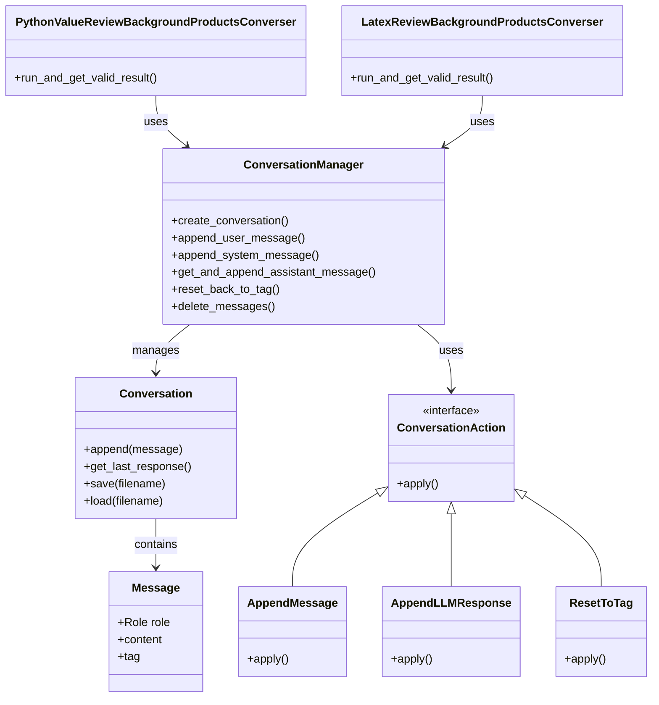
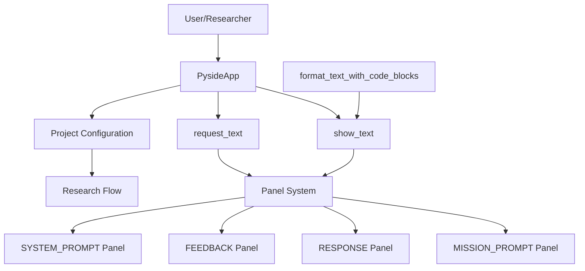
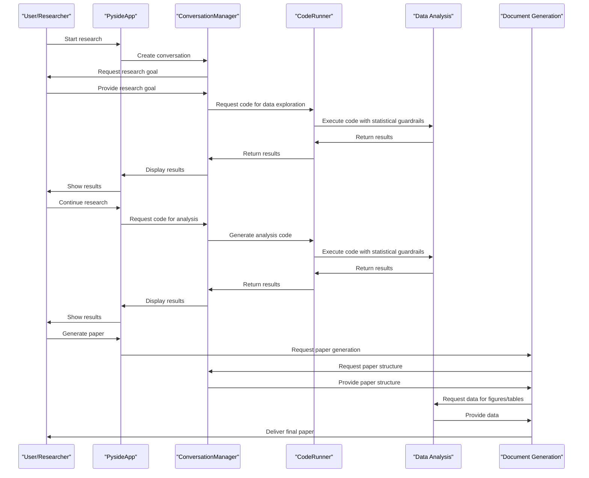

<!-- source: DeepWiki mcp.deepwiki.com · repo Technion-Kishony-lab/data-to-paper · page 1.2 Architecture Overview · fetched 2026-10-26 -->

# Architecture Overview

Relevant source files

The following files were used as context for generating this wiki page:

- [INSTALL.md](INSTALL.md)
- [README.md](README.md)
- [tests/functional/latex/test_process_latex.py](tests/functional/latex/test_process_latex.py)

## Purpose and Scope

This document provides a technical overview of the data-to-paper framework's architecture, explaining how its major components interact to enable end-to-end AI-driven scientific research. It covers the system's high-level organization, core components, and their relationships. For installation instructions, see [Installation and Setup](#1.1).

Sources: [README.md:10-14]()

## High-Level System Architecture

The data-to-paper framework is structured as a multi-system pipeline that transforms raw data into research papers through several processing stages.

The framework consists of six primary interconnected systems:

| System | Primary Responsibility |
|--------|------------------------|
| Data Analysis System | Processes raw data using AI-generated code with statistical validation |
| Code Generation System | Uses LLMs to write and debug Python analytical code |
| Conversation Management System | Orchestrates interactions with Large Language Models |
| Statistical Override System | Provides safety guardrails for statistical operations |
| Document Generation System | Transforms analysis results into LaTeX and compiled PDFs |
| Copilot UI System | Enables human oversight and guidance of the research process |

Sources: [README.md:38-45](), [README.md:58-59]()

## Core Components

### 1. Code Execution System

The Code Execution System provides a secure sandbox for running AI-generated analytical code with appropriate safeguards.

This diagram illustrates how `CodeRunner` serves as the central execution environment, with `DebuggerConverser` providing error handling and `RequestCodeProducts` managing the process of generating and executing code through conversations with LLMs.

For details on the specific safeguards and restrictions implemented in the Code Execution System, see [CodeRunner](#2.1) and [Debugging System](#2.2).

Sources: [README.md:58-59]()

### 2. Statistical Override System

The Statistical Override System intercepts calls to common statistical packages to enforce proper behavior and prevent typical errors in AI-generated statistical code.

This system implements overrides for:
- `statsmodels` and `scipy` to properly label p-values
- `sklearn` to prevent redundant model fitting operations
- `sklearn` to limit hyperparameter search iterations

For more detailed information on statistical package overrides, see [Statistical Package Overrides](#2.3).

Sources: [README.md:58-59]()

### 3. Data Analysis System

The Data Analysis System processes raw data through validation, analysis, and visualization stages.

The system extends standard Pandas DataFrames with added metadata for traceability and implements validation checks to ensure data quality before visualization. For more information on data validation and visualization, see [DataFrame Validation](#3.1) and [Data Visualization](#3.2).

Sources: [README.md:41-42]()

### 4. Document Generation System

The Document Generation System transforms analyzed data into research paper components and compiles them into a final PDF.

This system handles:
- Validation of data before conversion to LaTeX/figures
- Transformation of DataFrames to LaTeX tables and figures
- Compilation of all content into a PDF document

For more details on LaTeX generation and PDF compilation, see [LaTeX Generation](#4.1) and [PDF Compilation](#4.3).

Sources: [README.md:41-42](), [tests/functional/latex/test_process_latex.py:1-49]()

### 5. Conversation Management System

The Conversation Management System orchestrates interactions with LLMs throughout the research process.

The system manages structured conversations with LLMs, extracting specific data types (Python values, LaTeX code, etc.) from responses. For additional details, see [Conversation Management](#5.1) and [Data Type Extraction](#5.2).

Sources: [INSTALL.md:48-56]() (API key references)

### 6. User Interface System

The User Interface System provides a graphical interface for researchers to interact with and guide the AI-driven research process.

The UI system based on PySide/Qt provides:
- Text display with code highlighting
- User input collection
- Multiple panels for different content types
- Project configuration options

For more information on the user interface, see [PySide App](#6.1).

Sources: [README.md:45-57]()

## Data and Control Flow

The following sequence diagram illustrates the typical flow of data and control through the system components during a research project.

This diagram shows a typical research workflow, starting with setting research goals, proceeding through data exploration and analysis, and concluding with paper generation.

Sources: [README.md:63-67]()

## Security and Validation Features

The data-to-paper framework implements several security and validation mechanisms:

| Feature | Implementation | Purpose |
|---------|---------------|---------|
| Sandboxed Code Execution | `CodeRunner` class | Restricts file access and potentially dangerous operations |
| Statistical Guardrails | `OverrideStatisticsPackages` system | Prevents common statistical errors in AI-generated code |
| Data Validation | Validation functions before visualization | Ensures data quality and consistency |
| Output Validation | `check_analysis_df` and `check_displayitem_df` | Validates DataFrames before document generation |
| Traceability | Value tracking and linking | Allows any numeric value to be traced to its origin |

These features ensure that the research process remains safe, reliable, and transparent throughout all stages.

Sources: [README.md:58-59](), [README.md:41-42]()

---

