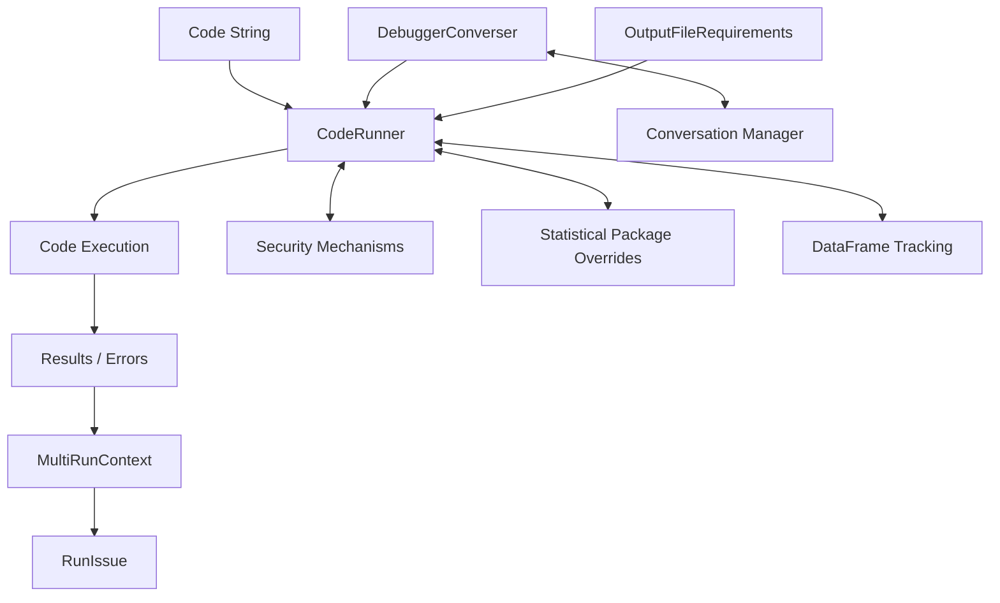
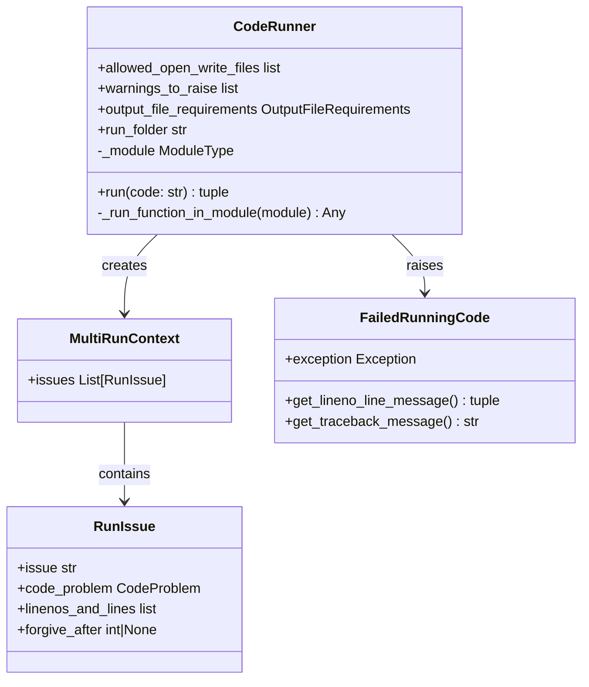
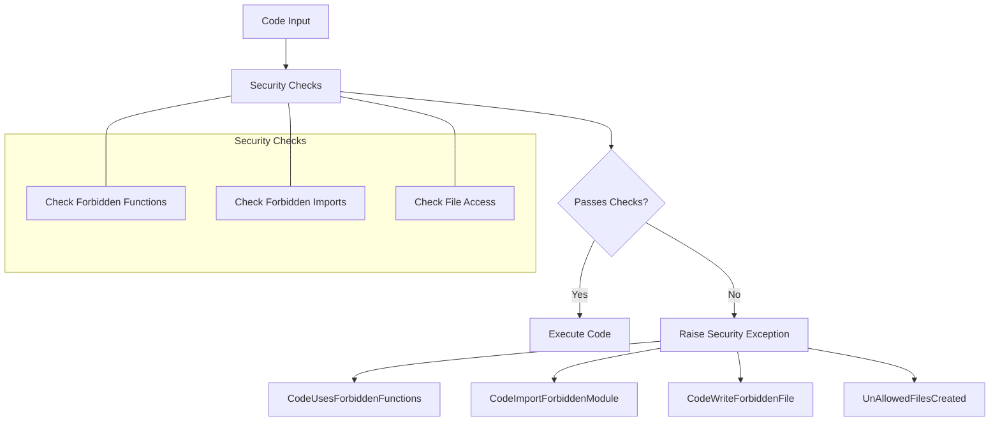
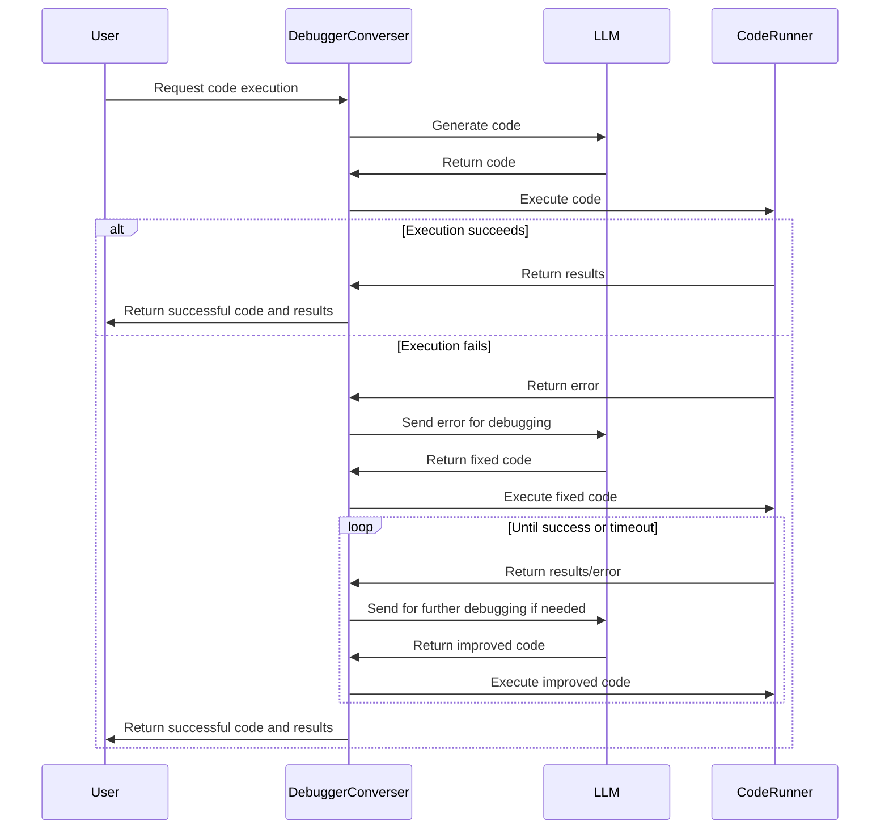
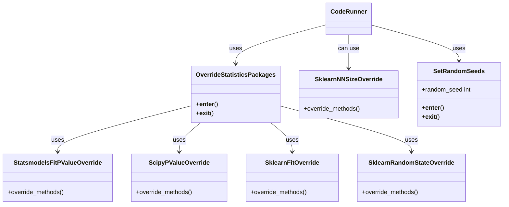
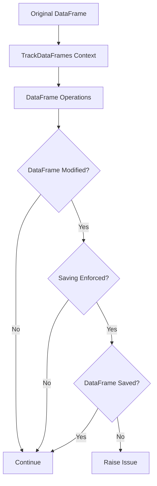
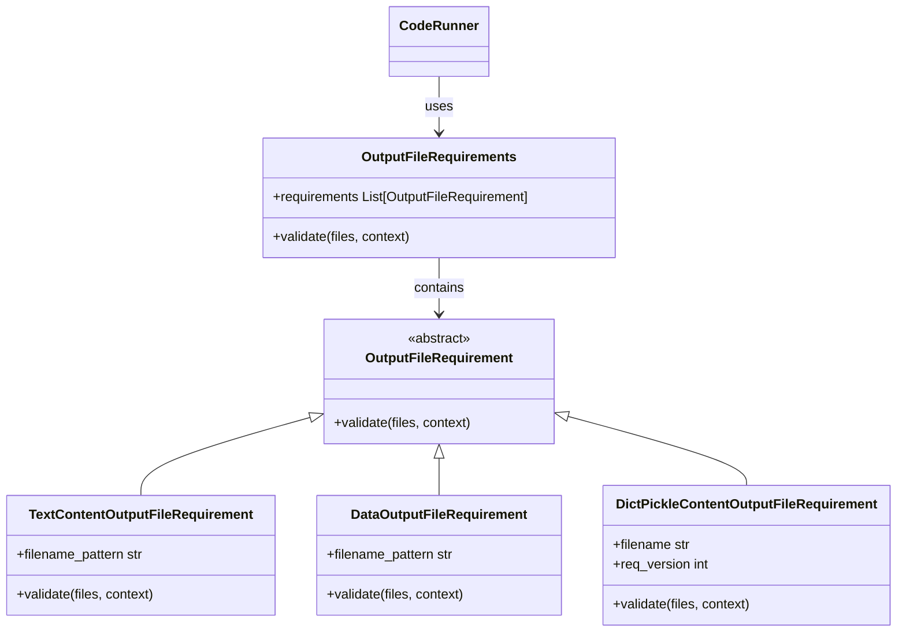
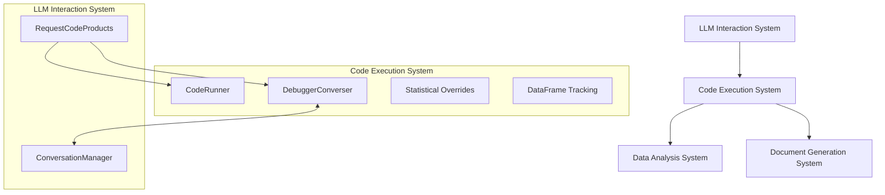

<!-- source: DeepWiki mcp.deepwiki.com · repo Technion-Kishony-lab/data-to-paper · page 2 Code Execution System · fetched 2026-10-26 -->

# Code Execution System

Relevant source files

The following files were used as context for generating this wiki page:

- [tests/functional/base_steps/test_debugger.py](tests/functional/base_steps/test_debugger.py)
- [tests/functional/base_steps/test_request_code.py](tests/functional/base_steps/test_request_code.py)
- [tests/functional/run_gpt_code/test_run_code.py](tests/functional/run_gpt_code/test_run_code.py)

The Code Execution System provides a secure, controlled environment for running AI-generated Python code within the data-to-paper framework. This system ensures that code execution is safe, reproducible, and properly integrated with the rest of the framework. It includes sandboxed execution, robust error handling, statistical package overrides, and automated debugging capabilities.

For details about how code is generated by LLMs, see [LLM Interaction System](#5). For information about data analysis performed using this execution system, see [Data Analysis System](#3).

## System Architecture

The Code Execution System consists of several interconnected components that work together to enable safe and controlled execution of Python code.

Sources: [tests/functional/run_gpt_code/test_run_code.py:9-18](), [tests/functional/base_steps/test_debugger.py:6-12]()

## Core Components

### CodeRunner

The `CodeRunner` class is the central component responsible for executing Python code in a controlled environment. It implements various security measures to prevent malicious or erroneous code execution.

The `run()` method executes the provided code string and returns a tuple containing:
1. The result of the execution
2. A list of created files
3. A `MultiRunContext` object containing issues
4. An error object (if execution failed)

Sources: [tests/functional/run_gpt_code/test_run_code.py:9-10](), [tests/functional/run_gpt_code/test_run_code.py:21-23](), [tests/functional/run_gpt_code/test_run_code.py:31-32]()

### Security Mechanisms

The `CodeRunner` implements several security mechanisms to prevent harmful code execution:

1. **Forbidden Function Checks**: Prevents use of potentially dangerous functions like `input()`, `exit()`, `quit()`, and `eval()`.
2. **Module Import Restrictions**: Blocks imports of certain modules like `os`, `sys`, and `matplotlib` by default.
3. **File Access Control**: Restricts which files can be opened for writing.
4. **File Creation Validation**: Ensures only allowed files are created.

Sources: [tests/functional/run_gpt_code/test_run_code.py:10-11](), [tests/functional/run_gpt_code/test_run_code.py:100-113](), [tests/functional/run_gpt_code/test_run_code.py:126-150](), [tests/functional/run_gpt_code/test_run_code.py:177-195]()

### Error Handling and Debugging

The system provides robust error handling and debugging capabilities, using the `DebuggerConverser` to facilitate iterative debugging with LLM assistance.

The `DebuggerConverser` manages the debugging process by:
1. Executing code using `CodeRunner`
2. Analyzing errors when execution fails
3. Communicating with LLMs to get improved code
4. Iterating until code executes successfully or a timeout is reached

Sources: [tests/functional/base_steps/test_debugger.py:6-12](), [tests/functional/base_steps/test_debugger.py:18-35](), [tests/functional/base_steps/test_debugger.py:95-117]()

## Statistical Package Overrides

The system includes mechanisms to override statistical packages to enforce correct behavior and prevent common errors. These overrides are implemented through context managers that temporarily modify the behavior of statistical functions.

The main types of statistical overrides include:

1. **P-value labeling**: Tracks p-values from statistical tests to ensure proper reporting
2. **Random state control**: Ensures reproducibility by setting random seeds
3. **Model fit monitoring**: Prevents multiple calls to fit() on the same model
4. **Neural network size limits**: Restricts neural network complexity to prevent excessive computation

Sources: [tests/functional/run_gpt_code/test_run_code.py:12-16](), [tests/functional/run_gpt_code/test_run_code.py:210-220](), [tests/functional/run_gpt_code/test_run_code.py:223-238](), [tests/functional/run_gpt_code/test_run_code.py:241-263](), [tests/functional/run_gpt_code/test_run_code.py:266-283]()

## DataFrame Tracking

The system includes a mechanism for tracking DataFrame changes during code execution to ensure that data integrity is maintained and that modifications are properly saved.

Key features of DataFrame tracking:

1. **Change detection**: Detects when DataFrames are modified during code execution
2. **Save enforcement**: Can require that modified DataFrames are saved
3. **Copy protection**: Can prevent modifications to existing DataFrames without making a copy first

Sources: [tests/functional/base_steps/test_request_code.py:14](), [tests/functional/base_steps/test_request_code.py:27](), [tests/functional/base_steps/test_request_code.py:44](), [tests/functional/base_steps/test_request_code.py:130-136]()

## Output File Requirements

The system allows specifying requirements for output files to ensure that code execution produces the expected outputs in the correct format.

The `OutputFileRequirements` class validates that the files created during code execution meet the specified requirements. Different types of requirements are available for different file types, such as text files, data files, and pickled dictionaries.

Sources: [tests/functional/run_gpt_code/test_run_code.py:8](), [tests/functional/run_gpt_code/test_run_code.py:17](), [tests/functional/run_gpt_code/test_run_code.py:195](), [tests/functional/run_gpt_code/test_run_code.py:213-214](), [tests/functional/base_steps/test_request_code.py:15-16](), [tests/functional/base_steps/test_request_code.py:26](), [tests/functional/base_steps/test_debugger.py:8-9](), [tests/functional/base_steps/test_debugger.py:48-50]()

## Integration with Other Systems

The Code Execution System is tightly integrated with other components of the data-to-paper framework:

Key integration points:

1. **LLM Interaction System**: Provides code generation capabilities through the `RequestCodeProducts` class, which uses the Code Execution System to run and debug the generated code.

2. **Data Analysis System**: Receives the output of code execution, particularly DataFrames and their associated metadata, for further analysis and visualization.

3. **Document Generation System**: Uses the results of code execution to generate research paper content, including tables, figures, and explanatory text.

Sources: [tests/functional/base_steps/test_request_code.py:9-11](), [tests/functional/base_steps/test_request_code.py:62-73]()

## Usage Examples

The following table shows common usage patterns for the Code Execution System:

| Use Case | Key Components | Example |
|----------|----------------|---------|
| Basic Code Execution | CodeRunner | `runner = CodeRunner()`   `result, files, context, error = runner.run(code)` |
| Execution with File Requirements | CodeRunner, OutputFileRequirements | `requirements = OutputFileRequirements([TextContentOutputFileRequirement('output.txt')])`   `runner = CodeRunner(output_file_requirements=requirements)` |
| Statistical Analysis | CodeRunner, OverrideStatisticsPackages | `with OverrideStatisticsPackages():`   `    runner.run(statistical_code)` |
| Reproducible Execution | CodeRunner, SetRandomSeeds | `with SetRandomSeeds(random_seed=42):`   `    runner.run(code_with_randomness)` |
| Debugging Code | DebuggerConverser | `debugger = DebuggerConverser(...)`   `code_and_output = debugger.run_debugging()` |
| DataFrame Tracking | CodeRunner, TrackDataFrames | `contexts = {'TrackDataFrames': TrackDataFrames()}`   `runner = CodeRunner(additional_contexts=contexts)` |

Sources: [tests/functional/run_gpt_code/test_run_code.py:31-32](), [tests/functional/run_gpt_code/test_run_code.py:194-195](), [tests/functional/run_gpt_code/test_run_code.py:210-216](), [tests/functional/run_gpt_code/test_run_code.py:241-263](), [tests/functional/base_steps/test_debugger.py:95-99](), [tests/functional/base_steps/test_request_code.py:43-44]()

---

