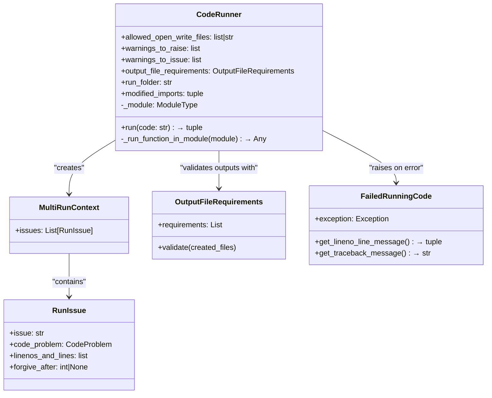
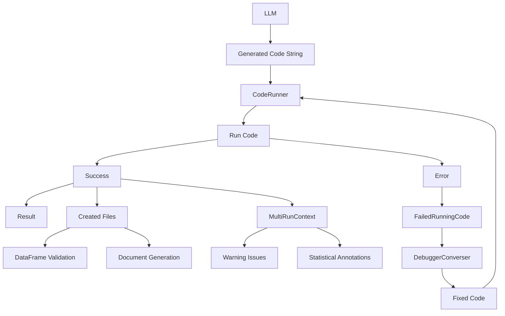
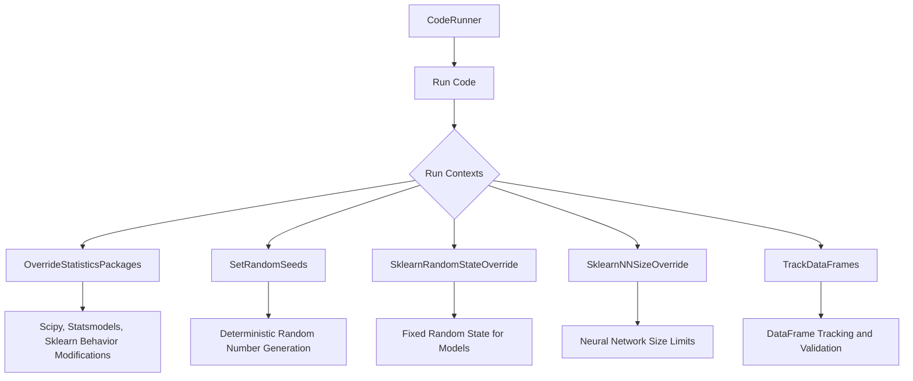

<!-- source: DeepWiki mcp.deepwiki.com · repo Technion-Kishony-lab/data-to-paper · page 2.1 CodeRunner · fetched 2026-10-26 -->

# CodeRunner

<details>
<summary>Relevant source files</summary>

The following files were used as context for generating this wiki page:

- [tests/functional/base_steps/test_debugger.py](tests/functional/base_steps/test_debugger.py)
- [tests/functional/base_steps/test_request_code.py](tests/functional/base_steps/test_request_code.py)
- [tests/functional/run_gpt_code/test_run_code.py](tests/functional/run_gpt_code/test_run_code.py)

</details>


## Overview

CodeRunner is a core component of the Code Execution System in the data-to-paper framework. It provides a secure sandboxed environment for executing Python code, particularly code generated by Large Language Models (LLMs). This document explains how CodeRunner works, its security features, and how it integrates with other components of the system.

For information about debugging code with LLM assistance, see [Debugging System](#2.2). For details about statistical package overrides used with CodeRunner, see [Statistical Package Overrides](#2.3).

Sources: [tests/functional/run_gpt_code/test_run_code.py:9-11]()

## Architecture and Components

CodeRunner serves as a secure execution environment that handles code execution with built-in safeguards. It can restrict forbidden operations, track created files, manage output requirements, and report execution issues.

### CodeRunner Core Architecture



Sources: [tests/functional/run_gpt_code/test_run_code.py:9-11](), [tests/functional/run_gpt_code/test_run_code.py:31-33](), [tests/functional/run_gpt_code/test_run_code.py:43]()

### Integration with Data-to-Paper Framework



Sources: [tests/functional/run_gpt_code/test_run_code.py:21-23](), [tests/functional/base_steps/test_debugger.py:28-38]()

## Key Features

### Code Execution

CodeRunner's primary function is to execute Python code strings safely. The `run()` method takes a code string as input and returns a tuple containing:

1. The execution result (if applicable)
2. Created files
3. A `MultiRunContext` object with execution issues
4. Error information (if the execution failed)

```python
result, created_files, multi_context, error = CodeRunner().run(code)
```

The executed code is run in a module context, which is stored in the `_module` attribute of the CodeRunner instance.

Sources: [tests/functional/run_gpt_code/test_run_code.py:31-33](), [tests/functional/run_gpt_code/test_run_code.py:43]()

### Security Restrictions

CodeRunner implements multiple layers of security to ensure safe execution of potentially untrusted code:

#### Forbidden Function Calls

CodeRunner prevents the use of potentially dangerous functions:

| Forbidden Function | Reason |
|-------------------|--------|
| `input()` | Blocks execution waiting for user input |
| `exit()` | Terminates the program |
| `quit()` | Terminates the program |
| `eval()` | Executes arbitrary code |
| `print()` (warns but doesn't block) | Encourages proper output file usage |

Sources: [tests/functional/run_gpt_code/test_run_code.py:100-113](), [tests/functional/run_gpt_code/test_run_code.py:116-123]()

#### Import Restrictions

By default, CodeRunner restricts imports of modules that could be used to access system resources:

| Restricted Modules | Example |
|-------------------|---------|
| `os` | System operations |
| `sys` | Python runtime environment |
| `matplotlib` (configurable) | Visualization (can be configured) |

The `modified_imports` parameter allows specifying which imports to restrict or modify.

Sources: [tests/functional/run_gpt_code/test_run_code.py:126-150](), [tests/functional/run_gpt_code/test_run_code.py:153-159]()

#### File Operation Restrictions

CodeRunner can restrict which files the code is allowed to write to:

- With `allowed_open_write_files=[]`, no file writing is allowed
- With `allowed_open_write_files=['file1.txt', 'file2.csv']`, only specified files can be written
- With `allowed_open_write_files='all'`, all file operations are allowed but still tracked

Sources: [tests/functional/run_gpt_code/test_run_code.py:177-190](), [tests/functional/run_gpt_code/test_run_code.py:193-195]()

### Error Handling

When code execution fails, CodeRunner catches exceptions and provides detailed error information:

- Line numbers and code snippets where the error occurred
- Formatted traceback messages for debugging
- Categorized error types via specific exception classes

```python
error = CodeRunner().run(code)[3]
if isinstance(error, FailedRunningCode):
    linenos_lines, msg = error.get_lineno_line_message()
    # linenos_lines contains tuples of (line_number, line_content)
```

Sources: [tests/functional/run_gpt_code/test_run_code.py:36-47](), [tests/functional/run_gpt_code/test_run_code.py:83-97]()

### Warning Management

CodeRunner can handle warnings in two ways:

1. **Raise warnings as exceptions**:
   ```python
   error = CodeRunner(warnings_to_raise=[UserWarning]).run(code)[3]
   ```

2. **Issue warnings as non-fatal issues**:
   ```python
   result, created_files, multi_context, error = CodeRunner(warnings_to_issue=[UserWarning]).run(code)
   issues = multi_context.issues  # Contains the warnings
   ```

Sources: [tests/functional/run_gpt_code/test_run_code.py:58-80]()

### Output File Requirements

CodeRunner can enforce requirements on output files through the `OutputFileRequirements` class:

```python
CodeRunner(
    allowed_open_write_files=['results.pkl'],
    output_file_requirements=OutputFileRequirements([
        DictPickleContentOutputFileRequirement('results.pkl', 1)
    ])
).run(code)
```

This ensures that code produces files in specific formats and with required content types.

Sources: [tests/functional/run_gpt_code/test_run_code.py:198-221]()

## Extension and Customization

### Custom Run Contexts

CodeRunner can be extended with additional contexts to modify execution behavior:



Sources: [tests/functional/run_gpt_code/test_run_code.py:210-221](), [tests/functional/run_gpt_code/test_run_code.py:235-263](), [tests/functional/base_steps/test_request_code.py:44]()

### Custom CodeRunner Subclasses

CodeRunner can be subclassed to customize behavior:

```python
class CallFuncCodeRunner(CodeRunner):
    def _run_function_in_module(self, module: ModuleType):
        return module.func()
```

The `TestCodeRunnerWithForgive` example shows how to create a specialized CodeRunner that handles specific types of issues, with the ability to "forgive" certain issues after a specific number of attempts.

Sources: [tests/functional/run_gpt_code/test_run_code.py:21-23](), [tests/functional/base_steps/test_debugger.py:28-38]()

## Usage Examples

### Basic Code Execution

```python
code = """
def f():
    return 'hello'
"""
run_code = CodeRunner()
result, created_files, multi_context, error = run_code.run(code)
# Access defined functions via the module
hello_result = run_code._module.f()  # 'hello'
```

Sources: [tests/functional/run_gpt_code/test_run_code.py:26-33]()

### Executing Code with Statistical Overrides

```python
with OverrideStatisticsPackages():
    error = CodeRunner(
        run_folder=tmpdir,
        allowed_open_write_files=['results.pkl'],
        output_file_requirements=OutputFileRequirements([
            DictPickleContentOutputFileRequirement('results.pkl', 1)
        ])
    ).run(statistical_code)
```

Sources: [tests/functional/run_gpt_code/test_run_code.py:198-221]()

### Reproducible Machine Learning

```python
with SetRandomSeeds(random_seed=42):
    result = CodeRunner().run(ml_code)
```

Sources: [tests/functional/run_gpt_code/test_run_code.py:254-263]()

## Integration with Debugging System

When CodeRunner encounters errors, these can be automatically addressed using the `DebuggerConverser`, which works with an LLM to fix the code:

```python
debugger = DebuggerConverser(
    output_file_requirements=OutputFileRequirements([
        TextContentOutputFileRequirement('output.txt')
    ])
)
fixed_code_and_output = debugger.run_debugging()
```

Sources: [tests/functional/base_steps/test_debugger.py:45-50](), [tests/functional/base_steps/test_debugger.py:95-99]()

## Summary

CodeRunner is a fundamental component of the data-to-paper framework that enables secure execution of code, typically generated by Large Language Models. It provides comprehensive security features, extensive error handling, and integration with other system components like the DebuggerConverser. Through its customization options, it can be tailored to specific execution requirements, making it a versatile tool for reproducible scientific research.

---

