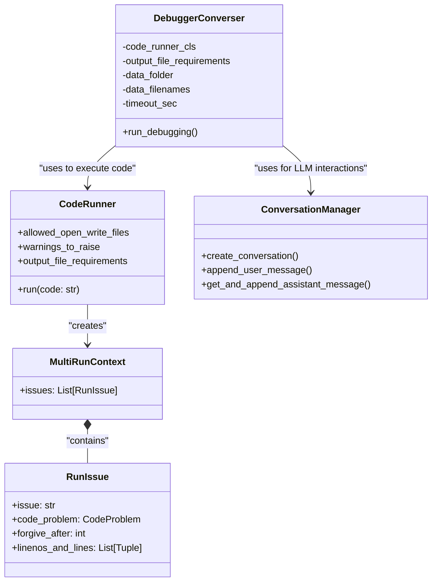
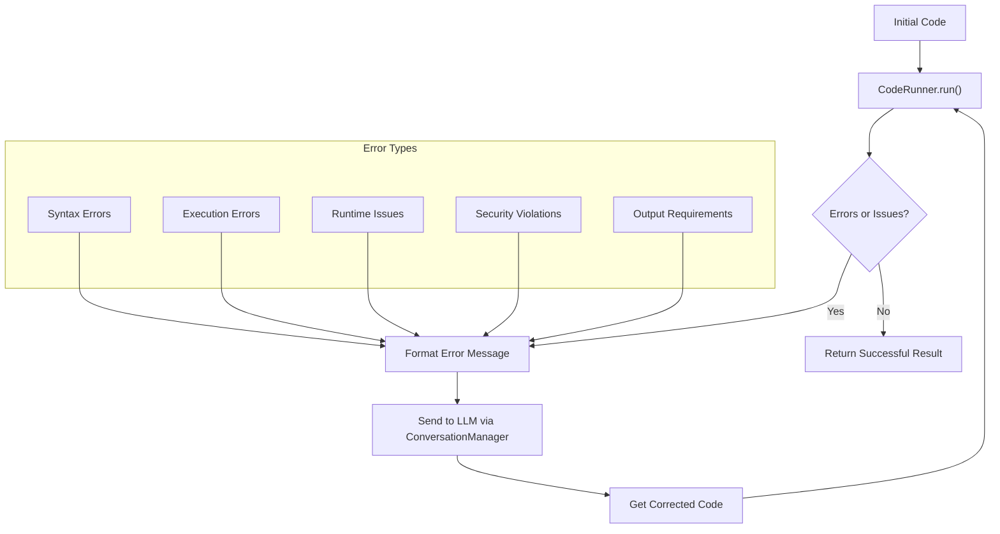
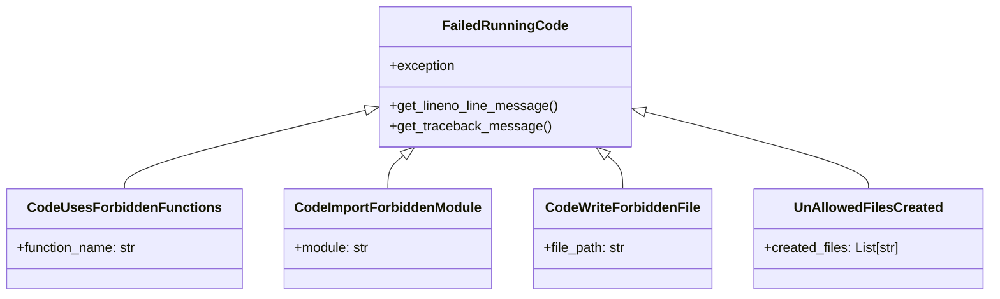
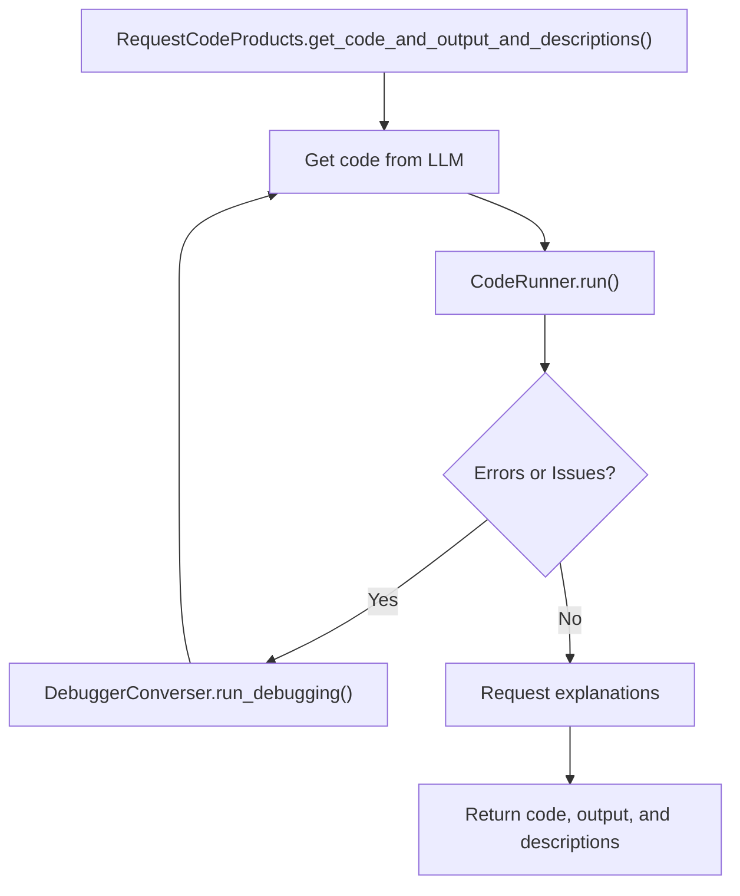

<!-- source: DeepWiki mcp.deepwiki.com · repo Technion-Kishony-lab/data-to-paper · page 2.2 Debugging System · fetched 2026-10-26 -->

# Debugging System

<details>
<summary>Relevant source files</summary>

The following files were used as context for generating this wiki page:

- [tests/functional/base_steps/test_debugger.py](tests/functional/base_steps/test_debugger.py)
- [tests/functional/base_steps/test_request_code.py](tests/functional/base_steps/test_request_code.py)
- [tests/functional/run_gpt_code/test_run_code.py](tests/functional/run_gpt_code/test_run_code.py)

</details>


The Debugging System is a critical component of the `data-to-paper` framework that facilitates automatic error detection and correction in AI-generated code. It serves as a bridge between the Code Execution System and the LLM Interaction System, providing an intelligent feedback loop that enables iterative debugging with assistance from large language models.

This page describes the debugging components, workflow, and error handling mechanisms. For information about the underlying code execution environment, see [CodeRunner](#2.1). For details on statistical safety measures, see [Statistical Package Overrides](#2.3).

## Components and Architecture

The Debugging System is centered around the `DebuggerConverser` class, which orchestrates the debugging process by detecting code issues, generating appropriate error messages, and working with LLMs to fix problems.



Sources: [tests/functional/base_steps/test_debugger.py:6-24](), [tests/functional/run_gpt_code/test_run_code.py:9-24]()

## Debugging Workflow

The debugging system follows an iterative process to detect and fix issues in code:



Sources: [tests/functional/base_steps/test_debugger.py:95-117](), [tests/functional/run_gpt_code/test_run_code.py:35-97]()

### Key Methods

The main entry point to the debugging system is the `run_debugging()` method of `DebuggerConverser`, which:

1. Takes code (often AI-generated)
2. Attempts to run it using `CodeRunner`
3. If issues are found, formats detailed error messages
4. Passes these messages to an LLM via the Conversation Management System
5. Gets corrected code from the LLM
6. Repeats until the code runs without issues or timeout occurs

Sources: [tests/functional/base_steps/test_debugger.py:95-117]()

## Error Types and Handling

The Debugging System handles a variety of error types, providing detailed context for the LLM to understand and fix issues:

### 1. Syntax Errors

Detected when code fails to parse. Error messages include line numbers and offending code segments.

```
SyntaxError: unexpected EOF while parsing
Line 3: f.write(
```

### 2. Execution Errors

Includes forbidden function calls, restricted imports, and general Python exceptions.



Sources: [tests/functional/run_gpt_code/test_run_code.py:10-11](), [tests/functional/run_gpt_code/test_run_code.py:99-190]()

### 3. Runtime Issues

Includes timeouts for long-running code and statistical inference issues.

Sources: [tests/functional/base_steps/test_debugger.py:119-124]()

### 4. Forgiveness Mechanism

The system can "forgive" certain minor issues after seeing them a specific number of times. This prevents endless debugging loops for non-critical warnings.

```python
RunIssue(issue='Small problem that can be forgiven',
         code_problem=CodeProblem.OutputFileAnnotation,
         forgive_after=1)
```

Sources: [tests/functional/base_steps/test_debugger.py:27-42](), [tests/functional/base_steps/test_debugger.py:126-134]()

## Integration with Other Systems

### Integration with Code Generation

The Debugging System complements the Code Generation System by providing a mechanism to fix issues in AI-generated code. This integration is handled through the `RequestCodeProducts` class, which:

1. Requests code from an LLM
2. Runs the code using `CodeRunner`
3. If errors occur, invokes the Debugging System
4. Collects explanations of the code and its outputs



Sources: [tests/functional/base_steps/test_request_code.py:62-73](), [tests/functional/base_steps/test_request_code.py:221-251]()

### Integration with Statistical Overrides

The Debugging System works with the Statistical Override System to enforce correct statistical practices. When code is run through `CodeRunner`, it can use contexts like `OverrideStatisticsPackages` to intercept and modify statistical function calls, reporting issues when problematic patterns are detected.

```python
with OverrideStatisticsPackages():
    error = CodeRunner(...).run(code)[3]
```

Sources: [tests/functional/run_gpt_code/test_run_code.py:210-220](), [tests/functional/run_gpt_code/test_run_code.py:12-15]()

## Example Debugging Flow

Here's an example of the debugging process in action:

1. LLM generates code with a syntax error:
   ```python
   with open('test_output.txt', 'w') as f:
       f.write(
   ```

2. `CodeRunner` executes the code and detects the error

3. `DebuggerConverser` formats the error message with context:
   ```
   SyntaxError: unexpected EOF while parsing
   Line 2: f.write(
   ```

4. The error message is sent to the LLM via the Conversation Manager

5. LLM responds with corrected code:
   ```python
   with open('test_output.txt', 'w') as f:
       f.write('The answer is 42')
   ```

6. The corrected code is executed successfully

Sources: [tests/functional/base_steps/test_debugger.py:102-117]()

## Configuration Options

The Debugging System can be configured with several options:

| Option | Description | Example |
|--------|-------------|---------|
| `timeout_sec` | Maximum execution time allowed for code | `timeout_sec=3` |
| `output_file_requirements` | Required output files with validation rules | `OutputFileRequirements([TextContentOutputFileRequirement('output.txt')])` |
| `data_folder` | Folder containing input data files | `/path/to/data` |
| `data_filenames` | Names of input data files | `('data.csv',)` |
| `code_runner_cls` | Class to use for code execution | `CodeRunner` |

Sources: [tests/functional/base_steps/test_debugger.py:46-55]()

## Timeout Handling

The Debugging System includes functionality to handle code that runs for too long, which is particularly important when dealing with potentially infinite loops or inefficient algorithms in AI-generated code.

Sources: [tests/functional/base_steps/test_debugger.py:54-55](), [tests/functional/base_steps/test_debugger.py:119-124]()

---

