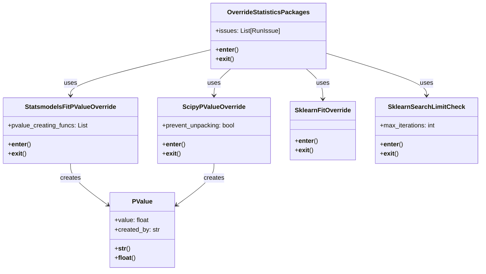
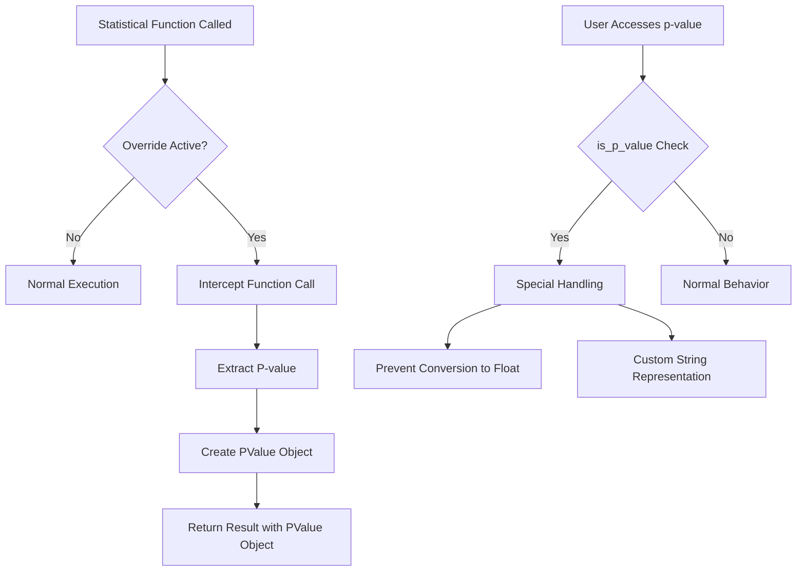
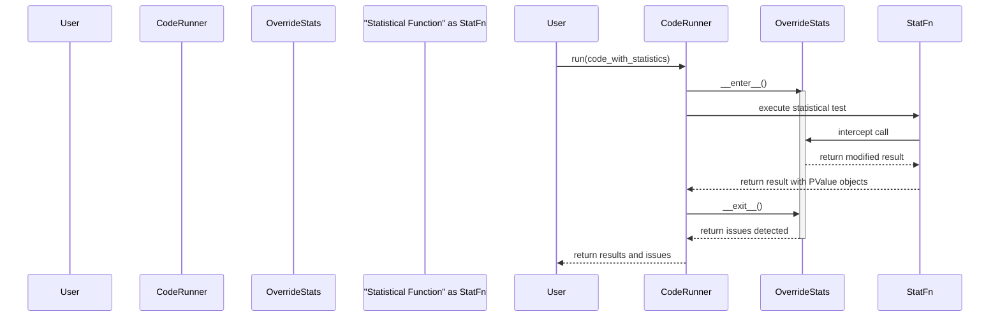

<!-- source: DeepWiki mcp.deepwiki.com · repo Technion-Kishony-lab/data-to-paper · page 2.3 Statistical Package Overrides · fetched 2026-10-26 -->

# Statistical Package Overrides

<details>
<summary>Relevant source files</summary>

The following files were used as context for generating this wiki page:

- [tests/functional/run_gpt_code/test_sklearn.py](tests/functional/run_gpt_code/test_sklearn.py)
- [tests/functional/run_gpt_code/test_statsmodels.py](tests/functional/run_gpt_code/test_statsmodels.py)

</details>


## Purpose and Overview

The Statistical Package Overrides system is a critical component of the `data-to-paper` framework that ensures statistical analysis is performed correctly and consistently. It intercepts calls to popular statistical packages and modifies their behavior to:

1. Track and properly label p-values to prevent misinterpretation
2. Prevent common statistical errors and pitfalls
3. Enforce best practices in statistical reporting
4. Limit computationally expensive operations to reasonable bounds

This system works transparently during code execution to help researchers avoid common statistical pitfalls without having to modify their analysis code.

Sources: [tests/functional/run_gpt_code/test_statsmodels.py:11-17]()

## Architecture Overview



**Class Hierarchy of Statistical Package Overrides**

The system uses a set of context managers to override the behavior of statistical packages. The main context manager, `OverrideStatisticsPackages`, applies all specific overrides and collects any issues that arise during execution.

Sources: [tests/functional/run_gpt_code/test_statsmodels.py:12-17](), [tests/functional/run_gpt_code/test_statsmodels.py:49-55]()

## P-Value Tracking System



**P-Value Tracking Workflow**

The core of the statistical override system is the `PValue` class, which wraps standard floating-point p-values with metadata:

- Tracks the statistical method that generated the p-value
- Prevents improper conversion to float (which would strip this metadata)
- Provides custom string representation for proper reporting

The `is_p_value()` function checks if a value is a `PValue` object, enabling special handling throughout the system.

Sources: [tests/functional/run_gpt_code/test_statsmodels.py:17](), [tests/functional/run_gpt_code/test_statsmodels.py:85-92]()

## Package-Specific Overrides

### Statsmodels Overrides

The `StatsmodelsFitPValueOverride` manages several behaviors for the statsmodels package:

1. **P-value Labeling**: 
   - Replaces float p-values with `PValue` objects that track their origin
   - Works with multiple model types (OLS, WLS, GLS, GLM, Logit)
   - Tracks which methods created p-values

2. **Usage Enforcement**:
   - Prevents the use of `summary()` method, encouraging more standardized reporting
   - Allows `summary2()` for better tabular output
   - Prevents conversion of p-values to raw floats

3. **Error Detection**:
   - Detects NaN p-values and issues warnings
   - Identifies singular matrix problems
   - Creates issues when fit() is not called on models

Sources: [tests/functional/run_gpt_code/test_statsmodels.py:72-99](), [tests/functional/run_gpt_code/test_statsmodels.py:102-115](), [tests/functional/run_gpt_code/test_statsmodels.py:129-141]()

### Scipy Overrides

The `ScipyPValueOverride` class modifies scipy statistical functions:

1. **P-value Labeling**:
   - Labels p-values from functions like `ttest_1samp`, `ttest_ind`, and `chi2_contingency`
   - Tracks the function that created each p-value

2. **Error Prevention**:
   - Raises errors on NaN p-values
   - Optionally prevents result unpacking (e.g., `statistic, pvalue = result`) to encourage accessing named attributes
   - Blocks index-based access to result tuples (`result[1]`) in favor of named attributes (`result.pvalue`)

Sources: [tests/functional/run_gpt_code/test_statsmodels.py:291-307](), [tests/functional/run_gpt_code/test_statsmodels.py:357-379]()

### Scikit-learn Overrides

The scikit-learn overrides address two major issues:

1. **`SklearnFitOverride`**:
   - Prevents multiple calls to `fit()` on the same model instance
   - Solves a subtle bug where scikit-learn reuses the same model object, causing unexpected behavior when data changes

2. **`SklearnSearchLimitCheck`**:
   - Limits the number of iterations in hyperparameter searches (GridSearchCV, RandomizedSearchCV)
   - Prevents computationally expensive searches from running too long
   - Raises a `RunIssue` when the search would exceed the maximum iterations

3. **`SklearnPValue`**:
   - Labels p-values from scikit-learn feature selection methods

Sources: [tests/functional/run_gpt_code/test_statsmodels.py:217-241](), [tests/functional/run_gpt_code/test_sklearn.py:12-57](), [tests/functional/run_gpt_code/test_sklearn.py:60-65]()

## Integration with Code Execution System



**Integration Flow with CodeRunner**

The `CodeRunner` class automatically applies statistical package overrides when executing code. It:

1. Enters the `OverrideStatisticsPackages` context
2. Executes the user's statistical code
3. Collects any issues that arise during execution
4. Reports these issues along with the execution results

This integration ensures that all statistical code runs with the necessary safeguards automatically applied.

Sources: [tests/functional/run_gpt_code/test_statsmodels.py:254-262](), [tests/functional/run_gpt_code/test_statsmodels.py:275-282]()

## Common Issues Detected

The statistical package overrides detect several common issues:

| Issue | Description | Package | Action |
|-------|-------------|---------|--------|
| NaN p-values | P-values that are NaN due to missing data or other issues | statsmodels, scipy | Raises `RunIssue` with explanation |
| Multiple `fit()` calls | Calling `fit()` multiple times on the same sklearn model | sklearn | Raises `RunIssue` to prevent the second call |
| Excessive search iterations | Hyperparameter searches with too many iterations | sklearn | Limits iterations and raises `RunIssue` if exceeded |
| Singular matrix warnings | Models with redundant features leading to singular matrices | statsmodels | Issues warning about potential multicollinearity |
| Unpacking statistical results | Using tuple unpacking instead of named attributes | scipy | Either prevents unpacking or issues guidance |
| Missing `fit()` call | Creating a model without calling `fit()` | statsmodels | Issues reminder to call `fit()` |

Sources: [tests/functional/run_gpt_code/test_statsmodels.py:102-115](), [tests/functional/run_gpt_code/test_statsmodels.py:129-141](), [tests/functional/run_gpt_code/test_statsmodels.py:302-307](), [tests/functional/run_gpt_code/test_sklearn.py:12-33]()

## Usage Examples

### Basic Usage with CodeRunner

To apply statistical overrides when running code:

```python
from data_to_paper.run_gpt_code.code_runner import CodeRunner
from data_to_paper.run_gpt_code.overrides.contexts import OverrideStatisticsPackages

# Code will run with all statistical overrides applied
result, _, _, exception = CodeRunner(
    additional_contexts={'OverrideStatisticsPackages': OverrideStatisticsPackages()}
).run(statistical_code)

# Check for any statistical issues
if exception:
    print(f"Statistical issue detected: {exception}")
```

### Manual Context Usage

For more control, you can manually use the context managers:

```python
from data_to_paper.run_gpt_code.overrides.contexts import OverrideStatisticsPackages

with OverrideStatisticsPackages() as context:
    # Your statistical code here
    model = ols('y ~ x', data=data).fit()
    p_value = model.pvalues[0]  # This will be a PValue object
    
# Check if any issues were detected
if context.issues:
    print(f"Issues detected: {context.issues}")
```

Sources: [tests/functional/run_gpt_code/test_statsmodels.py:49-55](), [tests/functional/run_gpt_code/test_statsmodels.py:254-262]()

## Best Practices

When working with the statistical package overrides, follow these best practices:

1. **Use Named Attributes**: Access result attributes by name (e.g., `result.pvalue`) rather than by index or unpacking
2. **Check Issue Reports**: Always check for issues returned by the context manager
3. **Use `summary2()` Instead of `summary()`**: For statsmodels, prefer `summary2()` for better tabular output
4. **Keep Hyperparameter Searches Reasonable**: Limit the search space in GridSearchCV and RandomizedSearchCV
5. **Always Call `fit()`**: Make sure to call `fit()` on models before accessing results
6. **Create New Model Instances**: Create new model instances rather than reusing existing ones with new data

Sources: [tests/functional/run_gpt_code/test_statsmodels.py:357-379](), [tests/functional/run_gpt_code/test_statsmodels.py:49-61](), [tests/functional/run_gpt_code/test_sklearn.py:36-57]()

## Limitations and Considerations

- Statistical overrides may slightly impact performance due to the interception of function calls
- Some very specialized statistical functions might not be covered by the overrides
- The system cannot catch all possible statistical errors, just the most common ones
- Custom statistical code might not benefit from these overrides if it doesn't use the standard packages

Sources: [tests/functional/run_gpt_code/test_statsmodels.py:338-346]()

---

