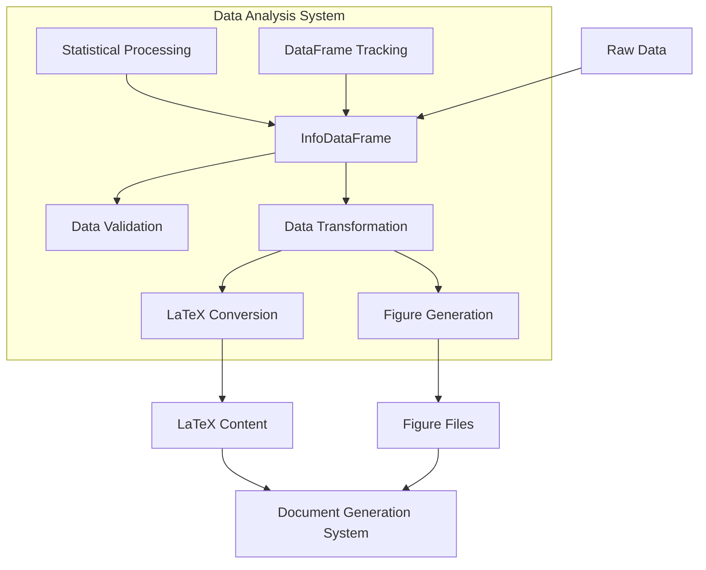
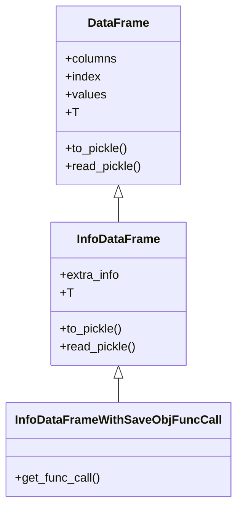
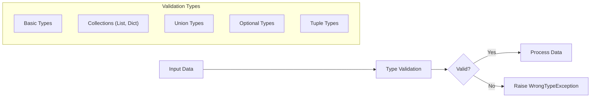
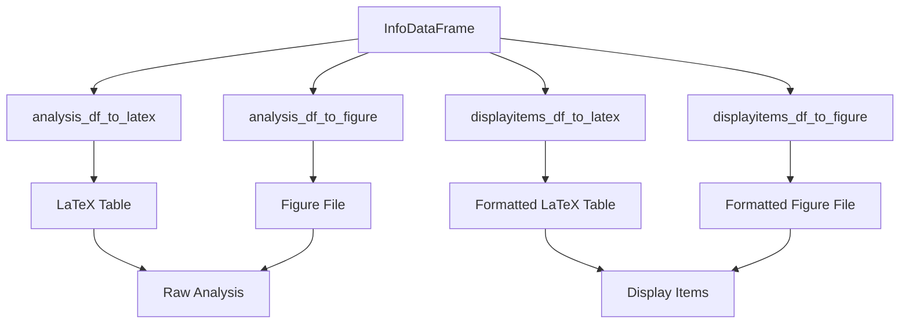
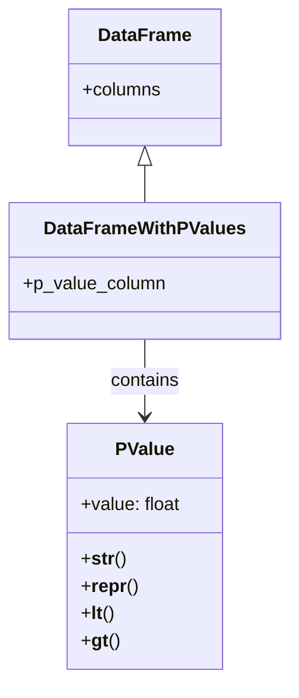
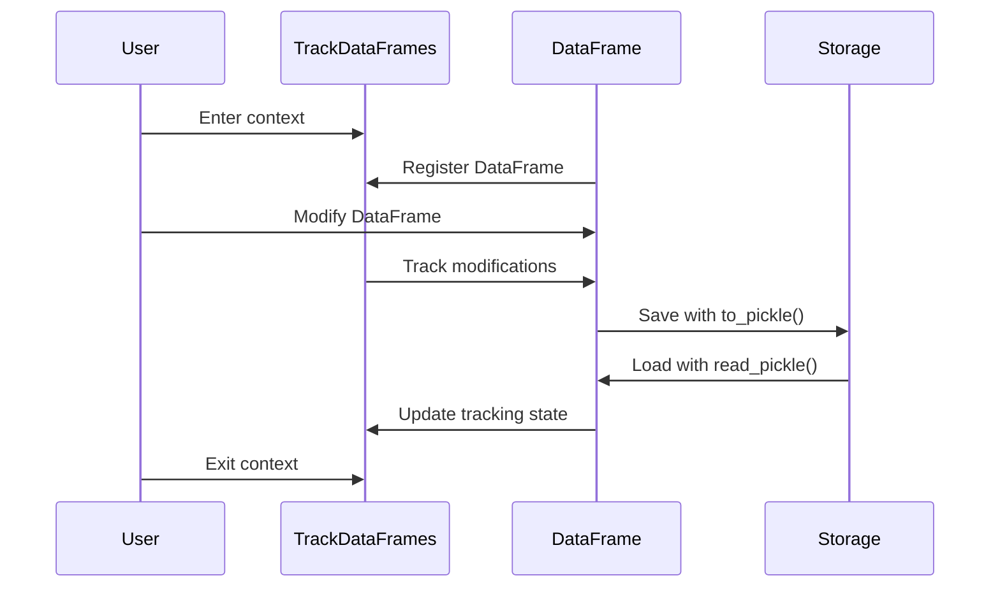
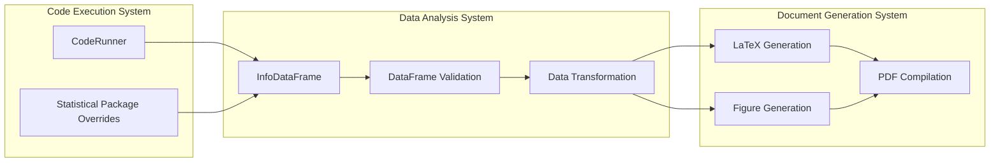
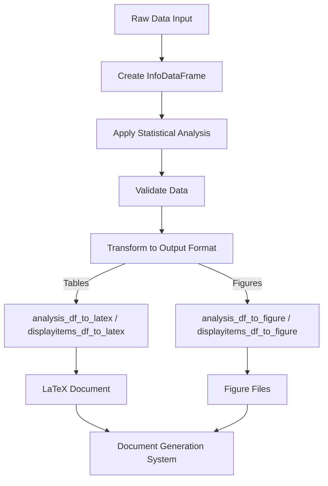

<!-- source: DeepWiki mcp.deepwiki.com · repo Technion-Kishony-lab/data-to-paper · page 3 Data Analysis System · fetched 2026-10-26 -->

# Data Analysis System

Relevant source files

The following files were used as context for generating this wiki page:

- [tests/functional/research_types/scientific_research/test_df_file_formatting.py](tests/functional/research_types/scientific_research/test_df_file_formatting.py)
- [tests/functional/run_gpt_code/test_mydata_df.py](tests/functional/run_gpt_code/test_mydata_df.py)
- [tests/functional/utils/test_check_types.py](tests/functional/utils/test_check_types.py)

The Data Analysis System is a core component of the data-to-paper framework that handles the processing, validation, transformation, and visualization of research data. It provides specialized data structures and utilities for ensuring data integrity, tracking data transformations, and converting data into formats suitable for publication in scientific papers.

For information about the Document Generation System that uses the analyzed data to create research papers, see [Document Generation System](#4). For details on how code execution is handled in a sandboxed environment, see [Code Execution System](#2).

## System Architecture

The Data Analysis System consists of several interrelated components that work together to process and validate research data:

Sources: [tests/functional/research_types/scientific_research/test_df_file_formatting.py:1-202](), [tests/functional/run_gpt_code/test_mydata_df.py:1-54]()

## Key Components

### InfoDataFrame

The InfoDataFrame is an extended Pandas DataFrame that preserves additional metadata and tracks transformations. It inherits from Pandas DataFrame and adds the ability to store extra information that persists through operations like saving, loading, and transformations.

Key features of InfoDataFrame:
- Maintains metadata through serialization/deserialization
- Preserves attributes during operations like transpose
- Integrates with the DataFrame tracking system

Sources: [tests/functional/run_gpt_code/test_mydata_df.py:10-54]()

### Data Validation System

The Data Analysis System includes robust validation mechanisms to ensure data integrity and correct typing:

The validation system supports:
- Validation of primitive types (int, str, etc.)
- Complex type checking for collections like List[str], Dict[str, int]
- Union type validation (Union[int, str])
- Optional type validation
- Tuple type validation with specific length and element types

Sources: [tests/functional/utils/test_check_types.py:1-57]()

### Data Transformation

The Data Analysis System provides utilities to transform DataFrames into formats suitable for inclusion in research papers:

These transformation functions handle:
- Converting DataFrames to LaTeX tables with proper formatting
- Creating figures from DataFrames with appropriate styling
- Handling special formatting for statistical values (e.g., p-values)
- Adding captions, labels, and glossaries for scientific documentation

Sources: [tests/functional/research_types/scientific_research/test_df_file_formatting.py:43-69]()

### Statistical Processing

The Data Analysis System includes specialized handling for statistical entities, particularly p-values:

The `PValue` class provides specialized formatting and comparison operations for statistical p-values. This allows for proper display in scientific papers with appropriate significance indicators.

Sources: [tests/functional/research_types/scientific_research/test_df_file_formatting.py:25-31]()

## DataFrame Tracking

The Data Analysis System includes a tracking mechanism to monitor DataFrame changes during code execution:

The `TrackDataFrames` context manager:
- Monitors DataFrame creation and modifications
- Ensures persistence of metadata during save/load operations
- Maintains the specialized DataFrame types and their attributes

Sources: [tests/functional/run_gpt_code/test_mydata_df.py:34-42]()

## Integration with Other Systems

The Data Analysis System integrates with other components of the data-to-paper framework:

Key integrations:
1. **Code Execution System**: Provides the sandboxed environment where data analysis code runs
2. **Statistical Package Overrides**: Ensures statistical functions behave properly during analysis
3. **Document Generation System**: Uses the transformed data to generate publication-ready documents

Sources: [tests/functional/research_types/scientific_research/test_df_file_formatting.py:8-22]()

## Data View Purposes

The Data Analysis System supports multiple presentation formats for different contexts through the `ViewPurpose` enumeration:

| View Purpose | Description | Use Case |
|-------------|-------------|----------|
| CODE_REVIEW | Raw format for code inspection | Code review and debugging |
| PRODUCT | Formatted output for general viewing | General product display |
| HYPERTARGET_PRODUCT | Output with hyperlinks | Interactive document viewing |
| APP_HTML | HTML format for application display | GUI application display |
| FINAL_APPENDIX | Format for document appendices | Research paper appendices |
| FINAL_INLINE | Format for inline document content | Main research paper content |

The system adapts its output formatting based on the view purpose, ensuring appropriate presentation in each context.

Sources: [tests/functional/research_types/scientific_research/test_df_file_formatting.py:106-141]()

## Data Flow

The typical workflow through the Data Analysis System follows these steps:

This workflow ensures that raw data is properly processed, validated, and transformed into formats suitable for inclusion in scientific publications.

Sources: [tests/functional/research_types/scientific_research/test_df_file_formatting.py:65-69]()

---

