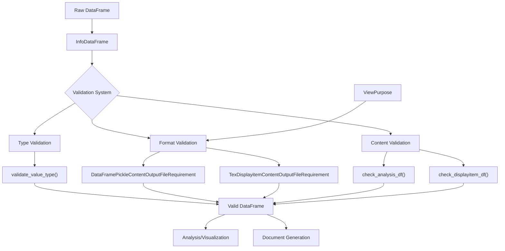
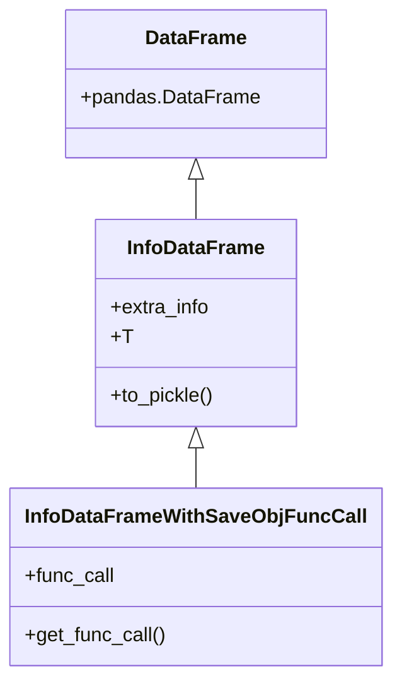
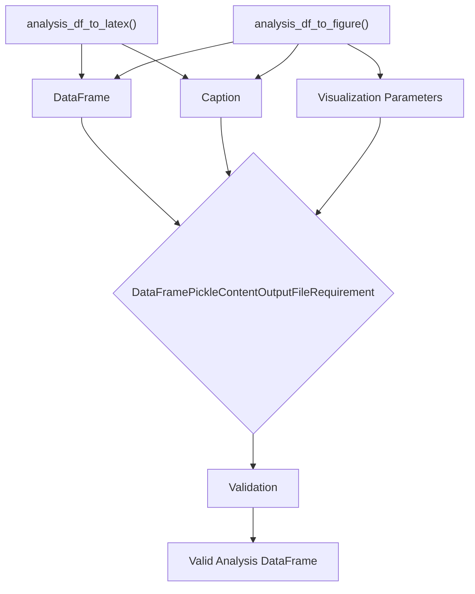
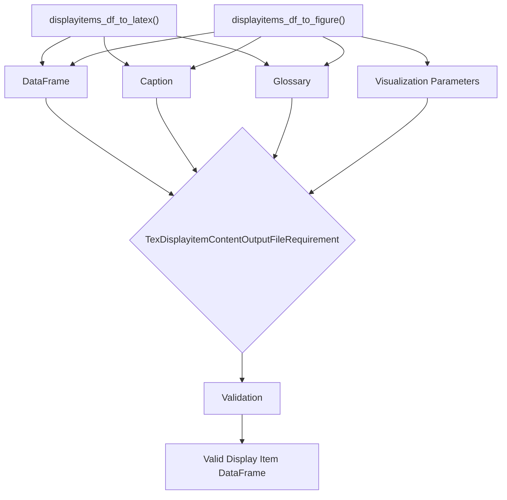
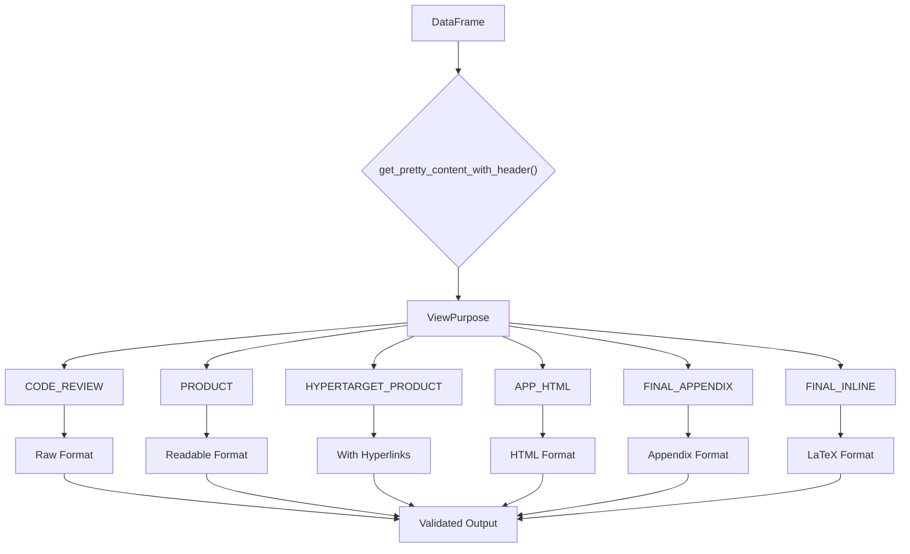
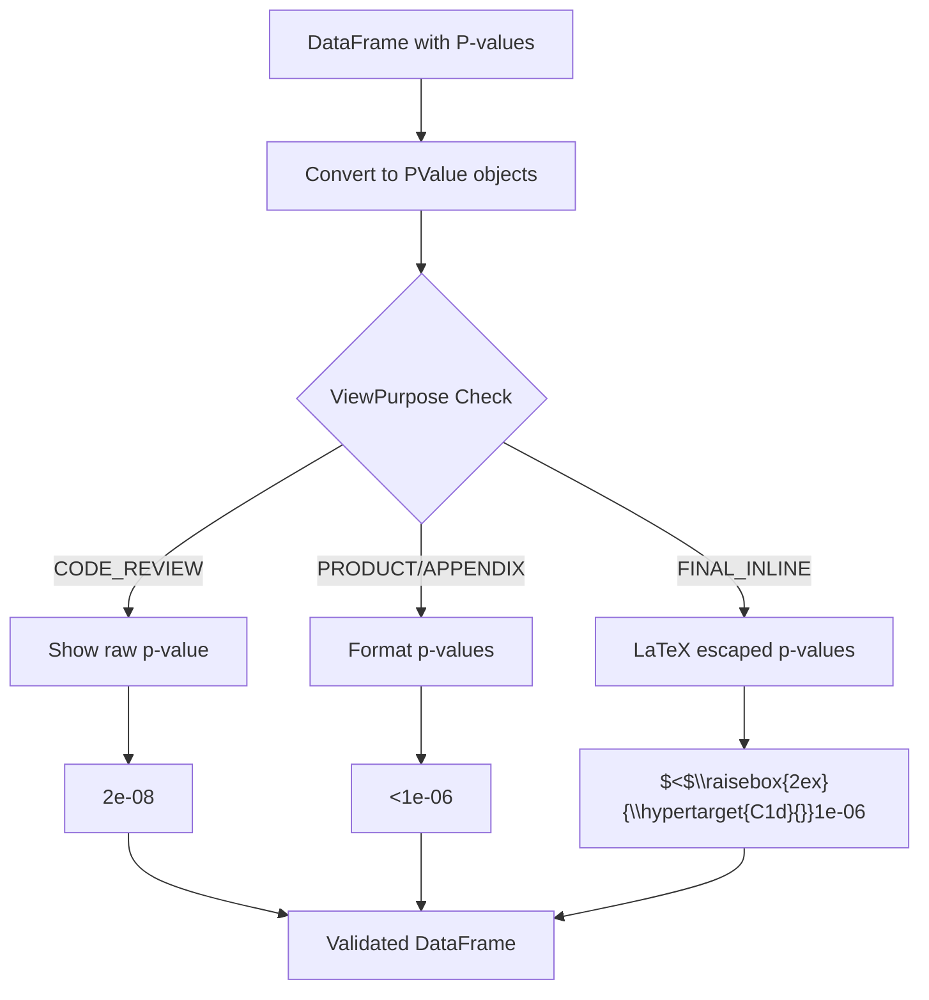
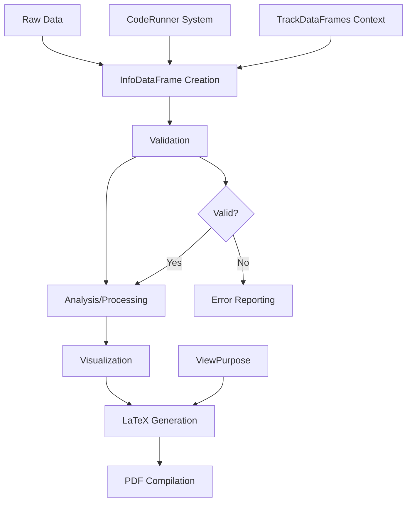
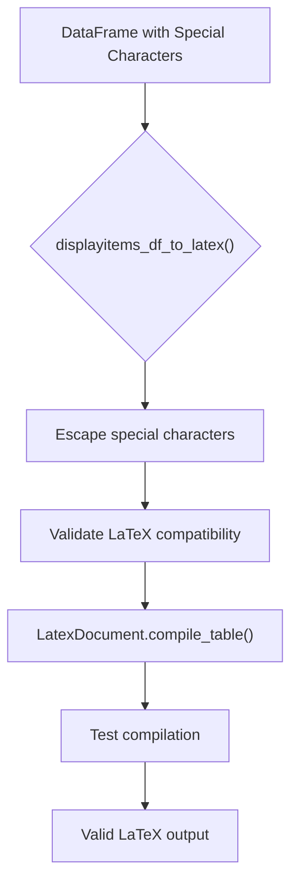

<!-- source: DeepWiki mcp.deepwiki.com · repo Technion-Kishony-lab/data-to-paper · page 3.1 DataFrame Validation · fetched 2026-10-26 -->

# DataFrame Validation

Relevant source files

The following files were used as context for generating this wiki page:

- [tests/functional/research_types/scientific_research/test_df_file_formatting.py](tests/functional/research_types/scientific_research/test_df_file_formatting.py)
- [tests/functional/run_gpt_code/test_mydata_df.py](tests/functional/run_gpt_code/test_mydata_df.py)
- [tests/functional/utils/test_check_types.py](tests/functional/utils/test_check_types.py)

## Purpose and Scope

The DataFrame Validation system is a core component of the data-to-paper framework that ensures data quality, consistency, and proper formatting of pandas DataFrames throughout the research workflow. This system verifies that DataFrames meet specific requirements before they can be used for analysis, visualization, or inclusion in research documents.

This page documents the DataFrame validation mechanisms, including validation requirements, type checking, and format verification. For information about how DataFrames are tracked during code execution, see [DataFrame Tracking](#2.4). For details about storage and formatting of DataFrames, see [DataFrame Storage and Formatting](#3.3).

Sources: [tests/functional/research_types/scientific_research/test_df_file_formatting.py]()

## DataFrame Validation Architecture

The DataFrame validation system consists of several components that work together to ensure data integrity and proper formatting.

**DataFrame Validation System Architecture**

Sources: [tests/functional/research_types/scientific_research/test_df_file_formatting.py:107-118](), [tests/functional/utils/test_check_types.py:4-37]()

## InfoDataFrame: The Foundation for Validation

The `InfoDataFrame` class extends pandas' DataFrame with additional capabilities to support validation, tracking, and metadata storage.

**InfoDataFrame Class Hierarchy**

`InfoDataFrame` allows attaching metadata to DataFrames through its `extra_info` property. This metadata persists through operations like pickling/unpickling and transposition.

`InfoDataFrameWithSaveObjFuncCall` extends this further by tracking function calls made on the DataFrame, which is essential for validation and reproduction.

Sources: [tests/functional/run_gpt_code/test_mydata_df.py:11-53]()

## Type Validation

The DataFrame validation system uses type checking to ensure that DataFrame values match expected types.

### Core Type Validation Functions

The system primarily relies on the following functions:

- `validate_value_type`: Validates if a value matches an expected type signature
- `raise_on_wrong_func_argument_types`: Ensures function arguments match expected types

Type validation supports complex type structures including:

| Type Structure | Example | Description |
|----------------|---------|-------------|
| Basic types | `int`, `str` | Validates simple types |
| Container types | `List[str]`, `Dict[str, int]` | Validates both container and content types |
| Union types | `Union[int, str]` | Validates that value matches one of multiple types |
| Optional types | `Optional[str]` | Validates value is either of specified type or None |
| Tuple types | `Tuple[int, str]` | Validates fixed-length tuples with specific types |

Sources: [tests/functional/utils/test_check_types.py:7-37]()

## DataFrame Content Requirements

DataFrames in the data-to-paper framework must meet specific content requirements based on their intended use. These requirements ensure that the data is properly structured for analysis, visualization, and document generation.

### Analysis DataFrame Requirements

Analysis DataFrames require specific validations to ensure they're suitable for statistical analysis and proper result presentation:

**Analysis DataFrame Validation Flow**

Sources: [tests/functional/research_types/scientific_research/test_df_file_formatting.py:43-50](), [tests/functional/research_types/scientific_research/test_df_file_formatting.py:76-85]()

### Display Item DataFrame Requirements

Display Item DataFrames have additional requirements for proper presentation in research documents:

**Display Item DataFrame Validation Flow**

Sources: [tests/functional/research_types/scientific_research/test_df_file_formatting.py:53-62](), [tests/functional/research_types/scientific_research/test_df_file_formatting.py:93-103]()

## View Purpose and Presentation Context

The DataFrame validation system adapts its validation requirements based on the context in which the DataFrame will be viewed or used, as defined by the `ViewPurpose` enum.

### ViewPurpose Options

The system supports multiple view contexts that determine how DataFrames are validated and presented:

| ViewPurpose | Description | Validation Requirements |
|-------------|-------------|-------------------------|
| CODE_REVIEW | For code review contexts | Raw format, includes all details |
| PRODUCT | For product-facing displays | Formatted for readability |
| HYPERTARGET_PRODUCT | For interactive documents | Includes hyperlinks to values |
| APP_HTML | For HTML application display | HTML formatting |
| FINAL_APPENDIX | For document appendices | Concise formatting |
| FINAL_INLINE | For inline document inclusion | Properly escaped for LaTeX |

Each ViewPurpose triggers specific validation logic to ensure the DataFrame meets the requirements for the intended presentation context.

**ViewPurpose and Presentation Context Flow**

Sources: [tests/functional/research_types/scientific_research/test_df_file_formatting.py:106-118](), [tests/functional/research_types/scientific_research/test_df_file_formatting.py:121-141](), [tests/functional/research_types/scientific_research/test_df_file_formatting.py:143-185]()

## Special Value Handling

The DataFrame validation system includes special handling for certain types of values:

### P-Value Handling

P-values receive special treatment in the validation system:

- Represented as `PValue` objects (not raw floating-point numbers)
- Formatted differently based on ViewPurpose
- Small p-values (<1e-6) are displayed as "<1e-6" in certain contexts
- Included in visualization metadata for proper annotation

**P-Value Validation and Formatting Flow**

Sources: [tests/functional/research_types/scientific_research/test_df_file_formatting.py:25-31](), [tests/functional/research_types/scientific_research/test_df_file_formatting.py:121-141](), [tests/functional/research_types/scientific_research/test_df_file_formatting.py:143-185]()

## DataFrame Validation Integration

The DataFrame validation system integrates with other components of the data-to-paper framework:

**DataFrame Validation in the Research Workflow**

Sources: [tests/functional/research_types/scientific_research/test_df_file_formatting.py:65-69](), [tests/functional/run_gpt_code/test_mydata_df.py:34-42]()

## Handling Special Cases

The validation system includes special handling for edge cases:

### Special Character Handling

DataFrames with special characters (like underscores) in indexes or column names receive special handling to ensure proper escaping in LaTeX output:

**Special Character Handling in DataFrame Validation**

Sources: [tests/functional/research_types/scientific_research/test_df_file_formatting.py:34-40](), [tests/functional/research_types/scientific_research/test_df_file_formatting.py:191-201]()

## Summary

The DataFrame Validation system is a critical component of the data-to-paper framework that ensures data quality, proper formatting, and consistency. It provides:

1. Enhanced DataFrame classes with metadata support
2. Type validation for DataFrame contents
3. Context-aware formatting based on view purpose
4. Special handling for statistical values like p-values
5. Integration with visualization and document generation systems

This validation ensures that data used in research is properly formatted, accurately represented, and meets the requirements for inclusion in research documents.

---

