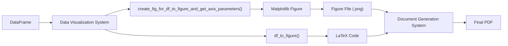
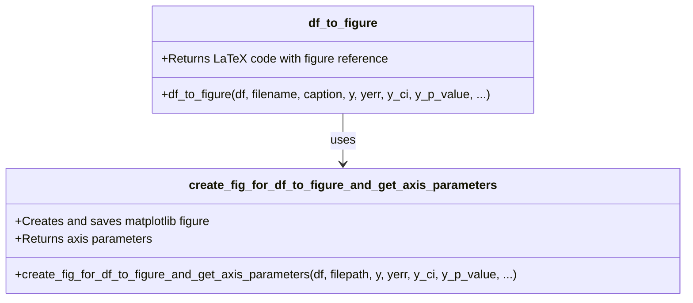
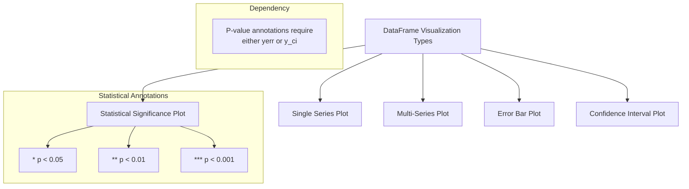
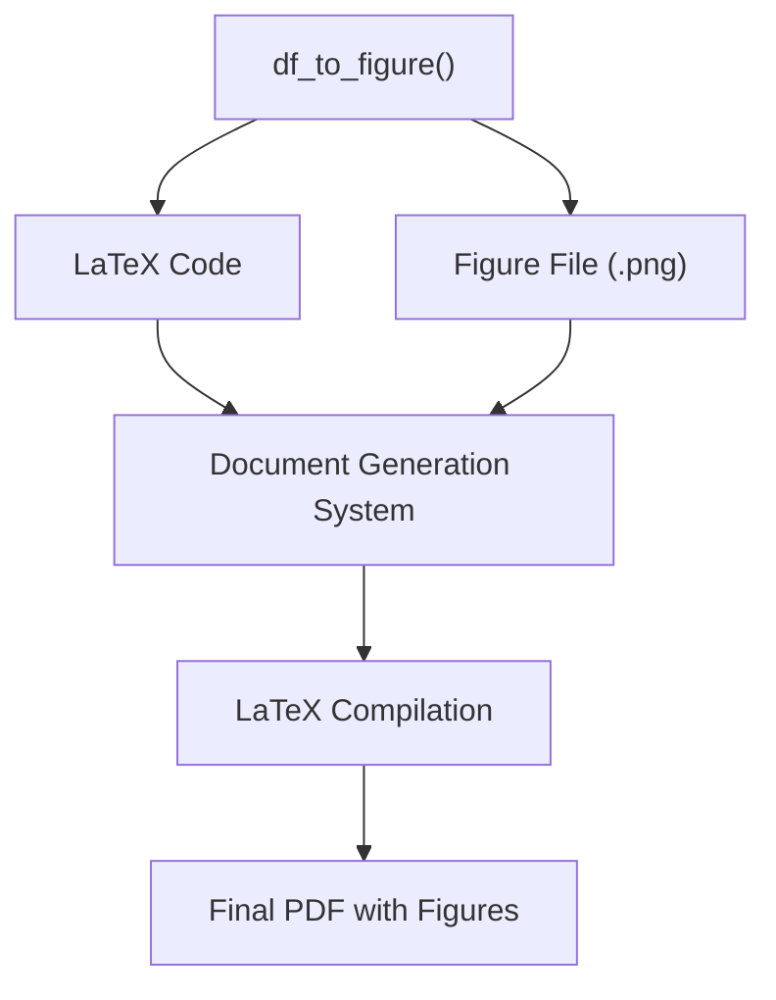

<!-- source: DeepWiki mcp.deepwiki.com · repo Technion-Kishony-lab/data-to-paper · page 3.2 Data Visualization · fetched 2026-10-26 -->

# Data Visualization

<details>
<summary>Relevant source files</summary>

The following files were used as context for generating this wiki page:

- [tests/functional/graphics/test_create_figure.py](tests/functional/graphics/test_create_figure.py)
- [tests/functional/graphics/test_df_to_figure.py](tests/functional/graphics/test_df_to_figure.py)

</details>


## Purpose and Scope

The Data Visualization component provides utilities to transform DataFrames containing analysis results into visual representations (figures) and generate corresponding LaTeX code for inclusion in research documents. This module bridges the data analysis and document generation systems, enabling seamless integration of visualizations into the final research paper.

For information about DataFrame validation before visualization, see [DataFrame Validation](#3.1). For details on how generated figures are incorporated into final documents, see [Document Generation System](#4) and [Figure Generation](#4.2).

## System Overview

The Data Visualization component takes validated DataFrames from the Data Analysis System and converts them into publication-ready figures with appropriate statistical annotations. It generates both the figure files and the LaTeX code needed to include them in the final document.



Sources: [tests/functional/graphics/test_create_figure.py:10-11](). [tests/functional/graphics/test_df_to_figure.py:1-2]()

## Core Functions

The data visualization system is built around two main functions:

1. `df_to_figure()` - Higher-level function that generates LaTeX code to include figures in documents
2. `create_fig_for_df_to_figure_and_get_axis_parameters()` - Lower-level function that handles the actual figure creation



Sources: [tests/functional/graphics/test_create_figure.py:10](). [tests/functional/graphics/test_df_to_figure.py:1-2]()

## Visualization Features

The Data Visualization system supports a variety of visualization features and customization options:

### Core Plotting Capabilities

| Feature | Parameter | Description |
|---------|-----------|-------------|
| Basic plotting | `y` | Column(s) to plot on the y-axis |
| Error bars | `yerr` | Column name(s) containing error values |
| Confidence intervals | `y_ci` | Column name(s) or tuple of column names with CI bounds |
| P-value annotations | `y_p_value` | Column name(s) containing p-values |
| Axis labels | `xlabel`, `ylabel` | Custom labels for x and y axes |
| Multiple series | `y` as list | Plot multiple data series in one figure |

Sources: [tests/functional/graphics/test_create_figure.py:44-101]()

### Visualization Types and Options

The system can generate various types of visualizations based on your data:



Sources: [tests/functional/graphics/test_create_figure.py:65-106]()

## Document Integration Features

The visualization system includes features to integrate figures seamlessly into the final research document:

### LaTeX Output Customization

| Feature | Parameter | Description |
|---------|-----------|-------------|
| Caption | `caption` | Figure caption text |
| Label | `label` | Figure label for cross-referencing |
| Note | `note` | Additional information to appear below the figure |
| Glossary | `glossary` | Dictionary of terms and their definitions |

Sources: [tests/functional/graphics/test_df_to_figure.py:4-26]()

## Usage Examples

### Basic Plot

```python
# Create a simple plot with a caption
latex_code = df_to_figure(
    dataframe, 
    filename='basic_plot',
    caption='Trend of measurements over time',
    y='measurement_value'
)
```

### Plot with Error Bars and P-values

```python
# Create a plot with error bars and p-value annotations
latex_code = df_to_figure(
    dataframe,
    filename='statistical_plot',
    caption='Statistical comparison between groups',
    y='mean_value',
    yerr='standard_error',
    y_p_value='p_value',
    xlabel='Treatment Groups',
    ylabel='Response (units)'
)
```

### Multiple Series with Confidence Intervals

```python
# Create a plot with multiple data series and confidence intervals
latex_code = df_to_figure(
    dataframe,
    filename='multi_series_plot',
    caption='Comparison of multiple variables',
    y=['variable1', 'variable2', 'variable3'],
    y_ci=['variable1_ci', 'variable2_ci', 'variable3_ci'],
    xlabel='Time Points',
    ylabel='Response',
    note='Error bands represent 95% confidence intervals.',
    glossary={'variable1': 'Description of variable 1', 
              'variable2': 'Description of variable 2',
              'variable3': 'Description of variable 3'}
)
```

Sources: [tests/functional/graphics/test_df_to_figure.py:4-26](), [tests/functional/graphics/test_create_figure.py:44-101]()

## Key Implementation Details

### Figure Generation

The figure generation process handles several technical challenges:

1. **Long Axis Labels**: Automatically adjusts figure layout when x-tick labels are long
2. **P-value Representation**: Converts numerical p-values to standard significance notation (* for p < 0.05, ** for p < 0.01, etc.)
3. **Confidence Intervals**: Supports both single column CI values and separate lower/upper bound columns

### Validation Rules

The system enforces several validation rules to ensure meaningful visualizations:

1. P-value annotations require either error bars or confidence intervals to be specified
2. Figure files are automatically saved to the specified directory
3. Generated LaTeX code includes all necessary commands to properly include the figure in the document

Sources: [tests/functional/graphics/test_create_figure.py:104-106]()

## Integration with the Document Generation System

The output of the Data Visualization system serves as input to the Document Generation System. The generated LaTeX code includes:

1. The necessary LaTeX commands to include the figure
2. Figure captions and labels
3. Optional notes and glossary entries
4. References to the saved figure files



Sources: [tests/functional/graphics/test_df_to_figure.py:18-26]()

---

