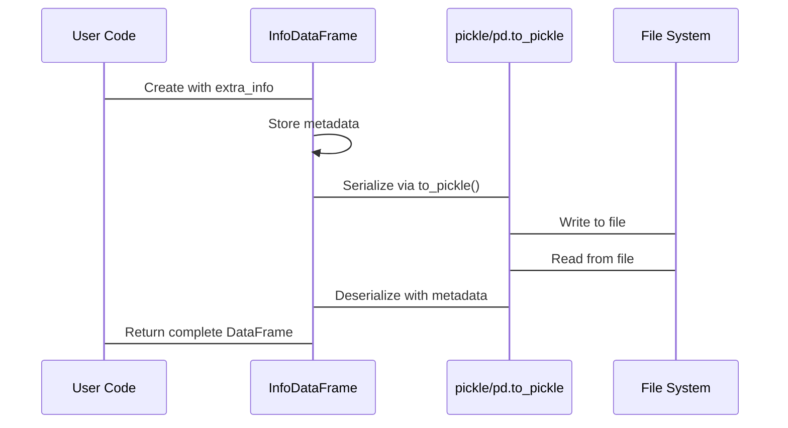
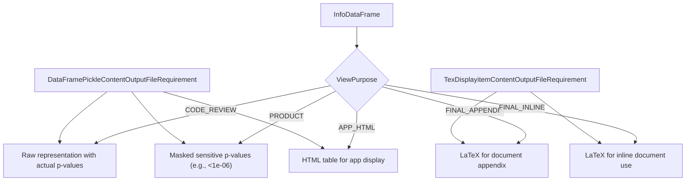
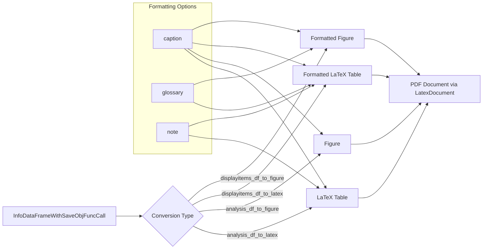

<!-- source: DeepWiki mcp.deepwiki.com · repo Technion-Kishony-lab/data-to-paper · page 3.3 DataFrame Storage and Formatting · fetched 2026-10-26 -->

# DataFrame Storage and Formatting

<details>
<summary>Relevant source files</summary>

The following files were used as context for generating this wiki page:

- [tests/functional/latex/test_tables.py](tests/functional/latex/test_tables.py)
- [tests/functional/research_types/scientific_research/test_df_file_formatting.py](tests/functional/research_types/scientific_research/test_df_file_formatting.py)
- [tests/functional/research_types/scientific_research/test_utils_modified_for_gpt_use.py](tests/functional/research_types/scientific_research/test_utils_modified_for_gpt_use.py)
- [tests/functional/run_gpt_code/test_mydata_df.py](tests/functional/run_gpt_code/test_mydata_df.py)
- [tests/functional/utils/test_check_types.py](tests/functional/utils/test_check_types.py)
- [tests/functional/utils/test_dataframe.py](tests/functional/utils/test_dataframe.py)

</details>


## Purpose and Overview

The DataFrame Storage and Formatting system in the `data-to-paper` framework provides specialized DataFrame classes and utilities that extend pandas DataFrames with additional metadata and formatting capabilities. This system serves as a bridge between raw data analysis and document generation, enabling DataFrames to maintain context and formatting information throughout the research pipeline.

This document explains how DataFrames are enhanced with metadata, how they're serialized while preserving this metadata, and how they're formatted for different output contexts such as code review, final documents, or HTML display. For information about DataFrame validation, see [DataFrame Validation](#3.1), and for details on visualization, see [Data Visualization](#3.2).

## InfoDataFrame Class

The core of the DataFrame storage system is the `InfoDataFrame` class, which extends pandas DataFrame to store additional metadata. This class can preserve extra information through serialization and common DataFrame operations.

### InfoDataFrame Class Hierarchy

```mermaid
classDiagram
    class "pd.DataFrame" {
        +Standard pandas DataFrame
    }
    
    class "InfoDataFrame" {
        +extra_info: Any
        +__init__(data, extra_info)
        +to_pickle(path)
    }
    
    class "InfoDataFrameWithSaveObjFuncCall" {
        +func_call: object
        +get_func_call()
    }
    
    class "TrackDataFrames" {
        +Context manager
        +__enter__()
        +__exit__()
    }
    
    "pd.DataFrame" <|-- "InfoDataFrame"
    "InfoDataFrame" <|-- "InfoDataFrameWithSaveObjFuncCall"
    "TrackDataFrames" --> "InfoDataFrame": tracks
```

Sources: 
- [tests/functional/run_gpt_code/test_mydata_df.py:12-20]()
- [tests/functional/run_gpt_code/test_mydata_df.py:38-42]()

The `InfoDataFrame` class maintains its metadata even through operations like transposition:

```python
df = InfoDataFrame({'a': [1, 2]}, extra_info=(7, 'ok'))
df = df.T  # extra_info is preserved
```

Sources:
- [tests/functional/run_gpt_code/test_mydata_df.py:45-53]()

The `InfoDataFrameWithSaveObjFuncCall` extends `InfoDataFrame` to also store function call information, which is used for tracking how the DataFrame was generated or processed.

## DataFrame Serialization

One of the key features of the `InfoDataFrame` class is its ability to be serialized and deserialized while preserving its metadata. This is essential for maintaining context across different stages of analysis.

### DataFrame Serialization Flow



The serialization works with both standard Python `pickle` and pandas' `to_pickle` method:

```python
# Using pickle directly
with open('custom_df.pickle', 'wb') as file:
    pickle.dump(df, file)

# Using pandas to_pickle
df.to_pickle('custom_df_pd.pickle')

# Both methods preserve the extra_info
loaded_df = pd.read_pickle('custom_df_pd.pickle')
assert loaded_df.extra_info == (7, 'ok')
```

Sources:
- [tests/functional/run_gpt_code/test_mydata_df.py:10-42]()

## DataFrame Formatting for Different Views

The system supports formatting DataFrames differently depending on the intended viewing context. This is managed through the `ViewPurpose` enum and specialized content output requirements.

### DataFrame View Formatting System



The system handles special cases like p-values differently depending on the view context:

- In `CODE_REVIEW` view, precise p-values like `2e-08` are shown
- In `PRODUCT` view, very small p-values are masked as `<1e-06`
- In `FINAL_INLINE` view, p-values get special LaTeX formatting with hypertarget tags

Sources:
- [tests/functional/research_types/scientific_research/test_df_file_formatting.py:121-141]()
- [tests/functional/research_types/scientific_research/test_df_file_formatting.py:143-185]()

## Conversion to Presentation Formats

The framework provides specialized functions for converting DataFrames to different presentation formats:

### DataFrame Presentation Conversion System



The system differentiates between:

1. **Analysis functions** (`analysis_df_to_latex`, `analysis_df_to_figure`): Used during data analysis
2. **Display item functions** (`displayitems_df_to_latex`, `displayitems_df_to_figure`): Used for final presentation 

Display item functions support additional formatting options like glossaries to explain abbreviations:

```python
displayitems_df_to_latex(df, 'table_label', 
                         caption='Table caption',
                         glossary={'coef': 'coefficient'})
```

Sources:
- [tests/functional/research_types/scientific_research/test_df_file_formatting.py:43-69]()
- [tests/functional/research_types/scientific_research/test_df_file_formatting.py:72-85]()
- [tests/functional/research_types/scientific_research/test_df_file_formatting.py:87-103]()
- [tests/functional/latex/test_tables.py:21-33]()

## LaTeX Integration

The framework provides robust support for converting DataFrames to LaTeX format with various styling options. The system handles special characters, underscores in captions, and other LaTeX-specific formatting needs.

```python
# Basic LaTeX conversion
latex = df_to_latex(df_table, 'test', 
                   caption='test caption', 
                   note='this is a note',
                   glossary={'CV': 'coefficient of variation'})

# Compilation to PDF
width = LatexDocument().compile_table(latex, file_stem='test')
```

The system also detects and handles potential issues like unknown abbreviations in column headers, ensuring that tables are properly documented.

Sources:
- [tests/functional/latex/test_tables.py:21-51]()
- [tests/functional/research_types/scientific_research/test_df_file_formatting.py:186-202]()

## Special Data Type Handling

The framework includes specialized handling for various data types within DataFrames:

1. **P-Values**: Special `PValue` objects that format differently in different contexts
2. **Lists**: Automatically formats lists in cells with appropriate delimiters
3. **Tuples**: Commonly used for confidence intervals, with special formatting

```python
# P-value handling
df.loc['row', 'P-value'] = PValue(0.00000002)  # Shows as 2e-08 or <1e-06 depending on context

# List handling
df = pd.DataFrame({'a': [[1, 2.3578523523523, 3], [4, 5, 6]]})
# When converted to LaTeX, displays as "2.358, ..." with appropriate formatting
```

Sources:
- [tests/functional/research_types/scientific_research/test_utils_modified_for_gpt_use.py:36-40]()
- [tests/functional/latex/test_tables.py:29-33]()

## Integration with Document Generation

The formatted DataFrames ultimately feed into the document generation system to create research papers. The system handles:

1. Converting DataFrames to LaTeX tables
2. Generating figures from DataFrames
3. Compiling these elements into a final PDF document

This integration ensures that data analyzed during research is accurately and consistently represented in the final document, with appropriate formatting for publication quality.

Sources:
- [tests/functional/research_types/scientific_research/test_df_file_formatting.py:187-202]()
- [tests/functional/latex/test_tables.py:21-26]()

## Type Validation

The system includes type validation to ensure DataFrames and their contents match expected types. This helps prevent errors in data processing and presentation.

```python
# Validates that values match expected types
validate_value_type(value, expected_type)

# Can validate complex nested types like Dict[str, List[str]]
```

Sources:
- [tests/functional/utils/test_check_types.py:7-37]()

The DataFrame Storage and Formatting system plays a crucial role in the data-to-paper framework by extending standard pandas DataFrames with metadata preservation, specialized formatting, and integration with document generation, enabling a seamless pipeline from data analysis to final research paper.

---

