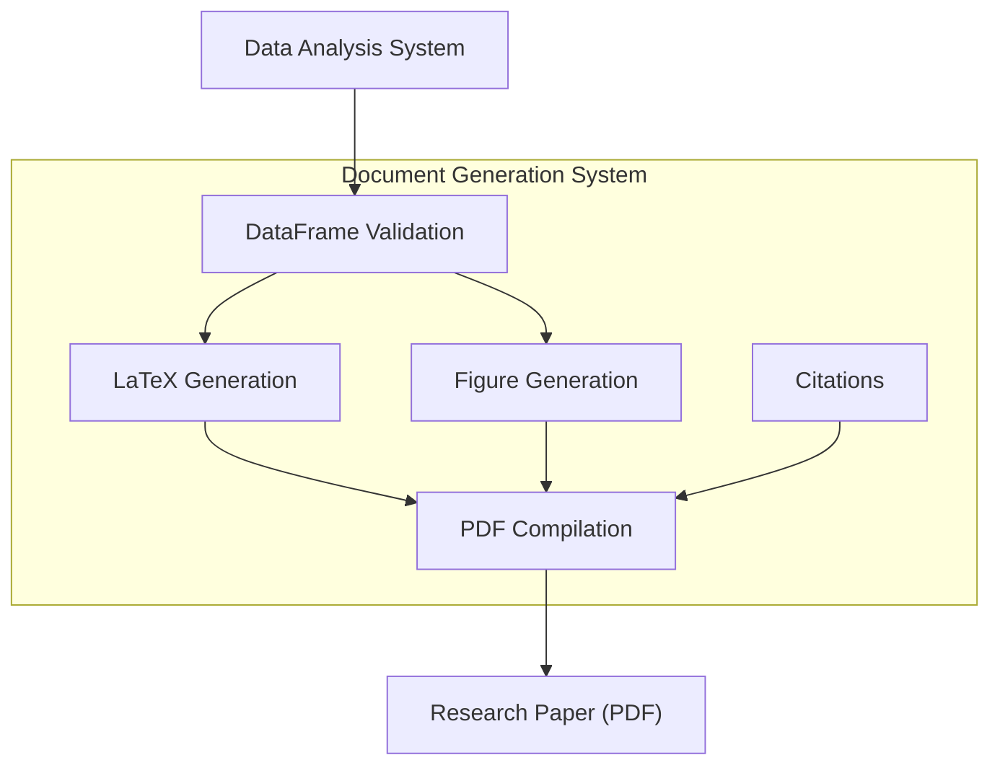
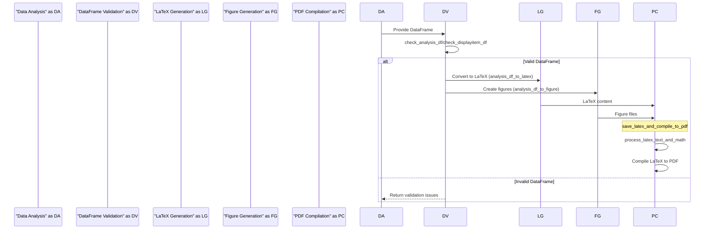
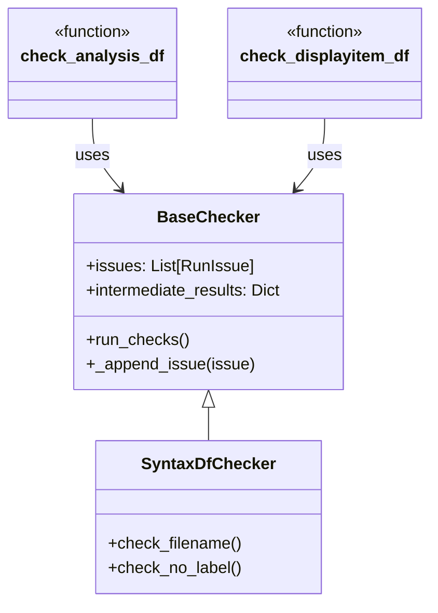
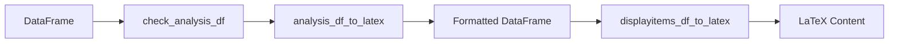
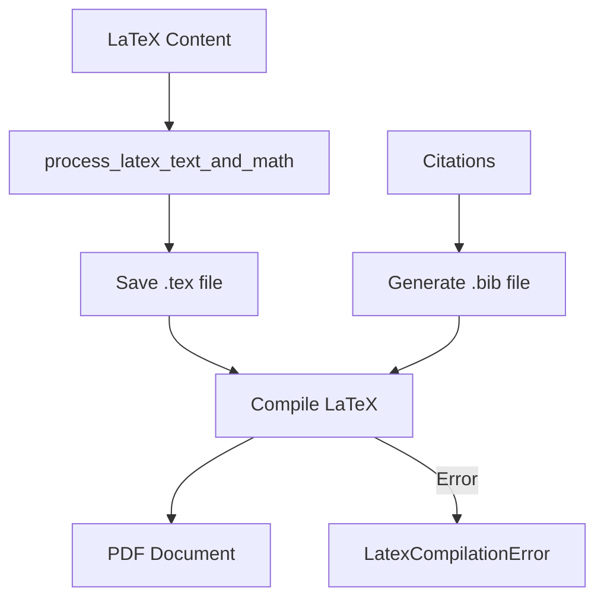
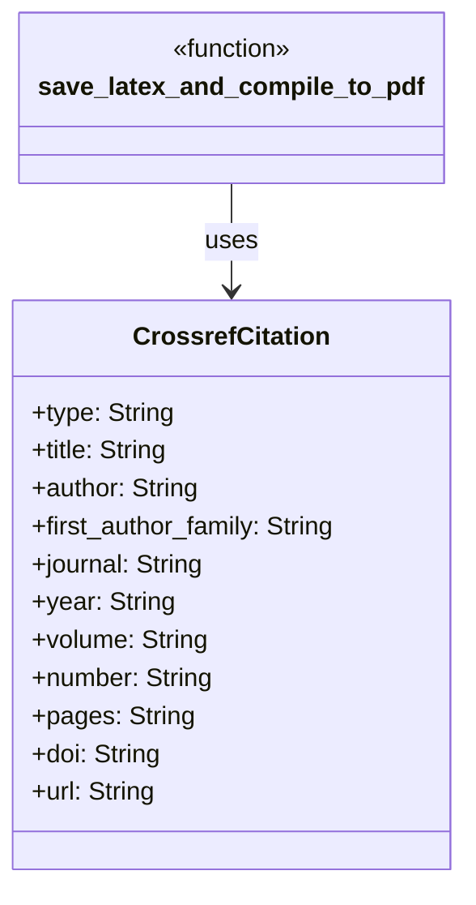

<!-- source: DeepWiki mcp.deepwiki.com · repo Technion-Kishony-lab/data-to-paper · page 4 Document Generation System · fetched 2026-10-26 -->

# Document Generation System

<details>
<summary>Relevant source files</summary>

The following files were used as context for generating this wiki page:

- [tests/functional/latex/test_latex_to_pdf.py](tests/functional/latex/test_latex_to_pdf.py)
- [tests/functional/research_types/scientific_research/test_df_check.py](tests/functional/research_types/scientific_research/test_df_check.py)

</details>


This document details the Document Generation System within the data-to-paper framework, which transforms research data into publication-ready documents. The system converts DataFrame objects into LaTeX tables, figures, and ultimately compiles these elements into a complete PDF research paper.

For information about DataFrame validation, see [Data Analysis System](#3). For LaTeX generation details, see [LaTeX Generation](#4.1).

## System Overview

The Document Generation System serves as the final transformation stage in the data-to-paper pipeline, converting analyzed data into a research paper format. It provides automated conversion of validated DataFrames into both LaTeX elements and figures, combining them into a structured document with proper formatting, citations, and layout.



Sources: [tests/functional/research_types/scientific_research/test_df_check.py:5-15](), [tests/functional/latex/test_latex_to_pdf.py:7-10]()

## Key Components and Workflow

The Document Generation System follows a structured workflow with distinct components handling specific aspects of the document creation process:

1. **DataFrame Validation**: Ensures data meets requirements before conversion
2. **LaTeX Generation**: Transforms DataFrames into LaTeX tables and text
3. **Figure Generation**: Creates visual representations from DataFrames
4. **PDF Compilation**: Combines all elements into a formatted PDF document



Sources: [tests/functional/research_types/scientific_research/test_df_check.py:63-80](), [tests/functional/latex/test_latex_to_pdf.py:120-127]()

## DataFrame Validation

Before a DataFrame can be converted to LaTeX or figures, it undergoes validation to ensure it meets specific requirements. The system provides two main validator functions:

- `check_analysis_df`: Validates DataFrames for analysis tables and figures
- `check_displayitem_df`: Validates DataFrames for display items in the final document

These validators check for issues such as:
- Invalid column or index names
- Unsupported data types
- Missing required metadata (e.g., captions)
- NaN values or other problematic data points
- Improper structure or formatting



Sources: [tests/functional/research_types/scientific_research/test_df_check.py:6-7](), [tests/functional/research_types/scientific_research/test_df_check.py:157-159](), [tests/functional/research_types/scientific_research/test_df_check.py:209-211]()

## LaTeX Generation

After validation, DataFrames are converted to LaTeX content using specialized conversion functions:

- `analysis_df_to_latex`: Converts analysis DataFrames to LaTeX tables
- `displayitems_df_to_latex`: Converts display item DataFrames to formatted LaTeX for inclusion in the document

These functions handle formatting, styling, and proper representation of data in LaTeX format. They can handle various data types, including p-values that require special formatting.

### DataFrame to LaTeX Workflow



Sources: [tests/functional/research_types/scientific_research/test_df_check.py:9-10](), [tests/functional/research_types/scientific_research/test_df_check.py:12-13](), [tests/functional/research_types/scientific_research/test_df_check.py:158-159](), [tests/functional/research_types/scientific_research/test_df_check.py:208-209]()

## Figure Generation

Similar to LaTeX generation, the system provides functions to convert DataFrames into figures:

- `analysis_df_to_figure`: Creates figures from analysis DataFrames
- `displayitems_df_to_figure`: Creates formatted figures for inclusion in the document

The system supports various plot types including bar charts, line plots, and scatter plots. It automatically handles formatting details like axis labels, titles, and legends.

### Figure Generation Configuration

When generating figures, users need to specify parameters such as:

| Parameter | Description | Required |
|-----------|-------------|----------|
| `y` | Column to plot on y-axis | Yes |
| `kind` | Plot type (bar, line, etc.) | Yes |
| `caption` | Figure caption | Yes (for display items) |
| `y_p_value` | Column with p-values for significance | Optional |

Sources: [tests/functional/research_types/scientific_research/test_df_check.py:8-9](), [tests/functional/research_types/scientific_research/test_df_check.py:10-11](), [tests/functional/research_types/scientific_research/test_df_check.py:162-192](), [tests/functional/research_types/scientific_research/test_df_check.py:214-225]()

## PDF Compilation

The final stage in the document generation process is compiling all LaTeX content and figures into a PDF document. This is primarily handled by the `save_latex_and_compile_to_pdf` function.

### LaTeX Compilation Process



The compilation process includes:

1. Cleaning LaTeX content to escape special characters
2. Saving content to a .tex file
3. Generating a BibTeX file for citations (if needed)
4. Running the LaTeX compiler to generate a PDF
5. Handling compilation errors
6. Cleaning up temporary files

### LaTeX Expression Evaluation

The system also provides functionality to evaluate expressions within LaTeX using the `evaluate_latex_num_command` function. This allows for dynamic calculation of values within the document.

For example, a LaTeX string like:
```latex
I have \num{1+2, "trivial"} apples.
```

Would be transformed to:
```latex
I have 3 apples.
```

With the calculation details preserved for reference.

Sources: [tests/functional/latex/test_latex_to_pdf.py:6-9](), [tests/functional/latex/test_latex_to_pdf.py:120-127](), [tests/functional/latex/test_latex_to_pdf.py:129-136](), [tests/functional/latex/test_latex_to_pdf.py:139-145](), [tests/functional/latex/test_latex_to_pdf.py:173-180]()

## Citation Management

The Document Generation System includes robust support for managing citations in research papers through the `CrossrefCitation` class. Citations can be provided to the PDF compilation process, which will generate the appropriate BibTeX entries.



Sources: [tests/functional/latex/test_latex_to_pdf.py:10](), [tests/functional/latex/test_latex_to_pdf.py:83-110](), [tests/functional/latex/test_latex_to_pdf.py:129-136]()

## Error Handling

The Document Generation System includes robust error handling, particularly for LaTeX compilation errors. When a compilation error occurs, a `LatexCompilationError` is raised with details about the error, including the problematic content and line number.

This helps users quickly identify and fix issues in their LaTeX content, improving the document generation workflow.

Sources: [tests/functional/latex/test_latex_to_pdf.py:7](), [tests/functional/latex/test_latex_to_pdf.py:164-169]()

## Integration with Other Systems

The Document Generation System integrates with several other components of the data-to-paper framework:

- **Data Analysis System**: Provides validated DataFrames for conversion to document elements
- **LaTeX Document Class**: Encapsulates LaTeX document structure and compilation logic
- **P-Value Handling**: Special handling for statistical p-values ensures proper formatting and representation

This integration ensures a seamless flow from data analysis to publication-ready documents.

Sources: [tests/functional/research_types/scientific_research/test_df_check.py:5](), [tests/functional/research_types/scientific_research/test_df_check.py:14]()

---

