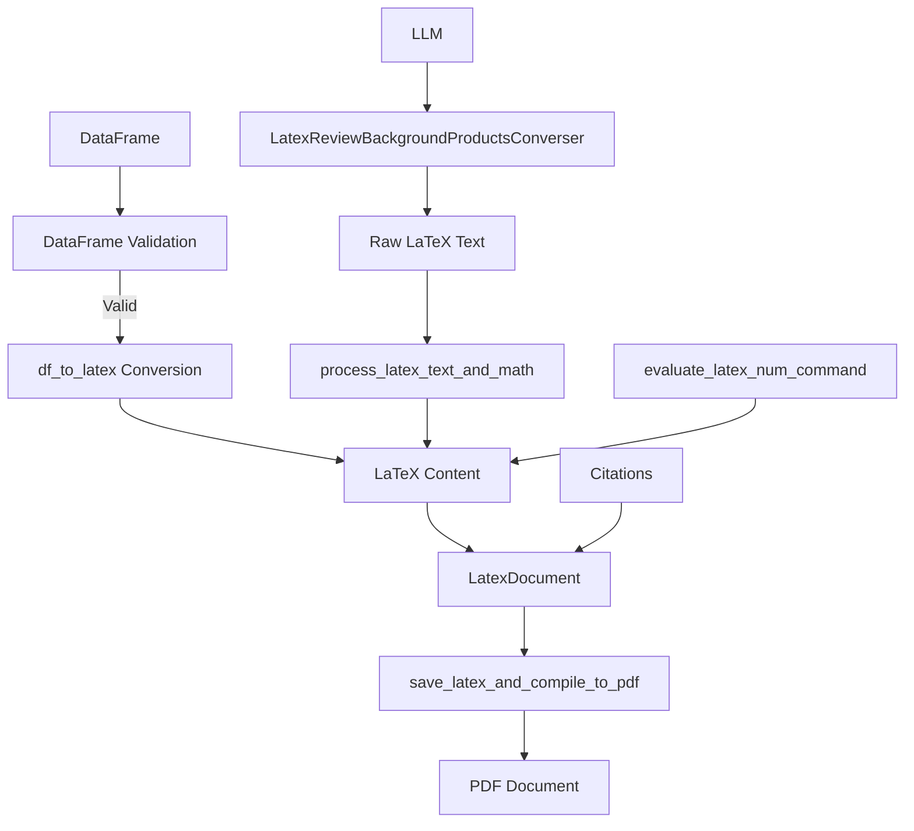
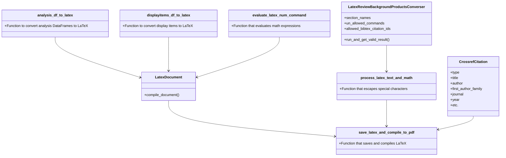
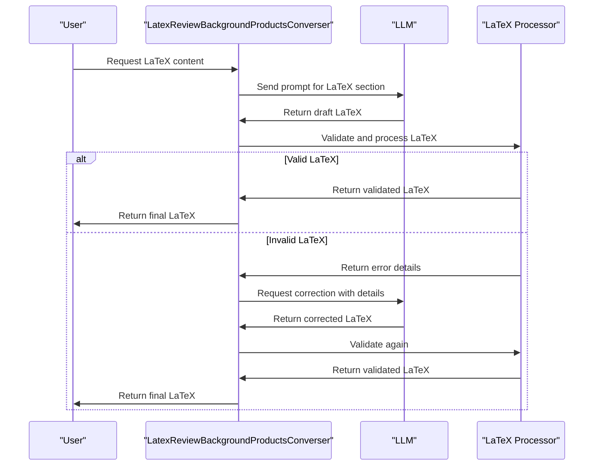

<!-- source: DeepWiki mcp.deepwiki.com · repo Technion-Kishony-lab/data-to-paper · page 4.1 LaTeX Generation · fetched 2026-10-26 -->

# LaTeX Generation

<details>
<summary>Relevant source files</summary>

The following files were used as context for generating this wiki page:

- [tests/functional/base_steps/test_request_latex.py](tests/functional/base_steps/test_request_latex.py)
- [tests/functional/base_steps/test_request_multi_choice.py](tests/functional/base_steps/test_request_multi_choice.py)
- [tests/functional/base_steps/test_request_python_value.py](tests/functional/base_steps/test_request_python_value.py)
- [tests/functional/base_steps/test_request_quoted_text.py](tests/functional/base_steps/test_request_quoted_text.py)
- [tests/functional/base_steps/test_review_dialog.py](tests/functional/base_steps/test_review_dialog.py)
- [tests/functional/base_steps/utils.py](tests/functional/base_steps/utils.py)
- [tests/functional/latex/test_latex_to_pdf.py](tests/functional/latex/test_latex_to_pdf.py)
- [tests/functional/research_types/scientific_research/test_df_check.py](tests/functional/research_types/scientific_research/test_df_check.py)

</details>


## Purpose and Overview

The LaTeX Generation system is responsible for transforming research data and analysis into properly formatted LaTeX content for scientific papers. This component handles conversion of DataFrames into LaTeX tables, processes raw LaTeX text for proper formatting, manages citations, and compiles LaTeX content into PDF documents.

This page focuses solely on the generation and processing of LaTeX content. For information about figure generation from data, see [Figure Generation](#4.2). For details on compiling LaTeX into final PDF documents, see [PDF Compilation](#4.3).

Sources: [tests/functional/latex/test_latex_to_pdf.py:5-10]()

## System Architecture

### LaTeX Generation Flow



Sources: [tests/functional/latex/test_latex_to_pdf.py:6-9](), [tests/functional/base_steps/test_request_latex.py:5-11]()

### Key Components and Interactions



Sources: [tests/functional/latex/test_latex_to_pdf.py:6-10](), [tests/functional/base_steps/test_request_latex.py:7]()

## Core Components

### LatexDocument Class

The `LatexDocument` class is responsible for managing LaTeX content and compiling it into a document. It serves as a container for LaTeX code and provides methods for compilation.

Key features:
- Hashable class that can be used in collections
- Provides `compile_document` method to compile LaTeX code into a document

```python
# Example of using LatexDocument
latex_doc = LatexDocument()
latex_doc.compile_document(latex_content, file_stem='output_name')
```

Sources: [tests/functional/latex/test_latex_to_pdf.py:8](), [tests/functional/latex/test_latex_to_pdf.py:116-117]()

### LaTeX to PDF Conversion

The `save_latex_and_compile_to_pdf` function handles saving LaTeX content to a file and compiling it into a PDF document. This function manages the entire process of creating a PDF from LaTeX code.

Key features:
- Saves LaTeX content to a .tex file
- Compiles the LaTeX content into a PDF
- Handles citations through BibTeX if provided
- Cleans up auxiliary files after compilation
- Raises `LatexCompilationError` if compilation fails

```python
# Example of using save_latex_and_compile_to_pdf
save_latex_and_compile_to_pdf(latex_content, 'document_name', '/output/path')
```

Sources: [tests/functional/latex/test_latex_to_pdf.py:9](), [tests/functional/latex/test_latex_to_pdf.py:120-147]()

### LaTeX Text Processing

The `process_latex_text_and_math` function is responsible for cleaning and formatting raw LaTeX text. It ensures that special characters are properly escaped to prevent LaTeX compilation errors.

Key features:
- Escapes special characters like `&`, `%`, `#`, and `_`
- Preserves already-escaped characters and mathematical expressions
- Handles both inline math (`$x^2$`) and display math (`$$x^2$$`)

Sources: [tests/functional/latex/test_latex_to_pdf.py:6](), [tests/functional/latex/test_latex_to_pdf.py:139-145](), [tests/functional/latex/test_latex_to_pdf.py:154-161]()

### LaTeX Mathematical Expression Evaluation

The `evaluate_latex_num_command` function processes LaTeX code containing the `\num{}` command, which allows embedding evaluated mathematical expressions in LaTeX documents.

Key features:
- Evaluates mathematical expressions within `\num{}` commands
- Supports addition, subtraction, multiplication, division, and exponentiation
- Can include a description of the calculation in quotes
- Creates a dictionary mapping indices to evaluation explanations

```python
# Example of evaluate_latex_num_command
latex = r'I have \num{1+2, "trivial"} apples.'
result, explanations = evaluate_latex_num_command(latex)
# result: 'I have 3 apples.'
# explanations: {'0': '1+2 = 3\n\ntrivial'}
```

Sources: [tests/functional/latex/test_latex_to_pdf.py:9](), [tests/functional/latex/test_latex_to_pdf.py:172-181]()

## Citation Handling

The system supports citation management through the `CrossrefCitation` class and BibTeX integration.

### CrossrefCitation Class

`CrossrefCitation` represents a scholarly citation with standard bibliographic fields:

```python
CrossrefCitation(
    type='article',
    title='Example Paper',
    author='Author Name',
    first_author_family='AuthorFamily',
    journal='Journal Name',
    year='2023',
    volume='1',
    number='1',
    pages='1-10',
    doi='10.1234/5678',
    url='https://example.com'
)
```

The citation system supports:
- Converting citations to BibTeX format
- Generating a .bib file with all citations
- Integrating citations into the LaTeX compilation process
- Citation detection and normalization in LaTeX content

Sources: [tests/functional/latex/test_latex_to_pdf.py:10](), [tests/functional/latex/test_latex_to_pdf.py:81-110](), [tests/functional/latex/test_latex_to_pdf.py:129-136]()

## DataFrame to LaTeX Conversion

The system provides functionality to convert pandas DataFrames into LaTeX tables through specialized functions.

### Analysis DataFrame to LaTeX

The `analysis_df_to_latex` function converts DataFrames containing analysis results into LaTeX tables. It includes validation steps to ensure the DataFrame meets requirements for proper LaTeX table generation.

Validation checks include:
- No NaN values
- No nested DataFrames or complex data types
- Appropriate column headers
- Reasonable DataFrame size
- No duplicated values

Sources: [tests/functional/research_types/scientific_research/test_df_check.py:9](), [tests/functional/research_types/scientific_research/test_df_check.py:157-159]()

### Display Items DataFrame to LaTeX

The `displayitems_df_to_latex` function converts DataFrames intended for display in the final paper into LaTeX tables. It includes additional validation specific to display purposes:

- Requires a caption
- Checks table width to ensure it fits in the document
- Validates LaTeX compilation of the resulting table

Sources: [tests/functional/research_types/scientific_research/test_df_check.py:13](), [tests/functional/research_types/scientific_research/test_df_check.py:206-209]()

## LLM Interaction for LaTeX Generation

The system leverages Large Language Models (LLMs) to generate and refine LaTeX content through specialized converser classes.

### LaTeX Review Background Products Converser

The `LatexReviewBackgroundProductsConverser` class facilitates requesting LaTeX content from LLMs and validating the responses.

Key features:
- Requests specific LaTeX sections (abstract, title, introduction, etc.)
- Validates LaTeX content for compilation errors
- Automatically corrects common LaTeX issues
- Manages citations in LaTeX content
- Enforces allowed commands and removes unapproved commands
- Supports iterative refinement through reviewer feedback



Sources: [tests/functional/base_steps/test_request_latex.py:7](), [tests/functional/base_steps/test_request_latex.py:18-23](), [tests/functional/base_steps/test_request_latex.py:95-112]()

## Error Handling and Validation

The LaTeX generation system includes robust error handling and validation mechanisms to ensure high-quality LaTeX output.

### LaTeX Compilation Error Handling

The system uses the `LatexCompilationError` exception class to handle compilation failures:
- Captures the failing LaTeX content
- Identifies the line number where the error occurred
- Provides detailed error messages for debugging

Sources: [tests/functional/latex/test_latex_to_pdf.py:7](), [tests/functional/latex/test_latex_to_pdf.py:164-169]()

### LaTeX Content Validation

LaTeX content validation includes:
- Checking for unescaped special characters (`&`, `%`, `#`, `_`, `~`, `^`)
- Validating LaTeX section structure
- Detecting and correcting citation formatting
- Removing unapproved LaTeX commands
- Ensuring proper nesting of LaTeX environments

Sources: [tests/functional/base_steps/test_request_latex.py:60-93]()

## Usage Examples

### Basic LaTeX Compilation

```python
from data_to_paper.latex.latex_doc import LatexDocument
from data_to_paper.latex.latex_to_pdf import save_latex_and_compile_to_pdf

# Create LaTeX content
latex_content = r"""
\documentclass{article}
\begin{document}
Hello World!
\end{document}
"""

# Save and compile to PDF
save_latex_and_compile_to_pdf(latex_content, "output", "/path/to/output/dir")
```

### Converting DataFrame to LaTeX

```python
import pandas as pd
from data_to_paper.research_types.hypothesis_testing.coding.analysis.my_utils.df_to_latex import analysis_df_to_latex

# Create a DataFrame
df = pd.DataFrame({'Column1': [1, 2, 3], 'Column2': [4, 5, 6]})

# Convert to LaTeX
latex_df = analysis_df_to_latex(df, 'example_table')
```

### Requesting LaTeX from LLM

```python
from data_to_paper.base_steps import LatexReviewBackgroundProductsConverser

# Create converser instance
converser = LatexReviewBackgroundProductsConverser(section_names=['abstract'])

# Request abstract from LLM
abstract_latex = converser.run_and_get_valid_result()
```

Sources: [tests/functional/base_steps/test_request_latex.py:54-57](), [tests/functional/base_steps/test_request_latex.py:96-106]()

---

