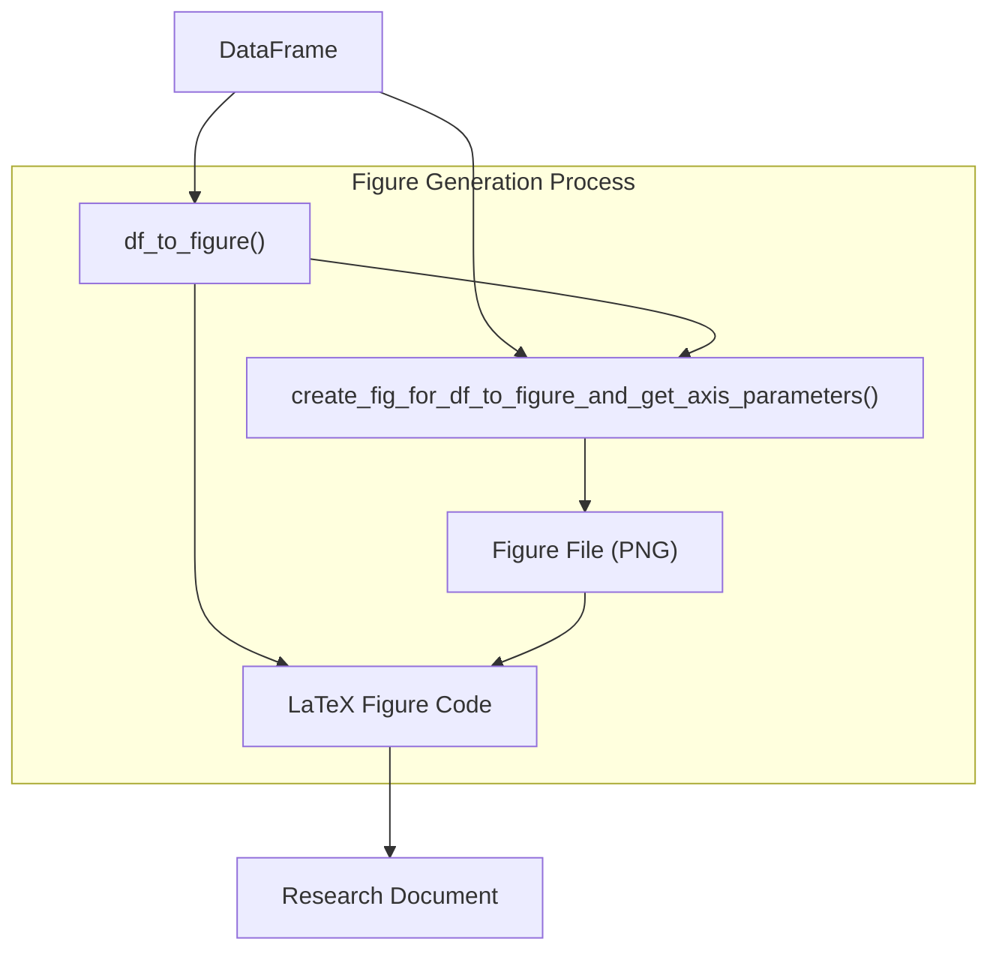
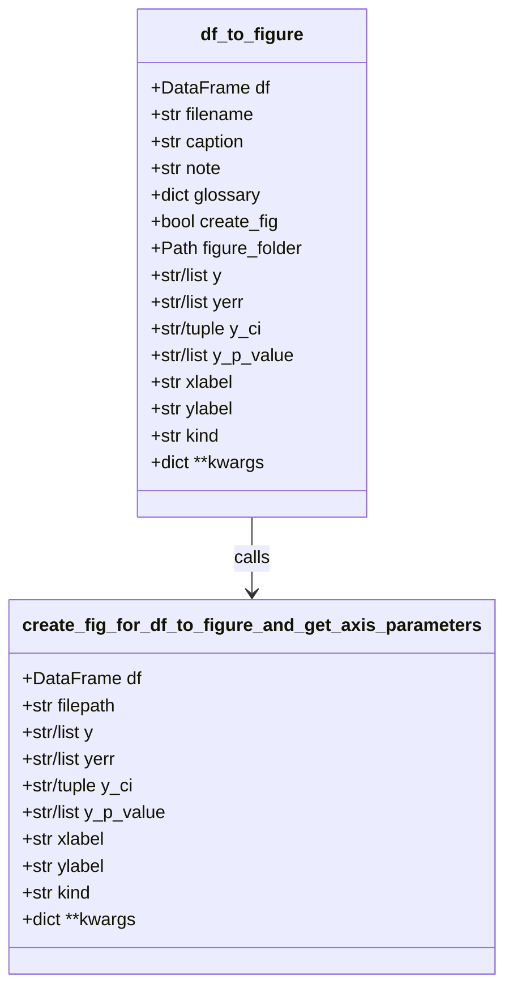
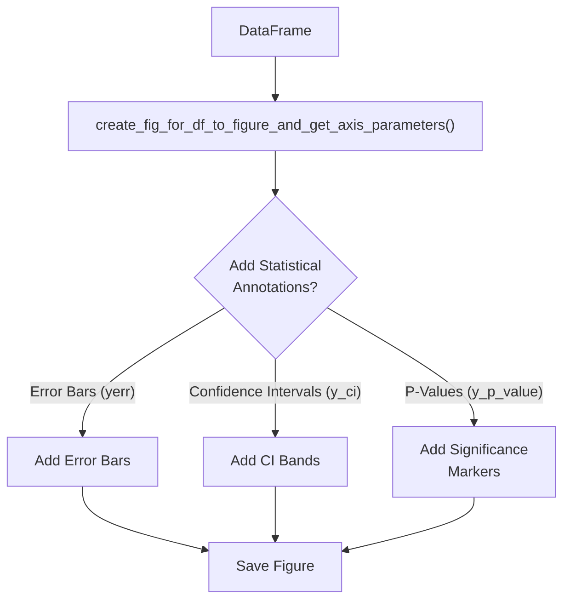
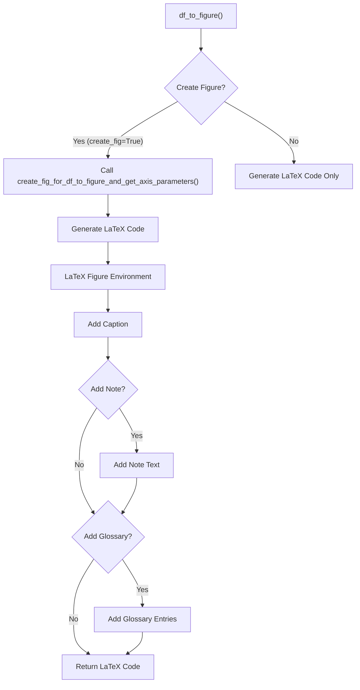
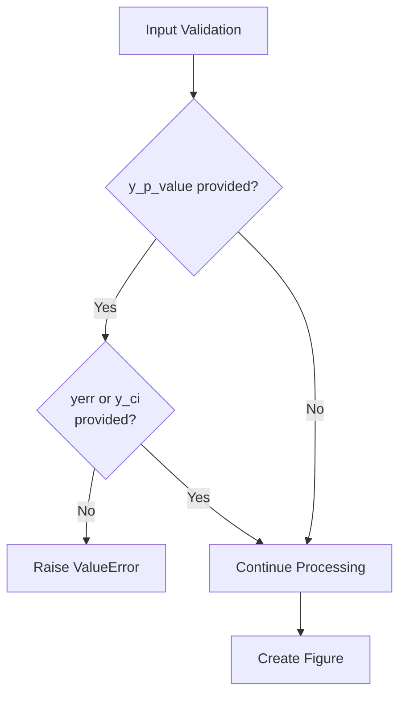
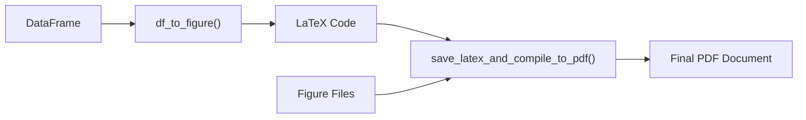

<!-- source: DeepWiki mcp.deepwiki.com · repo Technion-Kishony-lab/data-to-paper · page 4.2 Figure Generation · fetched 2026-10-26 -->

# Figure Generation

Relevant source files

The following files were used as context for generating this wiki page:

- [tests/functional/graphics/test_create_figure.py](tests/functional/graphics/test_create_figure.py)
- [tests/functional/graphics/test_df_to_figure.py](tests/functional/graphics/test_df_to_figure.py)

## Purpose and Scope

This document describes the Figure Generation system within the data-to-paper framework, which converts DataFrame data into publication-ready figures and handles their integration into research documents. It covers the process of creating customizable plots from DataFrames with support for statistical annotations, error bars, and confidence intervals. For information about generating LaTeX tables from DataFrames, see [LaTeX Generation](#4.1). For general data visualization utilities, see [Data Visualization](#3.2).

## Figure Generation Architecture

The Figure Generation system consists of two primary components that work together to create and integrate figures into research documents:

Sources: [data_to_paper/llm_coding_utils/df_to_figure.py]()

## Core Components

### DataFrame to Figure Conversion

The system converts DataFrames to figures through a two-step process:

1. **Figure Creation**: The `create_fig_for_df_to_figure_and_get_axis_parameters` function handles the actual creation of the figure using Matplotlib
2. **LaTeX Integration**: The `df_to_figure` function generates LaTeX code that references the created figure file

This separation allows for both the creation of standalone figures and their seamless integration into LaTeX documents.

Sources: [tests/functional/graphics/test_create_figure.py:10](), [tests/functional/graphics/test_df_to_figure.py:1]()

## Figure Creation Process

The `create_fig_for_df_to_figure_and_get_axis_parameters` function serves as the core figure generation component. It takes a DataFrame and various plotting parameters to create a publication-quality figure.

### Key Parameters

| Parameter | Type | Description |
|-----------|------|-------------|
| `df` | DataFrame | Data to plot |
| `filepath` | str | Output file path for the figure (without extension) |
| `y` | str/list | Column name(s) for y-axis data |
| `yerr` | str/list | Column name(s) for error bars |
| `y_ci` | str/tuple | Column name for confidence intervals or tuple of (lower, upper) bounds |
| `y_p_value` | str/list | Column name(s) for p-values to annotate |
| `xlabel` | str | X-axis label |
| `ylabel` | str | Y-axis label |
| `kind` | str | Plot type (line, bar, etc.) |

Sources: [tests/functional/graphics/test_create_figure.py:44-106]()

### Statistical Annotations Support

The system offers built-in support for statistical annotation, including:

1. **Error Bars**: Using the `yerr` parameter to specify error margins
2. **Confidence Intervals**: Using the `y_ci` parameter (as a single column or as tuple of lower/upper bounds)
3. **P-Value Annotations**: Using the `y_p_value` parameter to add statistical significance markers

Sources: [tests/functional/graphics/test_create_figure.py:65-80]()

### Multiple Series Support

The system can plot multiple data series by passing lists of column names to the `y`, `yerr`, and `y_p_value` parameters.

Sources: [tests/functional/graphics/test_create_figure.py:83-101]()

## LaTeX Integration

The `df_to_figure` function generates LaTeX code that includes the created figure in a document. It adds:

1. Figure environment with appropriate references
2. Caption text
3. Optional notes
4. Optional glossary for explaining variables

Sources: [tests/functional/graphics/test_df_to_figure.py:4-26]()

### LaTeX Output Example

The function generates LaTeX code that includes:

- Figure environment with `\includegraphics`
- Caption text from the `caption` parameter
- Notes section if provided
- Glossary entries if provided

The generated LaTeX can be integrated directly into research documents.

Sources: [tests/functional/graphics/test_df_to_figure.py:10-26]()

## Special Handling for Long Labels

The figure generation system includes special handling for long axis labels, automatically adjusting the figure layout to accommodate:

1. Long text labels
2. Wide character labels

This ensures figures remain readable regardless of label content.

Sources: [tests/functional/graphics/test_create_figure.py:53-62]()

## Validation and Requirements

The system enforces data validation requirements:

1. When specifying p-values (`y_p_value`), either error bars (`yerr`) or confidence intervals (`y_ci`) must be provided
2. Figure files are saved with appropriate extensions
3. All referenced columns must exist in the DataFrame

Sources: [tests/functional/graphics/test_create_figure.py:104-106]()

## Integration with Document Generation

The Figure Generation system integrates with the larger Document Generation System:

The figures created by this system are included in the final PDF document through LaTeX references. The Document Generation System handles the compilation process that integrates all figures and tables.

Sources: [tests/functional/graphics/test_df_to_figure.py:28-38]() (commented code indicates the integration)

## Usage Example

A typical usage of the figure generation system involves:

1. Creating a DataFrame with data to plot
2. Calling `df_to_figure` with appropriate parameters
3. Integrating the returned LaTeX code into the document

Key options that can be specified include:

- Y-axis data columns and corresponding error/CI/p-value columns
- Axis labels
- Figure captions and notes
- Glossary entries to explain variables

The system handles the technical details of creating publication-quality figures with appropriate statistical annotations.

Sources: [tests/functional/graphics/test_df_to_figure.py:18-26]()

---

