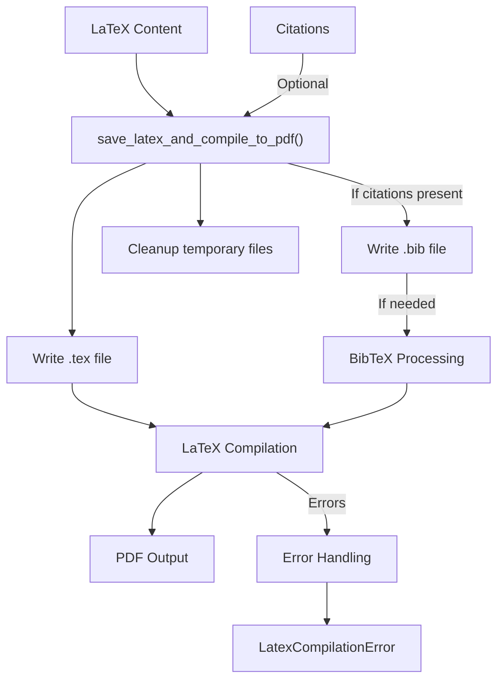
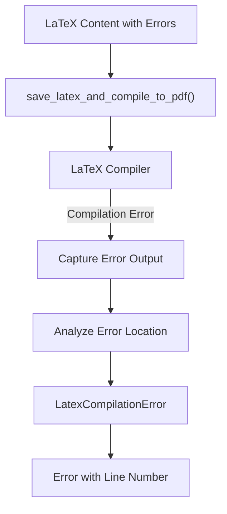
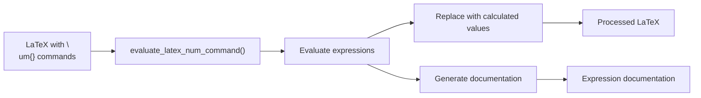
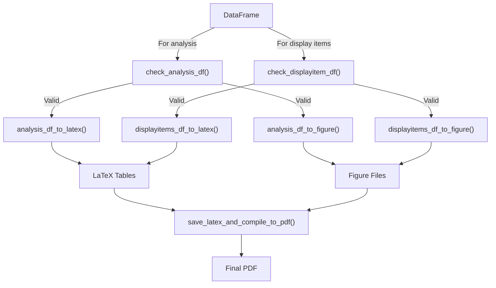

<!-- source: DeepWiki mcp.deepwiki.com · repo Technion-Kishony-lab/data-to-paper · page 4.3 PDF Compilation · fetched 2026-10-26 -->

# PDF Compilation

<details>
<summary>Relevant source files</summary>

The following files were used as context for generating this wiki page:

- [tests/functional/latex/test_latex_to_pdf.py](tests/functional/latex/test_latex_to_pdf.py)
- [tests/functional/research_types/scientific_research/test_df_check.py](tests/functional/research_types/scientific_research/test_df_check.py)

</details>


This document details the PDF compilation process in the data-to-paper framework, explaining how LaTeX content and figures are compiled into a final PDF document. It covers the process of converting LaTeX content to PDF, handling citations, error handling during compilation, and LaTeX expression evaluation. For information about LaTeX content generation, see [LaTeX Generation](#4.1), and for figure creation, see [Figure Generation](#4.2).

## PDF Compilation Process Overview

The PDF compilation system takes LaTeX content (potentially with citations and figures) and generates a PDF document through a multi-step process. It handles various LaTeX features including citations, hyperlinks, and mathematical expressions.

**PDF Compilation Workflow**


Sources: [tests/functional/latex/test_latex_to_pdf.py:9-11](), [tests/functional/latex/test_latex_to_pdf.py:120-126]()

## Key Components

### `save_latex_and_compile_to_pdf` Function

The central function for PDF compilation is `save_latex_and_compile_to_pdf`, which:

1. Takes LaTeX content as input
2. Saves it to a .tex file
3. Compiles it into a PDF
4. Handles citations if provided
5. Cleans up temporary files

Basic usage involves providing LaTeX content, a file name, and an output directory:

```
save_latex_and_compile_to_pdf(latex_content, file_name, output_directory)
```

When citations are included, an additional citations parameter is required:

```
save_latex_and_compile_to_pdf(latex_content, file_name, output_directory, citations)
```

Sources: [tests/functional/latex/test_latex_to_pdf.py:120-126](), [tests/functional/latex/test_latex_to_pdf.py:129-136]()

### Citation Handling

The system supports BibTeX citations through the `CrossrefCitation` class. Citations are stored in a collection and passed to the `save_latex_and_compile_to_pdf` function, which:

1. Writes citations to a .bib file
2. Ensures proper BibTeX processing during compilation
3. Includes the bibliography in the final PDF

**Citation Structure and Processing**
```mermaid
classDiagram
    class "CrossrefCitation" {
        +type: str
        +title: str
        +author: str
        +first_author_family: str
        +journal: str
        +year: str
        +volume: str
        +number: str
        +pages: str
        +doi: str
        +url: str
    }
    
    class "save_latex_and_compile_to_pdf" {
        +compile(latex_content, file_name, output_dir, citations)
    }
    
    "save_latex_and_compile_to_pdf" --> "CrossrefCitation" : processes
    "CrossrefCitation" --> "BibTeX file" : saved to
    "BibTeX file" --> "LaTeX Compiler" : used by
    "LaTeX Compiler" --> "PDF Document" : generates
```

Sources: [tests/functional/latex/test_latex_to_pdf.py:82-110](), [tests/functional/latex/test_latex_to_pdf.py:129-136]()

## Error Handling

The PDF compilation system includes robust error handling through the `LatexCompilationError` exception. When LaTeX compilation fails, the system:

1. Raises a `LatexCompilationError` with the original LaTeX content
2. Provides information about the line number where the error occurred
3. Preserves the LaTeX content for debugging purposes

**Example of error handling:**


Sources: [tests/functional/latex/test_latex_to_pdf.py:164-169]()

## LaTeX Text Processing and Expression Evaluation

### Processing LaTeX Text

The system includes `process_latex_text_and_math` which prepares raw text for LaTeX by:

1. Escaping special characters (e.g., &, %, #, _)
2. Preserving already escaped characters
3. Maintaining proper math mode environments ($...$, $$...$$)

This function is crucial for handling user-provided content that may contain unescaped special characters.

Sources: [tests/functional/latex/test_latex_to_pdf.py:6](), [tests/functional/latex/test_latex_to_pdf.py:139-145](), [tests/functional/latex/test_latex_to_pdf.py:154-161]()

### LaTeX Expression Evaluation

The system can evaluate mathematical expressions within LaTeX using the `evaluate_latex_num_command` function. This allows:

1. Embedding calculations directly in LaTeX using `\num{expression, "description"}`
2. Automatic evaluation of the expression (e.g., `\num{1+2, "trivial"}` becomes "3")
3. Documentation of the calculation in a separate dictionary

**LaTeX Expression Evaluation Process**


Sources: [tests/functional/latex/test_latex_to_pdf.py:172-181]()

## Integration with DataFrame Visualization

The PDF compilation system integrates with the DataFrame visualization system:

1. DataFrames are validated using `check_analysis_df` or `check_displayitem_df`
2. Validated DataFrames are converted to LaTeX tables or figures
3. The resulting LaTeX content is compiled to PDF

**DataFrame to PDF Integration**


Sources: [tests/functional/research_types/scientific_research/test_df_check.py:205-209](), [tests/functional/research_types/scientific_research/test_df_check.py:221-224]()

## LatexDocument Class

The `LatexDocument` class provides an object-oriented interface for LaTeX document operations:

1. Represents a LaTeX document with associated state and methods
2. Provides compilation functionality through the `compile_document` method
3. Designed to be hashable for storage in collections

Sources: [tests/functional/latex/test_latex_to_pdf.py:8](), [tests/functional/latex/test_latex_to_pdf.py:116-117](), [tests/functional/latex/test_latex_to_pdf.py:181-182]()

---

