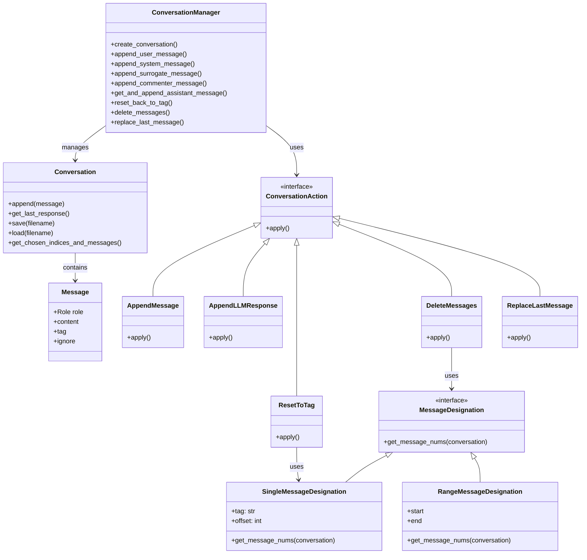
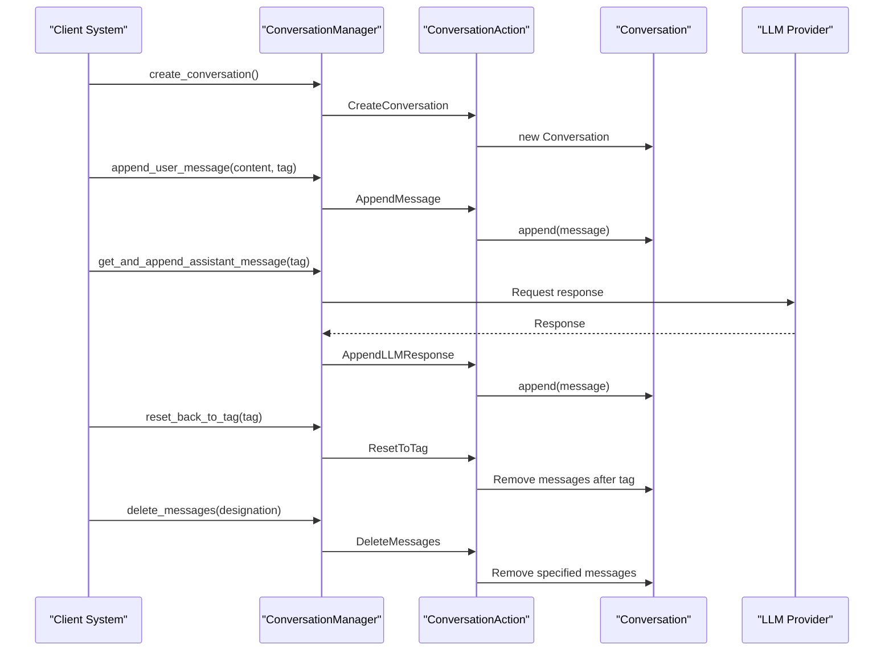
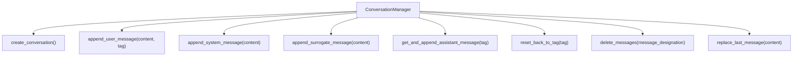
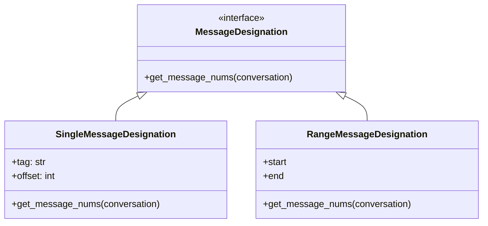
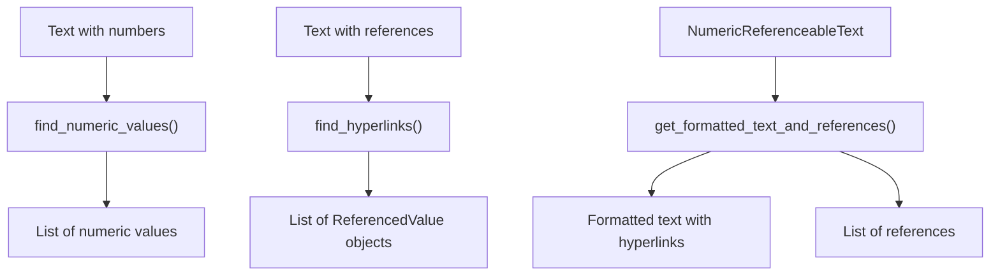
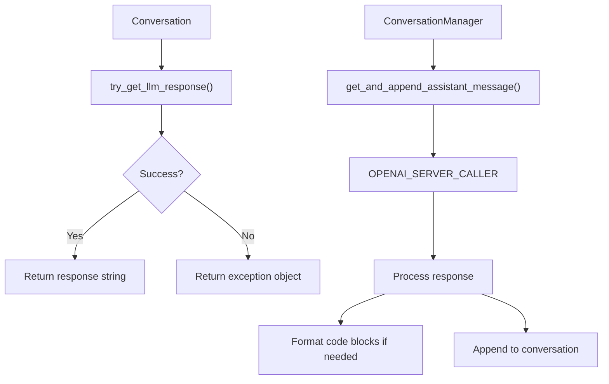

<!-- source: DeepWiki mcp.deepwiki.com · repo Technion-Kishony-lab/data-to-paper · page 5 LLM Interaction System · fetched 2026-10-26 -->

# LLM Interaction System

<details>
<summary>Relevant source files</summary>

The following files were used as context for generating this wiki page:

- [tests/functional/conversation/conftest.py](tests/functional/conversation/conftest.py)
- [tests/functional/conversation/test_actions.py](tests/functional/conversation/test_actions.py)
- [tests/functional/conversation/test_conversation.py](tests/functional/conversation/test_conversation.py)
- [tests/functional/conversation/test_conversation_manager.py](tests/functional/conversation/test_conversation_manager.py)
- [tests/functional/conversation/test_message_designation.py](tests/functional/conversation/test_message_designation.py)
- [tests/functional/utils/test_ref_numeric_values.py](tests/functional/utils/test_ref_numeric_values.py)

</details>


The LLM Interaction System provides a structured framework for managing interactions with Large Language Models (LLMs) in the data-to-paper ecosystem. This system handles the creation, management, and processing of conversations with LLMs, enabling other components to utilize AI capabilities in a controlled and reliable manner.

The system handles three main areas:
- Conversation management and tracking
- Extraction of structured data from LLM responses
- Integration with external LLM providers

For information about executing AI-generated code, see [Code Execution System](#2), and for information about generating document content, see [Document Generation System](#4).

## System Architecture

### Overview Diagram



Sources: [tests/functional/conversation/test_conversation_manager.py:1-127](), [tests/functional/conversation/test_actions.py:1-97](), [tests/functional/conversation/test_message_designation.py:1-44]()

### Interaction Flow



Sources: [tests/functional/conversation/test_conversation_manager.py:1-127](), [tests/functional/conversation/test_actions.py:1-97]()

## Conversation Management

The Conversation Management subsystem provides a structured way to interact with LLMs through a conversation-based paradigm. It maintains conversations as sequences of messages with different roles and provides methods to manipulate these conversations.

### ConversationManager

The `ConversationManager` class is the central component of the Conversation Management subsystem. It orchestrates conversations with LLMs and provides methods to manipulate them.

Key features:
- Creating and managing conversations
- Adding different types of messages (user, system, assistant)
- Getting responses from LLMs
- Manipulating conversation history (reset, delete, replace)



Sources: [tests/functional/conversation/test_conversation_manager.py:4-127]()

### Message Types and Roles

The system supports different types of messages within a conversation, each with a specific role:

| Role | Description | Used For |
|------|-------------|----------|
| `SYSTEM` | System instructions | Setting behavior instructions for the LLM |
| `USER` | User input | Providing queries or input to the LLM |
| `ASSISTANT` | LLM response | Responses generated by the LLM |
| `SURROGATE` | Predefined assistant response | Manually injected assistant messages |
| `COMMENTER` | Comment | Metadata or annotations (not sent to LLM) |

Messages can also have additional attributes:
- `tag`: Optional identifier for referencing specific messages
- `ignore`: Flag to exclude message from being sent to LLM
- `comment`: Additional metadata about the message

Sources: [tests/functional/conversation/conftest.py:1-23](), [tests/functional/conversation/test_conversation.py:1-80]()

### Conversation Actions

The system implements a command pattern for conversation manipulation through `ConversationAction` objects:

| Action | Description |
|--------|-------------|
| `CreateConversation` | Creates a new conversation |
| `AppendMessage` | Adds a message to a conversation |
| `AppendLLMResponse` | Adds an LLM-generated response |
| `FailedLLMResponse` | Handles a failed LLM response |
| `ResetToTag` | Resets conversation back to a specified tag |
| `DeleteMessages` | Removes specified messages |
| `ReplaceLastMessage` | Replaces the last message |

These actions provide an auditable and reproducible way to manipulate conversations.

Sources: [tests/functional/conversation/test_actions.py:3-97]()

### Message Designation

The system provides flexible ways to designate messages for operations like deletion or resetting:



#### Designation Methods:
- **By index**: Direct numerical index in the conversation
- **By tag**: Reference to a tagged message
- **By offset**: Relative position from a tagged message
- **By range**: A range of messages between two points

Sources: [tests/functional/conversation/test_message_designation.py:1-44]()

## Data Type Extraction

The system provides mechanisms for extracting structured data from LLM responses, particularly numeric values and references.

### Numeric Value Extraction

The framework can extract numeric values from text and create references to them:



Key classes:
- `NumericReferenceableText`: Creates references to all numeric values in text
- `LabeledNumericReferenceableText`: Creates references only to labeled numeric values
- `ReferencedValue`: Represents a referenced numeric value

Sources: [tests/functional/utils/test_ref_numeric_values.py:1-88]()

## LLM API Integration

The LLM Interaction System integrates with external LLM providers, particularly OpenAI's API.

### LLM Response Handling

The system provides utilities for requesting responses from LLMs and handling various scenarios:



Key features:
- Error handling for API issues
- Token counting and management
- Model selection flexibility
- Response formatting for code blocks

Sources: [tests/functional/conversation/test_conversation.py:28-44](), [tests/functional/conversation/test_conversation_manager.py:115-127]()

### Advanced Integration Features

The system includes several advanced features for LLM integration:

1. **Token Counting**: Calculates token usage for API requests
2. **Model Selection**: Supports different models like GPT-4 and GPT-4 Turbo
3. **Response Formatting**: Automatically formats code blocks with the appropriate language
4. **Error Handling**: Gracefully handles API errors and retries

Sources: [tests/functional/conversation/test_conversation.py:12-26]()

## Usage Examples

### Basic Conversation

```python
# Create a conversation manager
manager = ConversationManager()
manager.create_conversation()

# Add system and user messages
manager.append_system_message('You are a helpful assistant.')
manager.append_user_message('How much is 2 + 2?', tag='math_question')

# Get a response from the LLM
response = manager.get_and_append_assistant_message(tag='math_answer')

# Get the last response content
answer = manager.conversation.get_last_response()
```

### Conversation Management

```python
# Reset the conversation back to a specific point
manager.reset_back_to_tag('math_question')

# Delete specific messages
manager.delete_messages(RangeMessageDesignation.from_('math_question', -1))

# Replace the last response
manager.replace_last_message('New response content')
```

Sources: [tests/functional/conversation/test_conversation_manager.py:20-112]()

---

