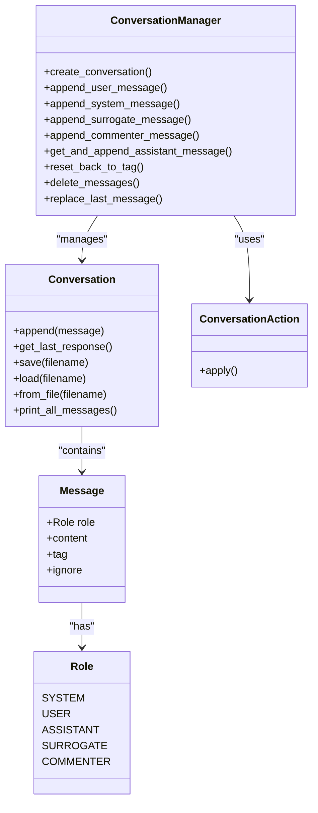
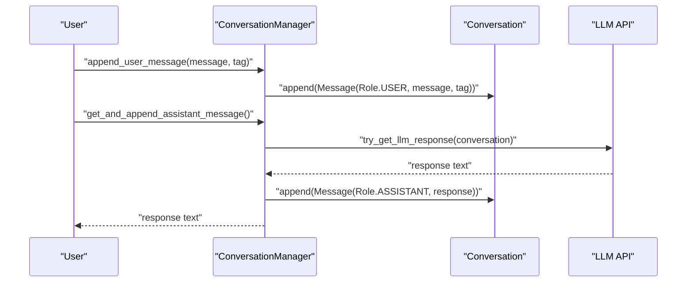
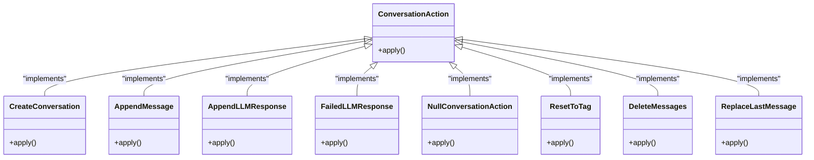
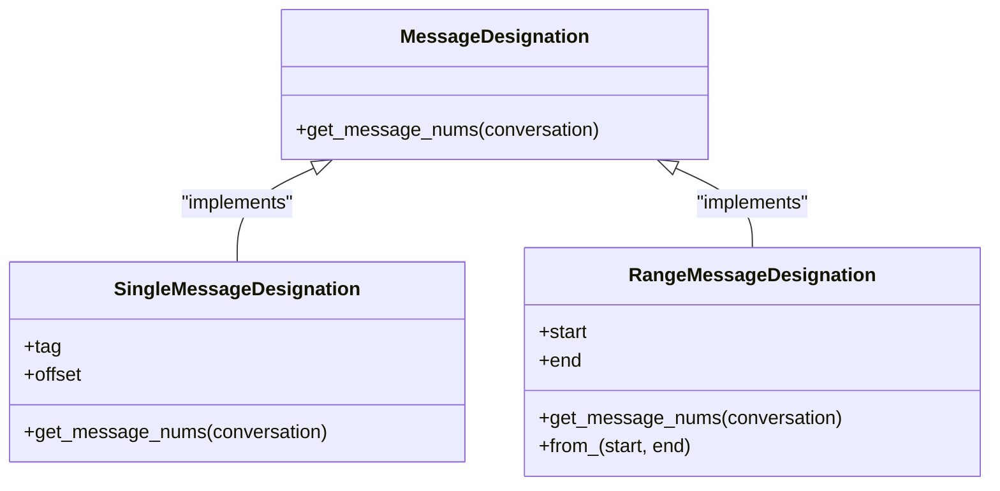
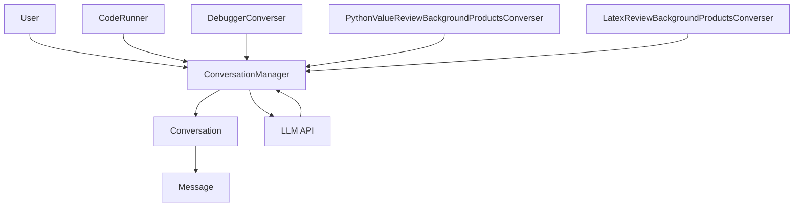

<!-- source: DeepWiki mcp.deepwiki.com · repo Technion-Kishony-lab/data-to-paper · page 5.1 Conversation Management · fetched 2026-10-26 -->

# Conversation Management

<details>
<summary>Relevant source files</summary>

The following files were used as context for generating this wiki page:

- [tests/functional/conversation/conftest.py](tests/functional/conversation/conftest.py)
- [tests/functional/conversation/test_actions.py](tests/functional/conversation/test_actions.py)
- [tests/functional/conversation/test_conversation.py](tests/functional/conversation/test_conversation.py)
- [tests/functional/conversation/test_conversation_manager.py](tests/functional/conversation/test_conversation_manager.py)
- [tests/functional/conversation/test_message_designation.py](tests/functional/conversation/test_message_designation.py)
- [tests/functional/utils/test_ref_numeric_values.py](tests/functional/utils/test_ref_numeric_values.py)

</details>


## Purpose and Scope

The Conversation Management system is responsible for orchestrating interactions with Large Language Models (LLMs) in the data-to-paper framework. It provides a structured way to create, maintain, and manipulate conversations with LLMs, including sending prompts, receiving responses, and tracking conversation state. This component serves as the communication layer between the framework and external LLM services.

For information about extracting specific data types from LLM responses, see [Data Type Extraction](#5.2).

## System Overview

The Conversation Management system consists of several core components that work together to facilitate structured conversations with LLMs:

**Conversation Management System Architecture**



Sources: [tests/functional/conversation/test_conversation_manager.py:1-127](), [tests/functional/conversation/test_conversation.py:1-81]()

## Core Components

### Conversation Manager

The `ConversationManager` class is the central component of the system. It orchestrates conversations with LLMs, providing methods to create conversations, add messages, retrieve LLM responses, and manipulate the conversation history.

#### Key Methods

| Method | Description |
|--------|-------------|
| `create_conversation()` | Creates a new conversation |
| `append_user_message(content, tag=None, comment=None)` | Adds a user message to the conversation |
| `append_system_message(content)` | Adds a system message to the conversation |
| `append_surrogate_message(content)` | Adds a predefined assistant message to the conversation |
| `append_commenter_message(content)` | Adds a comment message to the conversation |
| `get_and_append_assistant_message(tag=None, is_code=False, **kwargs)` | Sends the conversation to the LLM, gets a response, and adds it to the conversation |
| `reset_back_to_tag(tag)` | Resets the conversation back to a specific tagged message |
| `delete_messages(message_designation)` | Deletes specific messages from the conversation |
| `replace_last_message(content)` | Replaces the last message in the conversation |

Sources: [tests/functional/conversation/test_conversation_manager.py:4-127]()

### Conversation and Messages

Conversations are collections of messages with different roles. The `Conversation` class provides methods to manage these messages and save/load conversations.

#### Conversation Methods

| Method | Description |
|--------|-------------|
| `append(message)` | Adds a message to the conversation |
| `get_last_response()` | Returns the content of the last assistant message |
| `save(filename)` | Saves the conversation to a file |
| `load(filename)` | Loads a conversation from a file |
| `from_file(filename)` | Static method to create a conversation from a file |
| `print_all_messages()` | Prints all messages in the conversation |

#### Message Structure

Messages have the following properties:
- `role`: The role of the message sender (SYSTEM, USER, ASSISTANT, SURROGATE, COMMENTER)
- `content`: The text content of the message
- `tag`: Optional tag to identify the message (used for navigation within the conversation)
- `ignore`: Boolean flag to indicate if the message should be ignored when sending to LLM

Sources: [tests/functional/conversation/test_conversation.py:6-80](), [tests/functional/conversation/conftest.py:4-18]()

**Message Flow in a Conversation**



Sources: [tests/functional/conversation/test_conversation_manager.py:20-32](), [tests/functional/conversation/test_conversation.py:34-45]()

### Conversation Actions

The Conversation Management system uses an action-based approach to maintain a record of all operations performed on conversations. Each operation is represented by a `ConversationAction` that can be applied to a conversation.

**Conversation Actions Hierarchy**



Sources: [tests/functional/conversation/test_actions.py:3-97]()

#### Action Types

| Action | Description |
|--------|-------------|
| `CreateConversation` | Creates a new conversation |
| `AppendMessage` | Adds a message to a conversation |
| `AppendLLMResponse` | Adds an LLM response to a conversation |
| `FailedLLMResponse` | Records a failed attempt to get an LLM response |
| `NullConversationAction` | Represents no action (for logging purposes) |
| `ResetToTag` | Resets a conversation back to a specific tag |
| `DeleteMessages` | Deletes specific messages from a conversation |
| `ReplaceLastMessage` | Replaces the last message in a conversation |

Sources: [tests/functional/conversation/test_actions.py:19-97]()

### Message Designation

The system provides flexible ways to refer to messages within a conversation through the Message Designation system. This allows operations like deletion or resetting to target specific messages.

**Message Designation System**



Sources: [tests/functional/conversation/test_message_designation.py:3-44]()

#### Message Designation Types

| Designation | Description | Example |
|-------------|-------------|---------|
| `SingleMessageDesignation` | Refers to a single message by tag and optional offset | `'code'` or `('code', 1)` |
| `RangeMessageDesignation` | Refers to a range of messages | `(1, 3)` or `(None, 'code')` |
| Integer index | Refers to a specific message by index | `1` or `-1` (last message) |

Sources: [tests/functional/conversation/test_message_designation.py:7-44]()

## Integration with Other Systems

The Conversation Management system serves as a core component that interacts with several other systems in the data-to-paper framework:

**Conversation Management System Integration**



Sources: [tests/functional/conversation/test_conversation_manager.py:1-127]()

## Usage Examples

### Creating and Managing a Conversation

```python
# Initialize a conversation manager
manager = ConversationManager(actions_and_conversations=actions_and_conversations, conversation_name='example')

# Create a new conversation
manager.create_conversation()

# Add system instructions
manager.append_system_message('You are a helpful assistant.')

# Add a user message with a tag for reference
manager.append_user_message('How much is 2 + 2?', tag='math_question')

# Get LLM response and add it to the conversation
response = manager.get_and_append_assistant_message(tag='math_answer')

# Reset the conversation back to a specific point
manager.reset_back_to_tag(tag='math_question')

# Replace the last message
manager.replace_last_message('New response: The answer is 4.')
```

Sources: [tests/functional/conversation/test_conversation_manager.py:10-112]()

### Working with Code Responses

The Conversation Management system includes special handling for code responses, automatically adding Python syntax highlighting to code blocks:

```python
# Get an LLM response that contains code and add it to the conversation
response = manager.get_and_append_assistant_message(is_code=True)
```

When `is_code=True` is specified, the system automatically adds language identifiers to code blocks to ensure proper syntax highlighting (e.g., changing ``` to ```python).

Sources: [tests/functional/conversation/test_conversation_manager.py:115-127]()

### Saving and Loading Conversations

Conversations can be saved to files and loaded later:

```python
# Save a conversation to a file
conversation.save('my_conversation.txt')

# Load a conversation from a file
new_conversation = Conversation()
new_conversation.load('my_conversation.txt')

# Or create a conversation directly from a file
new_conversation = Conversation.from_file('my_conversation.txt')
```

Sources: [tests/functional/conversation/test_conversation.py:47-61]()

## Best Practices

1. **Use tags for important messages**: Tags make it easier to navigate and manipulate conversations, especially for resetting or referencing specific points.

2. **Handle LLM failures gracefully**: LLM calls can fail due to various reasons (token limits, connectivity issues, etc.). Always check for errors when calling `get_and_append_assistant_message()`.

3. **Use appropriate message roles**: Different roles (SYSTEM, USER, ASSISTANT, etc.) have different purposes and should be used accordingly.

4. **Save conversations for reproducibility**: Saving conversations to files provides a record of the interaction and allows for later analysis or resumption.

5. **Use message designations for precise operations**: When deleting messages or resetting conversations, use message designations to precisely target the desired messages.

---

