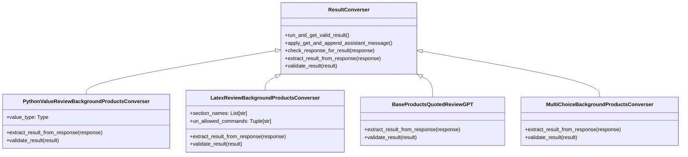
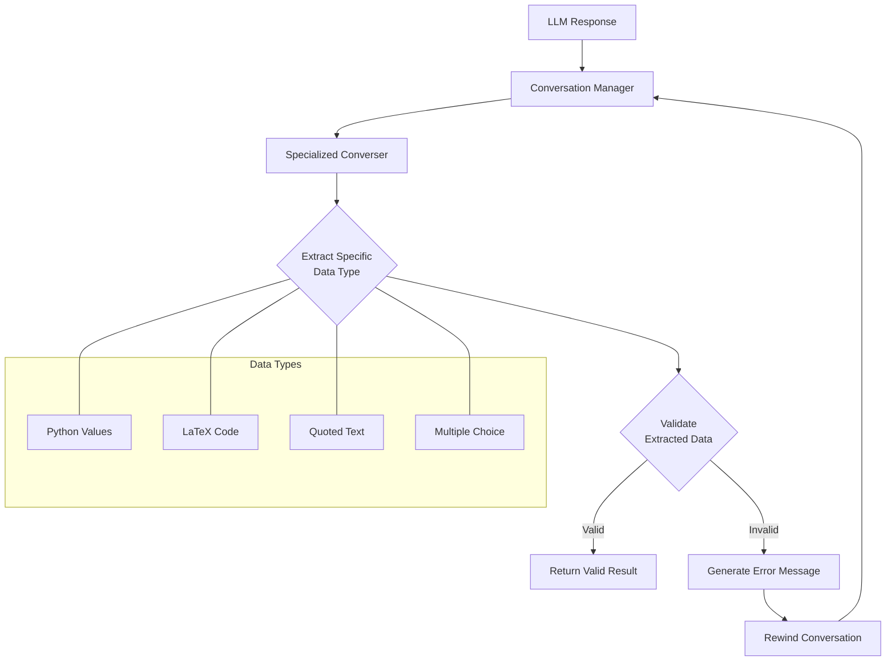
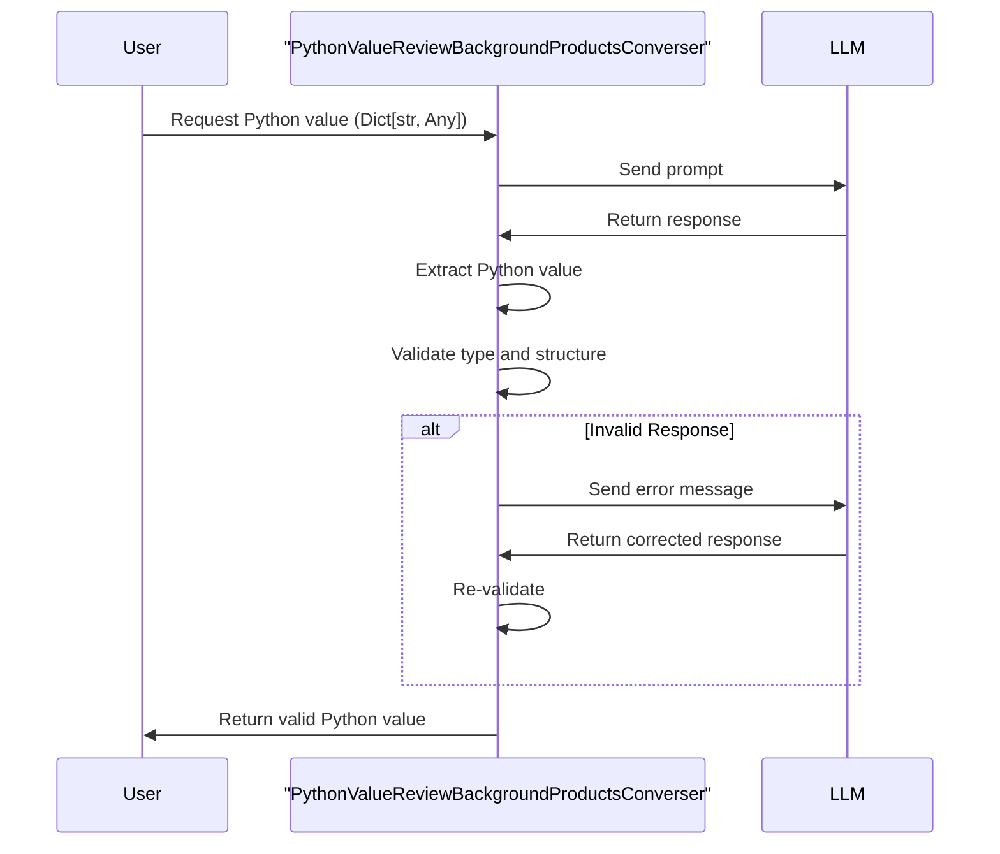
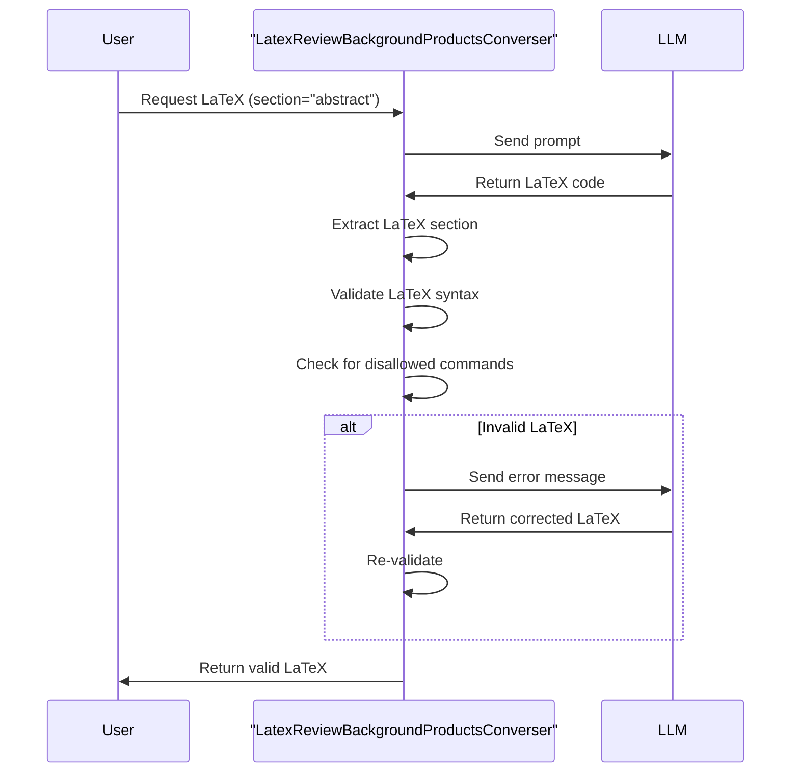
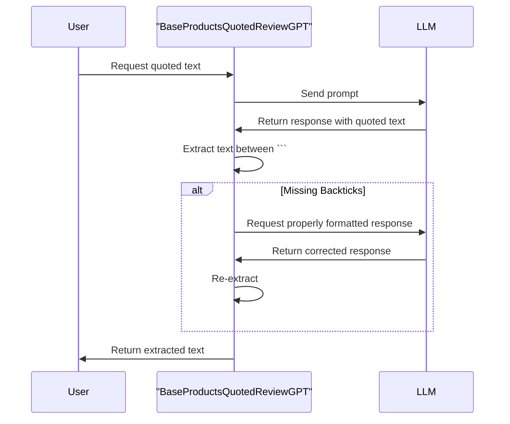
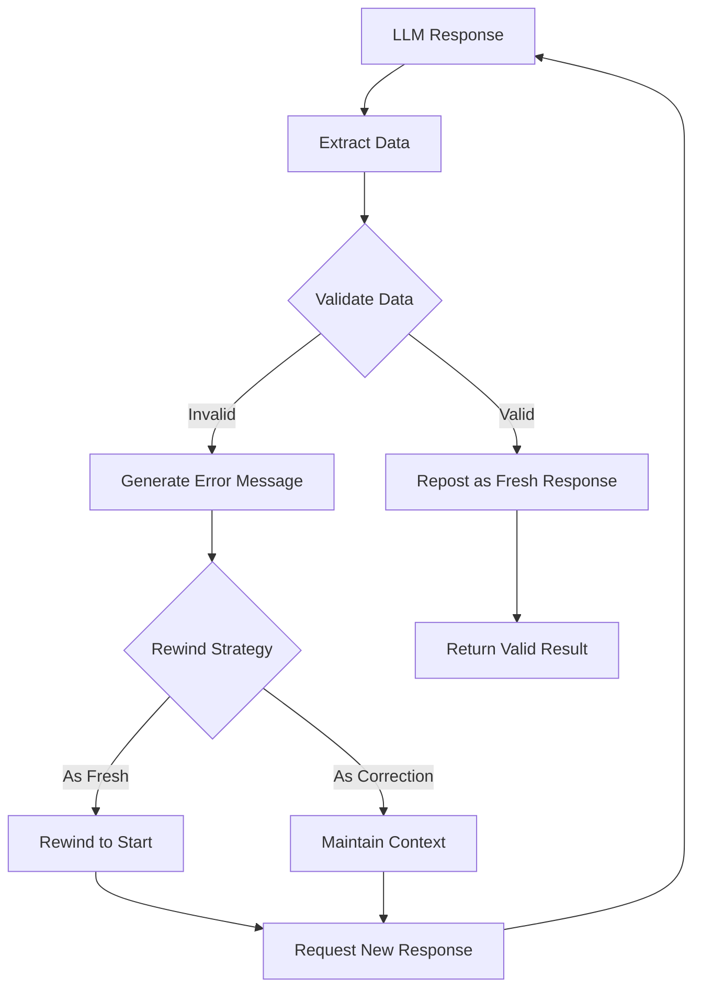
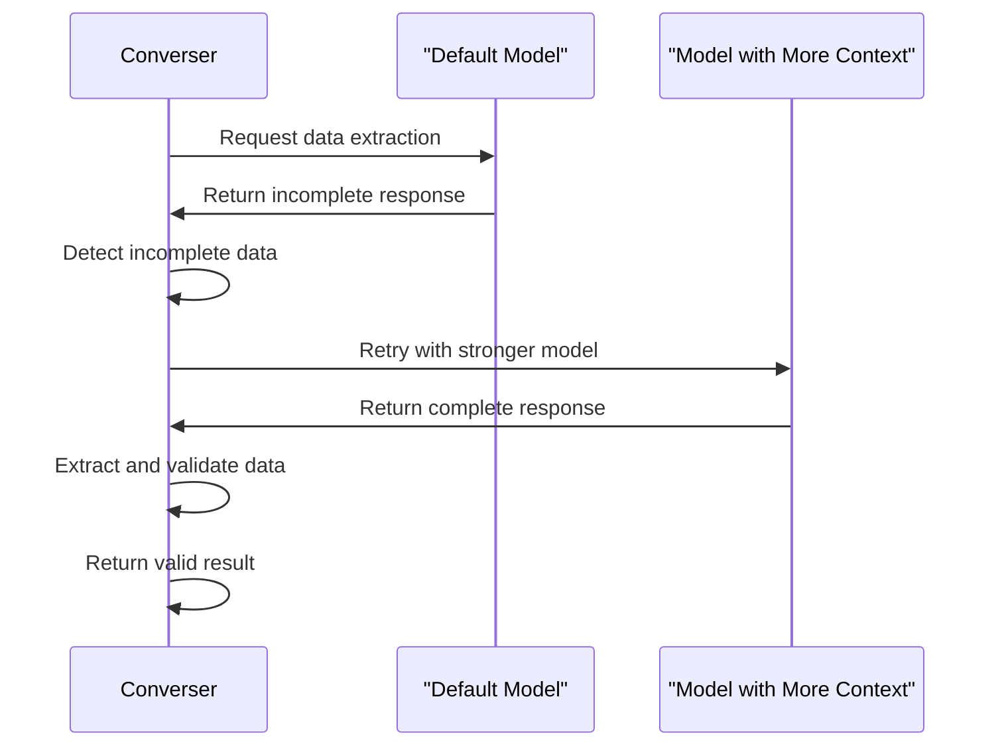
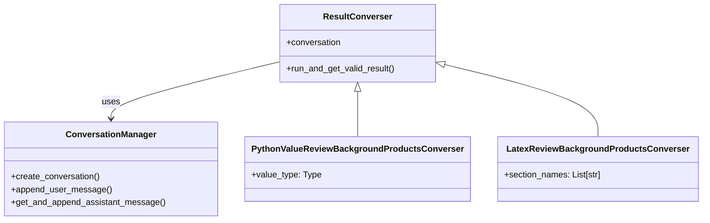
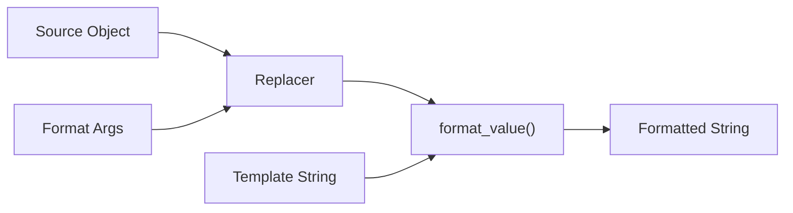

<!-- source: DeepWiki mcp.deepwiki.com · repo Technion-Kishony-lab/data-to-paper · page 5.2 Data Type Extraction · fetched 2026-10-26 -->

# Data Type Extraction

Relevant source files

The following files were used as context for generating this wiki page:

- [tests/functional/base_steps/test_request_latex.py](tests/functional/base_steps/test_request_latex.py)
- [tests/functional/base_steps/test_request_multi_choice.py](tests/functional/base_steps/test_request_multi_choice.py)
- [tests/functional/base_steps/test_request_python_value.py](tests/functional/base_steps/test_request_python_value.py)
- [tests/functional/base_steps/test_request_quoted_text.py](tests/functional/base_steps/test_request_quoted_text.py)
- [tests/functional/base_steps/test_review_dialog.py](tests/functional/base_steps/test_review_dialog.py)
- [tests/functional/base_steps/utils.py](tests/functional/base_steps/utils.py)
- [tests/functional/utils/test_replacer.py](tests/functional/utils/test_replacer.py)

## Purpose and Scope

This document details the Data Type Extraction system within the data-to-paper framework. This system is responsible for extracting and validating specific data types from Large Language Model (LLM) responses. It provides specialized classes for handling different data formats including Python values, LaTeX code, quoted text, and multiple choice selections.

The Data Type Extraction system is a critical component of the LLM Interaction System, enabling reliable extraction of structured data from free-form LLM responses. For information about the overall conversation management with LLMs, see [Conversation Management](#5.1).

## System Architecture

The Data Type Extraction system consists of specialized "converser" classes that extract and validate specific data types from LLM responses. These conversers inherit from a common base class structure and implement type-specific extraction and validation logic.

Sources: [tests/functional/base_steps/test_request_python_value.py:7-8](), [tests/functional/base_steps/test_request_latex.py:7](), [tests/functional/base_steps/test_request_quoted_text.py:1](), [tests/functional/base_steps/test_request_multi_choice.py:6](), [tests/functional/base_steps/utils.py:54-55]()

## Data Flow

The following diagram illustrates the data flow in the extraction process, from the LLM response to the validated result:

Sources: [tests/functional/base_steps/utils.py:36-52](), [tests/functional/base_steps/test_request_python_value.py:40-53](), [tests/functional/base_steps/test_request_latex.py:53-58]()

## Python Value Extraction

The Python Value Extraction component extracts and validates Python values of specific types from LLM responses. It supports various Python data types including dictionaries, lists, and sets.

### Key Features

1. **Type Validation**: Ensures extracted values match the expected Python type
2. **Structure Validation**: For complex types (like dictionaries), validates the structure matches requirements
3. **Key Validation**: For dictionaries, can validate specific keys are present
4. **Error Handling**: Provides detailed error messages for invalid responses

### Example Flow

Sources: [tests/functional/base_steps/test_request_python_value.py:20-29](), [tests/functional/base_steps/test_request_python_value.py:56-65]()

### Specialized Dictionary Extraction

The framework includes specialized support for dictionaries with defined keys through the `PythonDictWithDefinedKeysReviewBackgroundProductsConverser` class, which validates that dictionaries contain specific required keys.

Sources: [tests/functional/base_steps/test_request_python_value.py:7-8](), [tests/functional/base_steps/test_request_python_value.py:125-139]()

## LaTeX Extraction

The LaTeX Extraction component extracts and validates LaTeX code from LLM responses, with support for validating different LaTeX sections and ensuring proper LaTeX syntax.

### Key Features

1. **Section Extraction**: Extracts specific LaTeX sections (title, abstract, etc.)
2. **Syntax Validation**: Ensures valid LaTeX syntax
3. **Citation Handling**: Validates and corrects citations
4. **Command Filtering**: Can filter out disallowed LaTeX commands

### Example Flow

Sources: [tests/functional/base_steps/test_request_latex.py:16-24](), [tests/functional/base_steps/test_request_latex.py:48-58]()

### Citation Handling

The LaTeX extraction system includes special handling for citations:

1. **Citation Removal**: Option to remove citations from sections
2. **Citation Normalization**: Automatically corrects citation formats
3. **Floating Citation Detection**: Detects and corrects floating citations (citations not properly wrapped in `\cite{}`)

Sources: [tests/functional/base_steps/test_request_latex.py:122-146](), [tests/functional/base_steps/test_request_latex.py:161-174]()

## Quoted Text Extraction

The Quoted Text Extraction component extracts text enclosed in triple backticks from LLM responses.

### Key Features

1. **Backtick Detection**: Extracts text between triple backticks
2. **Header Handling**: Supports extraction with headers inside the quoted blocks
3. **Error Recovery**: Automatically handles missing closing backticks

### Example Flow

Sources: [tests/functional/base_steps/test_request_quoted_text.py:13-14](), [tests/functional/base_steps/test_request_quoted_text.py:20-24](), [tests/functional/base_steps/test_request_quoted_text.py:27-42]()

## Multiple Choice Extraction

The Multiple Choice Extraction component extracts and validates multiple choice answers from LLM responses.

### Key Features

1. **Single Choice Validation**: Ensures response is a single option
2. **Option Validation**: Validates that the selected option is among the available options
3. **Error Handling**: Provides clear error messages for invalid selections

Sources: [tests/functional/base_steps/test_request_multi_choice.py:13-14](), [tests/functional/base_steps/test_request_multi_choice.py:20-32]()

## Common Functionality

All data type extractors share common functionality provided by their base classes.

### Error Handling and Conversation Rewinding

The system includes sophisticated error handling and conversation management through the "rewind" mechanism:

1. **Error Detection**: Detects invalid responses based on type-specific validation rules
2. **Error Messages**: Generates clear error messages explaining the issue
3. **Conversation Rewinding**: Can rewind the conversation to a previous state to try again
4. **Fresh Response Formatting**: Reformats valid responses to be clean and properly structured

Sources: [tests/functional/base_steps/utils.py:54-67](), [tests/functional/base_steps/test_request_python_value.py:94-122](), [tests/functional/base_steps/test_request_latex.py:96-112]()

### Model Strength Adjustment

When extracting complex data, the system can automatically adjust the model to one with more context if needed:

Sources: [tests/functional/base_steps/test_request_quoted_text.py:45-56]()

## Integration with Conversation Management

The Data Type Extraction system integrates closely with the Conversation Management system. Each converser maintains its own conversation state and can interact with the LLM multiple times to obtain a valid result.

Sources: [tests/functional/base_steps/utils.py:26-32](), [tests/functional/base_steps/test_request_python_value.py:32-65]()

## Value Formatting and Replacement

The system uses the `Replacer` utility to format values within strings, supporting both direct attribute references and inline formatting:

Sources: [tests/functional/utils/test_replacer.py:16-30]()

---

