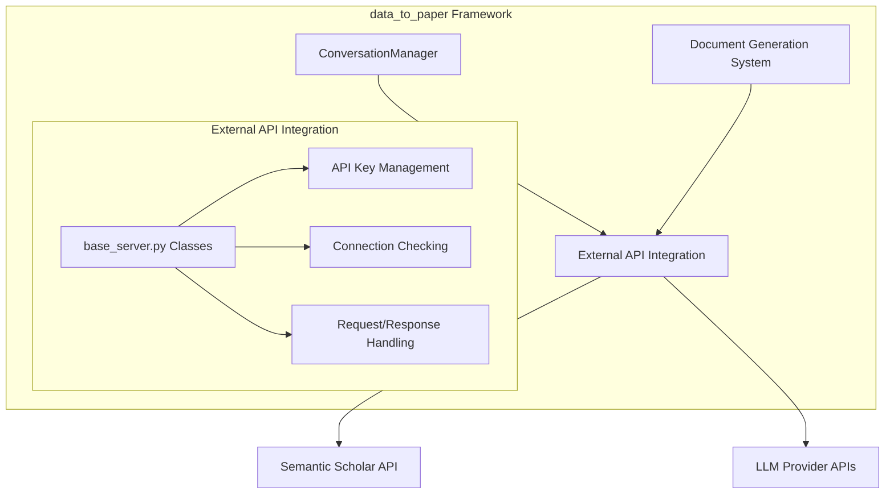
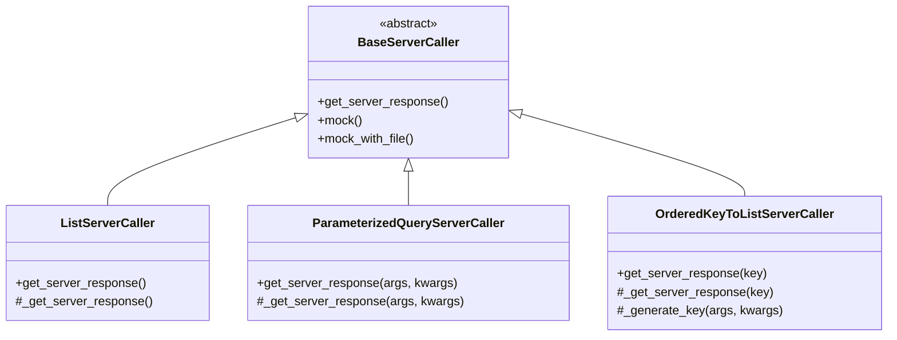
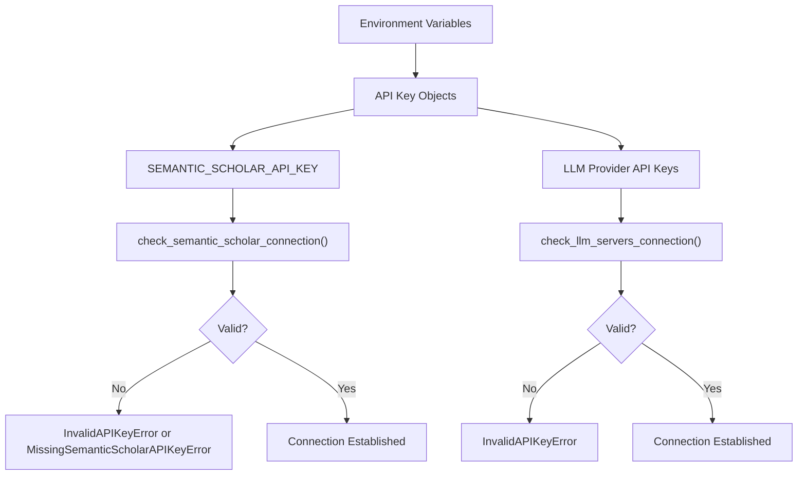
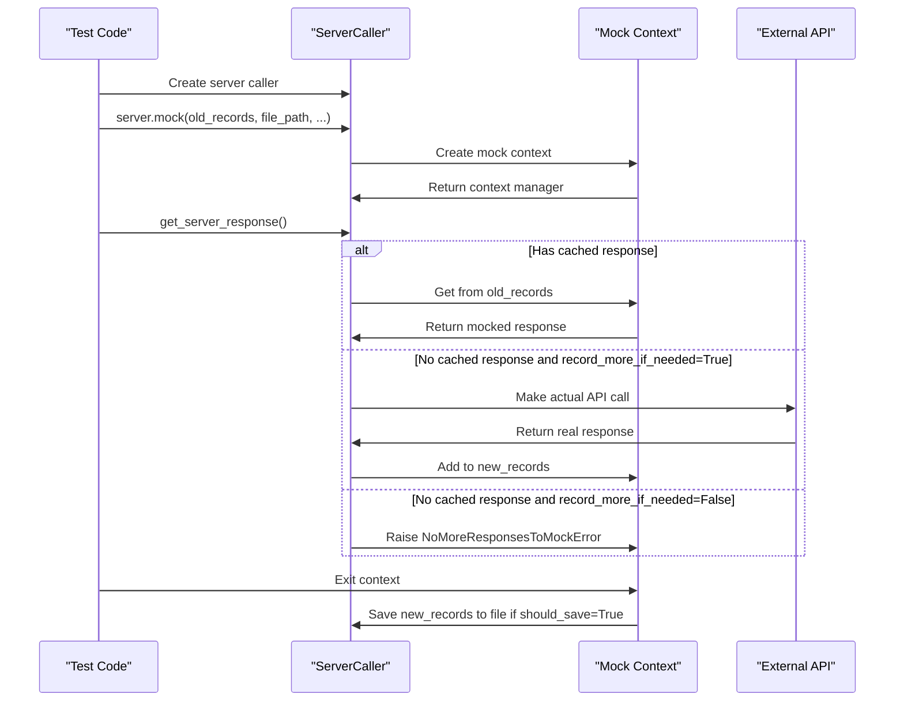
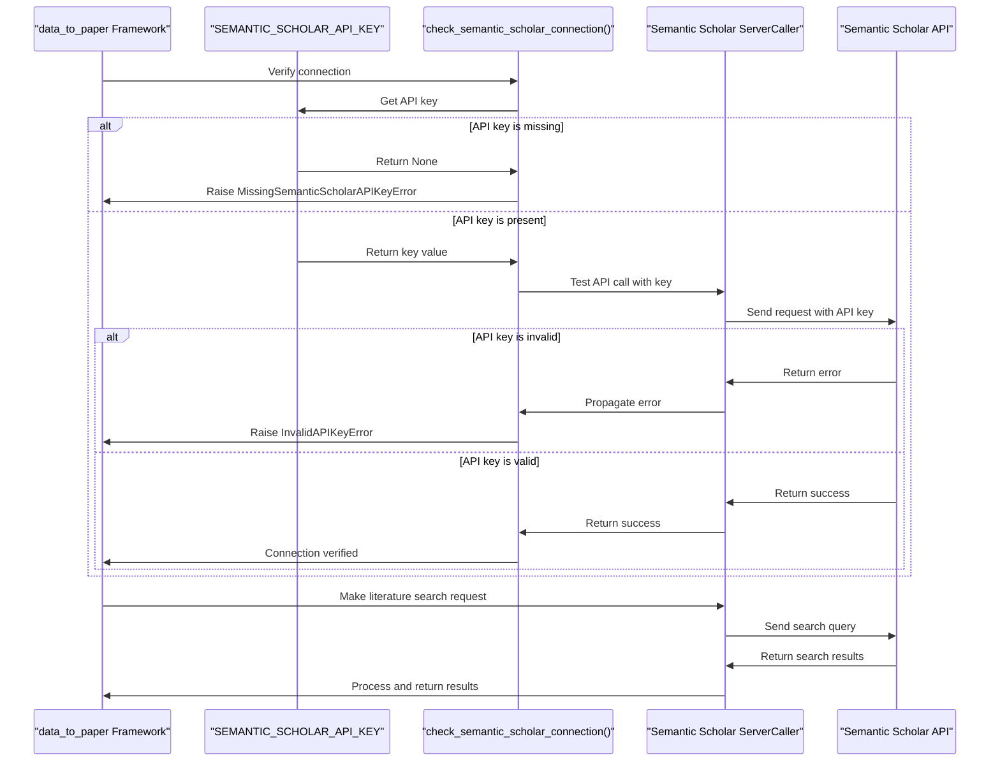

<!-- source: DeepWiki mcp.deepwiki.com · repo Technion-Kishony-lab/data-to-paper · page 5.3 External API Integration · fetched 2026-10-26 -->

# External API Integration

Relevant source files

The following files were used as context for generating this wiki page:

- [tests/functional/servers/__init__.py](tests/functional/servers/__init__.py)
- [tests/functional/servers/test_api_keys.py](tests/functional/servers/test_api_keys.py)
- [tests/functional/servers/test_servers.py](tests/functional/servers/test_servers.py)

## Overview

The External API Integration system in the data-to-paper framework facilitates communication with third-party services such as Semantic Scholar for literature searches and access to various LLM providers. This documentation covers the architecture, components, and usage of the external API integration system, focusing on how it manages connections, handles authentication, and provides a consistent interface for the rest of the application.

For information about the conversation management with LLMs, see [Conversation Management](#5.1).
For details on extracting specific data types from API responses, see [Data Type Extraction](#5.2).

Sources: [tests/functional/servers/test_api_keys.py:1-9]()

## Architecture

The External API Integration system provides a consistent interface for interacting with external APIs while handling concerns such as authentication, error handling, response caching, and testing capabilities.

The External API Integration system acts as a bridge between the data-to-paper framework and external services. It provides specialized callers for different API patterns and ensures proper authentication and error handling.

Sources: [tests/functional/servers/test_api_keys.py:1-9](), [tests/functional/servers/test_servers.py:7-8]()

## Server Caller Classes

The framework implements several server caller classes to support different API interaction patterns:

### ListServerCaller

The `ListServerCaller` class is designed for APIs that return sequential responses or where the order of responses matters. It doesn't accept parameters for the specific request.

### ParameterizedQueryServerCaller

The `ParameterizedQueryServerCaller` is used for APIs that require specific parameters for each request and can return different responses based on these parameters.

### OrderedKeyToListServerCaller

The `OrderedKeyToListServerCaller` combines features of both previous callers. It organizes responses by keys but maintains order within each key's response list.

Sources: [tests/functional/servers/test_servers.py:7-35]()

## API Key Management

The framework uses environment variables to manage API keys for external services. A specialized mechanism handles key validation and provides clear error messages for missing or invalid keys.

The system provides specialized error types for API key issues:
- `InvalidAPIKeyError`: Raised when an API key is present but invalid
- `MissingSemanticScholarAPIKeyError`: Raised when the Semantic Scholar API key is missing

Sources: [tests/functional/servers/test_api_keys.py:1-9](), [tests/functional/servers/test_api_keys.py:16-57]()

## Connection Verification

The framework includes utilities to verify connections to external services:

1. `check_semantic_scholar_connection()`: Verifies the connection to Semantic Scholar API
2. `check_llm_servers_connection()`: Verifies connections to LLM provider services
3. `check_all_servers()`: Comprehensive check of all external service connections

These functions verify that:
- API keys are present and valid
- The external services are reachable
- Authentication is working correctly

Sources: [tests/functional/servers/test_api_keys.py:1-5](), [tests/functional/servers/test_api_keys.py:12-57]()

## Mocking System for Testing

The server caller classes include a sophisticated mocking system to facilitate testing without making actual API calls.

### Key Mocking Features

1. **Record and Replay**: Responses can be recorded and replayed for consistent testing.
2. **File-based Storage**: Recorded responses can be saved to files and loaded later.
3. **Automatic Recording**: The system can automatically record new responses when needed.
4. **Error Simulation**: The mocking system can simulate API errors for testing error handling.

### Mocking Methods

- `mock()`: Creates a mock context with specified parameters
- `mock_with_file()`: Creates a mock context using responses from a file

Sources: [tests/functional/servers/test_servers.py:38-152]()

## Semantic Scholar Integration

The framework integrates with the Semantic Scholar API to enable literature searches and citation data retrieval.

Sources: [tests/functional/servers/test_api_keys.py:16-42]()

## Error Handling

The API integration system includes specialized error types to handle different failure scenarios:

| Error Type | Description | Handling Strategy |
|------------|-------------|-------------------|
| `InvalidAPIKeyError` | Raised when an API key is present but invalid | Suggests checking the key value and refreshing if needed |
| `MissingSemanticScholarAPIKeyError` | Raised when the Semantic Scholar API key is not provided | Directs users to obtain and configure the required API key |
| `NoMoreResponsesToMockError` | Raised during testing when no more mock responses are available | Indicates a test needs additional mock data |

Proper error handling ensures that API issues are reported clearly to users and don't cause unexpected application crashes.

Sources: [tests/functional/servers/test_api_keys.py:6-9](), [tests/functional/servers/test_servers.py:8]()

## Testing Support

The External API Integration system includes robust testing capabilities:

1. **Mock Server Responses**: Tests can provide pre-defined responses to avoid dependency on external services.
2. **Response Recording**: New responses can be recorded during testing for future test runs.
3. **Exception Simulation**: Tests can simulate API errors to validate error handling.
4. **File-based Testing**: Recorded responses can be stored in files and used across test runs.

This comprehensive testing approach ensures that the integration with external APIs remains reliable even as the APIs evolve.

Sources: [tests/functional/servers/test_servers.py:38-152]()

---

