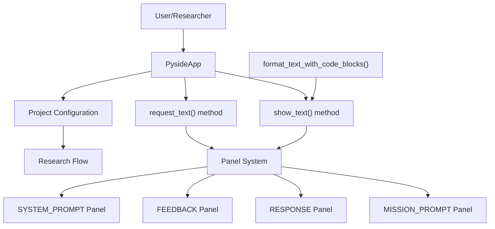
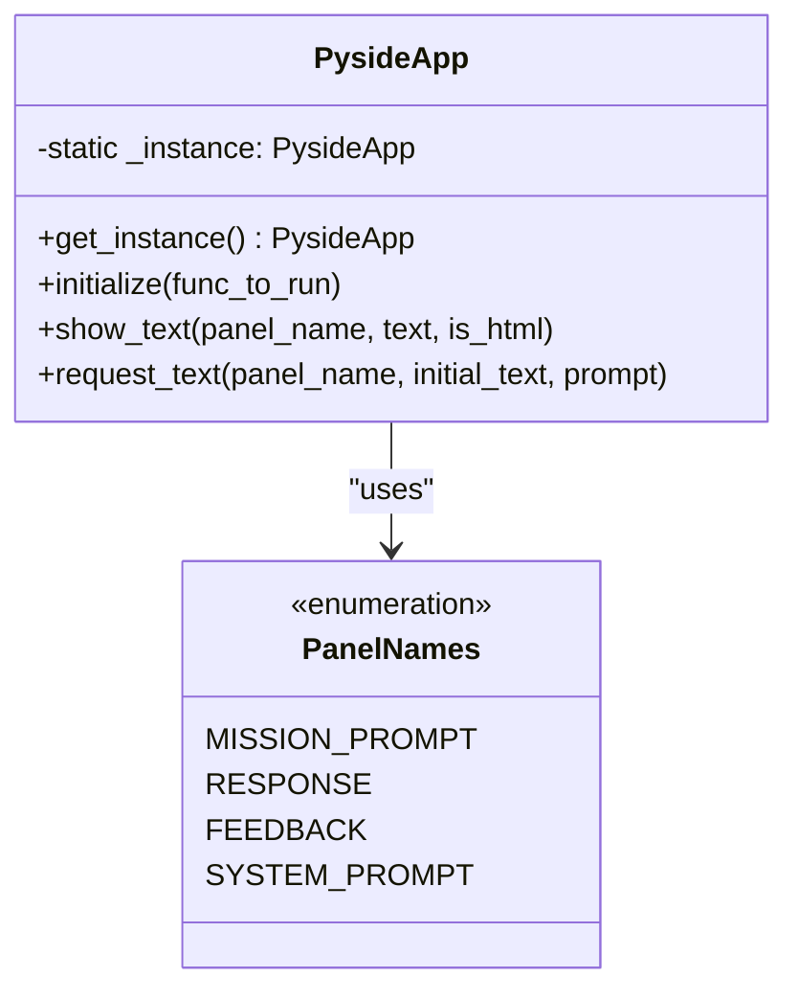
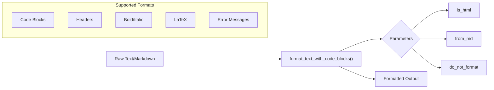
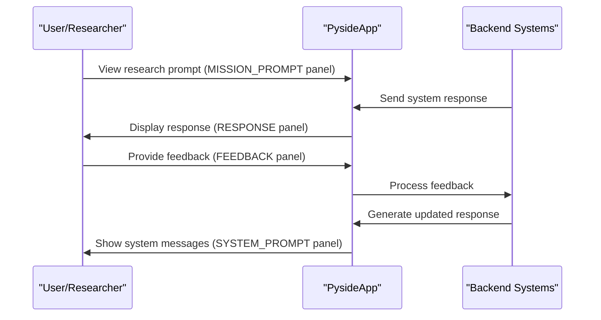
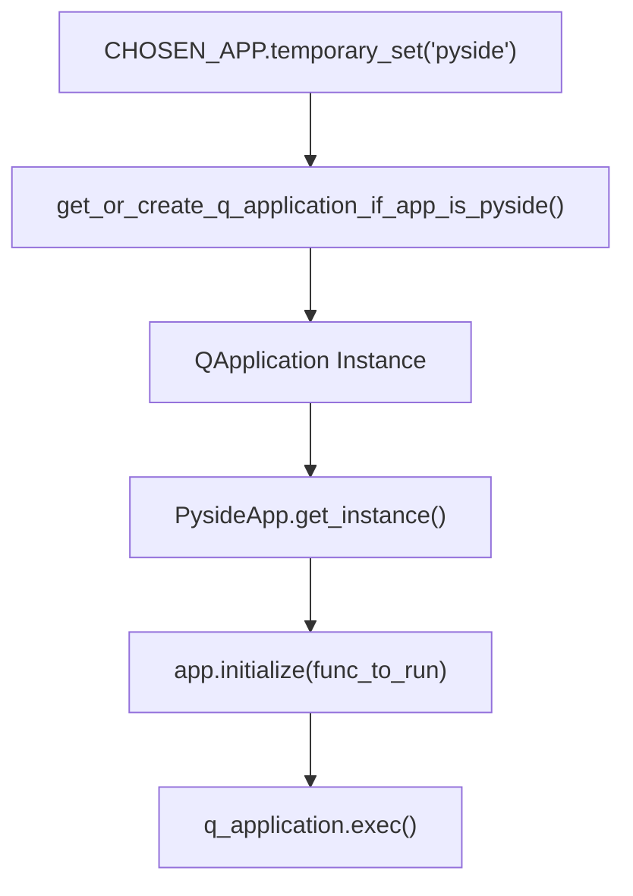
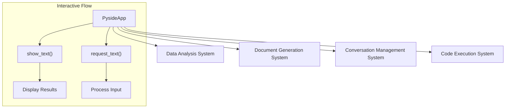

<!-- source: DeepWiki mcp.deepwiki.com · repo Technion-Kishony-lab/data-to-paper · page 6 User Interface · fetched 2026-10-26 -->

# User Interface

<details>
<summary>Relevant source files</summary>

The following files were used as context for generating this wiki page:

- [tests/functional/interactive/test_pyside_app.py](tests/functional/interactive/test_pyside_app.py)

</details>


This document describes the User Interface system of the data-to-paper framework, which provides the interactive front-end for researchers to interact with the underlying data analysis and document generation components. The UI allows users to view research prompts, see system responses, provide feedback, and engage with the AI-powered research workflow.

For information about the code execution system that runs behind the UI, see [Code Execution System](#2). For details on LLM interactions, see [LLM Interaction System](#5).

## Overview of the UI System

The User Interface is built on PySide (Qt for Python), implementing a desktop application that organizes information into panels and provides text display and input capabilities.



Sources: [tests/functional/interactive/test_pyside_app.py:138-155]()

## PysideApp Class

The central component of the UI system is the `PysideApp` class, which follows the Singleton pattern to ensure only one instance of the application exists at a time.



### Key Methods:

1. **get_instance()**: Static method that returns the singleton instance of `PysideApp`
2. **initialize(func_to_run)**: Sets up the application with a callback function to run
3. **show_text(panel_name, text, is_html=False)**: Displays text in the specified panel
4. **request_text(panel_name, initial_text, prompt)**: Requests text input from the user in the specified panel

Sources: [tests/functional/interactive/test_pyside_app.py:8-9](), [tests/functional/interactive/test_pyside_app.py:142-148]()

## Panel System

The UI is organized into distinct panels, each with a specific purpose in the research workflow. These panels are identified using the `PanelNames` enumeration.

| Panel Name | Purpose |
|------------|---------|
| MISSION_PROMPT | Displays the current research mission or task |
| RESPONSE | Shows responses from the system, including generated content and results |
| FEEDBACK | Collects feedback and additional instructions from the user |
| SYSTEM_PROMPT | Displays system prompts and messages to the user |

Sources: [tests/functional/interactive/test_pyside_app.py:9](), [tests/functional/interactive/test_pyside_app.py:142-148]()

## Text Formatting

The UI system includes utilities for formatting text with code blocks, headers, and other styling. The primary utility is `format_text_with_code_blocks()`, which converts markdown-style text to formatted text or HTML.



### Features of Text Formatting:

- Support for multiple code block types (Python, LaTeX, error, output)
- Header formatting with different levels (H1-H4)
- Bold and italic text formatting
- Special handling for LaTeX content
- Option to exclude certain formats from processing

Sources: [tests/functional/interactive/test_pyside_app.py:10](), [tests/functional/interactive/test_pyside_app.py:133-134](), [tests/functional/interactive/test_pyside_app.py:22-121]()

## User Interaction Flow

The UI facilitates interaction between the researcher and the system through a structured workflow:



### Typical Interaction Pattern:

1. The application initializes with a function to run
2. System displays research prompt in MISSION_PROMPT panel
3. System shows responses in RESPONSE panel (can include formatted text, code, or images)
4. User provides feedback through FEEDBACK panel
5. System messages are shown in SYSTEM_PROMPT panel

Sources: [tests/functional/interactive/test_pyside_app.py:140-148]()

## Application Initialization

The UI application is initialized through a specific process that ensures proper setup:



This initialization process:
1. Temporarily sets the application type to 'pyside'
2. Creates or retrieves a QApplication instance
3. Gets the singleton instance of PysideApp
4. Initializes the app with a function to run
5. Starts the application's event loop

Sources: [tests/functional/interactive/test_pyside_app.py:151-155]()

## Content Display Capabilities

The UI can display various types of content:

| Content Type | Description | Example |
|--------------|-------------|---------|
| Plain Text | Regular text content | "This is a regular text." |
| Formatted Text | Bold, italic, and other formatting | "We can **bold** and *italicize* text." |
| Code Blocks | Syntax-highlighted code | ```python print('Hello World!')``` |
| LaTeX | Mathematical equations and paper formatting | ```latex \begin{equation} E = mc^2 \end{equation}``` |
| Images | Visual content | `` |

The system handles proper HTML escaping to ensure that HTML tags in content are displayed as text rather than being rendered.

Sources: [tests/functional/interactive/test_pyside_app.py:22-129]()

## Integration with Other Systems

The UI connects with several other components in the data-to-paper framework:



The User Interface serves as the central point for user interaction, connecting researchers with the underlying systems for data analysis, document generation, code execution, and LLM interactions.

Sources: [tests/functional/interactive/test_pyside_app.py:6-8]()

---

