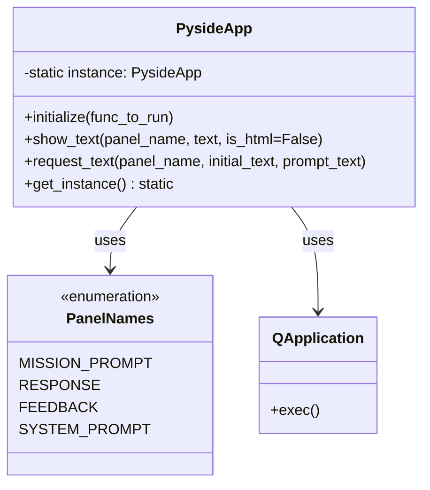
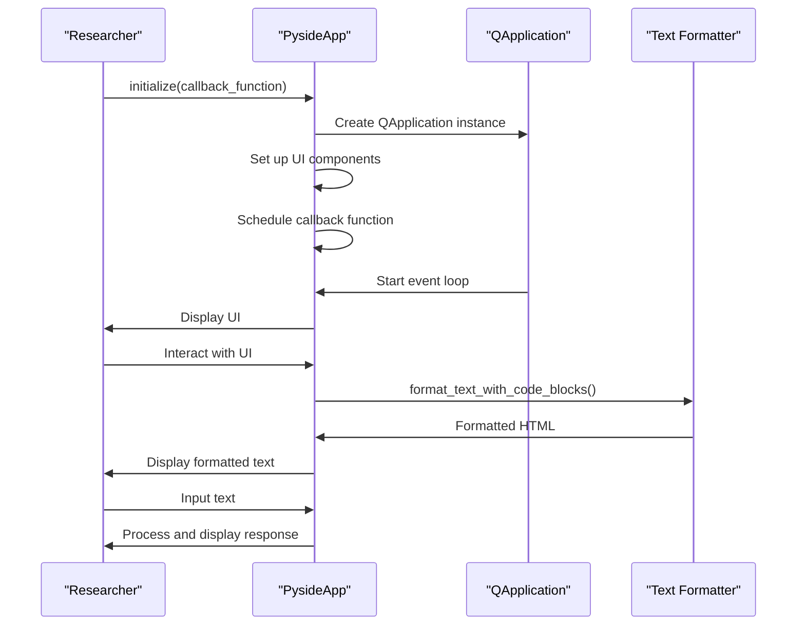
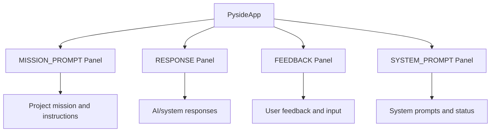
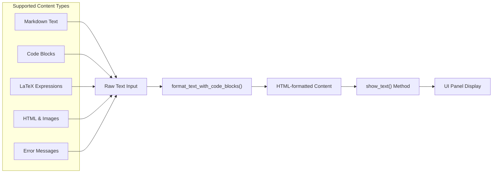
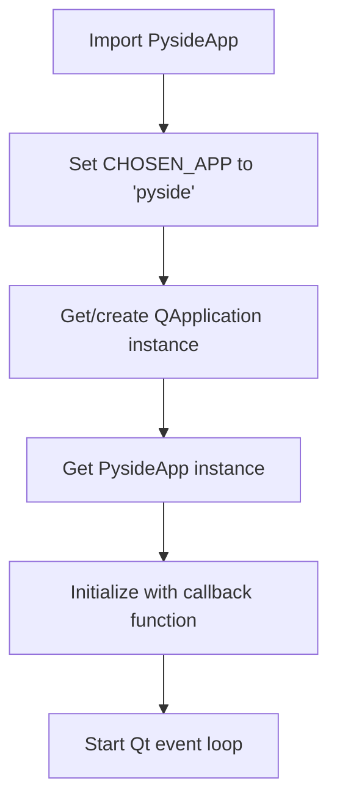

<!-- source: DeepWiki mcp.deepwiki.com · repo Technion-Kishony-lab/data-to-paper · page 6.1 PySide App · fetched 2026-10-26 -->

# PySide App

Relevant source files

The following files were used as context for generating this wiki page:

- [tests/functional/interactive/test_pyside_app.py](tests/functional/interactive/test_pyside_app.py)

## Purpose and Scope

The PySide App is a graphical user interface (GUI) component of the data-to-paper framework that facilitates researcher interaction with the system. It provides a structured interface for displaying formatted text, code blocks, images, and LaTeX content, as well as gathering user input. This page documents the architecture, components, and usage patterns of the PySide App.

For information about text formatting utilities used within the PySide App, see [Text Formatting Utilities](#6.2).

## Architecture and Components

The PySide App is built using PySide, which is a Python binding for the Qt framework. It follows a singleton pattern, ensuring only one instance of the application exists at any time.

The PySide App integrates with the Qt framework through the QApplication class and organizes its interface using a panel system defined by the PanelNames enumeration.

Sources: [tests/functional/interactive/test_pyside_app.py:8-9](). [tests/functional/interactive/test_pyside_app.py:152-154]()

## Initialization and Usage Flow

The application follows a specific initialization and usage flow:

The application is initialized with a callback function that defines the interaction flow. It uses a Qt application instance to manage the event loop and UI rendering.

Sources: [tests/functional/interactive/test_pyside_app.py:140-155]()

## Key Functionalities

The PysideApp class provides several key methods for interacting with the user interface:

| Method | Purpose | Parameters |
|--------|---------|------------|
| `initialize(func_to_run)` | Initializes the application with a callback function | `func_to_run`: Function to execute after initialization |
| `show_text(panel_name, text, is_html=False)` | Displays text in the specified panel | `panel_name`: Panel to show text in `text`: Content to display `is_html`: Whether content is HTML |
| `request_text(panel_name, initial_text, prompt_text)` | Requests text input from the user | `panel_name`: Panel to show prompt in `initial_text`: Default text in input field `prompt_text`: Prompt message |
| `get_instance()` | Returns the singleton instance of PysideApp | None |

Sources: [tests/functional/interactive/test_pyside_app.py:142-148](), [tests/functional/interactive/test_pyside_app.py:153]()

## Panel System

The PysideApp organizes its interface into distinct panels, each serving a specific purpose:

| Panel Name | Purpose | 
|------------|---------|
| MISSION_PROMPT | Displays project mission and instructions |
| RESPONSE | Shows AI-generated responses and analysis results |
| FEEDBACK | Collects user feedback and input |
| SYSTEM_PROMPT | Displays system prompts and status messages |

Sources: [tests/functional/interactive/test_pyside_app.py:9](), [tests/functional/interactive/test_pyside_app.py:142-148]()

## Text Formatting Integration

The PysideApp integrates with the text formatting utilities to render rich content including:

- Markdown text with bold and italic formatting
- Code blocks with syntax highlighting
- LaTeX mathematical expressions and document structures
- HTML content including images
- Output and error blocks

The formatting is handled through the `format_text_with_code_blocks` function, which converts raw text into properly formatted HTML for display in the UI.

Sources: [tests/functional/interactive/test_pyside_app.py:10](), [tests/functional/interactive/test_pyside_app.py:133-134](), [tests/functional/interactive/test_pyside_app.py:150]()

## Application Setup and Integration

The PySide App is initialized and run as follows:

The application integrates with the rest of the data-to-paper framework through the `CHOSEN_APP` environment variable, which can be temporarily set to 'pyside' to use the graphical interface.

Sources: [tests/functional/interactive/test_pyside_app.py:6-7](), [tests/functional/interactive/test_pyside_app.py:151-155]()

## Example Usage

The PysideApp is typically used to create an interactive session where users can view formatted output and provide input. Here's a typical usage pattern:

1. Import necessary modules
2. Define a callback function for interactive flow
3. Format content using text formatting utilities
4. Initialize the PysideApp with the callback function
5. Start the Qt application event loop

The callback function typically follows a pattern of showing text in different panels, requesting user input, and then processing and displaying results based on that input.

Sources: [tests/functional/interactive/test_pyside_app.py:140-155]()

## Conclusion

The PySide App provides a flexible and user-friendly graphical interface for the data-to-paper framework. Its panel-based organization, integration with text formatting utilities, and support for various content types make it a powerful tool for researchers interacting with the system. The singleton pattern ensures consistent state management, while the Qt-based implementation provides cross-platform compatibility.

---

